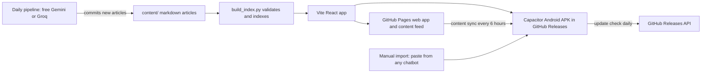

# PaperStack

**Learn AI and machine learning from scratch, one landmark research paper at a time.**

PaperStack is a Substack-style reading app for Android (and the web) that takes a complete beginner from "What is machine learning?" to how modern language models are trained and served. It ships with 52 story-driven articles: 10 beginner primers and 42 articles on the papers that built the field, from Turing's 1950 question to FlashAttention and vLLM. Every article has diagrams, analogies, tap-to-define glossary terms and a three-question quiz.

It costs nothing to run: no server, no database, no accounts. Pushing to `main` builds an installable APK and deploys the web version automatically.

---

## Contents

- [What's inside](#whats-inside)
- [How it works](#how-it-works)
- [Install the app on your phone](#install-the-app-on-your-phone)
- [One-time setup](#one-time-setup)
- [Adding more articles](#adding-more-articles)
- [Develop locally](#develop-locally)
- [Project structure](#project-structure)
- [Content format](#content-format)

---

## What's inside

**The learning path** (9 parts, 52 articles, about 72,000 words)

| Part | Track | Articles |
|---|---|---|
| 1 | Start Here | 10 primers: AI vs ML vs deep learning, data, loss, gradient descent, classification, overfitting, neural networks, backpropagation, embeddings, how to read papers |
| 2 | Foundations of Machine Learning | Turing 1950, Perceptron, Backpropagation, SVMs, Random Forests, Domingos |
| 3 | Deep Learning Takes Off | LeNet, Deep Autoencoders, AlexNet, Dropout, Adam, BatchNorm, ResNet, U-Net |
| 4 | Teaching Machines Language | LSTM, word2vec, Seq2seq, Bahdanau attention |
| 5 | Machines That Create | VAE, GAN, DDPM, Latent Diffusion |
| 6 | Learning by Doing | DQN, AlphaGo, PPO |
| 7 | Transformers and LLMs | Attention Is All You Need, GPT-1, BERT, GPT-3, Scaling Laws, Chinchilla, ViT, CLIP |
| 8 | Making LLMs Useful | InstructGPT, Chain-of-Thought, RAG, LoRA, DPO, LLaMA |
| 9 | The Systems Behind AI | Megatron-LM, FlashAttention, vLLM |

**The app**

- A calm, Substack-style reader: Literata serif, adjustable size and spacing, Light / Dark / Sepia themes, reading progress bar, "6 min left," position restore.
- Tap any underlined term for an instant definition. Long-press to highlight in four colours and add notes.
- Mermaid diagrams (tap for full-screen pinch zoom), KaTeX maths, and callouts for insights, analogies, history, misconceptions and exercises.
- A quiz at the end of every article; finishing it marks the article complete.
- Learning path with per-part progress rings, a daily streak, a celebration when you finish a part, and a daily reminder notification for your next article.
- Full-text search with filters, a Library (saved, highlights, history, imports), and backup/restore of your data.
- Works fully offline. New articles arrive without reinstalling, and the app tells you when a new APK is available.

## How it works



- **One source of truth.** Every article is a Markdown file with YAML frontmatter in `content/`. `pipeline/build_index.py` validates all of them (the app uses the same rules in `app/src/lib/frontmatter.ts`) and writes `content/index.json`.
- **One build, two targets.** The Vite app uses relative paths and hash routing, so the same build runs on GitHub Pages and inside the Android app (via Capacitor). All content is bundled into the APK.
- **Content sync.** The app checks `https://<you>.github.io/<repo>/content/index.json` at most every six hours (and on pull-to-refresh) and downloads only new or changed articles.
- **Update check.** Once a day the Android app asks the GitHub Releases API for the latest version and offers to download a newer APK.

## Install the app on your phone

1. On your Android phone, open **`https://github.com/<owner>/<repo>/releases/latest`** (the repo's Releases page).
2. Tap **`PaperStack-<version>.apk`** to download it.
3. When Android asks, allow your browser to **install unknown apps**, then install.
4. Later updates: the app shows **"Update available"** by itself. Tap **Download**, open the file, and it installs over the old version, keeping your progress, highlights and notes.

> GitHub Actions also uploads each APK as a workflow artifact, but artifacts download as zip files and need a GitHub login, so Releases is the way to install.

## One-time setup

### 1. Turn on GitHub Pages

Repository **Settings → Pages → Build and deployment → Source: GitHub Actions**. The `Deploy Web` workflow publishes the web app and the content feed that the Android app syncs from.

### 2. Create a signing key (important)

Android only installs an update over an existing app if both are signed with the **same key**. Without your own key, CI makes debug builds signed with a new throwaway key every time, so each build would have to replace the app (losing your progress). Do this once on your computer (needs Java's `keytool`):

```bash
keytool -genkeypair -v -keystore paperstack.jks -keyalg RSA -keysize 2048 -validity 10000 -alias paperstack
```

Choose a password when asked (you can use the same one for the store and the key). Then copy the keystore as base64:

```bash
base64 -i paperstack.jks | pbcopy     # macOS: copies to the clipboard
base64 -w 0 paperstack.jks            # Linux: prints it; copy the output
```

Add these in **Settings → Secrets and variables → Actions → New repository secret**:

| Secret | Value |
|---|---|
| `ANDROID_KEYSTORE_BASE64` | The base64 text from above |
| `ANDROID_KEYSTORE_PASSWORD` | The keystore password |
| `ANDROID_KEY_ALIAS` | `paperstack` (the alias you used) |
| `ANDROID_KEY_PASSWORD` | The key password |

Keep `paperstack.jks` and its password somewhere safe. If you lose them, future builds cannot update the installed app.

If the secrets are missing, the workflow still builds a debug APK and says so clearly in the release notes.

### 3. (Optional) Daily article generation

Add a free **`GEMINI_API_KEY`** (from [Google AI Studio](https://aistudio.google.com/apikey)) and/or **`GROQ_API_KEY`** (from the [Groq console](https://console.groq.com/keys)) as repository secrets. The `Daily Generate` workflow will then write two new articles every day at 7:00 AM IST. Optional: `S2_API_KEY` for higher Semantic Scholar rate limits. Without keys, the daily job exits cleanly and does nothing.

### 4. (Optional) Change the app id

`app/capacitor.config.ts` uses the placeholder `com.paperstack.reader`. If you change it (for example to `com.<your-github-username>.paperstack`), also update `namespace` and `applicationId` in `app/android/app/build.gradle` and the package of `MainActivity.java`. Do this **before** installing the app for real, because Android treats a different id as a different app.

## Adding more articles

All three routes produce the same file format, validated by the same rules.

### A. Automatically, every day (free cloud models)

With `GEMINI_API_KEY` or `GROQ_API_KEY` set, the daily workflow:

1. finds important, well-cited papers on Semantic Scholar that are not already in `content/` (and, if Semantic Scholar's free API is busy, takes the next paper from the curated `seed_papers` queue in `pipeline/config.yaml`, using arXiv for metadata),
2. downloads and extracts the PDF,
3. asks the model for structured notes, then for the article itself, using the shared writing guide,
4. validates it (retrying once with the validator's error messages),
5. commits it with a `[content]` message and redeploys the web app. The Android app picks it up through content sync; no new APK is built for content-only commits.

Run it on demand from **Actions → Daily Generate → Run workflow**. Each run uploads its structured log (`logs/run-<date>.jsonl`) as an artifact.

Paper metadata (title, authors, year, venue, link) always comes from Semantic Scholar or arXiv, never from the model, and every article must pass the same validator as the seed content. To steer what gets written next, reorder or extend `seed_papers` in `pipeline/config.yaml`. A free `S2_API_KEY` makes discovery much more reliable, because Semantic Scholar's shared anonymous quota is often exhausted.

### B. On your own computer with Ollama (free, local)

```bash
# one time
brew install ollama            # or see https://ollama.com
ollama pull qwen2.5:14b
pip install -r pipeline/requirements.txt

# start Ollama with a context window big enough for a paper
OLLAMA_CONTEXT_LENGTH=32768 ollama serve

# generate two articles with the local model only
./pipeline/run.sh --provider ollama --count 2
git add content && git commit -m "[content] two new articles" && git push
```

`run.sh` also accepts a specific paper: `./pipeline/run.sh --provider ollama --arxiv 2106.09685`.

### C. Manually, with any free chatbot

In the app: **Library → Imported → Import an article** (or **Settings → Import an article**).

1. Type the paper's title or link and choose where it goes.
2. Tap **Copy prompt** and paste it into ChatGPT, Gemini or Claude. The prompt includes the full writing guide and file format.
3. Paste the answer back. The app validates it, explains any problems in plain language, and can fix the common ones in one tap.
4. Tap **Import**. The article joins your path under "My Additions" (or the part you picked).
5. Optional: **Export .md** and commit it to `content/papers/` to share it with everyone.

## Develop locally

Requirements: Node 22+, Python 3.11+. Android builds additionally need Java 21 and the Android SDK (Android Studio installs both).

```bash
pip install -r pipeline/requirements-dev.txt
python pipeline/build_index.py          # validate content, write content/index.json

cd app
npm install
npm run dev                             # http://localhost:5173
npm test -- --run                       # unit and component tests
npm run lint
npm run build                           # production web build in app/dist
```

Useful checks:

```bash
python -m pytest -q pipeline/tests            # Python validator, pipeline tests
python pipeline/build_index.py --strict       # also fail on length warnings
```

Build the APK yourself:

```bash
cd app
npm run build && npx cap sync android
cd android && ./gradlew assembleDebug      # app/build/outputs/apk/debug/app-debug.apk
```

Regenerate the app icon and splash screens after editing `app/scripts/make-icons.mjs`: `npm run icons`.

## Project structure

```
paperstack/
├── app/                      Vite + React + TypeScript app (web and Android)
│   ├── src/components/       Reader, cover art, markdown renderer, quiz, sheets...
│   ├── src/pages/            Home, Learn, Track, Article, Search, Library, Import, Settings, Onboarding
│   ├── src/lib/              Content loading, validation, storage, sync, update check, native helpers
│   ├── android/              Capacitor Android project (committed)
│   ├── resources/            Source images for icons and splash screens
│   └── scripts/              copy-content.mjs, make-icons.mjs
├── content/
│   ├── primers/              10 beginner primers
│   ├── papers/               42 paper articles
│   ├── tracks.json           The 9 parts of the learning path
│   └── index.json            Generated metadata (do not edit by hand)
├── pipeline/                 Python content pipeline and validator
│   ├── prompts/              Writing guide and file format, shared with the app
│   └── tests/
├── tests/fixtures/           Shared validator fixtures (used by both TS and Python tests)
├── .github/workflows/        android-release.yml, deploy-web.yml, daily-generate.yml, ci.yml
├── PROGRESS.md               Build checklist
└── DECISIONS.md              Choices made along the way, and why
```

## Content format

Each article is Markdown with YAML frontmatter (id, kind, title, subtitle, track, prerequisites, difficulty, topics, paper metadata, a 3-8 term glossary and exactly 3 quiz questions). Paper articles use nine fixed sections, from "The hook" to "Key takeaways"; primers use six. Callouts use `:::insight`, `:::analogy`, `:::history`, `:::warning` and `:::try-this`; glossary terms are written `[[Term]]`; links to other articles are `[text](article:<id>)`; diagrams are ```` ```mermaid ```` blocks; maths uses `$...$`.

The complete specification, written for both humans and language models, lives in [`pipeline/prompts/format.md`](pipeline/prompts/format.md), and the writing guide in [`pipeline/prompts/writing_guide.md`](pipeline/prompts/writing_guide.md).

## Secrets reference

| Name | Where | Needed for |
|---|---|---|
| `ANDROID_KEYSTORE_BASE64` | GitHub Secrets | Updatable APKs |
| `ANDROID_KEYSTORE_PASSWORD` | GitHub Secrets | With the keystore |
| `ANDROID_KEY_ALIAS` | GitHub Secrets | With the keystore |
| `ANDROID_KEY_PASSWORD` | GitHub Secrets | With the keystore |
| `GEMINI_API_KEY` | GitHub Secrets or `.env` | Daily generation (optional) |
| `GROQ_API_KEY` | GitHub Secrets or `.env` | Fallback provider (optional) |
| `S2_API_KEY` | GitHub Secrets or `.env` | Higher Semantic Scholar limits (optional) |

No secrets live in the code; `.env` is git-ignored (copy `.env.example`).
