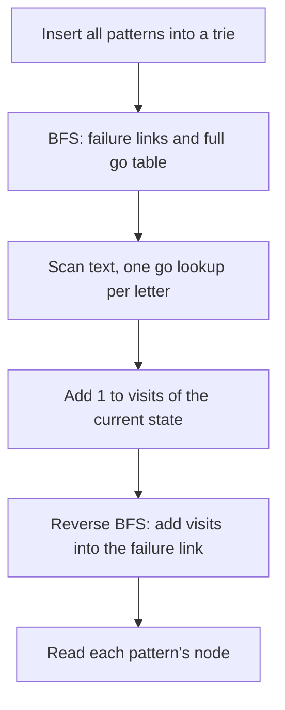

## The hook

A mail server checks every message against thousands of banned phrases. Running the prefix function from [A Reader Who Never Rereads the Page](article:cp-prefix-function) once per phrase means reading the message thousands of times. Aho and Corasick showed in 1975 how to read it once, looking for all the phrases at the same time.

The idea is the prefix function's fallback, applied to a trie of all patterns instead of a single pattern. On CSES it solves three problems with one structure: does each pattern occur, how many times, and where first. The part that trips people up is the last step, and the example below is built to show exactly why it is needed.

## The intuition

:::analogy
The filter holds a branching index of every banned phrase, letter by letter, as in [Autocomplete in Your Pocket](article:dsa-tries). As each letter of the message arrives, it remembers the longest piece of the message's end that is still the start of some banned phrase. When the next letter does not continue any phrase, it does not restart: it drops to the next shorter piece that is also the start of a phrase, exactly as KMP does, and tries again. And whenever it stands on a piece, every shorter ending of that piece that is itself a whole banned phrase has also just appeared.
:::

The branching index is the [[pattern trie]]; "the next shorter piece" is the [[failure link]]; and the remembered piece is the [[deepest state]].

## How it works

### Step 1: the trie

Insert every pattern. Each node stands for one string, a prefix of some pattern, and records its depth. Remember which node each pattern ends at.

### Step 2: failure links and the full table, by BFS

Process nodes in BFS order, shallow before deep:

- **root:** a missing edge by c loops back to the root; each child's failure link is the root;
- **node v, existing child u by c:** link[u] = go[link[v]][c], the longest proper suffix of u's string in the trie;
- **node v, missing edge by c:** go[v][c] = go[link[v]][c], so the scan never has to follow links at run time.

BFS order guarantees that link[v] is shallower than v, so its row of the [[transition table]] is already complete when v needs it. This is the KMP automaton from the prefix-function article, built over a trie.

### Step 3: scan the text

Start at the root; for each letter, v = go[v][letter]. One lookup per letter, and v is always the deepest state.

### Step 4: push counts down the failure links

At each text position, the scan stands on one node, but every node on its failure chain, every shorter suffix that is in the trie, also ends at that position. So:

- during the scan, add 1 to visits[v] at the deepest state only;
- afterwards, process nodes in reverse BFS order, deepest first, adding visits[u] into visits[link[u]].

Now visits[node of p] is the number of occurrences of pattern p. The failure links form the [[link tree]], and this step sums each subtree. The same pass with min instead of + gives the earliest end position of each node's string, which answers *Pattern Positions* after subtracting the pattern length.

Walking the failure chain at every text position instead gives the same answer but can cost O(|t| · L), for example with patterns a, aa, aaa, ... and a text of all a's.

| Task | What to aggregate | Answer for pattern p |
|---|---|---|
| does p occur | visits, summed | visits > 0 |
| how many times | visits, summed | visits |
| first position | earliest end, minimised | earliest end − \|p\| + 1 |
| streaming check after each letter | precomputed "some pattern ends on my chain" flag | flag of current state |



:::insight
Aho–Corasick is KMP on a trie: failure links play the role of the prefix function, and the full table removes every fallback from the scan. The scan sees only the longest match at each position, so shorter matches must be collected afterwards along the failure links.
:::

## Walk through an example

Patterns: ab, bab, bc, abc, ca. Text: babcabab.

**The trie and failure links.**

| Node | String | Failure link | Pattern |
|---|---|---|---|
| 0 | root | 0 | |
| 1 | a | 0 | |
| 2 | ab | 3, "b" | ab |
| 3 | b | 0 | |
| 4 | ba | 1, "a" | |
| 5 | bab | 2, "ab" | bab |
| 6 | bc | 8, "c" | bc |
| 7 | abc | 6, "bc" | abc |
| 8 | c | 0 | |
| 9 | ca | 1, "a" | ca |

For example, node 5 is "bab", child of "ba" by b. link[4] is "a", and go["a"][b] = "ab", so link[5] = node 2.

**The scan.**

| Position | Letter | State | String | Patterns on its failure chain |
|---|---|---|---|---|
| 0 | b | 3 | b | |
| 1 | a | 4 | ba | |
| 2 | b | 5 | bab | bab, ab |
| 3 | c | 7 | abc | abc, bc |
| 4 | a | 9 | ca | ca |
| 5 | b | 2 | ab | ab |
| 6 | a | 4 | ba | |
| 7 | b | 5 | bab | bab, ab |

At position 3, "babc" is not in the trie, so the table takes the scan straight to the longest suffix that is: "abc". At position 5, "cab" falls to "ab".

**Pushing counts.** Raw visits are 1 at node 3, 2 at node 4, 2 at node 5, 1 at node 7, 1 at node 9 and 1 at node 2. Adding deepest first: node 7 gives 1 to node 6 ("bc"); node 5 gives 2 to node 2 ("ab"), which then has 3.

| Pattern | Raw visits at its node | After pushing | First start |
|---|---|---|---|
| ab | 1 | 3 | 1 |
| bab | 2 | 2 | 0 |
| bc | 0 | 1 | 2 |
| abc | 1 | 1 | 1 |
| ca | 1 | 1 | 3 |

Reading raw visits alone would report "ab" once and "bc" never. Both are wrong: "ab" appears at 1, 4 and 6, and "bc" at 2, hidden inside the deeper matches "bab" and "abc".

:::try-this
Add the pattern "b" and count it in the same text. (Node 3 is "b". It receives its own raw visit from position 0, plus everything pushed into it: node 2, "ab", has 3 after pushing and links to node 3. So "b" gets 1 + 3 = 4, matching its four occurrences at positions 0, 2, 5 and 7.)
:::

:::warning
Common misconception: "After building the table, each pattern's count is how often the scan lands on its node." The scan lands only on the deepest match, so any pattern that is a suffix of another trie string is undercounted. Either walk the failure chain at every position, which can be quadratic, or push counts along failure links once at the end, which is linear.
:::

## The code

```pseudo
add(p): walk or create trie nodes for p's letters; remember the end node
build: BFS from the root
       missing root edges -> root; root children: link = root
       for v in BFS order, for each letter c:
           if child u exists: link[u] = go[link[v]][c]; enqueue u
           else: go[v][c] = go[link[v]][c]
scan(t): v = root; for each letter: v = go[v][letter]; visits[v] += 1; firstEnd[v] = min(firstEnd[v], i)
         for u in reverse BFS order (not the root): visits[link[u]] += visits[u]; firstEnd likewise with min
```

```cpp
#include <bits/stdc++.h>
using namespace std;

struct AhoCorasick {                                             // lowercase letters
    vector<array<int, 26>> go;                                   // full transition table once built
    vector<int> link, depth;                                     // failure link: longest proper suffix that is a trie node
    vector<int> order;                                           // BFS order: shallow nodes before deep ones
    vector<int> patNode;                                         // node where each pattern ends
    AhoCorasick() { newNode(0); }
    int newNode(int d) { go.push_back({}); go.back().fill(-1); link.push_back(0); depth.push_back(d); return go.size() - 1; }
    void add(const string& p) {
        int v = 0;
        for (char ch : p) {
            int c = ch - 'a';
            if (go[v][c] == -1) { int u = newNode(depth[v] + 1); go[v][c] = u; }
            v = go[v][c];
        }
        patNode.push_back(v);
    }
    void build() {
        queue<int> q;
        for (int c = 0; c < 26; c++) {
            if (go[0][c] == -1) go[0][c] = 0;                    // missing edges at the root loop back to it
            else link[go[0][c]] = 0, q.push(go[0][c]);
        }
        order = {0};
        while (!q.empty()) {
            int v = q.front(); q.pop();
            order.push_back(v);
            for (int c = 0; c < 26; c++) {
                int u = go[v][c];
                if (u == -1) go[v][c] = go[link[v]][c];          // missing edge: behave like the failure state
                else link[u] = go[link[v]][c], q.push(u);        // real edge: its failure is one step from v's failure
            }
        }
    }
    // For each pattern: number of occurrences and first starting position (or -1)
    pair<vector<long long>, vector<int>> scan(const string& t) const {
        int n = go.size();
        vector<long long> visits(n, 0);
        vector<int> firstEnd(n, INT_MAX);
        int v = 0;
        for (int i = 0; i < (int)t.size(); i++) {
            v = go[v][t[i] - 'a'];
            visits[v]++;                                         // count the deepest state only...
            firstEnd[v] = min(firstEnd[v], i);
        }
        for (int i = n - 1; i > 0; i--) {                        // ...then push counts down the failure links
            int u = order[i];
            visits[link[u]] += visits[u];
            firstEnd[link[u]] = min(firstEnd[link[u]], firstEnd[u]);
        }
        vector<long long> cnt;
        vector<int> first;
        for (int node : patNode) {
            cnt.push_back(visits[node]);
            first.push_back(firstEnd[node] == INT_MAX ? -1 : firstEnd[node] - depth[node] + 1);
        }
        return {cnt, first};
    }
};

int main() {
    vector<string> pats = {"ab", "bab", "bc", "abc", "ca"};
    string text = "babcabab";
    AhoCorasick ac;
    for (auto& p : pats) ac.add(p);
    ac.build();
    int v = 0;
    for (char ch : text) v = ac.go[v][ch - 'a'], cout << v << ' ';
    cout << '\n';                                                // 3 4 5 7 9 2 4 5
    auto [cnt, first] = ac.scan(text);
    for (auto x : cnt) cout << x << ' ';
    cout << '\n';                                                // 3 2 1 1 1
    for (auto x : first) cout << x << ' ';
    cout << '\n';                                                // 1 0 2 1 3

    mt19937 rng(23);                                             // against counting each pattern directly
    bool ok = true;
    for (int t = 0; t < 300; t++) {
        AhoCorasick A;
        vector<string> P(1 + rng() % 6);
        for (auto& p : P) { int L = 1 + rng() % 4; for (int i = 0; i < L; i++) p += char('a' + rng() % 3); A.add(p); }
        A.build();
        string T;
        int n = rng() % 20;
        for (int i = 0; i < n; i++) T += char('a' + rng() % 3);
        auto [C, F] = A.scan(T);
        for (int k = 0; k < (int)P.size(); k++) {
            long long c = 0; int f = -1;
            for (int i = 0; i + (int)P[k].size() <= n; i++)
                if (T.compare(i, P[k].size(), P[k]) == 0) { c++; if (f < 0) f = i; }
            ok = ok && C[k] == c && F[k] == f;
        }
    }
    cout << (ok ? "stress ok" : "stress FAILED") << '\n';        // stress ok
}
```

The random test inserts up to six patterns over three letters, scans a random text and compares every count and first position with a direct search; repeated short patterns make suffix relations, and therefore the pushing step, common.

## Complexity

- **Build: O(L·σ)** for total pattern length L and alphabet size σ, since every node fills σ table entries in O(1).
- **Scan: O(|t|),** one lookup per letter.
- **Aggregation: O(L),** one pass in reverse BFS order.
- **Space: O(L·σ)** for the table; with a large alphabet, store only real edges and follow failure links during the scan, which is still amortised linear.

## Common mistakes

- **Not pushing counts through failure links,** undercounting patterns that are suffixes of other trie strings.
- **Pushing in the wrong order:** deep nodes must give to their links before those links give onwards, so use reverse BFS order.
- **Computing link[u] from v instead of from link[v],** which links a node to its own parent.
- **Forgetting that equal patterns share a node;** record the node per pattern, not a pattern per node.
- **Walking the failure chain at every text position,** quadratic on texts like aaaa...a.
- **Reporting start positions without subtracting the pattern length** from the end position.

## Practice problems

*Finding Patterns* asks whether each pattern occurs: visits > 0 after pushing. *Counting Patterns* asks how often: visits after pushing. *Pattern Positions* asks where first: earliest end, minimised along the links. *Stream of Characters* checks after each new letter whether some word ends there, which a precomputed flag per state answers. The single-pattern version of the same automaton is in [A Reader Who Never Rereads the Page](article:cp-prefix-function).

## Key takeaways

- Aho–Corasick builds a trie of all patterns and gives every node a failure link to its longest proper suffix that is also in the trie.
- Filling missing transitions with the failure state's transitions, in BFS order, gives a full table so the text is scanned with one lookup per letter.
- The scan only stands on the deepest match at each position, and every shorter pattern on its failure chain also ends there.
- Adding visit counts from each node into its failure link, deepest nodes first, turns raw visits into exact occurrence counts for every pattern.
- The same aggregation with a minimum instead of a sum gives each pattern's first occurrence, all in time linear in the patterns and the text.
