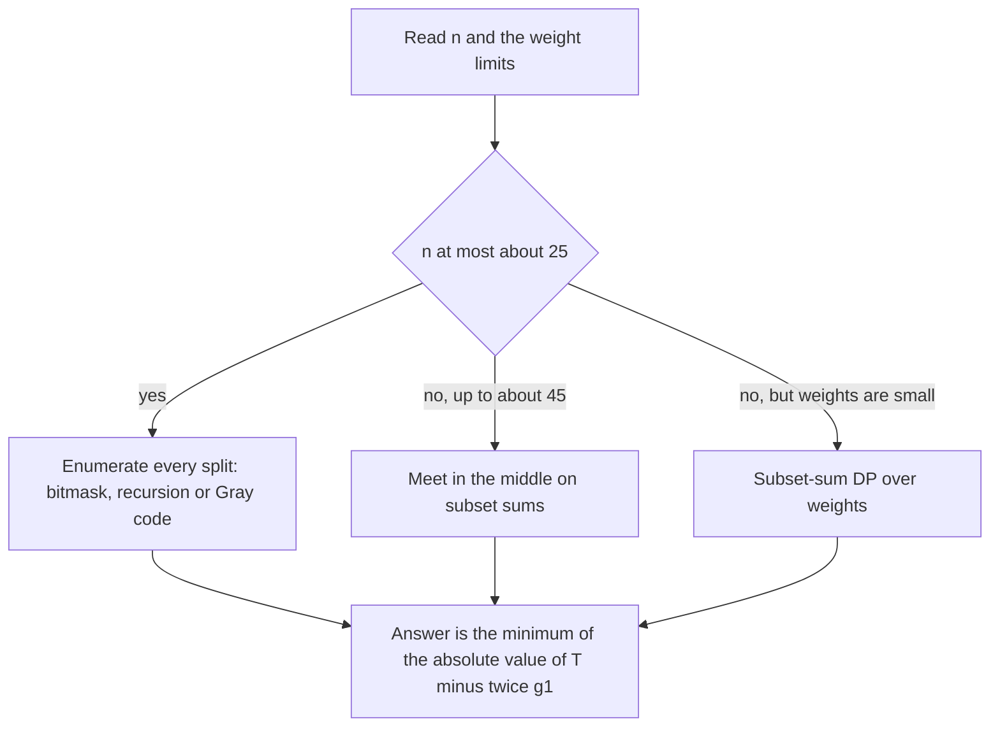

## The hook

A basket holds a handful of apples of different weights, and you must share them between two people as evenly as possible. Many people's first instinct is clever: sort the apples, deal them alternately, or run a knapsack DP. The intended solution of CSES *Apple Division* is none of those. It is to try every way of splitting the basket.

That feels like cheating, but it is the lesson: read the constraints before reaching for an algorithm. With at most 20 apples there are about a million splits, which a computer checks in a few milliseconds. Knowing when brute force is the right answer is a skill in its own right, and [Take It or Leave It: Generating Every Subset](article:dsa-subsets-permutations) supplies the tools.

## The problem

There are n apples with weights w₁ to wₙ, where n ≤ 20 and each weight is at most 10⁹. Divide them into two groups so that the difference between the groups' total weights is as small as possible, and print that difference.

For weights 3, 2, 7, 4, 1, the total is 17, and the best split is {7, 1} against {3, 2, 4}: 8 against 9, a difference of 1.

## The obvious approach

Three tempting shortcuts, and why each fails:

- **Greedy:** sort descending and give each apple to the lighter group. For 3, 3, 2, 2, 2 it gives {3, 2, 2} against {3, 2}, difference 2, while {3, 3} against {2, 2, 2} has difference 0.
- **Subset-sum DP:** a table of reachable sums needs an index for every possible sum up to the total, about 2·10¹⁰ for twenty apples of 10⁹. Too large by far.
- **Sorting and alternating:** no better than greedy, and easy to break the same way.

The [[constraint reading]] says something different: n is tiny, the weights are huge. That combination points straight at enumerating all [[split]]s.

## The key insight

:::analogy
Picture the basket as a row of 20 switches, one per apple: up sends the apple to the first person, down to the second. Every setting of the switches is a split, and there are 2²⁰, about a million, settings. Flicking through all of them is quick. Flicking cleverly is quicker still: if you change only one switch between consecutive settings, you never have to re-weigh the whole basket, only move one apple from one side to the other.
:::

Flicking through every setting is [[bitmask enumeration]], and changing one switch at a time is [[Gray code]] order.

### Three ways to enumerate

| Method | How | Cost |
|---|---|---|
| bitmask loop | for each mask, sum the apples whose bit is set | O(2^n · n), about 2·10⁷ for n = 20 |
| recursion | each apple goes left or right, carrying the current difference | O(2^n) |
| Gray code | consecutive masks differ in one apple; adjust one running sum | O(2^n) |

For a group-1 total g₁ and overall total T, the difference is |T − 2·g₁|, so only one running sum is needed.

### Halving by symmetry

Swapping the two groups gives the same difference. [[Symmetry halving]] fixes apple 0 in group 1 and enumerates the remaining n − 1 apples: 2^(n−1) splits, half the work. The recursion in the code starts with apple 0 already placed.

### When n grows

At n = 40 the 2⁴⁰ splits are too many, but the question "which subset sum is closest to T/2" splits into two halves of 20 apples each, which is exactly the method of [Two Tunnel Teams Digging From Both Ends](article:cp-meet-in-the-middle).



:::insight
The right algorithm is decided by which quantity is small. Here the number of apples is tiny while the weights are huge, so enumeration over choices wins; if the weights were tiny and the apples many, a DP over sums would win instead.
:::

## Walk through an example

Weights 3, 2, 7, 4, 1, total T = 17. With apple 0 (weight 3) fixed in group 1, there are 2⁴ = 16 splits of the rest. A few of them:

| Group 1 | g₁ | \|T − 2·g₁\| |
|---|---|---|
| {3} | 3 | 11 |
| {3, 2} | 5 | 7 |
| {3, 7} | 10 | 3 |
| {3, 4, 1} | 8 | 1 |
| {3, 2, 4} | 9 | 1 |
| {3, 7, 4} | 14 | 11 |
| all five | 17 | 17 |

The minimum over all 16 is 1, reached by {3, 4, 1} and by {3, 2, 4}; the second is the mirror image of {7, 1}.

**Gray code with three apples.** The masks come in the order 000, 001, 011, 010, 110, 111, 101, 100, each differing from the previous one in one bit. Starting from g₁ = 0, the running sum adds or removes a single weight at each step, so all eight splits cost eight updates instead of 8 × 3 bit checks.

All three methods agree on 300 random tests, and on a full test of 20 apples with weights up to 10⁹ the program runs in milliseconds.

:::try-this
For weights 3, 3, 2, 2, 2, what does the greedy "give the next heaviest apple to the lighter side" produce, and what does enumeration find? (Greedy: 3 to A, 3 to B, 2 to A, 2 to B, 2 to A, giving 7 against 5, difference 2. Enumeration finds {3, 3} against {2, 2, 2}, 6 against 6, difference 0.)
:::

:::warning
Common misconception: "Brute force is never the intended solution." In this problem it is precisely the intended one, and the clever alternatives are either wrong, like greedy, or too slow, like DP over sums of up to 2·10¹⁰. Always estimate 2^n, n!, n² or n·W from the limits before deciding that brute force will not do.
:::

## The code

```pseudo
bitmask: for mask in 0..2^n-1: g1 = sum of w[i] with bit i set; best = min(best, |T - 2*g1|)
recursion(i, diff): if i == n: return |diff|
                    return min(recursion(i+1, diff + w[i]), recursion(i+1, diff - w[i]))
                    start with recursion(1, w[0])          # apple 0 fixed: symmetry halving
gray: for k in 1..2^n-1: i = lowest set bit of k; flip apple i in the running sum g1
```

```cpp
#include <bits/stdc++.h>
using namespace std;
using ll = long long;

ll byBitmask(const vector<ll>& w) {                              // O(2^n * n): bit i of mask = apple i in group 1
    int n = w.size();
    ll total = accumulate(w.begin(), w.end(), 0LL), best = LLONG_MAX;
    for (int mask = 0; mask < (1 << n); mask++) {
        ll g1 = 0;
        for (int i = 0; i < n; i++) if (mask >> i & 1) g1 += w[i];
        best = min(best, llabs(total - 2 * g1));                 // |g1 - g2| with g2 = total - g1
    }
    return best;
}

ll byRecursion(const vector<ll>& w, int i, ll diff) {            // O(2^n): each apple goes to one side
    if (i == (int)w.size()) return llabs(diff);
    return min(byRecursion(w, i + 1, diff + w[i]), byRecursion(w, i + 1, diff - w[i]));
}

ll byGrayCode(const vector<ll>& w) {                             // O(2^n): neighbouring masks differ in one apple
    int n = w.size();
    ll total = accumulate(w.begin(), w.end(), 0LL), g1 = 0, best = llabs(total);
    for (int k = 1; k < (1 << n); k++) {
        int bit = __builtin_ctz(k);                              // the apple that flips at step k
        g1 += ((k ^ (k >> 1)) >> bit & 1) ? w[bit] : -w[bit];    // gray(k) = k xor (k >> 1)
        best = min(best, llabs(total - 2 * g1));
    }
    return best;
}

int main() {
    vector<ll> w = {3, 2, 7, 4, 1};
    cout << byBitmask(w) << ' ' << byRecursion(w, 1, w[0]) << ' ' << byGrayCode(w) << '\n';   // 1 1 1

    mt19937 rng(34);                                             // three enumerations must agree
    bool ok = true;
    for (int t = 0; t < 300; t++) {
        int n = 1 + rng() % 12;
        vector<ll> v(n);
        for (auto& x : v) x = 1 + rng() % 1000000000;
        ll a = byBitmask(v);
        ok = ok && byRecursion(v, 1, v[0]) == a && byGrayCode(v) == a;
    }
    vector<ll> big(20);
    for (auto& x : big) x = 1 + rng() % 1000000000;              // the largest case: 2^20 splits
    cout << (byGrayCode(big) == byRecursion(big, 1, big[0])) << ' ' << (ok ? "stress ok" : "stress FAILED") << '\n';   // 1 stress ok
}
```

## Complexity

- **Recursion and Gray code: O(2^n)** time, O(n) stack or none.
- **Bitmask loop: O(2^n · n),** about 2·10⁷ simple operations for n = 20, still fast.
- **With symmetry halving:** 2^(n−1) splits.

## Common mistakes

- **Reaching for a DP over sums** when the weights make the table impossibly large.
- **Using a greedy rule,** which fails on small inputs like 3, 3, 2, 2, 2.
- **int sums:** twenty weights of 10⁹ add up to 2·10¹⁰, beyond 32 bits.
- **Computing |g₁ − g₂| with two loops** instead of |T − 2·g₁|.
- **Shifting 1 << n with n near 31** in other problems with the same pattern; use 1LL when n can be large.

## Practice problems

*Apple Division* is this walkthrough. *Meet in the Middle* is the same idea at n = 40, where each half is enumerated and the two lists combined. *Last Stone Weight II* is the opposite case: many stones with small weights, so the subset-sum DP over weights is the right tool and enumeration is not.

## Key takeaways

- With at most 20 apples, all 2^20 splits can be checked in milliseconds, which makes brute-force enumeration the intended solution.
- Large weights rule out a DP over sums, and greedy splitting is simply wrong, so reading the constraints decides the method.
- The difference for a split is |T − 2·g₁|, so only one running sum is needed.
- Recursion or Gray code order enumerates splits in O(2^n), and fixing one apple in the first group halves the work by symmetry.
- When the number of items grows to around 40, meet in the middle replaces full enumeration.
