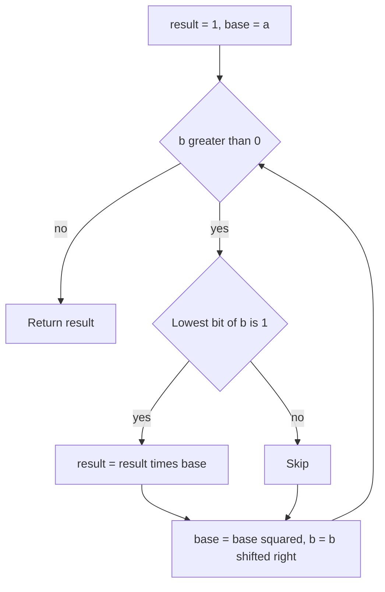

## The hook

Compute 3 to the power 1,000,000,000, modulo 10⁹ + 7. Multiplying by 3 a billion times takes about a billion steps: seconds in C++, too slow when there are a hundred thousand such queries.

There is a way that takes about thirty steps. It is one of the oldest algorithms in mathematics, and it shows up everywhere in competitive programming and cryptography: modular inverses, matrix powers, RSA and Diffie-Hellman all depend on it.

## The intuition

:::analogy
Think of folding a long paper strip in half, again and again. One fold doubles the layers to 2, the next to 4, then 8, 16. Thirty folds give over a billion layers. Squaring a number works the same way: each squaring doubles the [[exponent]], so a handful of squarings reaches astronomically large powers.
:::

Folding only gives powers of two, though: 2, 4, 8, 16 layers. To get 13 layers, combine the folded stacks you already have: 8 + 4 + 1. That combination is exactly the [[binary representation]] of 13.

## How it works

Write the exponent b in binary. Then:

$$a^{13} = a^{8 + 4 + 1} = a^8 \cdot a^4 \cdot a^1$$

The powers $a^1, a^2, a^4, a^8, \dots$ come from [[repeated squaring]]: each is the square of the previous one. Walk through the bits of b from the lowest:

1. Keep `base`, starting at a, and `result`, starting at 1.
2. If the current bit of b is 1, multiply `result` by `base`.
3. Square `base`, and shift b right by one bit.
4. Stop when b becomes 0.



Everything is done modulo m, using the rules from [Doing Maths on a Clock Face](article:cp-modular-arithmetic), with products in 64-bit integers.

:::insight
Any exponent is a sum of powers of two, and powers of two of the base come from squaring. So instead of b multiplications, you need one squaring per bit plus one multiplication per 1 bit: O(log b) work.
:::

## Walk through an example

Compute 3¹³ mod 1000. 13 in binary is 1101.

| Step | Lowest bit of b | result | base (before squaring) | b after shift |
|---|---|---|---|---|
| 1 | 1 | 1 × 3 = 3 | 3 | 6 (110) |
| 2 | 0 | 3 | 9 | 3 (11) |
| 3 | 1 | 3 × 81 = 243 | 81 | 1 (1) |
| 4 | 1 | 243 × 561 = 136,323 → 323 | 6561 → 561 | 0 |

Check: 3¹³ = 1,594,323, and 1,594,323 mod 1000 = 323. Four steps instead of thirteen; for a billion, about thirty instead of a billion.

:::try-this
Compute 2¹⁰ mod 1000 with the method. 10 is 1010 in binary. (Bits from the lowest: 0, 1, 0, 1. Result picks up base at the 2nd and 4th steps: 4 × 256 = 1024, mod 1000 = 24. Check: 2¹⁰ = 1024.)
:::

## The code

```pseudo
power(a, b, m):
    result = 1
    base = a mod m
    while b > 0:
        if b is odd: result = result * base mod m
        base = base * base mod m
        b = b / 2              // integer division, same as shifting right
    return result
```

```cpp
#include <bits/stdc++.h>
using namespace std;

long long power(long long a, long long b, long long m) {
    long long result = 1 % m;
    a %= m;
    while (b > 0) {
        if (b & 1) result = result * a % m;
        a = a * a % m;
        b >>= 1;
    }
    return result;
}

int main() {
    cout << power(3, 13, 1000) << '\n';                 // 323
    cout << power(3, 1000000000, 1000000007) << '\n';
    // a^(b^c) mod p: reduce the exponent modulo p - 1 (Fermat).
    long long p = 1000000007;
    cout << power(2, power(3, 4, p - 1), p) << '\n';    // 2^81 mod p
}
```

### The recursive view

The same idea reads naturally as recursion: to compute aᵇ, compute a^(b/2) once and square it, multiplying by one extra a when b is odd. Each call halves the exponent, so the depth is about log₂ b. This "solve half, then combine" shape is divide and conquer, and it is why squaring is so powerful: you never compute the same half twice. In the paper-strip picture, you fold once and then trust the folded strip to stand for both halves.

The same function works for anything you can multiply associatively, not just numbers: square matrices (for Fibonacci numbers and linear recurrences), permutations, or polynomials. That is why it reappears in matrix exponentiation later in this track.

### Exponents of exponents

**Exponentiation II** asks for $a^{b^c} \bmod p$ with p = 10⁹ + 7. Computing $b^c$ first is impossible; it is enormous. But by [[Fermat's little theorem]], $a^{p-1} \equiv 1 \pmod p$ when p does not divide a, so the exponent only matters modulo p − 1. Compute $e = b^c \bmod (p - 1)$, then $a^e \bmod p$. (When a is a multiple of p, the answer is simply 0 for any positive exponent.)

## Complexity

- **Time:** O(log b) multiplications, about 60 for exponents up to 10¹⁸.
- **Space:** O(1) for the iterative version; the recursive version uses O(log b) stack.

## Common mistakes

:::warning
Common misconception: "reduce the exponent modulo p." Exponents repeat with period dividing p − 1, not p. Reducing b modulo p gives wrong answers. Reduce the base modulo p, and the exponent modulo p − 1, and only for a prime p.
:::

- **Overflow in `a * a`** when a is not reduced first or the type is `int`.
- **Returning 1 when m = 1**: anything mod 1 is 0, which is why the code starts with `1 % m`.
- **Negative exponents** in problems like Pow(x, n): compute the positive power, then take the reciprocal, and beware of n = −2³¹ overflowing when negated.
- **Floating point powers**: `pow()` from `<cmath>` returns a double and loses precision for big integers; never use it for modular powers.

## Practice problems

*Exponentiation* is the template exactly. *Exponentiation II* adds the Fermat trick. *Pow(x, n)* is the same idea with doubles and negative exponents, a common interview version. *Count Good Numbers* uses two modular powers with exponents up to about 10¹⁵. The same function will power modular inverses in the next articles of this track.

## Key takeaways

- Write the exponent in binary; the base's powers of two come from repeated squaring.
- Multiply the result by the current base only where the exponent has a 1 bit, giving O(log b) multiplications.
- Do every step modulo m with 64-bit products, and start the result at 1 % m.
- For a prime modulus p, exponents can be reduced modulo p − 1 by Fermat's little theorem, which handles towers like a^(b^c).
- Never use floating-point pow for exact integer powers.
