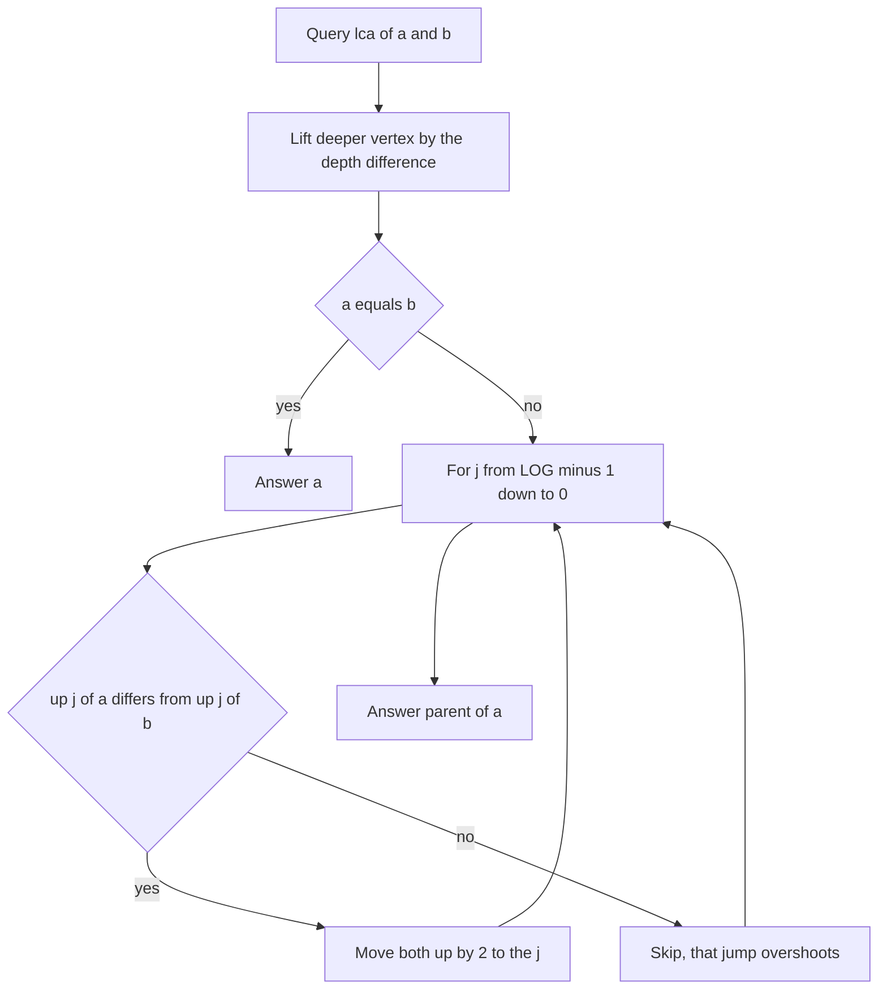
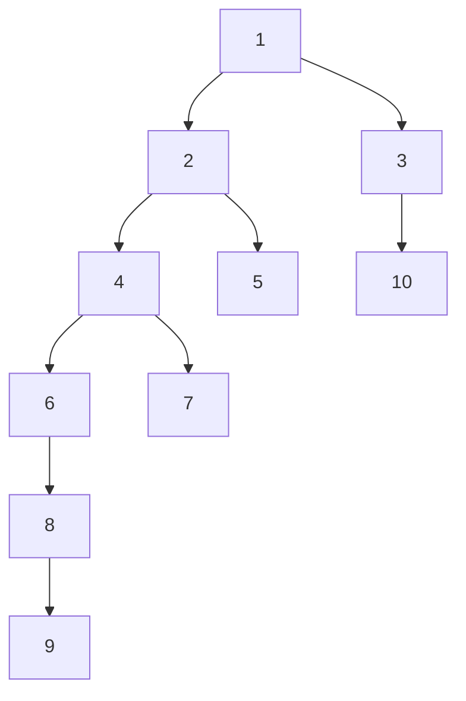

## The hook

A company of 200,000 employees, each with one boss, and 200,000 questions of the form "who is the boss of the boss of the boss... k levels above employee x?". Walking up one boss at a time costs up to 200,000 steps per question, 4·10¹⁰ in total. That is hours, not a second.

The fix is to precompute, for every employee, the boss 1 level up, 2 levels up, 4, 8, and so on. Any climb is then a handful of big jumps. [The Closest Shared Ancestor in a Family Tree](article:dsa-lca) introduced this for LCA; here we build it to contest strength and use it for ancestors, distances and long walks on graphs where every vertex has one exit.

## The intuition

:::analogy
Picture the company as a tall building where each employee works on their own floor and their boss sits somewhere above. Every floor has a bank of express elevators: one goes up exactly 1 floor of bosses, one goes up 2, one goes up 4, one goes up 8, and so on. To rise 13 levels you ride the 8, then the 4, then the 1. You never ride the same express twice, and you never need more rides than the number of bits in 13.
:::

The elevator bank is the [[ancestor table]], up[j][v] = the vertex 2^j levels above v. Installing the elevators is cheap thanks to the [[doubling recurrence]]: an elevator that skips 8 is just "take the 4, then take the 4 from where you arrive". Choosing which elevators to ride is the [[binary decomposition]] of the jump length.

## How it works

### Building the table

```
up[0][v] = parent(v)                      (root's parent = sentinel 0)
up[j][v] = up[j-1][ up[j-1][v] ]          for j = 1 .. LOG-1
```

Fill vertices in an order where each parent comes before its children, such as BFS order from the root, so that up[j−1] of the parent is ready. Making the sentinel 0 point to itself at every level means "jumping past the root" stays at 0 instead of indexing out of range.

### k-th ancestor

For every set bit j of k, set v = up[j][v]. The order of the bits does not matter, since a climb of 8 then 4 lands where 4 then 8 does. If k exceeds depth[v], the answer does not exist; checking that first avoids relying on the sentinel.

### Lowest common ancestor in two phases

- **Phase 1, equalise depths.** Lift the deeper vertex by the depth difference, using the k-th ancestor routine. If the two vertices are now equal, that vertex is the LCA.
- **Phase 2, descend the elevator sizes together.** For j from LOG−1 down to 0: if up[j][a] ≠ up[j][b], move both up by 2^j. An equal pair means that jump would land on the LCA or above it, which we must not overshoot, so we skip it.

After the loop, a and b are the two children of the LCA on their respective paths, and up[0][a] is the [[lowest common ancestor]]. This is the standard "binary search by descending powers": at each size, take the jump if it keeps you on the safe side.

### Distance and other path facts

With depth[] from the same BFS:

- dist(a, b) = depth[a] + depth[b] − 2·depth[lca(a, b)], which is CSES *Distance Queries*;
- the path a → b goes up from a to the LCA, then down to b, so "the t-th vertex on the path" is a k-th ancestor of a or of b;
- storing, beside up[j][v], the minimum edge weight on those 2^j edges lets the same jumps answer "minimum edge on the path" in O(log n).

### Choosing LOG

[[LOG]] levels can make any jump up to 2^LOG − 1. It must cover the largest jump the problem can ask for:

| Largest jump | Smallest safe LOG | Why |
|---|---|---|
| n − 1 = 10⁵ − 1 | 17 | 2^17 = 131,072 |
| k up to n = 2·10⁵ | 18 | 2^17 = 131,072 is too small |
| k up to 10⁹ | 30 | 2^30 = 1,073,741,824 |
| k up to 10¹⁸ | 60 | needs a 64-bit k |

Computing LOG from n in code, as the program below does, removes the guesswork for tree problems.

### Long walks on a functional graph

In CSES *Planets Queries I* every planet has one teleporter, and a query asks where you land after k up to 10⁹ teleports. This is a [[functional graph]], not a tree, but the table works the same way: jump[0][v] is the teleporter target and jump[j][v] = jump[j−1][jump[j−1][v]]. There is no root and no sentinel, because every vertex always has a next step, and walks simply loop around cycles.



:::insight
Binary lifting trades O(n log n) memory for O(log n) climbs. Every question that can be phrased as "go up by some amount" or "go up as far as possible while a condition stays true" becomes a descent through the powers of two.
:::

## Walk through an example

Ten employees, boss of each in brackets: 2 [1], 3 [1], 4 [2], 5 [2], 6 [4], 7 [4], 8 [6], 9 [8], 10 [3]. Employee 1 is the root.



Depths: 1 is 0; 2 and 3 are 1; 4, 5 and 10 are 2; 6 and 7 are 3; 8 is 4; 9 is 5. With n = 10, LOG = 4, since 2^4 = 16 > 10. The table, with 0 meaning "above the root":

| v | 1 | 2 | 3 | 4 | 5 | 6 | 7 | 8 | 9 | 10 |
|---|---|---|---|---|---|---|---|---|---|---|
| up[0][v], 1 up | 0 | 1 | 1 | 2 | 2 | 4 | 4 | 6 | 8 | 3 |
| up[1][v], 2 up | 0 | 0 | 0 | 1 | 1 | 2 | 2 | 4 | 6 | 1 |
| up[2][v], 4 up | 0 | 0 | 0 | 0 | 0 | 0 | 0 | 1 | 2 | 0 |

Each row comes from the one above: up[1][9] = up[0][up[0][9]] = up[0][8] = 6, and up[2][9] = up[1][up[1][9]] = up[1][6] = 2. Level 3 is all zeros, because nobody is 8 levels deep.

**3rd ancestor of 9.** 3 = 2 + 1, so ride the 2-elevator to up[1][9] = 6, then the 1-elevator to up[0][6] = 4. Walking one step at a time agrees: 9 → 8 → 6 → 4.

**lca(9, 7).**

| Step | a | b | Action |
|---|---|---|---|
| start | 9 (depth 5) | 7 (depth 3) | lift a by 2 |
| equal depth | 6 | 7 | different, so descend |
| j = 1 | 6 | 7 | up[1] gives 2 and 2: equal, skip |
| j = 0 | 6 | 7 | up[0] gives 4 and 4: equal, skip |
| end | 6 | 7 | answer up[0][6] = 4 |

dist(9, 7) = 5 + 3 − 2·2 = 4, the path 9, 8, 6, 4, 7.

**lca(9, 10).** Lift 9 by 5 − 2 = 3 to reach 4. At j = 1, up[1][4] = 1 and up[1][10] = 1 are equal, so skip. At j = 0, up[0][4] = 2 and up[0][10] = 3 differ, so move to 2 and 3. The answer is up[0][2] = 1, and dist(9, 10) = 5 + 2 − 0 = 7.

:::try-this
Find lca(5, 9) by hand. (Lift 9 by 5 − 2 = 3 to vertex 4. Now 4 and 5: at j = 1 both give 1, skip; at j = 0 both give 2, skip. The answer is up[0][4] = 2, and indeed 5 and 4 are both children of 2.)
:::

:::warning
Common misconception: "The LCA loop can run j upwards from 0 just as well." It cannot, because a jump once taken is never undone. If a and b sit 3 levels below their LCA, the ascending loop takes the 1-jump (ancestors differ), then skips the 2-jump (it would land on the LCA), and ends 2 levels below the LCA instead of 1, so up[0][a] is wrong. Descending order is safe because any size it skips can still be made up from the smaller sizes that follow.
:::

## The code

```pseudo
build:
    LOG = smallest value with 2^LOG > n
    for v in BFS order: up[0][v] = parent[v]; for j in 1..LOG-1: up[j][v] = up[j-1][up[j-1][v]]
kth(v, k): if k > depth[v]: return none; for each set bit j of k: v = up[j][v]; return v
lca(a, b):
    if depth[a] < depth[b]: swap
    a = kth(a, depth[a] - depth[b]); if a == b: return a
    for j = LOG-1 down to 0: if up[j][a] != up[j][b]: a = up[j][a]; b = up[j][b]
    return up[0][a]
```

```cpp
#include <bits/stdc++.h>
using namespace std;

struct Lifting {                                                 // vertices 1..n, root 1; 0 means "no vertex"
    int n, LOG;
    vector<vector<int>> up;                                      // up[j][v] = 2^j-th ancestor of v
    vector<int> depth;
    Lifting(int n, const vector<int>& parent) : n(n), depth(n + 1, 0) {   // parent[1] = 0
        LOG = 1;
        while ((1 << LOG) <= n) LOG++;                           // 2^LOG > n: covers any jump up to n
        up.assign(LOG, vector<int>(n + 1, 0));
        vector<vector<int>> children(n + 1);
        for (int v = 2; v <= n; v++) children[parent[v]].push_back(v);
        vector<int> order = {1};                                 // BFS, so parents are filled before children
        for (int i = 0; i < (int)order.size(); i++)
            for (int c : children[order[i]]) depth[c] = depth[order[i]] + 1, order.push_back(c);
        for (int v : order) {
            up[0][v] = parent[v];
            for (int j = 1; j < LOG; j++) up[j][v] = up[j - 1][up[j - 1][v]];
        }
    }
    int kth(int v, long long k) const {                          // k-th ancestor, or 0 if it does not exist
        if (k > depth[v]) return 0;
        for (int j = 0; j < LOG; j++) if (k >> j & 1) v = up[j][v];
        return v;
    }
    int lca(int a, int b) const {
        if (depth[a] < depth[b]) swap(a, b);
        a = kth(a, depth[a] - depth[b]);                         // lift the deeper vertex to equal depth
        if (a == b) return a;
        for (int j = LOG - 1; j >= 0; j--)
            if (up[j][a] != up[j][b]) a = up[j][a], b = up[j][b];   // jump while still below the LCA
        return up[0][a];
    }
    int dist(int a, int b) const { return depth[a] + depth[b] - 2 * depth[lca(a, b)]; }
};

int planetJump(const vector<int>& to, int x, long long k) {      // functional graph: follow to[] k times
    int n = to.size(), LOG = 1;
    while ((1LL << LOG) <= k) LOG++;
    vector<vector<int>> jump(LOG, to);
    for (int j = 1; j < LOG; j++)
        for (int v = 0; v < n; v++) jump[j][v] = jump[j - 1][jump[j - 1][v]];
    for (int j = 0; j < LOG; j++) if (k >> j & 1) x = jump[j][x];
    return x;
}

int main() {
    vector<int> parent = {0, 0, 1, 1, 2, 2, 4, 4, 6, 8, 3};      // parent[v] for v = 1..10
    Lifting L(10, parent);
    cout << L.kth(9, 3) << ' ' << L.kth(9, 5) << ' ' << L.kth(9, 6) << '\n';      // 4 1 0
    cout << L.lca(9, 7) << ' ' << L.lca(9, 10) << ' ' << L.lca(5, 9) << '\n';     // 4 1 2
    cout << L.dist(9, 7) << ' ' << L.dist(9, 10) << ' ' << L.LOG << '\n';         // 4 7 4

    vector<int> to = {1, 2, 0, 0};                               // 0 -> 1 -> 2 -> 0 is a cycle, 3 -> 0
    cout << planetJump(to, 3, 1000000000) << ' ' << planetJump(to, 3, 2) << '\n'; // 0 1

    mt19937 rng(5);                                              // compare with walking one step at a time
    bool ok = true;
    for (int t = 0; t < 200; t++) {
        int n = 1 + rng() % 40;
        vector<int> p(n + 1, 0), perm(n + 1), q(n + 1, 0);
        for (int v = 2; v <= n; v++) p[v] = 1 + rng() % (v - 1);
        iota(perm.begin(), perm.end(), 0);
        shuffle(perm.begin() + 2, perm.end(), rng);              // relabel: parents need not have smaller ids
        for (int v = 2; v <= n; v++) q[perm[v]] = perm[p[v]];
        Lifting R(n, q);
        auto naiveLca = [&](int a, int b) {
            set<int> anc;
            for (int x = a; x; x = q[x]) anc.insert(x);
            for (int x = b; x; x = q[x]) if (anc.count(x)) return x;
            return 0;
        };
        for (int i = 0; i < 30; i++) {
            int a = 1 + rng() % n, b = 1 + rng() % n, k = rng() % (n + 1), x = a;
            for (int s = 0; s < k && x; s++) x = q[x];
            ok = ok && R.lca(a, b) == naiveLca(a, b) && R.kth(a, k) == x;
        }
    }
    cout << (ok ? "stress ok" : "stress FAILED") << '\n';        // stress ok
}
```

For *Company Queries I*, print `kth(x, k)`, or −1 when it returns 0. For *Company Queries II*, print `lca(a, b)`. For *Distance Queries*, build the parent array by a BFS over the undirected edges first, then print `dist(a, b)`.

In `planetJump`, a start at planet 3 moves to 0 and then circles the 3-cycle; 10⁹ − 1 remaining steps is a multiple of 3, so the walk ends back at 0. Two steps end at 1.

## Complexity

- **Build: O(n log n)** time and memory, one entry per vertex per level.
- **k-th ancestor and LCA: O(log n)** per query.
- **Functional graph walks: O(n log k)** to build, O(log k) per query.
- **Memory note:** 2·10⁵ vertices with 18 levels is 3.6·10⁶ ints, about 14 MB, which is fine; storing the table as up[j][v] keeps each level contiguous.

## Common mistakes

- **LOG too small** for the largest jump, which silently drops the highest bits of k.
- **No sentinel at the root:** jumping past the root must land on a value whose own ancestors are defined, such as 0 pointing to 0.
- **Filling the table before the parent's row exists;** process vertices in BFS order, or fill level by level for all vertices.
- **Ascending the LCA loop** instead of descending.
- **Forgetting the a == b check** after equalising depths, which happens whenever one vertex is an ancestor of the other.
- **Using int for k** in functional-graph walks where k reaches 10¹⁸.

## Practice problems

*Company Queries I* is the k-th ancestor with a "does not exist" case. *Company Queries II* is LCA directly. *Distance Queries* needs a BFS to root the tree, then the distance formula. *Planets Queries I* is the functional graph version with k up to 10⁹. The tree DP background is in [Managers Summarising Their Teams' Reports](article:dsa-tree-recursion).

## Key takeaways

- Binary lifting stores, for every vertex, its ancestors 1, 2, 4, 8 and more levels up, each level built from the one below by up[j][v] = up[j−1][up[j−1][v]].
- A climb of k levels follows the set bits of k, so it takes O(log k) jumps.
- LCA lifts the deeper vertex to equal depth, then jumps both vertices by descending powers of two while their ancestors differ, and finishes one step above.
- Distances on a tree follow from depths and the LCA as depth[a] + depth[b] − 2·depth[lca].
- LOG must make 2^LOG larger than the biggest jump the problem allows, and the same table works on any graph where every vertex has exactly one next step.
