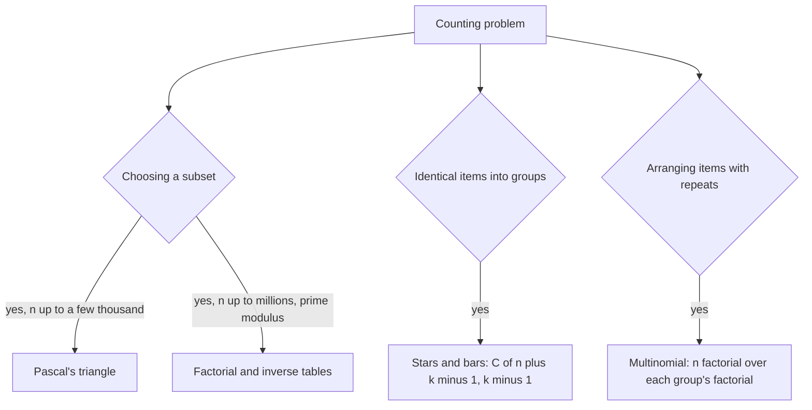

## The hook

A cricket coach has 15 players and must pick 11. How many different teams are possible? Writing them out would take a lifetime: there are 1,365. Now pick 50 out of a million, modulo 10⁹ + 7, a hundred thousand times. Counting problems like this fill contest rounds from about 1400 rating upward.

All of them rest on one number, C(n, k), and three ways to compute it. Pick the right one for the constraints, and the counting becomes a lookup.

## The intuition

:::analogy
Picture choosing a team from a squad standing in a line. Point at the first player and ask a single question: is this player in the team or not? If yes, you still need to choose k − 1 more from the rest. If not, you need all k from the rest. Every team falls into exactly one of those two cases, so the total is the sum of both counts. Repeat the question for the next player in line, and the whole triangle builds itself.
:::

That one question gives [[Pascal's triangle]], and it is the heart of the [[binomial coefficient]] C(n, k): the number of ways to choose k items from n when order does not matter.

## How it works

### The formula

$$C(n, k) = \frac{n!}{k!\,(n-k)!}$$

- $n!$ counts all orders of n items.
- Dividing by $k!$ removes the order inside the chosen group, and by $(n-k)!$ the order among the rest.

Ordered choices are [[permutation]]s: $n!/(n-k)!$. Unordered choices divide out the $k!$ orders of the same group.

### Way 1: Pascal's triangle (small n)

$$C(n, k) = C(n-1, k-1) + C(n-1, k), \quad C(n, 0) = C(n, n) = 1$$

Fill a table row by row. Only additions, so it works with any modulus, even non-prime ones. Cost: O(n²) time and memory, fine for n up to a few thousand. If you only need one row, you can also build it left to right with C(n, k) = C(n, k − 1) × (n − k + 1) / k, using an inverse for the division under a prime modulus.

### Way 2: factorial tables (large n, prime modulus)

Precompute factorials and inverse factorials up to n as in [Finding the Undo Button on a Clock](article:cp-modular-inverse). Then each query is

$$C(n, k) = \text{fact}[n] \cdot \text{inv\_fact}[k] \cdot \text{inv\_fact}[n-k] \bmod p$$

in O(1), after O(n) setup.

### Way 3: stars and bars (distributing identical items)

To split n identical items among k people (some may get none), write n stars and k − 1 bars in a row; the bars cut the stars into k groups. Every arrangement is a different split, so the count is

$$C(n + k - 1,\ k - 1)$$



:::insight
Most counting problems are a binomial coefficient in disguise. Grid paths are choosing which steps go right; splitting identical items is choosing where the bars go; arranging letters with repeats divides out the repeats. Find the "choose" hiding in the story, and the table does the rest.
:::

## Walk through an example

**Pascal's triangle**, first six rows:

| n | C(n, 0) ... C(n, n) |
|---|---|
| 0 | 1 |
| 1 | 1 1 |
| 2 | 1 2 1 |
| 3 | 1 3 3 1 |
| 4 | 1 4 6 4 1 |
| 5 | 1 5 10 10 5 1 |

C(5, 2) = 10, and it equals C(4, 1) + C(4, 2) = 4 + 6 from the row above.

**Stars and bars**: 5 identical apples, 3 children. Arrangement `★★|★|★★` means 2, 1, 2. There are 5 + 2 = 7 positions, choose where the 2 bars go: C(7, 2) = 21.

**Grid paths**: from the top-left to the bottom-right of a 3 by 3 grid of squares, moving right or down, every path is 3 Rs and 3 Ds in some order: choose which 3 of the 6 steps are R, C(6, 3) = 20.

:::try-this
How many distinct arrangements does the word "BANANA" have? It has 6 letters: A three times, N twice, B once. (The [[multinomial coefficient]] is 6! / (3! 2! 1!) = 720 / 12 = 60.)
:::

## The code

```pseudo
// Pascal (any modulus, n up to a few thousand)
for n in 0..N:
    C[n][0] = C[n][n] = 1
    for k in 1..n-1: C[n][k] = (C[n-1][k-1] + C[n-1][k]) mod m

// Factorial tables (prime p, n up to millions)
C(n, k) = 0 if k < 0 or k > n
        else fact[n] * inv_fact[k] * inv_fact[n-k] mod p
```

```cpp
#include <bits/stdc++.h>
using namespace std;

int main() {
    const int N = 1000;
    const int MOD = 1'000'000'007;
    vector<vector<int>> C(N + 1, vector<int>(N + 1, 0));
    for (int n = 0; n <= N; n++) {
        C[n][0] = C[n][n] = 1;
        for (int k = 1; k < n; k++) C[n][k] = (C[n - 1][k - 1] + C[n - 1][k]) % MOD;
    }
    cout << C[5][2] << ' ' << C[7][2] << ' ' << C[6][3] << ' ' << C[15][11] << '\n';  // 10 21 20 1365
}
```

## Complexity

- **Pascal's triangle:** O(n²) time and memory; only additions.
- **Factorial tables:** O(n) setup plus one modular exponentiation; O(1) per query.
- **Stars and bars and multinomials:** a constant number of table lookups each.

## Common mistakes

:::warning
Common misconception: "C(n, k) is n! / k! / (n − k)!, so compute the factorials and divide." Factorials overflow quickly, and after taking remainders, plain division is wrong. Use Pascal's triangle or modular inverses.
:::

- **Forgetting C(n, k) = 0** when k < 0 or k > n, which often appears at boundaries.
- **Mixing up stars and bars variants**: if each person must get at least one item, give each one first and count C(n − 1, k − 1).
- **Using factorial tables with a non-prime modulus**, where inverses may not exist; use Pascal or other methods.
- **Building a Pascal table of n = 10⁶**, which needs about 10¹² entries.

## Practice problems

*Pascal's Triangle* builds the table. *Binomial Coefficients* (CSES) needs factorial tables for a million queries. *Distributing Apples* is stars and bars exactly. *Unique Paths* is the grid path count, solvable with DP or directly with C(m + n − 2, m − 1).

## Key takeaways

- C(n, k) counts ways to choose k of n items when order does not matter, and equals n! / (k!(n − k)!).
- Pascal's rule, C(n, k) = C(n − 1, k − 1) + C(n − 1, k), comes from asking whether one particular item is chosen.
- Use Pascal's triangle for small n or any modulus, and factorial tables with inverses for large n with a prime modulus.
- Stars and bars counts splits of n identical items into k groups as C(n + k − 1, k − 1).
- Many counting stories, such as grid paths and letter arrangements, are binomial or multinomial coefficients in disguise.
