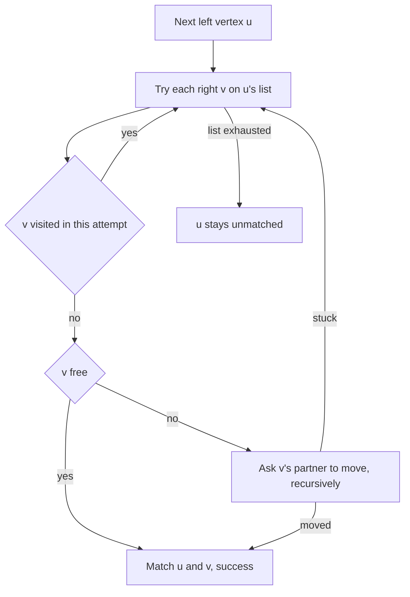
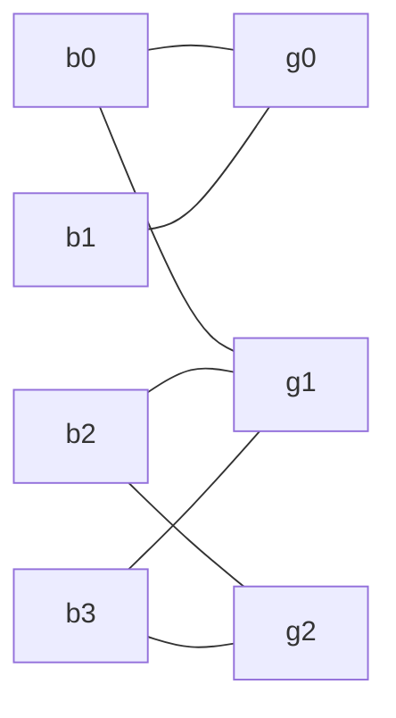

## The hook

A school dance has boys and girls, and a list of pairs who have agreed to dance together. The organiser wants as many couples on the floor at once as possible, with nobody in two couples. Pairing greedily goes wrong quickly: if the first boy grabs the one girl who is the only option for someone else, a couple is lost.

That is maximum [[bipartite graph]] matching, CSES *School Dance*. [Water Pipes From a Reservoir to a City](article:cp-max-flow) already solves it as a flow with unit capacities, but Kuhn's algorithm does the same work in twenty lines, and König's theorem turns its result into answers about vertex covers and independent sets.

## The intuition

:::analogy
Boys arrive one at a time. A new boy asks each girl on his list in turn. A free girl simply says yes. A girl who is already dancing says: "only if my current partner can find someone else". Her partner then goes through his own list, asking the same way, and so on down a chain. If the chain eventually reaches a free girl, everybody along it moves one place over and the new boy gets a partner. Nobody loses a dance; one more couple appears.
:::

A set of couples is a [[matching]]. The chain "new boy, girl, her partner, his next girl, ..." alternates between edges outside and inside the matching, an [[alternating path]], and a chain that ends at a free girl is an [[augmenting path]].

## How it works

### Kuhn's algorithm

```
try(u):                                  # can left vertex u be matched?
    for each right v adjacent to u:
        if visited[v]: continue
        visited[v] = true
        if matchR[v] is none or try(matchR[v]):
            matchR[v] = u
            return true
    return false

for each left u: clear visited; if try(u): size += 1
```

Each call `try(u)` is a DFS for an augmenting path starting at u. The recursion `try(matchR[v])` is "her partner looks for someone else". When it succeeds, the assignments are rewritten on the way back up the recursion, which flips every edge along the path.

The visited marks stop the search from asking the same girl twice during one attempt. Each attempt is O(E), and there are V attempts: O(V·E). For CSES-sized dances that is fast; for very large graphs, Hopcroft–Karp, which finds many shortest augmenting paths per round, is the stronger tool.

### When to clear the visited marks

This is where implementations go wrong.

- **Never clearing between attempts is wrong.** Take boys 0 and 1, where boy 0 likes girls 0 and 1, and boy 1 likes only girl 0. Boy 0 takes girl 0 and marks her. Boy 1 then finds girl 0 marked and gives up, so the answer is 1. The right answer is 2: boy 0 could have moved to girl 1.
- **Clearing inside the recursion is too slow.** It removes the protection against revisiting, and the search can become exponential.
- **Clearing after each success is exactly right.** A mark means "this girl leads nowhere under the current matching". After a failed attempt the matching is unchanged, so the marks stay valid and can be kept, which is a useful speed-up; after a success they are stale.

### Why there is no better matching

A matching is maximum exactly when it has no augmenting path, a result known as Berge's lemma. Kuhn's algorithm stops a boy only when no augmenting path starts at him, and an unmatched boy never gains one later, since new augmentations never free up a previously failed route. So the final matching is maximum.

### Matching as flow

Add a source with capacity-1 edges to every left vertex, capacity-1 edges along every allowed pair, and capacity-1 edges from every right vertex to a sink. An integral maximum flow is a maximum matching, and each augmenting path in the flow network is exactly a Kuhn chain. Kuhn's algorithm is the specialised version that never builds the network.

### König's theorem: covers and independent sets

A [[vertex cover]] is a set of vertices touching every edge. Every matching edge needs its own cover vertex, so any cover is at least as big as any matching. [[König's theorem]] says that in bipartite graphs the two meet, and the proof builds the cover:

1. from every unmatched left vertex, explore alternating paths: left to right along any edge, right to left along a matching edge;
2. the cover is the left vertices **not** reached plus the right vertices that **were** reached.

| Quantity | In a bipartite graph | From the matching |
|---|---|---|
| maximum matching | M | Kuhn or flow |
| minimum vertex cover | equals M | König construction |
| maximum independent set | V − M | complement of the cover |
| minimum edge cover, no isolated vertices | V − M | matching plus one edge per unmatched vertex |

The independent set row matters: "choose the most people such that no two are in conflict", when conflicts only run between two groups, is V minus a maximum matching.



:::insight
Every improvement to a matching is a chain of polite reassignments that ends at someone free. Kuhn's algorithm is a DFS for such a chain, and König's theorem says that when no chain exists, a set of exactly that many vertices blocks every possible pair.
:::

## Walk through an example

Four boys and four girls. Allowed pairs: boy 0 with girls 0 and 1; boy 1 with girl 0; boy 2 with girls 1 and 2; boy 3 with girls 1 and 2.



| Boy | Search | Result | Matching afterwards |
|---|---|---|---|
| 0 | g0 is free | b0–g0 | b0–g0 |
| 1 | g0 is taken; ask b0; b0 skips g0, already asked, and takes free g1 | b1–g0, b0 moves to g1 | b0–g1, b1–g0 |
| 2 | g1 is taken; ask b0; b0 tries g0, taken, ask b1; b1 has nothing else; b0 is stuck. Then g2 is free | b2–g2 | b0–g1, b1–g0, b2–g2 |
| 3 | g1: ask b0, stuck as before. g2: ask b2; b2's options g1 and g2 are already asked this round | fails | unchanged |

Maximum matching: 3 couples. Girl 3 has no allowed partner, and boy 3 cannot be fitted in.

**König's cover.** Start from the unmatched boy 3. He reaches g1 and g2; their partners b0 and b2 are reached; b0 reaches g0, whose partner b1 is reached. Every boy is reached, so no left vertex joins the cover; the reached girls g0, g1 and g2 form it. Size 3, equal to the matching, and every allowed pair indeed involves one of those three girls.

So the largest group of dancers with no allowed pair among them has 8 − 3 = 5 people: all four boys plus girl 3.

:::try-this
Add the pair boy 3 with girl 3. What changes? (Boy 3's search now reaches free girl 3 after g1 and g2 fail, so the matching becomes 4. Every left vertex is matched, the König search starts from nobody, and the cover is all four boys, size 4.)
:::

:::warning
Common misconception: "Process each boy and give him any free girl; a greedy pass is maximum if you are careful about order." Some order may happen to work, but no simple rule finds it. With boy 0 liking girls 0 and 1, and boy 1 liking only girl 0, a greedy pass that gives boy 0 girl 0 leaves boy 1 alone; the fix is precisely the augmenting step, where boy 0 moves to girl 1.
:::

## The code

```pseudo
run: clear marks
     for each left u: if tryKuhn(u): size += 1; clear marks     # keep marks after a failure
tryKuhn(u): for v in adj[u] not marked:
                mark v
                if matchR[v] free or tryKuhn(matchR[v]): matchR[v] = u; return true
            return false
cover: BFS from unmatched left vertices (any edge to the right, matching edge back)
       cover = unreached left + reached right
```

```cpp
#include <bits/stdc++.h>
using namespace std;

struct Kuhn {                                                    // left 0..nl-1, right 0..nr-1
    int nl, nr;
    vector<vector<int>> adj;                                     // adj[left] = right vertices it may pair with
    vector<int> matchR, matchL;                                  // partner of each vertex, or -1
    vector<char> used;                                           // right vertices tried in the current search
    Kuhn(int nl, int nr) : nl(nl), nr(nr), adj(nl), matchR(nr, -1), matchL(nl, -1) {}
    bool tryKuhn(int u) {
        for (int v : adj[u]) {
            if (used[v]) continue;
            used[v] = 1;
            if (matchR[v] == -1 || tryKuhn(matchR[v])) {         // v is free, or its partner can move elsewhere
                matchR[v] = u, matchL[u] = v;
                return true;
            }
        }
        return false;
    }
    int run() {
        int size = 0;
        used.assign(nr, 0);
        for (int u = 0; u < nl; u++)
            if (tryKuhn(u)) size++, used.assign(nr, 0);          // marks must be fresh after every success
        return size;
    }
    pair<vector<int>, vector<int>> vertexCover() {               // Konig: alternate from unmatched left vertices
        vector<char> visL(nl, 0), visR(nr, 0);
        vector<int> q;
        for (int u = 0; u < nl; u++) if (matchL[u] == -1) visL[u] = 1, q.push_back(u);
        for (int i = 0; i < (int)q.size(); i++)
            for (int v : adj[q[i]])
                if (!visR[v]) {
                    visR[v] = 1;                                 // any edge from left to right
                    int w = matchR[v];                           // then the matching edge back to the left
                    if (w != -1 && !visL[w]) visL[w] = 1, q.push_back(w);
                }
        vector<int> L, R;                                        // cover = unreached left + reached right
        for (int u = 0; u < nl; u++) if (!visL[u]) L.push_back(u);
        for (int v = 0; v < nr; v++) if (visR[v]) R.push_back(v);
        return {L, R};
    }
};

int main() {
    Kuhn k(4, 4);                                                // boys 0..3, girls 0..3
    k.adj = {{0, 1}, {0}, {1, 2}, {1, 2}};
    cout << k.run() << ':';
    for (int u = 0; u < 4; u++) cout << ' ' << k.matchL[u];
    cout << '\n';                                                // 3: 1 0 2 -1
    auto [L, R] = k.vertexCover();
    cout << L.size() << ' ' << R.size() << ':';
    for (int v : R) cout << " g" << v;
    cout << '\n';                                                // 0 3: g0 g1 g2

    mt19937 rng(2);                                              // brute force over sets of used right vertices
    bool ok = true;
    for (int t = 0; t < 400; t++) {
        int nl = 1 + rng() % 6, nr = 1 + rng() % 6;
        Kuhn K(nl, nr);
        for (int u = 0; u < nl; u++)
            for (int v = 0; v < nr; v++) if (rng() % 3 == 0) K.adj[u].push_back(v);
        vector<int> best(1 << nr, -1);                           // best[mask] = largest matching using exactly mask
        best[0] = 0;
        for (int u = 0; u < nl; u++) {
            vector<int> nb = best;
            for (int mask = 0; mask < (1 << nr); mask++) {
                if (best[mask] < 0) continue;
                for (int v : K.adj[u]) if (!(mask >> v & 1)) nb[mask | 1 << v] = max(nb[mask | 1 << v], best[mask] + 1);
            }
            best = nb;
        }
        int brute = *max_element(best.begin(), best.end());
        int got = K.run();
        auto [CL, CR] = K.vertexCover();
        set<int> sl(CL.begin(), CL.end()), sr(CR.begin(), CR.end());
        bool covers = true;
        for (int u = 0; u < nl; u++) for (int v : K.adj[u]) covers = covers && (sl.count(u) || sr.count(v));
        ok = ok && got == brute && covers && (int)(CL.size() + CR.size()) == got;
    }
    cout << (ok ? "stress ok" : "stress FAILED") << '\n';        // stress ok
}
```

The stress test checks three things on 400 random graphs: the matching size equals a brute-force maximum, the König set touches every edge, and its size equals the matching. For *School Dance*, print the size and then each boy with `matchL[u]`, converting to 1-indexed numbers.

## Complexity

- **Kuhn: O(V·E)** time, V attempts of one DFS each; recursion depth is at most the number of left vertices.
- **König cover:** one more O(V + E) search.
- **Flow formulation:** the same bound with Edmonds–Karp on unit capacities, or better with Dinic.
- **Space: O(V + E).**

## Common mistakes

- **Never clearing the visited marks** between left vertices, which misses augmentations after the first success.
- **Clearing marks inside the recursion,** which makes the search exponential.
- **Building matchR without matchL** and then being unable to print the pairs from the left side.
- **Reversing the König rule:** the cover takes left vertices not reached and right vertices reached.
- **Applying König's theorem to non-bipartite graphs,** where matching and vertex cover can differ.
- **Recursion depth** on graphs with 10⁵ left vertices and long chains; the flow version or an iterative DFS avoids it.

## Practice problems

*School Dance* is the template, with the pairs printed. SPOJ *Fast Maximum Matching* has graphs large enough that the plain O(V·E) bound is tight, which is a good reason to read about Hopcroft–Karp. *Maximize Mex* matches values to clubs and processes deletions in reverse, adding one value at a time and extending the matching while it can. The flow view of the same problem is in [Water Pipes From a Reservoir to a City](article:cp-max-flow), and checking whether a graph is bipartite at all is in [Two Teams, No Rivals on the Same Side](article:dsa-bipartite).

## Key takeaways

- A matching grows exactly when there is an augmenting path, a chain of reassignments that starts and ends at unmatched vertices.
- Kuhn's algorithm searches for such a chain from each left vertex with a DFS, rewriting partners as the recursion returns, for O(V·E) in total.
- The visited marks must be cleared after every successful augmentation, and may be kept after a failure because the matching did not change.
- Bipartite matching is unit-capacity maximum flow, and Kuhn's algorithm is that flow without building the network.
- König's theorem gives a minimum vertex cover of the same size as the maximum matching, and its complement is a maximum independent set of size V minus the matching.
