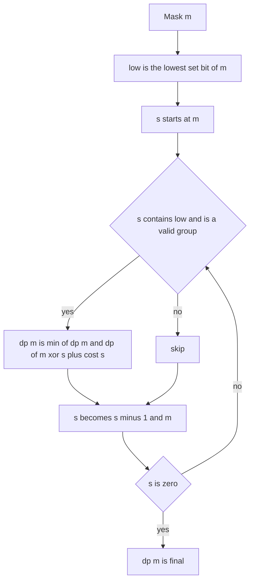

## The hook

A courier has 18 deliveries and a van that carries at most 10 kilograms per trip. What is the fewest number of trips? Trying every way to split 18 parcels into trips is astronomically many. Yet bitmask DP answers it in well under a second, and the same toolkit handles routes visiting every city, scheduling courses with a limit per term, and any problem whose state is "which items are already handled".

The basics, a set stored as bits and dp[mask][last] for routes, are in [A Checklist Written as a Row of Lights](article:dsa-bitmask-dp-intro). Contest problems add three things: iterating over the submasks of a mask, splitting a set into groups, and squeezing 2²⁰-sized tables into the memory limit.

## The intuition

:::analogy
Picture a row of switches, one per city or parcel, where on means "done". A route DP walks from one switch pattern to the next by turning on one switch. A grouping DP is different: it jumps from a pattern to a smaller pattern by turning off a whole group of switches at once, any group that fits. The question is how to try every group inside the current pattern without wasting time on switches that are already off, and the answer is a neat bit trick that counts down through exactly the switches that are on.
:::

That bit trick is [[submask enumeration]]: for a mask m, the loop s = m, s = (s - 1) & m visits every non-empty [[submask]] of m. Summed over all masks, the work is the [[3ⁿ bound]]: each item is outside the mask, inside the mask but not the submask, or inside both.

## How it works

### Routes: dp[mask][last]

The Hamiltonian-path DP from the intro article: dp[mask][v] is the best value for a path that visits exactly mask and ends at v, extended one vertex at a time. O(2ⁿ × n²) time and O(2ⁿ × n) memory. CSES *Hamiltonian Flights* counts such routes modulo 10⁹ + 7 for n = 20.

### Submask enumeration

```
for (s = m; s > 0; s = (s - 1) & m):  // every non-empty submask of m, largest first
```

To include the empty submask, handle it separately after the loop. Over all 2ⁿ masks, the loop body runs 3ⁿ times in total: about 4.3 × 10⁷ for n = 16, 3.9 × 10⁸ for n = 18, and 3.5 × 10⁹ for n = 20, which is too slow. Submask DP fits n up to about 16 to 18.

### Set partition DP

dp[mask] is the best partition of mask into valid groups. Fix the group containing the lowest item of mask, [[lowest-bit anchoring]], so each partition is generated once:

dp[mask] = min over submasks s of mask that contain lowbit(mask) and are valid groups of dp[mask ^ s] + cost(s).

Precompute cost(s) or valid(s) for every subset in O(2ⁿ × n). This is [[set partition DP]], O(3ⁿ). *Minimum Number of Work Sessions to Finish the Tasks* is exactly this with "sum of task times ≤ session length" as the validity test; *Parallel Courses II* uses submasks to choose which available courses to take each term.

### When 3ⁿ is too slow: carry extra state

CSES *Elevator Rides* has n = 20 people, too many for 3ⁿ. Instead, add people one at a time and remember the current ride: dp[mask] = (fewest rides, smallest weight in the last ride). Adding person i either fits in the last ride or starts a new one. Comparing pairs lexicographically picks the best. That is O(2ⁿ × n), and it has its own walkthrough in this track.

### Memory at n = 20

| Table | Entries | Memory with 4-byte ints | With 8-byte values |
|---|---|---|---|
| dp[2²⁰] | about 10⁶ | 4 MB | 8 MB |
| dp[2²⁰][20] | about 2.1 × 10⁷ | 84 MB | 168 MB |

Typical limits are 256 MB or 512 MB, so dp[mask][last] fits with 32-bit values. Tricks when it is tight: drop masks that cannot occur (in Hamiltonian Flights, every mask must contain the start), store counts modulo the prime in 32 bits, or process masks by popcount layer so only two layers are kept.

| Problem shape | State | Time | Typical n |
|---|---|---|---|
| Visit all items in some order | dp[mask][last] | O(2ⁿ n²) | up to 20 |
| Split items into groups | dp[mask], submasks | O(3ⁿ) | up to 16 to 18 |
| Pack items into bins, greedy-in-order | dp[mask] = (bins, last fill) | O(2ⁿ n) | up to 20 |



:::insight
Masks let a DP state be "which items are done". Turning on one item at a time gives O(2ⁿ × n) or O(2ⁿ × n²) DPs; removing a whole group at a time needs submask enumeration, whose total cost is exactly 3ⁿ because each item plays one of three roles.
:::

## Walk through an example

### Submasks of 1011

The loop starting at m = 1011 visits 1011, 1010, 1001, 1000, 0011, 0010, 0001, then stops; with the empty mask 0000 that is all 2³ = 8 submasks, since m has three set bits.

### Parcels into trips

Weights 4, 8, 6, 1 (items 0 to 3), capacity 10.

| Group (submask) | Weight | Valid? |
|---|---|---|
| {4, 6} | 10 | yes |
| {8, 1} | 9 | yes |
| {4, 8} | 12 | no |
| {4, 6, 1} | 11 | no |
| {8, 6} | 14 | no |

dp[all] anchors on item 0 (weight 4): trying {4}, {4, 6}, {4, 1}, {4, 6, 1} and so on. The best is {4, 6} with dp[{8, 1}] = 1, so 2 trips. With item 0 anchored, the partition {8, 1} | {4, 6} is never tried a second time in the other order.

### Counting the work

For n = 4, the total number of (mask, submask) pairs is 81 = 3⁴, checked by summing 2^popcount over all 16 masks. For n = 20 it would be about 3.5 × 10⁹, which is why Elevator Rides needs the O(2ⁿ × n) state instead.

:::try-this
How many submasks does m = 110110 have, and what does the enumeration loop print first and last? (m has four set bits, so 2⁴ = 16 submasks including 0. The loop starts at 110110 itself and, before stopping, ends at 000010, the smallest non-empty submask, since the lowest set bit of m is bit 1.)
:::

:::warning
Common misconception: "Iterating submasks of every mask is 4ⁿ, so it is never feasible." Each item has only three roles across a (mask, submask) pair, so the total is 3ⁿ, not 2ⁿ × 2ⁿ. For n = 15 that is about 1.4 × 10⁷, comfortable; the real limit is around n = 17 or 18, depending on the work per pair.
:::

## The code

```pseudo
submask_partition(n, valid):                  # dp[mask] = fewest valid groups covering mask
    dp[0] = 0; dp[others] = inf
    for mask in 1 .. 2^n - 1:
        low = mask & -mask
        for s = mask; s > 0; s = (s - 1) & mask:
            if (s & low) and valid[s]: dp[mask] = min(dp[mask], dp[mask ^ s] + 1)
```

```cpp
#include <bits/stdc++.h>
using namespace std;

int minGroups(const vector<int>& w, int cap) {          // O(3^n) set partition DP
    int n = w.size(), full = (1 << n) - 1;
    vector<int> sum(1 << n, 0), dp(1 << n, INT_MAX / 2);
    for (int s = 1; s <= full; s++) {
        int low = __builtin_ctz(s);
        sum[s] = sum[s & (s - 1)] + w[low];              // add the lowest item's weight
    }
    dp[0] = 0;
    for (int mask = 1; mask <= full; mask++) {
        int low = mask & -mask;
        for (int s = mask; s; s = (s - 1) & mask)        // every submask of mask
            if ((s & low) && sum[s] <= cap) dp[mask] = min(dp[mask], dp[mask ^ s] + 1);
    }
    return dp[full];
}

pair<int, int> elevator(const vector<int>& w, int cap) { // O(2^n n): (rides, last ride weight)
    int n = w.size(), full = (1 << n) - 1;
    vector<pair<int, int>> best(1 << n, {INT_MAX, INT_MAX});
    best[0] = {1, 0};
    for (int mask = 1; mask <= full; mask++)
        for (int i = 0; i < n; i++) {
            if (!(mask >> i & 1)) continue;
            auto [r, last] = best[mask ^ (1 << i)];
            pair<int, int> cand = last + w[i] <= cap ? make_pair(r, last + w[i]) : make_pair(r + 1, w[i]);
            best[mask] = min(best[mask], cand);
        }
    return best[full];
}

int main() {
    cout << minGroups({4, 8, 6, 1}, 10) << ' ' << elevator({4, 8, 6, 1}, 10).first << '\n';   // 2 2
    int m = 0b1011, count = 0;
    for (int s = m; s; s = (s - 1) & m) cout << bitset<4>(s) << ' ', count++;
    cout << "+ 0000: " << count + 1 << '\n';                                               // 1011 1010 1001 1000 0011 0010 0001 + 0000: 8
    long long pairs = 0;
    for (int mask = 0; mask < (1 << 10); mask++) pairs += 1LL << __builtin_popcount(mask);
    cout << pairs << ' ' << (long long)pow(3, 10) << '\n';                                 // 59049 59049
    cout << elevator({4, 8, 6, 1, 5}, 10).first << '\n';                                   // 3
}
```

## Complexity

- **Route DP: O(2ⁿ × n²) time, O(2ⁿ × n) memory.**
- **Submask partition DP: O(3ⁿ) time, O(2ⁿ) memory,** plus O(2ⁿ) to precompute subset sums.
- **Elevator-style DP: O(2ⁿ × n) time, O(2ⁿ) memory.**
- **Rule of thumb:** n ≤ 20 for 2ⁿ × n, n ≤ 16 to 18 for 3ⁿ.

## Common mistakes

- **Forgetting the empty submask** when the transition needs it, since the loop stops at 0.
- **Not anchoring on the lowest bit,** which generates each partition many times and wastes most of the work.
- **Using 3ⁿ for n = 20,** where it is about 3.5 × 10⁹ steps.
- **Allocating dp[1 << 20][20] with 64-bit values** when 32-bit would do, doubling memory.
- **Computing subset sums inside the submask loop** instead of precomputing them.

## Practice problems

*Hamiltonian Flights* is the route DP at n = 20. *Elevator Rides* is the O(2ⁿ × n) packing DP. *Minimum Number of Work Sessions to Finish the Tasks* is the set partition DP with submasks, small enough for 3ⁿ. *Parallel Courses II* chooses a submask of available courses each term.

## Key takeaways

- A bitmask records which items are done, and route problems extend it one item at a time with dp[mask][last].
- The loop s = (s - 1) & m visits every non-empty submask of m in decreasing order.
- Enumerating all submasks of all masks costs exactly 3ⁿ, because each item is outside, in the mask only, or in both.
- Set partition DP chooses the group containing the lowest item of the mask, so each partition is built once.
- When 3ⁿ is too slow, carrying extra state such as the current bin's fill gives O(2ⁿ × n) instead.
