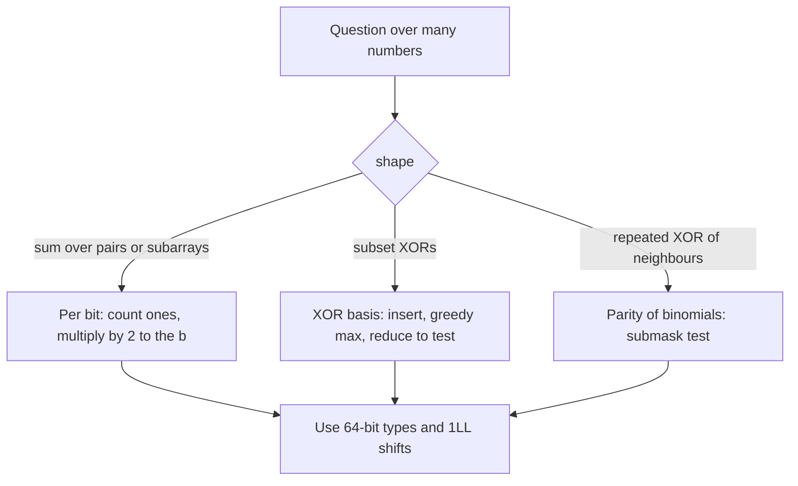

## The hook

Sum a[i] XOR a[j] over all pairs of a hundred thousand numbers: five billion pairs, far too many to visit. Find the largest XOR any subset can make: 2ⁿ subsets. Work out the top of a pyramid where every brick is the XOR of the two below it: a million rows of work.

Each becomes a few lines once you stop treating numbers as numbers and start treating them as rows of independent switches. [Flip a Switch Twice and Nothing Happened](article:dsa-bit-manipulation-tricks) covered single-number tricks. This article is about whole collections of numbers, where the same independence gives three powerful tools.

## The intuition

:::analogy
Every number is a panel of 60 light switches. XOR, AND and OR never let one switch affect another: the 5th light of a XOR b depends only on the 5th lights of a and b. So any question about "all pairs" or "all subsets" can be asked 60 times, once per light, and each light only has two states. Counting how often the 5th light ends up on across all pairs is a simple multiplication, and so is every other light.
:::

That is [[per-bit contribution]]. The same independence is what makes XOR behave like addition of vectors over the field with two elements, which gives the [[XOR basis]].

## How it works

### Per-bit contribution

For a sum of bitwise results over many terms, handle each bit b separately and add count × 2^b:

| Sum over all pairs i < j | Pairs with bit b set | Why |
|---|---|---|
| a[i] XOR a[j] | ones × zeros | the bits must differ |
| a[i] AND a[j] | ones × (ones − 1) / 2 | both bits must be 1 |
| a[i] OR a[j] | all pairs minus zeros × (zeros − 1) / 2 | at least one bit is 1 |

Sixty bits times n numbers is O(60·n), instead of O(n²) pairs. The same idea handles sums over all subarrays, using prefix XORs: the XOR of a subarray is pre[r] XOR pre[l], so "sum of subarray XORs" is "sum of XORs over pairs of prefix values".

### The XOR basis

Treat each number as a vector of 60 bits. XORing numbers is adding vectors modulo 2, and the subset XORs of an array form a vector space. A basis of that space needs at most 60 values. Build it greedily:

```
insert(x):
    for b from 59 down to 0:
        if bit b of x is 0: continue
        if basis[b] is empty: basis[b] = x; return        # new direction
        x ^= basis[b]                                     # clear bit b, keep going
    # x became 0: it was linearly dependent
```

Each stored value has a distinct highest bit, which makes three queries easy:

- **Maximum subset XOR:** start from 0 and, from the highest bit down, XOR in basis[b] if that makes the value larger. Greedy works because basis[b] is the only value that can change bit b without touching higher bits.
- **Is v reachable:** reduce v like an insertion; v is a subset XOR exactly when it becomes 0.
- **How many distinct subset XORs:** exactly 2^[[rank]], counting the empty subset's 0.

A value that reduces to zero is [[linearly dependent]]. Codeforces *(Zero XOR Subset)-less* asks for the largest number of segments with no group of segments XORing to zero, and the answer is the rank of the prefix XORs, provided the total is not zero.

### The XOR pyramid

Write n numbers in a row; above each adjacent pair write their XOR; repeat up to a single number. Each step is Pascal's rule with XOR instead of addition, so base[i] reaches the top along C(n − 1, i) paths, and only the parity matters: the top is the XOR of base[i] over the i with C(n − 1, i) odd. By Lucas's theorem modulo 2, from [Reading a Number Digit by Digit in Base p](article:cp-lucas-theorem), C(m, i) is odd exactly when i is a [[submask]] of m. CSES *Xor Pyramid* is then one loop with the test (i & (n − 1)) == i, in O(n) instead of O(n²).

### Width traps

[[Integer width]] causes most bitwise wrong answers:

- `1 << 40` is an int shift and undefined; write `1LL << 40`;
- `__builtin_popcount` takes an unsigned int; use `__builtin_popcountll` for 64-bit values;
- counts such as ones × zeros × 2^b exceed 32 bits quickly;
- a basis sized for 30 bits silently drops the high bits of values up to 10¹⁸.



:::insight
XOR is addition without carries, so every bit is an independent little problem, and the numbers together form a vector space over two elements. Counting per bit and keeping a basis of at most 60 vectors turn questions over n² pairs or 2ⁿ subsets into O(60·n) work.
:::

## Walk through an example

### Pair XOR sum of 5, 1, 6, 3

| Bit b | Values with the bit | ones | zeros | Pairs differing | Contribution |
|---|---|---|---|---|---|
| 0 | 5, 1, 3 | 3 | 1 | 3 | 3 × 1 = 3 |
| 1 | 6, 3 | 2 | 2 | 4 | 4 × 2 = 8 |
| 2 | 5, 6 | 2 | 2 | 4 | 4 × 4 = 16 |

Total 27. Directly: 5⊕1 = 4, 5⊕6 = 3, 5⊕3 = 6, 1⊕6 = 7, 1⊕3 = 2, 6⊕3 = 5, and 4 + 3 + 6 + 7 + 2 + 5 = 27.

### XOR basis of the same numbers

| Insert | Reduction | Result |
|---|---|---|
| 5 = 101 | highest bit 2 is free | basis[2] = 5 |
| 1 = 001 | highest bit 0 is free | basis[0] = 1 |
| 6 = 110 | bit 2: 6 ⊕ 5 = 3 = 011; bit 1 is free | basis[1] = 3 |
| 3 = 011 | bit 1: 3 ⊕ 3 = 0 | dependent |

Rank 3, so there are 2³ = 8 distinct subset XORs, here all of 0 to 7. The greedy maximum: 0 → 0 ⊕ 5 = 5 → 5 ⊕ 3 = 6 → 6 ⊕ 1 = 7. Is 4 reachable? 4 ⊕ 5 = 1, then 1 ⊕ 1 = 0: yes, for example 5 ⊕ 1.

### XOR pyramid of 2, 10, 5, 12, 9

Simulating: 8, 15, 9, 5; then 7, 6, 12; then 1, 10; then 11. With n = 5, n − 1 = 4 = 100 in binary, whose submasks are 0 and 4. So the top is base[0] ⊕ base[4] = 2 ⊕ 9 = 11, matching the simulation, and the middle three numbers do not matter at all.

:::try-this
Change the base to 2, 10, 5, 12, 9, 7, six numbers. Which positions now reach the top, and what is it? (n − 1 = 5 = 101, with submasks 0, 1, 4 and 5. The top is 2 ⊕ 10 ⊕ 9 ⊕ 7 = 6.)
:::

:::warning
Common misconception: "To maximise the XOR of a subset, take the largest numbers." For 5, 1, 6, 3, the two largest give 6 ⊕ 5 = 3, and all four give 1. The best is 7, from 5 ⊕ 3 ⊕ 1 or 6 ⊕ 1. XOR has no order to exploit directly; the basis turns it into one, highest bit first.
:::

## The code

```pseudo
pairXorSum: for each bit b: ones = count with bit b; total += ones * (n - ones) * 2^b
basis insert(x): for b high to low: if bit b of x: if basis[b] empty: store, done; else x ^= basis[b]
maxXor: best = 0; for b high to low: best = max(best, best ^ basis[b])
pyramid top: XOR of base[i] over i with (i & (n - 1)) == i
```

```cpp
#include <bits/stdc++.h>
using namespace std;
using ll = long long;

ll pairXorSum(const vector<ll>& a) {                             // sum of a[i] xor a[j] over all pairs i < j
    ll total = 0, n = a.size();
    for (int b = 0; b < 60; b++) {
        ll ones = 0;
        for (ll x : a) ones += x >> b & 1;
        total += ones * (n - ones) * (1LL << b);                 // a pair has bit b set iff exactly one has it
    }
    return total;
}

struct XorBasis {                                                // linear basis over GF(2), 60-bit values
    ll basis[60] = {};                                           // basis[b] has highest set bit b, or is 0
    int rank = 0;
    bool insert(ll x) {
        for (int b = 59; b >= 0; b--) {
            if (!(x >> b & 1)) continue;
            if (!basis[b]) { basis[b] = x, rank++; return true; }   // new independent direction
            x ^= basis[b];                                       // clear bit b and keep reducing
        }
        return false;                                            // x was already a xor of earlier values
    }
    ll maxXor() const {
        ll best = 0;
        for (int b = 59; b >= 0; b--) best = max(best, best ^ basis[b]);   // greedily keep high bits
        return best;
    }
    bool representable(ll x) const {
        for (int b = 59; b >= 0; b--) if (x >> b & 1) { if (!basis[b]) return false; x ^= basis[b]; }
        return true;
    }
};

ll xorPyramidTop(const vector<ll>& base) {                       // value at the top of a xor pyramid
    ll n = base.size(), top = 0;
    for (ll i = 0; i < n; i++)
        if ((i & (n - 1)) == i) top ^= base[i];                  // C(n-1, i) is odd iff i is a submask of n-1
    return top;
}

int main() {
    vector<ll> a = {5, 1, 6, 3};
    cout << pairXorSum(a) << '\n';                               // 27
    XorBasis xb;
    for (ll x : a) cout << xb.insert(x);
    cout << ' ' << xb.rank << ' ' << xb.maxXor() << ' ' << xb.representable(4) << '\n';   // 1110 3 7 1
    cout << xorPyramidTop({2, 10, 5, 12, 9}) << '\n';                // 11
    ll safe = 1LL << 40;                                         // 1 << 40 would overflow a 32-bit int
    cout << safe << '\n';                                        // 1099511627776

    mt19937 rng(31);                                             // brute force checks
    bool ok = true;
    for (int t = 0; t < 300; t++) {
        int n = 1 + rng() % 10;
        vector<ll> v(n);
        for (auto& x : v) x = rng() % 64;
        ll s = 0;
        for (int i = 0; i < n; i++) for (int j = i + 1; j < n; j++) s += v[i] ^ v[j];
        ok = ok && pairXorSum(v) == s;
        set<ll> reach = {0};                                     // every subset xor
        for (ll x : v) { set<ll> nxt = reach; for (ll r : reach) nxt.insert(r ^ x); reach = nxt; }
        XorBasis B;
        for (ll x : v) B.insert(x);
        ok = ok && B.maxXor() == *reach.rbegin() && (ll)reach.size() == (1LL << B.rank);
        for (ll q = 0; q < 64; q++) ok = ok && B.representable(q) == (bool)reach.count(q);
        vector<ll> row = v;                                      // simulate the pyramid
        while (row.size() > 1) { vector<ll> up; for (size_t i = 0; i + 1 < row.size(); i++) up.push_back(row[i] ^ row[i + 1]); row = up; }
        ok = ok && xorPyramidTop(v) == row[0];
    }
    cout << (ok ? "stress ok" : "stress FAILED") << '\n';        // stress ok
}
```

The random test compares every routine with brute force: all pairs for the XOR sum, the full set of subset XORs for the basis maximum, count and membership, and a row-by-row simulation for the pyramid.

## Complexity

- **Per-bit sums: O(n · B)** for B bits, here 60.
- **XOR basis: O(B)** per insertion and per query; O(n · B) to build.
- **Pyramid top: O(n).**
- **Space: O(B)** for the basis.

## Common mistakes

- **`1 << b` for b ≥ 31,** instead of `1LL << b`.
- **A basis with too few bits** for the values in the input.
- **Forgetting that the empty subset gives 0** when counting distinct subset XORs.
- **Expecting the greedy maximum on raw values** instead of on the basis.
- **Overflow in ones × zeros × 2^b;** use 64-bit arithmetic, or reduce modulo the required prime.
- **Simulating the whole pyramid,** which is quadratic for a million numbers.

## Practice problems

*Xor Pyramid* is the submask test on n − 1. *(Zero XOR Subset)-less* is the rank of the prefix XORs. *Find XOR Sum of All Pairs Bitwise AND* simplifies per bit to (XOR of arr1) AND (XOR of arr2). *Bitwise XOR of All Pairings* depends only on whether each array's length is odd. The trie approach to the maximum XOR of two numbers is in [Taking the Opposite Turn at Every Fork](article:dsa-max-xor-trie).

## Key takeaways

- Bitwise operations act on each bit independently, so sums of XOR, AND or OR over all pairs are computed bit by bit from counts of ones.
- A pair has bit b in its XOR exactly when one value has the bit and the other does not, giving ones times zeros pairs per bit.
- An XOR basis of at most 60 values, each with a distinct highest bit, represents every subset XOR of an array.
- The basis gives the maximum subset XOR greedily, tests whether a value is reachable by reduction, and counts distinct subset XORs as 2 to the rank.
- Repeated XOR of neighbours follows Pascal's rule modulo 2, so only base positions that are submasks of n − 1 reach the top of an XOR pyramid.
