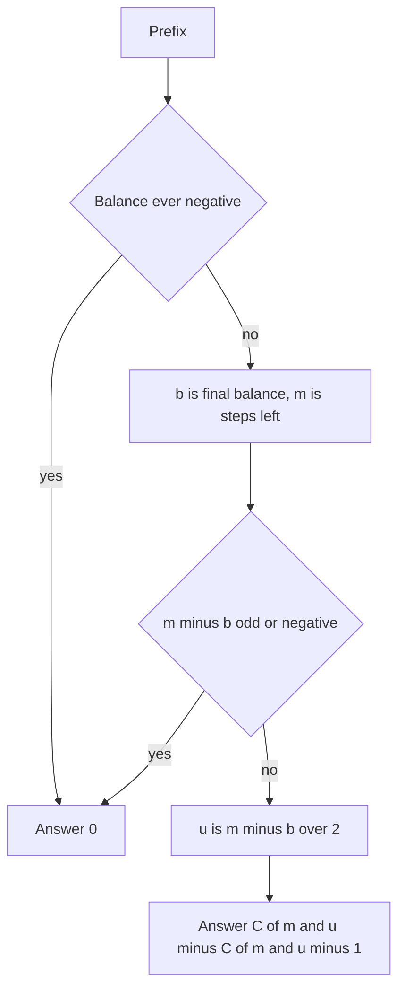

## The hook

A hiker walks a ridge in fixed-length steps, each step one metre up or one metre down. The walk must start and end at sea level, and the hiker refuses to ever go below it, because below sea level is the sea. How many different walks of 2k steps are there?

That hiker's walk is a bracket sequence in disguise: up is '(' and down is ')'. Counting walks directly by recursion is exponential, but a beautiful trick, reflecting the bad walks into easy-to-count ones, gives the answer with a single binomial coefficient, and it extends to counting completions of any partial sequence.

## The problem

*Bracket Sequences I*: count the [[valid bracket sequence]]s of length n, modulo 10⁹ + 7. *Bracket Sequences II*: given n and a prefix, count the valid sequences of length n that start with that prefix. For n = 6 the first answer is 5; for n = 8 with prefix "((", the second is 9.

## The obvious approach

Generate all 2ⁿ strings and check each, or use DP over (position, balance) in O(n²). The DP is correct and fine for n in the thousands, but CSES allows n up to 10⁶, where O(n²) is far too slow. The answer needs a closed form.

## The key insight

:::analogy
Draw every walk on squared paper as a mountain profile: up a square for '(', down for ')'. A valid sequence is a profile that starts and ends at sea level and never dips below it. Now take any profile that does dip below: find the first moment it touches one metre below sea level, and mirror everything after that moment, swapping ups and downs. The mirrored walk ends two metres below sea level. Every bad walk becomes exactly one walk ending at -2, and every walk ending at -2 comes from exactly one bad walk, so counting the bad walks is the same as counting walks that end at -2.
:::

Turning brackets into a [[lattice path]] makes the problem geometric. With k = n / 2 pairs:

- all strings with k '(' and k ')' number C(2k, k);
- by the [[reflection principle]], the invalid ones number C(2k, k + 1), the paths with k + 1 downs that end at -2;
- so the valid ones number C(2k, k) - C(2k, k + 1) = C(2k, k) / (k + 1), the [[Catalan number]].

Odd n gives 0, since the counts of '(' and ')' must be equal.

### Completing a prefix

For *Bracket Sequences II*, first scan the prefix. If its balance ever goes negative, the answer is 0. Otherwise let b be its final balance and m = n - (prefix length) the steps left. The rest of the walk goes from height b to 0 in m steps without dipping below 0, so it has u = (m - b) / 2 ups and m - u downs; if m - b is odd or negative, the answer is 0.

The same reflection counts the bad completions. All paths from b to 0 number C(m, u). For a path that touches -1, mirror the part before its first touch instead: its start moves from b to -2 - b, and the result is a path from -2 - b to 0, which has exactly u - 1 down steps. That correspondence is one to one, so there are C(m, u - 1) bad completions, and

completions = C(m, u) - C(m, u - 1).

With k = n / 2 and an empty prefix, this is the Catalan formula again.

Factorials and inverse factorials up to 10⁶, from [How Many Ways to Pick the Team?](article:cp-binomial-coefficients), make each binomial O(1).

| Quantity | Formula |
|---|---|
| All balanced strings with k pairs | C(2k, k) |
| Invalid ones (dip below 0) | C(2k, k + 1) |
| Valid ones | C(2k, k) / (k + 1) |
| Completions of a prefix with balance b, m steps left | C(m, u) - C(m, u - 1), u = (m - b) / 2 |



:::insight
Every walk that dips below the line can be mirrored after its first dip into a walk that ends two units lower, and the mirror is reversible. So the bad walks are counted by one binomial coefficient, and the good ones are all walks minus that.
:::

## Walk through an example

### Length 6

The five valid sequences: ((())), (()()), (())(), ()(()), ()()().

| Count | Value |
|---|---|
| All strings with 3 '(' and 3 ')' | C(6, 3) = 20 |
| Bad ones, reflected | C(6, 4) = 15 |
| Valid | 20 - 15 = 5 = C(6, 3) / 4 |

For example, the bad string "())(()" first touches -1 after its third character, "())". Mirroring the remaining three characters "(()" into "))(" gives "())))(", with 2 ups and 4 downs, a walk that ends at -2. Each of the 15 bad strings maps to a different such walk, and every walk ending at -2 maps back.

### Completing prefixes for n = 8 and n = 10

| n | Prefix | Balance b | Steps left m | u | C(m, u) - C(m, u - 1) |
|---|---|---|---|---|---|
| 8 | (( | 2 | 6 | 2 | 15 - 6 = 9 |
| 8 | ()( | 1 | 5 | 2 | 10 - 5 = 5 |
| 10 | (() | 1 | 7 | 3 | 35 - 21 = 14 |
| 6 | ) | goes negative | | | 0 |
| 7 | ( | | | | 0, odd length |

All five values were also confirmed by brute force over every completion.

:::try-this
How many valid sequences of length 10 are there, and how many of them start with "()"? (k = 5 gives C(10, 5) / 6 = 252 / 6 = 42. With prefix "()", b = 0 and m = 8, so u = 4 and the count is C(8, 4) - C(8, 3) = 70 - 56 = 14, the Catalan number C_4, since after "()" any valid sequence of 4 pairs can follow.)
:::

:::warning
Common misconception: "The reflection should flip the whole path." Only the part after the first touch of -1 is mirrored. Flipping the entire path changes every step and does not give a one-to-one correspondence with paths ending at -2. The first-touch rule is what makes the map reversible: the mirrored path also first touches -1 at the same moment, so flipping back recovers the original.
:::

## The code

```pseudo
precompute fact[0..N], inv_fact[0..N] mod p
C(a, b) = 0 if b < 0 or b > a else fact[a] * inv_fact[b] * inv_fact[a-b]

bracket_sequences_i(n):
    if n odd: return 0
    k = n / 2; return C(2k, k) - C(2k, k + 1)

bracket_sequences_ii(n, prefix):
    b = 0; for c in prefix: b += (c == '(' ? 1 : -1); if b < 0: return 0
    m = n - len(prefix)
    if m < b or (m - b) odd: return 0
    u = (m - b) / 2
    return C(m, u) - C(m, u - 1)
```

```cpp
#include <bits/stdc++.h>
using namespace std;
using ll = long long;
const ll MOD = 1000000007;

struct Binom {
    vector<ll> f, inv;
    explicit Binom(int n) : f(n + 1), inv(n + 1) {
        f[0] = 1;
        for (int i = 1; i <= n; i++) f[i] = f[i - 1] * i % MOD;
        inv[n] = power(f[n], MOD - 2);
        for (int i = n; i > 0; i--) inv[i - 1] = inv[i] * i % MOD;
    }
    static ll power(ll b, ll e) {
        ll r = 1;
        for (b %= MOD; e; e >>= 1, b = b * b % MOD) if (e & 1) r = r * b % MOD;
        return r;
    }
    ll C(int a, int b) const { return (b < 0 || b > a) ? 0 : f[a] * inv[b] % MOD * inv[a - b] % MOD; }
};

ll completions(const Binom& bc, int n, const string& prefix) {
    int b = 0;
    for (char c : prefix) {
        b += (c == '(') ? 1 : -1;
        if (b < 0) return 0;                                   // already dipped below sea level
    }
    int m = n - prefix.size();
    if (m < b || (m - b) % 2) return 0;
    int u = (m - b) / 2;                                       // ups still needed
    return (bc.C(m, u) - bc.C(m, u - 1) + MOD) % MOD;          // all paths minus reflected bad ones
}

int main() {
    Binom bc(1000000);
    for (int n : {2, 4, 6, 8, 10, 7}) cout << completions(bc, n, "") << ' ';
    cout << '\n';                                              // 1 2 5 14 42 0
    cout << completions(bc, 8, "((") << ' ' << completions(bc, 8, "()(") << ' ' << completions(bc, 10, "(()") << ' '
         << completions(bc, 6, ")") << ' ' << completions(bc, 10, "()") << '\n';   // 9 5 14 0 14
    cout << completions(bc, 1000000, "") << '\n';              // 213941567, the Catalan number for n = 10^6 modulo 1e9+7
}
```

## Complexity

- **Precomputation: O(N)** for factorials and inverse factorials up to N = 10⁶.
- **Each answer: O(1)** after scanning the prefix in O(length).
- **Space: O(N).**
- **Compared with the O(n²) DP over (position, balance):** the closed form is what makes n = 10⁶ feasible.

## Common mistakes

- **Forgetting odd lengths,** which have no valid sequence.
- **Not checking the prefix itself:** a prefix that dips below zero, or has more '(' than can be closed in the remaining steps, has 0 completions.
- **Subtracting without adding MOD,** which leaves a negative value in modular arithmetic.
- **Dividing by k + 1 directly** instead of multiplying by its modular inverse, or using the subtraction form, which needs no division.
- **Reflecting the whole path** instead of only the part after the first touch of -1.

## Practice problems

*Bracket Sequences I* is the Catalan number modulo a prime. *Bracket Sequences II* is the prefix version with the shifted reflection. *Generate Parentheses* lists the sequences for small n by backtracking, a good way to see the Catalan counts appear. Counting basics are in [Counting Outfits Without Trying Them On](article:cp-counting-techniques).

## Key takeaways

- A bracket sequence is a path of up and down steps, and it is valid when the path never dips below zero and ends at zero.
- Reflecting a bad path after its first touch of -1 gives a one-to-one correspondence with paths that end at -2.
- The number of valid sequences with k pairs is C(2k, k) - C(2k, k + 1), the Catalan number C(2k, k) / (k + 1).
- Completing a prefix with balance b in m steps has C(m, u) - C(m, u - 1) valid ways, where u = (m - b) / 2.
- Odd lengths, prefixes that dip below zero, and balances larger than the remaining steps all give 0.
