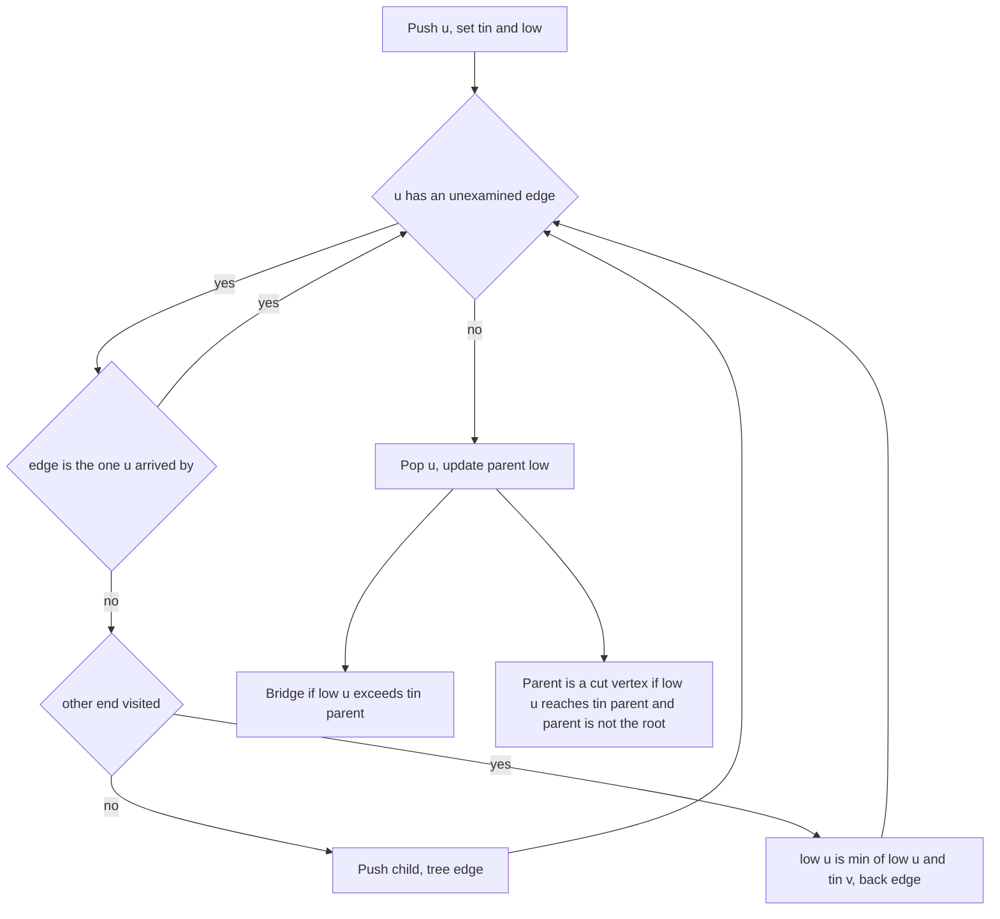
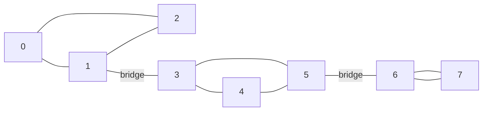

## The hook

A city engineer is given a map of roads and asked two questions before the flood season. Which single road, if washed away, would cut some neighbourhood off from the rest? Which single junction, if it had to close, would do the same?

Trying every road one at a time costs a full search per road, which is 2·10⁵ searches on a CSES-sized map. One depth-first walk answers both questions at once. The DSA version of this idea is in [The One Road Whose Closure Splits the City](article:dsa-critical-connections); here we take it to contest scale, with parallel roads, a recursion-free walk, and two things built on top: the bridge tree and an orientation that keeps every street usable one way.

## The intuition

:::analogy
The engineer explores the city on foot, unrolling a ball of string, and stamps each junction with the time of first arrival. Then, standing at any junction v, they send a scout into everything explored beyond v with one rule: the scout may wander forward along the string as far as they like, take one shortcut road that is not on the string, but may never walk back along the road v was entered by. The scout reports the earliest stamp they can reach. If that stamp is still later than the junction p that v was entered from, then the whole region beyond v hangs on the single road p–v.
:::

The stamps are [[entry time]]s, tin[v]. The scout's report is the [[low-link]], low[v]. The string roads form the DFS tree, and every other road is a [[back edge]] that joins a junction to one of its ancestors on the string; in an undirected DFS no road ever jumps sideways between two branches.

Two verdicts come from the same report, for each tree edge p → v:

| Report | Meaning | Verdict |
|---|---|---|
| low[v] > tin[p] | the region beyond v cannot even reach p without the road p–v | p–v is a [[bridge]] |
| low[v] ≥ tin[p] | the region beyond v cannot get above p without passing through p | p is an [[articulation point]] (unless p is the root) |
| low[v] < tin[p] | the region beyond v has its own way up past p | neither |

The root is special: nothing is above it, so the second test is meaningless there. The root is a cut vertex exactly when it has two or more DFS children, because the scouts of different branches can never meet except at the root.

## How it works

### Computing low in one pass

```
visit u (arrived by edge id e):
    tin[u] = low[u] = timer++
    for each edge (u, v, id):
        if id == e: skip                 # the road we came in on
        if v unvisited: visit v (by id); low[u] = min(low[u], low[v]); test p = u, child v
        else: low[u] = min(low[u], tin[v])   # a back edge
```

Each vertex is entered once and each edge is looked at twice, once from each end, so the walk is O(n + m).

### The multi-edge trap

CSES *Necessary Roads* allows several roads between the same pair of cities. Suppose there are two roads between 6 and 7. When the walk reaches 7 along the first one, the second road is a real alternative: wash away either and the other still connects them.

- **Skip by edge id:** from 7, only the road used to arrive is skipped; the parallel road counts as a back edge to 6, low[7] becomes tin[6], and 6–7 is correctly not a bridge.
- **Skip by parent vertex:** from 7, every road to 6 is skipped, low[7] stays tin[7], and 6–7 is reported as a bridge. Wrong.

Articulation points do not care about parallel edges, since closing a junction closes all its roads anyway. Bridges do, so always store the edge id in the adjacency list.

### Recursion depth

A path of 10⁵ cities makes a recursive DFS 10⁵ calls deep. That fits in many judges' stacks, but not all. The iterative form keeps an explicit stack of vertices and, for each vertex, a pointer `it[u]` to the next edge to examine:

- top of stack u still has edges: take the next one, and either push a new child or record a back edge;
- top of stack u has no edges left: pop it, and push its low into its parent, running the bridge and cut tests there.

That "finish" step is exactly the code that runs after a recursive call returns.

### The bridge tree

Delete every bridge and the city falls into [[2-edge-connected component]]s: inside each piece, any single road can be washed away and the piece stays connected. Shrink each piece to a node and put the bridges back: the result is the [[bridge tree]], and it is a forest, since a cycle in it would mean the bridges on that cycle were not bridges at all.

Problems that ask "how many roads must be crossed between a and b no matter which route is taken" become distance queries on the bridge tree.

### Orienting every road

CSES *Strongly Connected Edges* and Codeforces *Bertown roads* ask for a direction on every road so that every city can reach every other. A bridge makes this impossible: whichever way it points, one side can never return. If the graph is connected and has no bridge, the DFS itself gives an answer:

- every tree edge points from parent to child, down the string;
- every back edge points from the descendant up to the ancestor.

From any vertex you can climb back towards the root because, with no bridges, every subtree has a back edge escaping above its top; repeating that climb reaches the root, and from the root the tree edges reach everything.



:::insight
The same report answers both questions; only the inequality changes. Strict for roads, because reaching p itself is enough to keep the road replaceable. Non-strict for junctions, because reaching p is no help when p is the one closing.
:::

## Walk through an example

Eight junctions and ten roads, with ids in brackets: 0–1 [0], 1–2 [1], 2–0 [2], 1–3 [3], 3–4 [4], 4–5 [5], 5–3 [6], 5–6 [7], 6–7 [8], 6–7 [9]. Roads 8 and 9 are parallel. The walk starts at 0 and takes edges in this order.



| Step | Event | Effect |
|---|---|---|
| 1 | enter 0, 1, 2 along roads 0, 1 | tin 0, 1, 2 |
| 2 | at 2, road 2 to visited 0 | back edge: low[2] = 0 |
| 3 | finish 2, low 0 | low[1] = 0; 0 > tin[1] = 1 is false, no bridge |
| 4 | from 1, enter 3, 4, 5 along roads 3, 4, 5 | tin 3, 4, 5 |
| 5 | at 5, road 6 to visited 3 | back edge: low[5] = 3 |
| 6 | from 5, enter 6, then 7 along roads 7, 8 | tin 6, 7 |
| 7 | at 7, road 8 is the arrival road | skipped |
| 8 | at 7, road 9 to visited 6 | back edge: low[7] = 6 |
| 9 | finish 7, low 6 | 6 > tin[6] = 6 is false: road 8 is not a bridge. 6 ≥ 6: **6 is a cut vertex** |
| 10 | finish 6, low 6 | 6 > tin[5] = 5: **road 7 (5–6) is a bridge**, and **5 is a cut vertex** |
| 11 | finish 5, low 3; finish 4, low 3 | low[4] = 3, then low[3] = 3; 3 ≥ tin[3] = 3: **3 is a cut vertex** |
| 12 | finish 3, low 3 | 3 > tin[1] = 1: **road 3 (1–3) is a bridge**, and **1 is a cut vertex** |
| 13 | finish 1, then root 0 | 0 has one DFS child, so it is not a cut vertex |

Final values:

| Vertex | 0 | 1 | 2 | 3 | 4 | 5 | 6 | 7 |
|---|---|---|---|---|---|---|---|---|
| tin | 0 | 1 | 2 | 3 | 4 | 5 | 6 | 7 |
| low | 0 | 0 | 0 | 3 | 3 | 3 | 6 | 6 |

Bridges: 1–3 and 5–6. Cut vertices: 1, 3, 5, 6. Deleting the two bridges leaves three 2-edge-connected components, {0, 1, 2}, {3, 4, 5} and {6, 7}, and the bridge tree is a path of three nodes.

Look at step 8 again. Had the walk skipped every road back to 6, low[7] would have stayed 7, and 7 > 6 would have declared road 8 a bridge, even though road 9 runs right beside it.

:::try-this
Add one road 7–0 [10]. Which bridges and cut vertices remain? (Now the walk from 7 finds a back edge to 0, so low[7] = 0, and that 0 flows up through 6, 5, 4 and 3. Every low drops to 0, which is below tin[1] = 1, so neither 1–3 nor 5–6 is a bridge any more, and none of 1, 3, 5, 6 passes the non-strict test. The graph has no bridges and no cut vertices: the whole map is one 2-edge-connected component.)
:::

:::warning
Common misconception: "Every endpoint of a bridge is an articulation point." Not when the endpoint has degree one: in a graph that is a single road 0–1, the road is a bridge, but removing vertex 1 leaves vertex 0 on its own, still one component. Conversely, a cut vertex need not touch any bridge: two triangles sharing one vertex have a cut vertex and no bridges at all.
:::

## The code

```pseudo
for every unvisited s:
    push s; tin[s] = low[s] = timer++
    while stack not empty:
        u = top
        if u has an unexamined edge (v, id):
            if id == arrivalEdge[u]: continue
            if v unvisited: tin[v] = low[v] = timer++; parent[v] = u; arrivalEdge[v] = id; push v
            else: low[u] = min(low[u], tin[v])
        else:
            pop u; p = parent[u]
            if p exists:
                low[p] = min(low[p], low[u])
                if low[u] > tin[p]: arrivalEdge[u] is a bridge
                if p is not a root and low[u] >= tin[p]: p is a cut vertex
    if s has at least two children: s is a cut vertex
```

```cpp
#include <bits/stdc++.h>
using namespace std;

struct LowLink {
    int n;
    vector<vector<pair<int, int>>> adj;                         // (neighbour, edge id)
    vector<int> tin, low, par, parEdge;
    vector<bool> cut, isBridge;
    vector<int> orientFrom;                                      // edge id -> tail of its DFS orientation
    LowLink(int n, const vector<array<int, 2>>& edges)
        : n(n), adj(n), tin(n, -1), low(n), par(n, -1), parEdge(n, -1), cut(n, false),
          isBridge(edges.size(), false), orientFrom(edges.size(), -1) {
        for (int i = 0; i < (int)edges.size(); i++) {
            adj[edges[i][0]].push_back({edges[i][1], i});
            adj[edges[i][1]].push_back({edges[i][0], i});
        }
        vector<int> it(n, 0);
        int timer = 0;
        for (int s = 0; s < n; s++) {
            if (tin[s] != -1) continue;
            int rootChildren = 0;
            vector<int> st = {s};
            tin[s] = low[s] = timer++;
            while (!st.empty()) {
                int u = st.back();
                if (it[u] < (int)adj[u].size()) {
                    auto [v, id] = adj[u][it[u]++];
                    if (id == parEdge[u]) continue;              // skip by edge id, not by vertex
                    if (orientFrom[id] == -1) orientFrom[id] = u; // first look: tree edge down or back edge up
                    if (tin[v] == -1) {
                        tin[v] = low[v] = timer++;
                        par[v] = u, parEdge[v] = id;
                        if (u == s) rootChildren++;
                        st.push_back(v);
                    } else {
                        low[u] = min(low[u], tin[v]);
                    }
                } else {
                    st.pop_back();
                    int p = par[u];
                    if (p == -1) continue;
                    low[p] = min(low[p], low[u]);
                    if (low[u] > tin[p]) isBridge[parEdge[u]] = true;
                    if (p != s && low[u] >= tin[p]) cut[p] = true;
                }
            }
            if (rootChildren >= 2) cut[s] = true;
        }
    }
    vector<int> twoEdgeComponents(int& count) const {          // label pieces left after deleting bridges
        vector<int> comp(n, -1);
        count = 0;
        for (int s = 0; s < n; s++) {
            if (comp[s] != -1) continue;
            vector<int> st = {s};
            comp[s] = count;
            while (!st.empty()) {
                int u = st.back(); st.pop_back();
                for (auto [v, id] : adj[u])
                    if (!isBridge[id] && comp[v] == -1) comp[v] = count, st.push_back(v);
            }
            count++;
        }
        return comp;
    }
};

int components(int n, const vector<array<int, 2>>& edges, int skipEdge, int skipVertex) {
    vector<vector<int>> g(n);
    for (int i = 0; i < (int)edges.size(); i++) {
        auto [a, b] = edges[i];
        if (i == skipEdge || a == skipVertex || b == skipVertex) continue;
        g[a].push_back(b), g[b].push_back(a);
    }
    vector<bool> seen(n, false);
    int c = 0;
    for (int s = 0; s < n; s++) {
        if (s == skipVertex || seen[s]) continue;
        c++;
        vector<int> st = {s};
        seen[s] = true;
        while (!st.empty()) {
            int u = st.back(); st.pop_back();
            for (int v : g[u]) if (!seen[v]) seen[v] = true, st.push_back(v);
        }
    }
    return c;
}

int main() {
    vector<array<int, 2>> e = {{0, 1}, {1, 2}, {2, 0}, {1, 3}, {3, 4}, {4, 5}, {5, 3}, {5, 6}, {6, 7}, {6, 7}};
    LowLink L(8, e);
    cout << "bridges:";
    for (int i = 0; i < (int)e.size(); i++) if (L.isBridge[i]) cout << ' ' << e[i][0] << '-' << e[i][1];
    cout << "\ncut:";
    for (int v = 0; v < 8; v++) if (L.cut[v]) cout << ' ' << v;
    int cnt;
    auto comp = L.twoEdgeComponents(cnt);
    cout << "\npieces " << cnt << ':';
    for (int c : comp) cout << ' ' << c;
    cout << '\n';
    // bridges: 1-3 5-6
    // cut: 1 3 5 6
    // pieces 3: 0 0 0 1 1 1 2 2

    auto e2 = e;
    e2.push_back({7, 0});                                        // the try-this road
    LowLink L2(8, e2);
    int bridges2 = count(L2.isBridge.begin(), L2.isBridge.end(), true);
    int cuts2 = count(L2.cut.begin(), L2.cut.end(), true);
    vector<vector<int>> dg(8);                                   // orient every road, then check reachability
    for (int i = 0; i < (int)e2.size(); i++) {
        int a = L2.orientFrom[i], b = e2[i][0] ^ e2[i][1] ^ a;
        dg[a].push_back(b);
    }
    bool strong = true;
    for (int s = 0; s < 8; s++) {
        vector<bool> seen(8, false);
        vector<int> st = {s};
        seen[s] = true;
        while (!st.empty()) {
            int u = st.back(); st.pop_back();
            for (int v : dg[u]) if (!seen[v]) seen[v] = true, st.push_back(v);
        }
        strong = strong && count(seen.begin(), seen.end(), true) == 8;
    }
    cout << bridges2 << ' ' << cuts2 << ' ' << (strong ? "strong" : "broken") << '\n';   // 0 0 strong

    mt19937 rng(7);                                              // brute force: remove each edge and vertex
    bool ok = true;
    for (int t = 0; t < 300; t++) {
        int n = 1 + rng() % 7, m = rng() % 10;
        vector<array<int, 2>> r;
        for (int i = 0; i < m; i++) {
            int a = rng() % n, b = rng() % n;
            if (a != b) r.push_back({a, b});
        }
        LowLink R(n, r);
        int base = components(n, r, -1, -1);
        for (int i = 0; i < (int)r.size(); i++)
            ok = ok && (R.isBridge[i] == (components(n, r, i, -1) > base));
        for (int v = 0; v < n; v++)
            ok = ok && (R.cut[v] == (components(n, r, -1, v) > base));
    }
    cout << (ok ? "stress ok" : "stress FAILED") << '\n';         // stress ok
}
```

The brute force removes each road and each junction in turn and counts components; the low-link answers agree on 300 random graphs with parallel edges. Removing a vertex is compared against the original component count, which is the right test: a cut vertex is one whose removal increases the number of pieces, and an isolated vertex, whose removal decreases it, is correctly not a cut vertex.

For *Strongly Connected Edges*, first check that the graph is connected and that no edge is a bridge, then print each edge as `orientFrom[id]` to its other end.

## Complexity

- **Time: O(n + m).** Each vertex is pushed and popped once, each edge examined twice.
- **Space: O(n + m)** for the adjacency list, the explicit stack and the per-vertex arrays.
- **Bridge tree:** one more O(n + m) pass to label the pieces, plus one node per piece and one edge per bridge.

## Common mistakes

- **Skipping the parent by vertex** instead of by edge id, which reports parallel roads as bridges.
- **Using the strict test for cut vertices** or the non-strict test for bridges.
- **Applying the child test to the root;** the root needs the "two or more DFS children" rule instead.
- **Counting root children wrongly** in the iterative version: count tree edges leaving the root, not all its neighbours.
- **Forgetting disconnected graphs:** start a walk from every unvisited vertex, with the root rule applied to each start.
- **Recursing 10⁵ deep** on a judge with a small stack.
- **Orienting without checking for bridges** in the orientation problems; with a bridge the answer is impossible.

## Practice problems

*Necessary Roads* is bridge finding at CSES size, with possible parallel roads. *Necessary Cities* asks for articulation points. *Strongly Connected Edges* and *Bertown roads* both need the orientation idea: impossible when there is a bridge or the graph is disconnected, otherwise tree edges point down and back edges up. The directed version of low-links, with a stack of unfinished vertices, is in [One-Way Streets, Found in a Single Walk](article:cp-scc).

## Key takeaways

- One DFS computes entry times and low-links, and those two arrays answer both the bridge question and the articulation point question.
- A tree edge p–v is a bridge when low[v] is strictly greater than tin[p], and a non-root p is a cut vertex when some child has low[v] at least tin[p].
- The parent edge must be skipped by its id, so that a parallel road counts as the second route it really is.
- Deleting all bridges leaves 2-edge-connected components, and shrinking them gives the bridge tree, which is always a forest.
- A connected graph without bridges can be oriented to be strongly connected by pointing tree edges down and back edges up.
