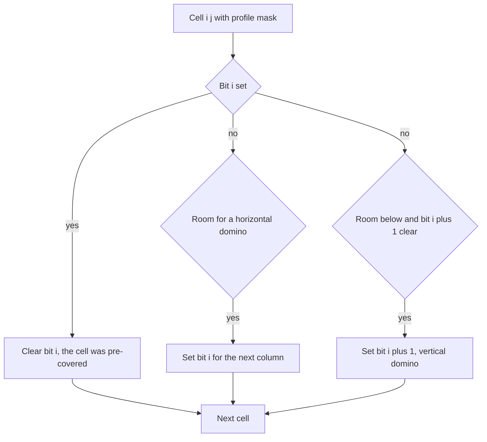

## The hook

A tiler lays 1 × 2 dominoes over a long floor 10 tiles wide and 1,000 tiles long. In how many different ways can the floor be covered completely? The number is astronomically large and the ways are impossible to list. But the tiler works in strips, and at any moment only one thing matters about the work so far: which squares of the next strip are already covered by dominoes sticking out.

That jagged edge is small: 10 squares, so 2¹⁰ = 1,024 possibilities. Broken-profile DP carries the count of ways for each possible edge across the floor, one square at a time.

## The intuition

:::analogy
Look at the boundary between the tiled part of the floor and the untiled part. Behind it, everything is covered. Just past it, some squares are already covered by dominoes that stick out across the boundary, and the rest are bare. That pattern of covered and bare squares along the edge is all the tiler needs to continue: how the area behind was tiled does not matter. So keep, for every possible edge pattern, the number of ways to have tiled everything behind it, and advance the boundary one square at a time.
:::

The edge pattern is the [[profile]], an n-bit mask for a board with n rows. Moving the boundary one cell at a time, in [[column-major order]], makes the boundary a staircase, a [[broken profile]]: rows above the current cell already describe the next column, rows from the current cell down still describe the current column.

## How it works

### The state

dp[mask] = the number of ways to cover every cell before the current one, such that the cells past the boundary marked in mask are already covered by dominoes sticking out. Start with dp[0] = 1 before the first cell; the answer is dp[0] after the last cell.

### The cell transition

At cell (i, j), for each mask with count c, apply one [[cell transition]]:

- **bit i is set:** the cell is already covered. Clear bit i, since nothing sticks into cell (i, j + 1) from here, and keep count c.
- **bit i is clear,** the cell is bare, so cover it:
  - with a horizontal domino, if j + 1 < m: set bit i, which now means "cell (i, j + 1) is covered";
  - with a vertical domino, if i + 1 < n and bit i + 1 is clear: set bit i + 1, meaning "cell (i + 1, j) is covered"; bit i stays clear, since nothing sticks into the next column from row i.

After the last row of a column, the mask describes the next column entirely, and the next column begins.

### Cost

n × m cells, 2ⁿ masks, at most two transitions each: O(n × m × 2ⁿ). For CSES *Counting Tilings*, n ≤ 10 and m ≤ 1,000, that is about 10⁷ updates. Keep two arrays of size 2ⁿ, the current and the next, and reduce modulo 10⁹ + 7.

### Column-at-a-time profiles

The alternative processes a whole column per step: for each mask of the current column, a recursive search generates every next-column mask, and the DP counts transitions. It has the same states but more complex transitions; cell-by-cell is shorter to write and easier to get right. The same column-profile idea solves colouring problems such as *Painting a Grid With Three Different Colors*, where the profile is the colouring of the previous column.

| Board | Profile bits | States | Work |
|---|---|---|---|
| 2 × m dominoes | 2 | 4 | O(m), equivalent to Fibonacci |
| 10 × 1,000 dominoes | 10 | 1,024 | about 10⁷ |
| 5 × m colourings with 3 colours | one colour per row | up to 3⁵ = 243 valid columns | O(m × states²) |



:::insight
Only the boundary between tiled and untiled cells affects how the rest can be tiled. Advancing that boundary one cell at a time keeps it as an n-bit mask, so a problem over an exponential number of tilings becomes a DP over 2ⁿ boundary shapes per cell.
:::

## Walk through an example

### A 2 × 3 board

Masks are written with row 0 first.

| After column | Profiles and their counts |
|---|---|
| 0 | 00: 1 (a vertical domino), 11: 1 (two horizontals sticking out) |
| 1 | 00: 2, 11: 1 |
| 2 | 00: 3 |

The answer is dp[00] = 3: three verticals; one vertical then two horizontals; two horizontals then one vertical. The counts for 2 × m boards are 1, 2, 3, 5, 8, 13: Fibonacci numbers, as the two-row case should give.

### A 3 × 4 board

| After column | Profiles (row 0 first) |
|---|---|
| 0 | 100: 1, 001: 1, 111: 1 |
| 1 | 000: 3, 110: 1, 011: 1 |
| 2 | 100: 4, 001: 4, 111: 3 |
| 3 | 000: 11 |

The answer is 11. After column 0, profile 100 means row 0 used a horizontal domino sticking into column 1 and rows 1 and 2 used a vertical one; 111 means three horizontals. A 3 × 3 board has no tilings at all, since 9 squares cannot be covered by dominoes, and the DP correctly ends with 0.

### Larger boards

The same code gives 36 tilings for 4 × 4 and 781 for 4 × 7, and for the CSES maximum of 10 × 1,000 it runs in a fraction of a second.

:::try-this
Why does the DP never place a horizontal domino in the last column, and what happens to the count if you allow it by mistake? (A horizontal domino at column m - 1 would cover a cell in column m, outside the board. If allowed, it leaves a set bit after the last column, so those ways end in a non-zero mask; reading only dp[0] still gives the right answer, but the wasted states cost time. The j + 1 < m check removes them early.)
:::

:::warning
Common misconception: "The profile should record which cells of the current column are covered." With cell-by-cell processing, that view breaks halfway down a column: rows already processed have moved on to describe the next column. Mixing the two meanings, or forgetting that a vertical domino marks the cell below in the current column, is the usual source of wrong counts. Check the 2 × m case against Fibonacci and 3 × 4 against 11.
:::

## The code

```pseudo
dp = {0: 1}
for j in 0 .. m-1:
    for i in 0 .. n-1:
        nd = all zeros
        for mask, c in dp:
            if mask has bit i: nd[mask without bit i] += c
            else:
                if j + 1 < m: nd[mask with bit i] += c                       # horizontal
                if i + 1 < n and mask lacks bit i+1: nd[mask with bit i+1] += c   # vertical
        dp = nd
return dp[0]
```

```cpp
#include <bits/stdc++.h>
using namespace std;
using ll = long long;
const ll MOD = 1000000007;

ll countTilings(int n, int m) {
    int S = 1 << n;
    vector<ll> dp(S, 0), nd(S);
    dp[0] = 1;
    for (int j = 0; j < m; j++)
        for (int i = 0; i < n; i++) {
            fill(nd.begin(), nd.end(), 0);
            for (int mask = 0; mask < S; mask++) {
                ll c = dp[mask];
                if (!c) continue;
                if (mask >> i & 1) {                               // pre-covered: move on
                    ll& t = nd[mask & ~(1 << i)];
                    t = (t + c) % MOD;
                    continue;
                }
                if (j + 1 < m) { ll& t = nd[mask | (1 << i)]; t = (t + c) % MOD; }            // horizontal
                if (i + 1 < n && !(mask >> (i + 1) & 1)) { ll& t = nd[mask | (1 << (i + 1))]; t = (t + c) % MOD; }   // vertical
            }
            swap(dp, nd);
        }
    return dp[0];
}

int main() {
    for (int m = 1; m <= 6; m++) cout << countTilings(2, m) << ' ';
    cout << '\n';                                                   // 1 2 3 5 8 13
    cout << countTilings(3, 4) << ' ' << countTilings(3, 3) << ' ' << countTilings(4, 4) << ' '
         << countTilings(4, 7) << '\n';                             // 11 0 36 781
    cout << countTilings(10, 1000) << '\n';                         // 789797918
}
```

The last line is the largest CSES case; it runs in well under a second because each of the 10,000 cells processes only 1,024 masks.

## Complexity

- **Time: O(n × m × 2ⁿ),** about 10⁷ updates for n = 10, m = 1,000.
- **Space: O(2ⁿ),** two arrays swapped after each cell.
- **Orientation:** if the board is wider than it is tall, transpose it so n is the smaller side.

## Common mistakes

- **Letting the profile run over the larger dimension,** giving 2^1000 states; always use the shorter side for n.
- **Forgetting the j + 1 < m check,** which lets horizontal dominoes stick off the board.
- **Placing a vertical domino onto a pre-covered cell below,** by not checking bit i + 1.
- **Not clearing bit i** when skipping a pre-covered cell, which carries stale coverage into the next column.
- **Forgetting the modulus** on large boards.

## Practice problems

CSES *Counting Tilings* is the broken-profile DP exactly as written here. *Domino and Tromino Tiling* is a 2 × n board with two tile shapes, small enough for a linear recurrence, but good for checking profile thinking. *Painting a Grid With Three Different Colors* uses a column profile of colours instead of coverage. The underlying mask techniques are in [Visited Cities as a Row of Switches](article:cp-bitmask-dp).

## Key takeaways

- Broken-profile DP tiles a grid one cell at a time and stores, as a bitmask, which cells just past the boundary are already covered.
- At each cell, a covered cell is skipped and its bit cleared, and an uncovered cell takes a horizontal domino into the next column or a vertical domino onto the cell below.
- The state has 2ⁿ masks for n rows, so the total work is O(n × m × 2ⁿ), with n the shorter side.
- The answer is the number of ways that end with an empty profile after the last cell.
- Checking 2 × m boards against Fibonacci numbers and 3 × 4 against 11 is a quick way to validate the transitions.
