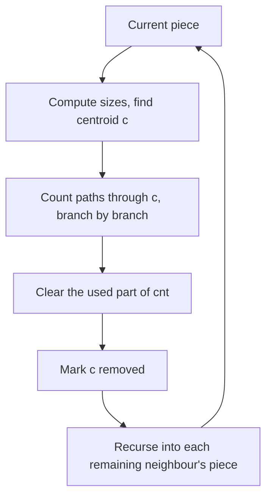
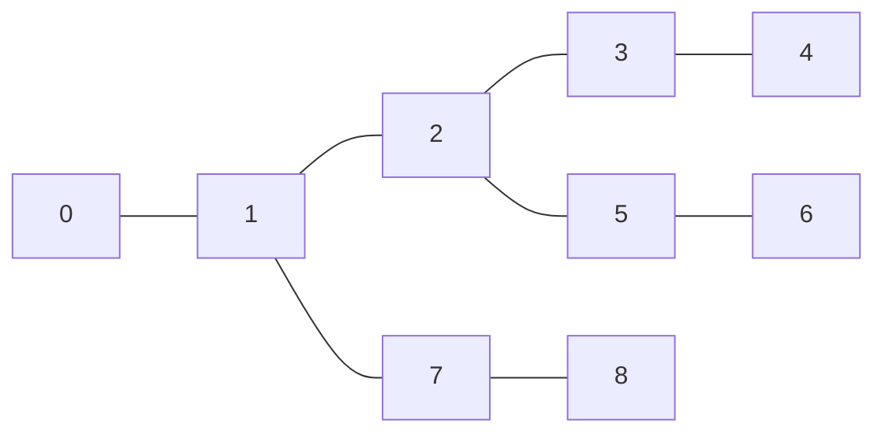

## The hook

How many pairs of vertices in a tree of 2·10⁵ vertices are exactly k edges apart? A BFS from every vertex is O(n²), 4·10¹⁰ steps. A tree DP that keeps, for each vertex, a count of descendants at each depth is quadratic on a long path.

Centroid decomposition is divide and conquer for trees. Pick a vertex that cuts the tree into pieces of at most half the size, count every path that passes through it, delete it, and recurse into the pieces. Because sizes halve, there are only about log₂ n rounds, and each round touches every vertex once.

## The intuition

:::analogy
A kingdom of towns joined by roads, with no loops, has to be governed. The king picks a capital so that, if the capital vanished, no surviving province would hold more than half the towns. The capital's officials handle every journey that passes through the capital. Then each province picks its own capital by the same rule and handles journeys through that one, and so on. Every journey is handled by exactly one capital: the first capital on its route to be chosen. And since provinces at least halve each time, no town sits under more than about log₂ n capitals.
:::

The capital is the [[centroid]], each province is a [[piece]], and the chain of capitals above each town forms the [[centroid tree]]. Journeys handled at a capital are [[path through a centroid]].

## How it works

### Finding a centroid

Root the current piece anywhere and compute subtree sizes. For a vertex v, removing it leaves its children's subtrees and the "upper part" of size total − sz[v]. v is a centroid when the largest of those is at most total / 2.

- **Existence:** start at the root and keep stepping into a child whose subtree has more than total / 2 vertices. The upper part grows each step, but it stays below total / 2 because the child you stepped into had more than half. The walk stops at a vertex with no oversized child: a centroid.
- **CSES *Finding a Centroid*** is exactly this check on the whole tree.

### The decomposition

```
decompose(piece):
    c = centroid of piece
    handle all paths through c
    mark c removed
    for each remaining neighbour v of c: decompose(piece containing v)
```

Every vertex is in one piece per level, so each level costs O(n) for sizes and counting, and there are at most about log₂ n + 1 levels: O(n log n) total.

The essential detail is the **removed flag**. Every walk inside a piece must refuse to step onto a removed vertex, or pieces leak into each other and both the size halving and the correctness collapse.

### Counting paths of length exactly k

Every path of the tree has a unique first-chosen centroid on it, and at that moment the whole path lies inside that centroid's piece. So it is enough to count, at each centroid c, the paths in its piece that pass through c.

A path through c is two downward legs in **different** branches of c, with lengths a and b and a + b = k; a leg of length 0 means the path ends at c. Use a [[depth count array]]:

1. set cnt[0] = 1, standing for c itself;
2. for each branch of c in turn: BFS to collect depths d of its vertices; for each d, add cnt[k − d] to the answer; then add the branch's depths into cnt;
3. clear cnt, but only up to the largest depth used.

Pairing a branch only with earlier branches counts each path once and never pairs two vertices of the same branch, whose real distance does not go through c.

Two details keep this fast and safe:

- **stop the BFS at depth k;** deeper vertices cannot be part of a k-edge path through c;
- **guard the index:** k − d must not exceed the largest depth stored so far, or the read goes beyond the array whenever k is larger than the piece.

For *Fixed-Length Paths II*, which asks for lengths between k₁ and k₂, replace the single lookup with a range sum over cnt, maintained with prefix sums or a Fenwick tree.

### The centroid tree for online queries

Codeforces *Xenia and Tree* paints vertices red and asks for the distance from v to the nearest red vertex. Every path from v to u passes through some common centroid-tree ancestor of v and u, so:

- for each centroid c, keep best[c], the distance from c to the nearest red vertex in c's piece;
- painting u red: for every centroid ancestor c of u, best[c] = min(best[c], dist(u, c));
- query v: the answer is the minimum over centroid ancestors c of best[c] + dist(v, c).

Each operation touches O(log n) ancestors, and dist comes from an LCA structure such as [Express Elevators That Skip 1, 2, 4 and 8 Floors](article:cp-binary-lifting), or from distances precomputed per level.

| Task | Work at each centroid | Total |
|---|---|---|
| count paths of length k | depth counts across branches | O(n log n) |
| count paths with length in a range | depth counts plus prefix sums | O(n log n) |
| nearest marked vertex, online | best value per centroid ancestor | O(log n) per operation, times the distance cost |
| count paths with sum at most W | sorted leg lengths plus two pointers | O(n log² n) |



:::insight
Centroid decomposition guarantees that every vertex takes part in only O(log n) rounds of work. Any question about all paths can therefore spend linear time per round and still finish in O(n log n), as long as each path is credited to the first centroid that splits it.
:::

## Walk through an example

Nine vertices with edges 0–1, 1–2, 2–3, 3–4, 2–5, 5–6, 1–7, 7–8. Count paths with exactly k = 3 edges.



**Finding the first centroid.** Rooted at 0, sz[1] = 8 and sz[2] = 5. Vertex 1 fails: removing it leaves the piece under 2, with 5 > 4.5 vertices. Vertex 2 works: removing it leaves {0, 1, 7, 8}, {3, 4} and {5, 6}, of sizes 4, 2 and 2, all at most 4.5.

**Counting through centroid 2.** Branches in adjacency order: via 1, via 3, via 5. cnt starts as [1, 0, 0, 0].

| Branch | Depths found | Lookups cnt[3 − d] | Paths added | cnt afterwards |
|---|---|---|---|---|
| via 1 | 1: 1; 0, 7: 2; 8: 3 | d = 3 finds cnt[0] = 1 | 1 (8–7–1–2) | [1, 1, 2, 1] |
| via 3 | 3: 1; 4: 2 | d = 1 finds 2; d = 2 finds 1 | 3 | [1, 2, 3, 1] |
| via 5 | 5: 1; 6: 2 | d = 1 finds 3; d = 2 finds 2 | 5 | [1, 3, 4, 1] |

Through centroid 2: 1 + 3 + 5 = 9 paths. For instance the branch via 5 finds 5–2–1–0, 5–2–1–7, 5–2–3–4, 6–5–2–1 and 6–5–2–3.

**The pieces.** {0, 1, 7, 8} has centroid 1 and contains one more 3-edge path, 0–1–7–8. {3, 4} and {5, 6} have none. Total 10, which matches a BFS from every vertex.

The centroid tree has 2 at the top; 1, 3 and 5 below it; 0 and 7 below 1; 8 below 7; 4 below 3; 6 below 5. Its depth is 3, against log₂ 9 ≈ 3.2.

| k | 1 | 2 | 3 | 4 | 5 |
|---|---|---|---|---|---|
| paths with exactly k edges | 8 | 9 | 10 | 7 | 2 |

With k = 1 the count is the number of edges, 8, as it must be.

:::try-this
Why is the path 4–3–2–1 counted at centroid 2 and not again inside the piece {3, 4}? (Once 2 is removed, the piece {3, 4} no longer contains 2 or 1, so no walk inside it can reach them. Each path is counted only at the first centroid on it to be chosen, which for 4–3–2–1 is 2.)
:::

:::warning
Common misconception: "Pick any vertex, such as the root of each piece, and the recursion is still fine." On a path of n vertices, always splitting at an end leaves a piece of n − 1, giving n levels and O(n²) work. The halving property is the whole point; on a path of 10⁵ vertices the real centroids give 17 levels.
:::

## The code

```pseudo
build(root, level):
    c = centroid of root's piece        (sizes by BFS, skipping removed vertices)
    removed[c] = true; countThrough(c)
    for each neighbour v of c not removed: build(v, level + 1)
countThrough(c):
    cnt[0] = 1; maxd = 0
    for each branch s of c not removed:
        collect (vertex, depth) by BFS from s, depth starting at 1, stopping at depth k
        for each depth d: if k - d <= maxd: paths += cnt[k - d]
        for each depth d: cnt[d] += 1; maxd = max(maxd, d)
    clear cnt[0 .. maxd]
```

```cpp
#include <bits/stdc++.h>
using namespace std;

struct Centroid {
    int n, k;
    const vector<vector<int>>& adj;
    vector<bool> removed;
    vector<int> sz, par, cparent, clevel;                        // centroid-tree parent and level
    vector<long long> cnt;                                       // cnt[d] = vertices at depth d seen so far
    long long paths = 0;                                         // paths with exactly k edges
    Centroid(const vector<vector<int>>& adj, int k)
        : n(adj.size()), k(k), adj(adj), removed(n, false), sz(n), par(n), cparent(n, -1), clevel(n, 0), cnt(n + 1, 0) {
        build(0, -1, 0);
    }
    vector<int> component(int root) {                            // BFS order of root's piece, with parents and sizes
        vector<int> order = {root};
        par[root] = -1;
        for (int i = 0; i < (int)order.size(); i++)
            for (int v : adj[order[i]])
                if (!removed[v] && v != par[order[i]]) par[v] = order[i], order.push_back(v);
        for (int i = order.size() - 1; i >= 0; i--) {
            sz[order[i]] = 1;
            for (int v : adj[order[i]]) if (!removed[v] && v != par[order[i]]) sz[order[i]] += sz[v];
        }
        return order;
    }
    int findCentroid(int root) {
        auto order = component(root);
        int total = order.size();
        for (int v : order) {                                    // largest piece left if v were removed
            int biggest = total - sz[v];
            for (int c : adj[v]) if (!removed[c] && c != par[v]) biggest = max(biggest, sz[c]);
            if (2 * biggest <= total) return v;
        }
        return root;                                             // not reached: a centroid always exists
    }
    void build(int root, int up, int level) {
        int c = findCentroid(root);
        removed[c] = true, cparent[c] = up, clevel[c] = level;
        countThrough(c);
        for (int v : adj[c]) if (!removed[v]) build(v, c, level + 1);
    }
    void countThrough(int c) {                                   // paths with exactly k edges through c
        int maxd = 0;
        cnt[0] = 1;
        for (int s : adj[c]) {
            if (removed[s]) continue;
            vector<pair<int, int>> q = {{s, 1}};                 // (vertex, depth) inside this branch
            vector<int> from = {c};
            for (int i = 0; i < (int)q.size(); i++) {
                auto [v, d] = q[i];
                if (d >= k) continue;                            // deeper vertices can never help
                for (int w : adj[v])
                    if (!removed[w] && w != from[i]) q.push_back({w, d + 1}), from.push_back(v);
            }
            for (auto [v, d] : q) if (k - d <= maxd) paths += cnt[k - d];   // pair with earlier branches only
            for (auto [v, d] : q) cnt[d]++, maxd = max(maxd, d);
        }
        fill(cnt.begin(), cnt.begin() + maxd + 1, 0);            // clear only what was used
    }
};

long long brute(const vector<vector<int>>& adj, int k) {         // BFS from every vertex
    int n = adj.size();
    long long total = 0;
    for (int s = 0; s < n; s++) {
        vector<int> dist(n, -1), q = {s};
        dist[s] = 0;
        for (int i = 0; i < (int)q.size(); i++)
            for (int v : adj[q[i]]) if (dist[v] < 0) dist[v] = dist[q[i]] + 1, q.push_back(v);
        for (int v = s + 1; v < n; v++) total += dist[v] == k;
    }
    return total;
}

int main() {
    int n = 9;
    vector<array<int, 2>> edges = {{0, 1}, {1, 2}, {2, 3}, {3, 4}, {2, 5}, {5, 6}, {1, 7}, {7, 8}};
    vector<vector<int>> adj(n);
    for (auto [a, b] : edges) adj[a].push_back(b), adj[b].push_back(a);
    for (int k = 1; k <= 5; k++) cout << Centroid(adj, k).paths << ' ';
    cout << '\n';                                                // 8 9 10 7 2
    Centroid C(adj, 3);
    for (int v = 0; v < n; v++) cout << C.cparent[v] << ' ';
    cout << '\n';                                                // 1 2 -1 2 3 2 5 1 7

    mt19937 rng(9);                                              // random trees against brute force
    bool ok = true;
    for (int t = 0; t < 300; t++) {
        int m = 1 + rng() % 50, k = 1 + rng() % 6;
        vector<vector<int>> g(m);
        for (int v = 1; v < m; v++) { int p = rng() % v; g[p].push_back(v), g[v].push_back(p); }
        ok = ok && Centroid(g, k).paths == brute(g, k);
    }
    vector<vector<int>> line(100000);                            // a path: the worst case for naive splitting
    for (int v = 1; v < 100000; v++) line[v - 1].push_back(v), line[v].push_back(v - 1);
    Centroid L(line, 7);
    int deepest = *max_element(L.clevel.begin(), L.clevel.end());
    cout << (ok ? "stress ok" : "stress FAILED") << ' ' << L.paths << ' ' << deepest << '\n';   // stress ok 99993 16
}
```

On the path of 10⁵ vertices the deepest centroid level is 16, so there are 17 levels, and the program finds the 10⁵ − 7 = 99,993 pairs seven apart. An earlier version of this code read `cnt[k − d]` without the `k − d ≤ maxd` guard; the random test caught it on trees smaller than k, where the index runs past the array.

## Complexity

- **Time: O(n log n).** About log₂ n + 1 levels, and at each level the pieces are disjoint, so sizes, centroid search and counting are O(n) per level.
- **Space: O(n)** for the arrays and BFS queues; the recursion is only O(log n) deep.
- **Centroid tree queries:** O(log n) ancestors per operation, each needing a distance.

## Common mistakes

- **Not marking removed centroids,** so walks leak into other pieces.
- **Splitting at an arbitrary vertex** instead of a true centroid, which can give n levels.
- **Recomputing sizes from the original root** instead of within the current piece.
- **Clearing the whole cnt array** at every centroid, which is O(n²).
- **Pairing vertices from the same branch,** which uses a distance through c that does not exist.
- **Reading cnt[k − d] beyond the used range** when k is larger than the piece.
- **Forgetting the paths that end at the centroid;** cnt[0] = 1 covers them.

## Practice problems

*Finding a Centroid* checks the size test on its own. *Fixed-Length Paths I* is the exact-length count above, at n = 2·10⁵. *Fixed-Length Paths II* replaces the lookup with a range sum. *Xenia and Tree* uses the centroid tree with a best distance per centroid. The recursion habits behind subtree sizes are in [Managers Summarising Their Teams' Reports](article:dsa-tree-recursion), and the rerooting alternative for some all-pairs questions is in [Every Town Imagining Itself as the Capital](article:cp-dp-on-trees-advanced).

## Key takeaways

- A centroid is a vertex whose removal leaves pieces of at most half the size, and walking towards any oversized subtree always finds one.
- Removing centroids recursively gives at most about log₂ n + 1 levels, so linear work per level costs O(n log n) in total.
- Every path is handled at the first centroid on it, as two legs from different branches, so counting branch by branch against earlier branches counts each path once.
- The depth count array must be cleared only up to the depths actually used, and lookups must stay within that range.
- The centroid tree answers online queries such as the nearest marked vertex by checking only the O(log n) centroid ancestors of a vertex.
