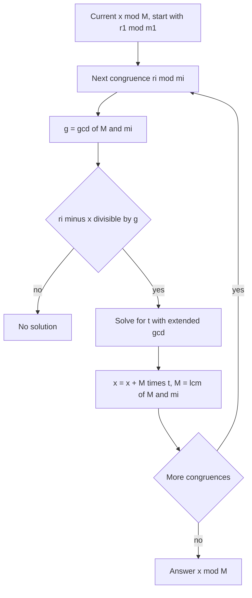

## The hook

There is a number. Divided by 3 it leaves 2, divided by 5 it leaves 3, divided by 7 it leaves 2. What is it? This puzzle comes from an ancient Chinese mathematical text, the *Sunzi Suanjing*, and its answer, 23, can be found by a method that still powers contest solutions and real systems today.

In contests, the Chinese remainder theorem appears whenever information arrives "modulo several numbers": cyclic events that must line up, answers computed modulo small primes and then combined, or constraints like "x leaves remainder r when divided by m" stacked together. It is also how RSA implementations speed up decryption.

## The intuition

:::analogy
Imagine three clocks with different cycle lengths: one has 3 positions, one has 5, one has 7. Every second, all three tick forward together. Right now they show 2, 3 and 2. How many seconds since they all showed 0? Because 3, 5 and 7 share no factors, the combined pattern of the three dials does not repeat until 3 × 5 × 7 = 105 seconds have passed. So each combination of readings happens exactly once in every 105 seconds, and the readings pin down the time.
:::

Each clock reading is a [[congruence]]: x ≡ 2 (mod 3), x ≡ 3 (mod 5), x ≡ 2 (mod 7). The [[Chinese remainder theorem (CRT)]] says that when the moduli are [[pairwise coprime]], exactly one x in [0, 105) satisfies all three.

## How it works

### Combining two congruences

The workhorse is merging two congruences into one, then repeating:

x ≡ r₁ (mod m₁) and x ≡ r₂ (mod m₂).

From the first, x = r₁ + m₁·t for some integer t. Substituting into the second:

$$m_1 t \equiv r_2 - r_1 \pmod{m_2}$$

- Let g = gcd(m₁, m₂). If (r₂ − r₁) is not divisible by g, there is **no solution**.
- Otherwise, divide through by g and solve for t using the inverse of m₁/g modulo m₂/g, which the [[extended Euclidean algorithm]] gives.
- The merged congruence is x ≡ r₁ + m₁·t (mod [[LCM]](m₁, m₂)).

When m₁ and m₂ are coprime, g = 1, the solution always exists, and the new modulus is m₁·m₂.



### The constructive formula (coprime moduli)

For pairwise coprime moduli with product M, let Mᵢ = M / mᵢ and yᵢ the inverse of Mᵢ modulo mᵢ. Then

$$x \equiv \sum_i r_i \, M_i \, y_i \pmod M$$

Each term is ≡ rᵢ modulo its own mᵢ (because Mᵢ·yᵢ ≡ 1 there) and ≡ 0 modulo every other mⱼ (because Mᵢ contains mⱼ as a factor). The terms do not interfere, so the sum satisfies every congruence at once.

:::insight
For coprime moduli, the residues modulo each mᵢ are independent coordinates of a number modulo M. CRT is the conversion between "one number mod M" and "a tuple of remainders", and the formula builds one basis element per coordinate that is 1 there and 0 everywhere else.
:::

### Where it is used

- **Combining answers modulo small moduli**: compute a result modulo several small primes, then rebuild it modulo their product.
- **Lining up periodic events**: "event A happens every 4 days starting day 3, event B every 6 days starting day 5; when do they coincide?" is exactly two congruences, solved with the general merge.
- **Problems with hidden structure**: Codeforces *GCD Table* reduces to finding a position satisfying many congruences with non-coprime moduli.

## Walk through an example

**The ancient puzzle:** x ≡ 2 (mod 3), x ≡ 3 (mod 5), x ≡ 2 (mod 7). M = 105.

| i | mᵢ | rᵢ | Mᵢ = 105/mᵢ | Mᵢ mod mᵢ | yᵢ (inverse) | rᵢ·Mᵢ·yᵢ |
|---|---|---|---|---|---|---|
| 1 | 3 | 2 | 35 | 2 | 2 | 140 |
| 2 | 5 | 3 | 21 | 1 | 1 | 63 |
| 3 | 7 | 2 | 15 | 1 | 1 | 30 |

Sum: 140 + 63 + 30 = 233, and 233 mod 105 = **23**. Check: 23 = 7·3 + 2 = 4·5 + 3 = 3·7 + 2. ✓

**Merging step by step instead:** x ≡ 2 (mod 3) and x ≡ 3 (mod 5) merge to x ≡ 8 (mod 15). Merging with x ≡ 2 (mod 7) gives x ≡ 23 (mod 105), the same answer.

**Non-coprime moduli:** x ≡ 3 (mod 4), x ≡ 5 (mod 6). gcd = 2 and 5 − 3 = 2 is divisible by 2, so a solution exists modulo lcm = 12: x ≡ **11** (mod 12). But x ≡ 3 (mod 4), x ≡ 4 (mod 6) has **no solution**: 4 − 3 = 1 is not divisible by 2.

:::try-this
Solve x ≡ 1 (mod 4) and x ≡ 2 (mod 9). (Coprime, M = 36. Numbers ≡ 2 mod 9: 2, 11, 20, 29. Which is ≡ 1 mod 4? 29 = 7·4 + 1. So x ≡ 29 (mod 36).)
:::

## The code

```pseudo
ext_gcd(a, b):                      // returns g, p, q with a*p + b*q = g
    if b == 0: return a, 1, 0
    g, p, q = ext_gcd(b, a mod b)
    return g, q, p - (a / b) * q

merge(r1, m1, r2, m2):
    g, p, _ = ext_gcd(m1, m2)
    if (r2 - r1) mod g != 0: return NONE
    t = ((r2 - r1) / g * p) mod (m2 / g)     // m1 * t ≡ r2 - r1 (mod m2)
    l = m1 / g * m2
    return (r1 + m1 * t) mod l, l
```

```cpp
#include <bits/stdc++.h>
using namespace std;
using ll = long long;

ll extGcd(ll a, ll b, ll& p, ll& q) {
    if (b == 0) { p = 1; q = 0; return a; }
    ll p1, q1, g = extGcd(b, a % b, p1, q1);
    p = q1; q = p1 - (a / b) * q1;
    return g;
}

// Merge x = r1 (mod m1) with x = r2 (mod m2). Returns false if no solution.
bool mergeCRT(ll& r1, ll& m1, ll r2, ll m2) {
    ll p, q, g = extGcd(m1, m2, p, q);
    if ((r2 - r1) % g != 0) return false;
    ll mod = m2 / g;
    ll t = (__int128)((r2 - r1) / g % mod + mod) % mod * ((p % mod + mod) % mod) % mod;
    ll l = m1 / g * m2;
    r1 = (ll)(((__int128)m1 * t + r1) % l + l) % l;
    m1 = l;
    return true;
}

int main() {
    ll r = 2, m = 3;
    mergeCRT(r, m, 3, 5);
    mergeCRT(r, m, 2, 7);
    cout << r << " mod " << m << '\n';                    // 23 mod 105
    ll r2 = 3, m2 = 4;
    cout << (mergeCRT(r2, m2, 4, 6) ? "ok" : "none") << '\n';  // none
}
```

## Complexity

- **Time:** each merge runs one extended GCD, O(log M), so k congruences cost O(k log M).
- **Space:** O(1).
- **Overflow:** the combined modulus can approach 10¹⁸ even when each mᵢ is small, so intermediate products need 128-bit arithmetic, as in the code.

## Common mistakes

:::warning
Common misconception: "CRT always gives a solution modulo the product of the moduli." That only holds for pairwise coprime moduli. In general a solution exists only if every pair of remainders agrees modulo the gcd of their moduli, and the result is modulo the LCM, not the product.
:::

- **Overflow** in m₁·t when the merged modulus is large: use `__int128` or careful modular multiplication.
- **Negative remainders** from C++ `%`: normalise with `((x % m) + m) % m`.
- **Using the product formula with non-coprime moduli**, which silently gives wrong answers; use the general merge.
- **Forgetting the "no solution" case** that the problem may expect you to report.

## Practice problems

*Chinese Remainder* (Kattis) is the coprime two-congruence case with large numbers. *General Chinese Remainder* removes the coprime guarantee. *Remainders Game* asks whether a set of known remainders determines x mod k, which comes down to whether k divides the LCM of the moduli. *GCD Table* is a hard problem where CRT with non-coprime moduli is the central step. The inverses come from [Finding the Undo Button on a Clock](article:cp-modular-inverse).

## Key takeaways

- The Chinese remainder theorem says congruences with pairwise coprime moduli have exactly one solution modulo the product of the moduli.
- Merging two congruences means writing x = r1 + m1·t and solving m1·t ≡ r2 − r1 modulo m2 with the extended Euclidean algorithm.
- For non-coprime moduli, a solution exists only if the remainders agree modulo the gcd, and the merged modulus is the LCM.
- The constructive formula sums one term per congruence, each equal to its remainder there and zero modulo every other modulus.
- Merged moduli grow quickly, so use 128-bit intermediates and normalise negative remainders.
