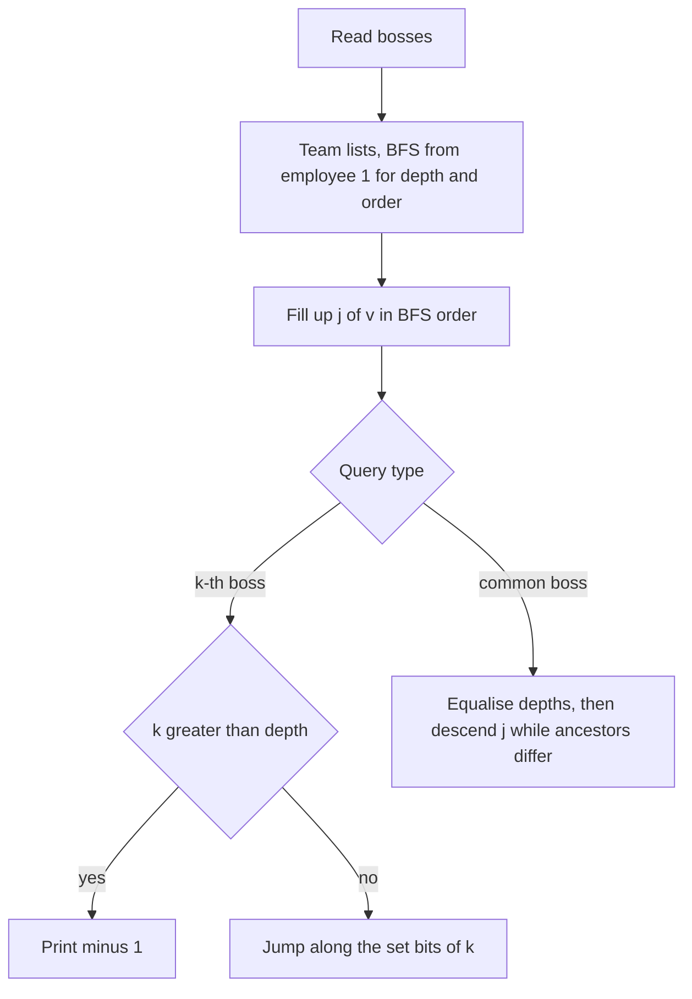
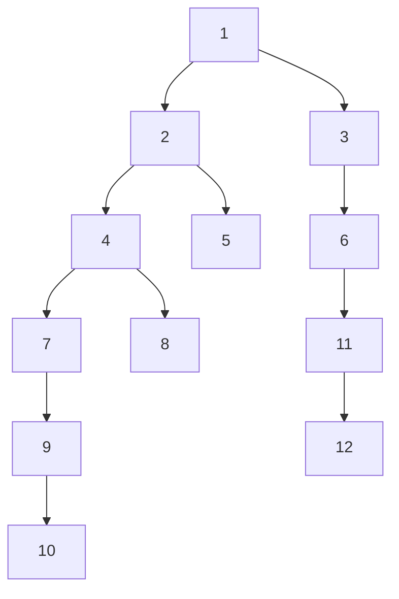

## The hook

A company has a general director, and every other employee has exactly one direct boss. Two kinds of questions arrive by the hundred thousand: "who is employee x's boss k levels up?" and "who is the lowest boss that both a and b report to?". In a deep company, walking up boss by boss is far too slow.

These are CSES *Company Queries I* and *II*, the standard test of binary lifting, introduced in [Express Elevators That Skip 1, 2, 4 and 8 Floors](article:cp-binary-lifting). This walkthrough goes from input to accepted code, with the out-of-range case handled carefully and a second, offline method to check against.

## The problem

There are n employees numbered 1 to n, with employee 1 the general director, and for each employee 2 to n their direct boss. Both n and the number of queries q go up to 2·10⁵.

- **Company Queries I:** for each query (x, k), print the employee k levels above x, or −1 if there is no such employee.
- **Company Queries II:** for each query (a, b), print the lowest employee who is a boss of both, counting each employee as their own boss for this purpose, so the answer may be a or b.

For the twelve-employee company with bosses 2:1, 3:1, 4:2, 5:2, 6:3, 7:4, 8:4, 9:7, 10:9, 11:6, 12:11, the queries (10, 3) and (10, 6) give 4 and −1, and the queries (10, 8) and (12, 5) give 4 and 1.

## The obvious approach

Follow boss pointers one at a time. A k-th boss query costs k steps, and a lowest common boss query costs up to the depth of the two employees. In a company that is one long chain, depth is about 2·10⁵, so 2·10⁵ queries cost about 4·10¹⁰ steps. Too slow by a factor of thousands.

Storing every employee's whole chain of command would make each query O(1) but costs O(n²) memory on a chain.

## The key insight

:::analogy
Every floor of the corporate tower has express elevators that rise 1, 2, 4, 8 and more levels of management. Installing them is cheap: the 8-level elevator from your floor is the 4-level elevator taken twice. To go up 13 levels, ride the 8, the 4 and the 1. To find where two employees' chains of command meet, first bring the lower one up to the same level, then ride the biggest elevators that keep them on different floors; when no elevator keeps them apart, they are one floor below the meeting point.
:::

The elevator bank is the [[jump table]], and each employee's [[chain of command]] is what the elevators skip along.

### Company Queries I

- If k > depth[x], the answer is −1. This is the [[out-of-range jump]], checked before touching the table.
- Otherwise, for each set bit j of k, move x to up[j][x].

### Company Queries II

The [[lowest common boss]] is the LCA:

1. lift the deeper employee by the depth difference, using the k-th boss routine;
2. if they now coincide, that employee is the answer;
3. otherwise, for j from high to low, jump both whenever up[j][a] ≠ up[j][b]; the answer is the direct boss of a.

### Building it from the input

The input lists bosses, not a rooted traversal. Build each boss's team list, BFS from the director to get depths and an order in which every boss comes before their team, then fill the table in that order. This works whatever order the boss numbers arrive in.

### A second method for Company Queries I

All queries are known in advance, so they can be answered offline. Run a DFS from the director and keep the current chain of command on a stack: push an employee on entry, pop on exit. When the DFS enters employee x, the stack holds exactly the director down to x, so the k-th boss is the entry k places below the top, or −1 if the stack is not that tall. This [[offline chain method]] is O(n + q) and makes a good cross-check for the lifting code.

| Method | Build | Per query | Online | Handles LCA |
|---|---|---|---|---|
| walk up | none | O(depth) | yes | yes, slowly |
| binary lifting | O(n log n) | O(log n) | yes | yes |
| offline chain stack | O(n + q) | O(1) | no | no |



:::insight
The two query types share one table. The only problem-specific care is the out-of-range case, and checking it against depth up front is simpler and safer than reasoning about what a sentinel does after a jump past the director.
:::

## Walk through an example

The twelve-employee company, as a tree:



Depths: employee 1 is 0; 2 and 3 are 1; 4, 5 and 6 are 2; 7, 8 and 11 are 3; 9 and 12 are 4; 10 is 5. With n = 12, LOG = 4. Jump table entries for employees 10 and 12:

| Level j, jump 2^j | up[j][10] | up[j][12] |
|---|---|---|
| 0, one level | 9 | 11 |
| 1, two levels | 7 | 6 |
| 2, four levels | 2 | 1 |
| 3, eight levels | 0 | 0 |

**Company Queries I.**

| Query (x, k) | depth[x] | Jumps | Answer |
|---|---|---|---|
| (10, 1) | 5 | level 0: 10 → 9 | 9 |
| (10, 3) | 5 | level 0: 10 → 9, level 1: 9 → 4 | 4 |
| (10, 5) | 5 | level 0: 10 → 9, level 2: 9 → 1 | 1 |
| (10, 6) | 5 | out of range | −1 |
| (12, 2) | 4 | level 1: 12 → 6 | 6 |
| (12, 4) | 4 | level 2: 12 → 1 | 1 |

**Company Queries II.**

| Query (a, b) | Equalise | Descent | Answer |
|---|---|---|---|
| (10, 8) | lift 10 by 2 to 7 | level 1: 2 and 2, skip; level 0: 4 and 4, skip | 4 |
| (10, 5) | lift 10 by 3 to 4 | level 1: 1 and 1, skip; level 0: 2 and 2, skip | 2 |
| (12, 5) | lift 12 by 2 to 6 | level 1: 1 and 1, skip; level 0: 3 and 2 differ, move to 3 and 2 | 1 |
| (9, 10) | lift 10 by 1 to 9 | equal at once | 9 |

**Offline check.** When the DFS enters employee 10, the stack is 1, 2, 4, 7, 9, 10. The 3rd boss is three places below the top: 4. The 6th would be six places below the top, but the stack only has five entries under 10, so −1. Both methods agree on every query.

:::try-this
Find the lowest common boss of 11 and 8 by hand. (Depths are both 3, so no lift is needed. At level 1, up[1][11] = 3 and up[1][8] = 2 differ, so move to 3 and 2. At level 0, their bosses are both 1, so skip. The answer is up[0][3] = 1.)
:::

:::warning
Common misconception: "If the jump goes past the director, the table returns 0, and 0 can be printed as −1 at the end, so no depth check is needed." It works only if every level maps 0 to 0 and the answer is tested for 0. Forget either detail and you print employee numbers from garbage entries. The explicit `k > depth[x]` check is one line and removes the question entirely.
:::

## The code

```pseudo
read bosses; team lists; BFS from 1 gives depth and an order with bosses first
LOG = smallest with 2^LOG > n; for v in order: up[0][v] = boss[v]; up[j][v] = up[j-1][up[j-1][v]]
kthBoss(x, k): if k > depth[x]: return -1; for set bits j of k: x = up[j][x]; return x
commonBoss(a, b): lift deeper by the depth difference; if equal return
                  for j = LOG-1 down to 0: if up[j][a] != up[j][b]: a, b = up[j][a], up[j][b]
                  return up[0][a]
```

```cpp
#include <bits/stdc++.h>
using namespace std;

struct Company {                                                 // employees 1..n, boss[1] = 0 (the director)
    int n, LOG = 1;
    vector<vector<int>> up;                                      // up[j][v] = boss 2^j levels above v, 0 = nobody
    vector<int> depth;
    Company(int n, const vector<int>& boss) : n(n), depth(n + 1, 0) {
        while ((1 << LOG) <= n) LOG++;                           // jumps up to n fit: 2^LOG > n
        up.assign(LOG, vector<int>(n + 1, 0));
        vector<vector<int>> team(n + 1);
        for (int v = 2; v <= n; v++) team[boss[v]].push_back(v);
        vector<int> order = {1};                                 // BFS: every boss before their team
        for (int i = 0; i < (int)order.size(); i++)
            for (int c : team[order[i]]) depth[c] = depth[order[i]] + 1, order.push_back(c);
        for (int v : order) {
            up[0][v] = boss[v];
            for (int j = 1; j < LOG; j++) up[j][v] = up[j - 1][up[j - 1][v]];
        }
    }
    int kthBoss(int v, int k) const {                            // Company Queries I
        if (k > depth[v]) return -1;                             // out of range: answer before jumping
        for (int j = 0; j < LOG; j++) if (k >> j & 1) v = up[j][v];
        return v;
    }
    int commonBoss(int a, int b) const {                         // Company Queries II
        if (depth[a] < depth[b]) swap(a, b);
        a = kthBoss(a, depth[a] - depth[b]);
        if (a == b) return a;
        for (int j = LOG - 1; j >= 0; j--)
            if (up[j][a] != up[j][b]) a = up[j][a], b = up[j][b];
        return up[0][a];
    }
};

vector<int> offlineKth(int n, const vector<int>& boss, const vector<pair<int, int>>& qs) {   // chain-stack method
    vector<vector<int>> team(n + 1);
    for (int v = 2; v <= n; v++) team[boss[v]].push_back(v);
    vector<vector<pair<int, int>>> at(n + 1);                    // queries grouped by employee: (k, index)
    for (int i = 0; i < (int)qs.size(); i++) at[qs[i].first].push_back({qs[i].second, i});
    vector<int> ans(qs.size()), chain = {1}, it(n + 1, 0), st = {1};
    auto answer = [&](int v) {
        for (auto [k, i] : at[v]) ans[i] = k < (int)chain.size() ? chain[chain.size() - 1 - k] : -1;
    };
    answer(1);
    while (!st.empty()) {
        int u = st.back();
        if (it[u] < (int)team[u].size()) {
            int c = team[u][it[u]++];
            st.push_back(c), chain.push_back(c);                 // chain = director down to c
            answer(c);
        } else {
            st.pop_back(), chain.pop_back();
        }
    }
    return ans;
}

int main() {
    vector<int> boss = {0, 0, 1, 1, 2, 2, 3, 4, 4, 7, 9, 6, 11};   // boss[v] for v = 1..12
    Company c(12, boss);
    vector<pair<int, int>> q1 = {{10, 1}, {10, 3}, {10, 5}, {10, 6}, {12, 2}, {12, 4}};
    for (auto [x, k] : q1) cout << c.kthBoss(x, k) << ' ';
    cout << '\n';                                                // 9 4 1 -1 6 1
    for (int x : offlineKth(12, boss, q1)) cout << x << ' ';
    cout << '\n';                                                // 9 4 1 -1 6 1
    cout << c.commonBoss(10, 8) << ' ' << c.commonBoss(10, 5) << ' ' << c.commonBoss(12, 5) << ' '
         << c.commonBoss(9, 10) << ' ' << c.commonBoss(11, 8) << '\n';                  // 4 2 1 9 1

    mt19937 rng(15);                                             // random companies against walking up
    bool ok = true;
    for (int t = 0; t < 200; t++) {
        int n = 1 + rng() % 50;
        vector<int> perm(n + 1), b(n + 1, 0), p(n + 1, 0);
        iota(perm.begin(), perm.end(), 0);
        shuffle(perm.begin() + 2, perm.end(), rng);              // bosses need not have smaller numbers
        for (int v = 2; v <= n; v++) p[v] = 1 + rng() % (v - 1);
        for (int v = 2; v <= n; v++) b[perm[v]] = perm[p[v]];
        Company C(n, b);
        vector<pair<int, int>> qs;
        for (int i = 0; i < 30; i++) qs.push_back({1 + (int)(rng() % n), (int)(rng() % (n + 1))});
        auto off = offlineKth(n, b, qs);
        for (int i = 0; i < 30; i++) {
            auto [x, k] = qs[i];
            int w = x;
            for (int s = 0; s < k && w; s++) w = b[w];
            int expect = w ? w : -1;
            ok = ok && C.kthBoss(x, k) == expect && off[i] == expect;
            int y = 1 + rng() % n;
            set<int> anc;
            for (int z = x; z; z = b[z]) anc.insert(z);
            int z = y;
            while (!anc.count(z)) z = b[z];
            ok = ok && C.commonBoss(x, y) == z;
        }
    }
    cout << (ok ? "stress ok" : "stress FAILED") << '\n';        // stress ok
}
```

For the CSES input, read n and q, set `boss[1] = 0`, read the bosses of employees 2 to n, then answer each query with `kthBoss` or `commonBoss`. Use fast input, since both files have 2·10⁵ lines of queries.

## Complexity

- **Build: O(n log n)** time and memory, about 18 levels for n = 2·10⁵.
- **Each query: O(log n).**
- **Offline chain method: O(n + q)** for Company Queries I, as a check or as an alternative.

## Common mistakes

- **No out-of-range check,** printing whatever the table holds after jumping past the director.
- **LOG sized from a guess** such as 17, which drops bit 17 of k when k reaches 2·10⁵.
- **Filling the table in input order** when a boss may appear after their team member; fill in BFS order.
- **Off-by-one in the chain method:** the k-th boss is at index size − 1 − k, and k = 0 is the employee themselves.
- **Forgetting that a can be b's boss** in Company Queries II; the equal-after-lift check handles it.
- **Recursive DFS** for the offline method on a chain of 2·10⁵ employees.

## Practice problems

*Company Queries I* and *II* are this walkthrough. *Distance Queries* adds depths: depth[a] + depth[b] − 2·depth[lca]. *Kth Ancestor of a Tree Node* is Company Queries I as a class with online queries, where the binary lifting version is the natural fit. The method itself, including functional graphs, is in [Express Elevators That Skip 1, 2, 4 and 8 Floors](article:cp-binary-lifting).

## Key takeaways

- Walking up one boss at a time costs up to the depth per query, which is far too slow for a deep company and 2·10⁵ queries.
- A jump table of bosses 1, 2, 4, 8 and more levels up answers the k-th boss with one jump per set bit of k.
- Checking k against the employee's depth first gives −1 for out-of-range requests without trusting what the table holds past the director.
- The lowest common boss equalises depths and then jumps both employees while their bosses differ, finishing one level above.
- When all queries are known, a DFS that keeps the current chain of command on a stack answers every k-th boss query in constant time.
