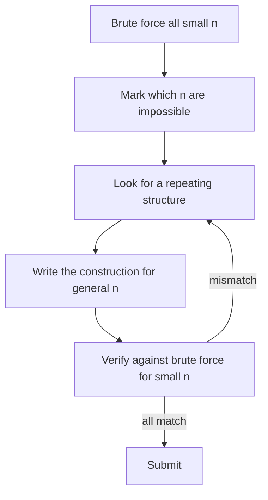

## The hook

"Print a permutation of 1 to n where no two neighbours differ by exactly 1, or say NO SOLUTION." There are n! permutations; for n = 10⁶ you cannot search them. And there is no formula to look up. You have to invent an arrangement.

Problems like this make up a big share of Codeforces rounds between 1000 and 1700. They feel like puzzles, and they reward a specific habit: look at small cases until the structure shows itself, then write that structure down.

## The intuition

:::analogy
Building a Lego model without instructions is hard if you stare at the whole picture on the box. It is easy if you notice that the model is really one small module repeated: a window, a window, a window, then a door. Once you see the repeating module, you build it again and again without thinking.
:::

A [[constructive problem]] asks you to output an object with some property. The trick is almost never cleverness at full size. It is finding the repeating module in small sizes, then repeating it.

## How it works

A reliable routine:

1. **Make a [[small-case table]].** Solve n = 1 to 6 by hand, or better, write a tiny brute force that prints every valid answer for n up to 8.
2. **Find the impossible cases.** Often a few small n have no answer, and every larger n does.
3. **Look for structure.** Evens then odds? Alternating high and low? Reverse halves? Pairs that cancel?
4. **Prefer simple, regular constructions.** "Print any valid answer" means a [[checker]] verifies your output, so you can choose the easiest pattern, not the "nicest" answer.
5. **Prove it or test it.** Argue why the pattern works for every n, or check it against the brute force for all small n.

Sometimes the structure is a [[reduction]]: the answer for n is the answer for n − 2 plus two new elements placed at the ends. Then induction does the proof for you.



:::insight
For constructive problems, five minutes of small cases is worth more than thirty minutes of thinking at full size. Patterns that are invisible in the statement become obvious in a table of answers for n = 1 to 8.
:::

## Walk through an example

**Permutations** (CSES): no two adjacent numbers may differ by exactly 1.

Small-case table, by brute force or by hand:

| n | Valid answer? | Example |
|---|---|---|
| 1 | yes | 1 |
| 2 | no | 1 2 and 2 1 both fail |
| 3 | no | every arrangement has a 1-2 or 2-3 pair next to each other |
| 4 | yes | 2 4 1 3 |
| 5 | yes | 2 4 1 3 5 |
| 6 | yes | 2 4 6 1 3 5 |

**Structure:** all even numbers in order, then all odd numbers in order. Within each group, neighbours differ by 2. At the junction, the last even (the largest even number) meets 1, and the difference is at least 3 once n ≥ 4.

**Construction:** if n is 2 or 3, print NO SOLUTION; otherwise print evens then odds. One line of logic, O(n) output, no search.

:::try-this
Check the junction for n = 4 and n = 5 with the "evens then odds" rule. Then explain why the same rule fails for n = 3. (n = 4 gives 2 4 1 3, junction 4 to 1, difference 3. n = 5 gives 2 4 1 3 5, same junction. n = 3 gives 2 1 3, and 2 to 1 differs by exactly 1.)
:::

## The code

```pseudo
if n == 2 or n == 3:
    print "NO SOLUTION"
else:
    print 2, 4, 6, ..., (all evens up to n)
    print 1, 3, 5, ..., (all odds up to n)
```

```cpp
#include <bits/stdc++.h>
using namespace std;

int main() {
    int n;
    cin >> n;
    if (n == 2 || n == 3) {
        cout << "NO SOLUTION\n";
        return 0;
    }
    for (int x = 2; x <= n; x += 2) cout << x << ' ';
    for (int x = 1; x <= n; x += 2) cout << x << ' ';
    cout << '\n';
}
```

A brute force to build the small-case table, for any similar problem, is just "try every [[permutation]] with `next_permutation` and print the valid ones".

## Complexity

The construction is O(n) time and O(1) extra space beyond printing. The brute force used for exploration is O(n! · n), which is fine because you only run it for n up to about 8.

## Common mistakes

:::warning
Common misconception: "my construction works for n = 4, 5 and 6, so it works." Constructive patterns often break at the smallest sizes or at special values like n = 1. Check every n up to 8 or 10 against the brute force, not just the ones you tried by hand.
:::

- **Missing impossible cases**, like n = 2 and 3 here, or reporting impossible when an answer exists.
- **Over-complicated constructions** when a checker accepts any answer; simpler is easier to get right.
- **Off-by-one at the junction** between two parts of the construction.
- **Slow output** for large n: build the output once and print with fast I/O.

## Practice problems

*Permutations* is the walkthrough above. *Two Sets* constructs a split of 1 to n into two equal sums by pairing from both ends. *Palindrome Reorder* builds a palindrome from letter counts: half of each letter on the left, the odd one in the middle, the mirror on the right. *Gray Code* builds the next size by reflecting the previous list and prefixing bits, a perfect example of a reduction. Then try Codeforces problems tagged "constructive algorithms" around 1200 to 1500.

## Key takeaways

- Constructive problems ask you to build an object with given properties, not to search for it.
- Make a small-case table with a brute force first; patterns and impossible cases appear quickly.
- "Print any valid answer" means a checker is used, so choose the simplest regular construction that works.
- Many constructions are reductions, building the answer for n from a smaller answer, which also gives a proof by induction.
- Verify the construction against the brute force for every small n before submitting.
