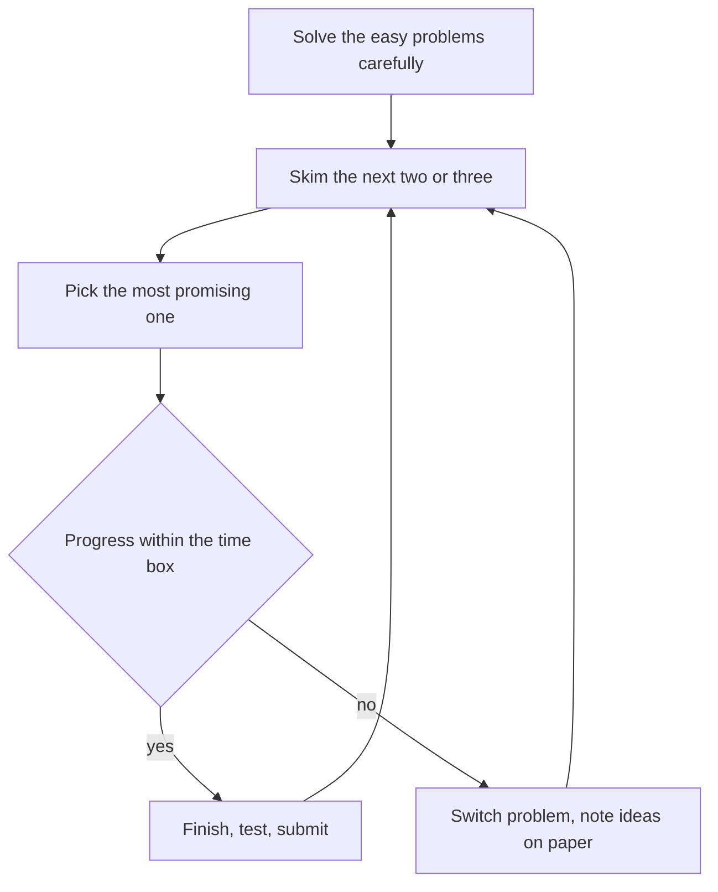

## The hook

Two contestants know exactly the same algorithms. One finishes with four problems solved; the other with two. The difference is not intelligence. The second spent seventy minutes fighting problem C, never read problem D, and submitted B three times without testing it.

Contests reward knowledge, but they also reward pacing. The good news is that pacing is a skill you can learn in a week, and it pays off immediately.

## The intuition

:::analogy
A marathon runner does not sprint the first kilometre because they feel fresh, and does not keep pounding against a wall at kilometre thirty. They run to a plan, check their pace, drink at the stations, and adjust when the body says so. A contest is a two-hour race: the plan is your problem order, the pace checks are your time boxes, and the drink stations are the moments you step back and look at the scoreboard.
:::

You cannot control which problems appear. You can control where your minutes go.

## Let's build it up

### Before the start

- Template ready, compiler tested, stress-testing script at hand (see [Let a Robot Find Your Wrong Answer](article:cp-stress-testing)).
- Water, no notifications, a sheet of paper for small cases.
- A plan: "A and B fast and clean, then C, then decide."

### The opening minutes

Solve the easy problems quickly but carefully. A and B in a Div. 2 round are usually reachable for most participants, and every minute saved here is a minute for C. Still test the samples and one edge case before submitting: a rejected attempt costs [[penalty]] in most formats.

### Reading ahead

Once the easy ones are done, skim the next two or three problems before committing. Difficulty is personal: a "D" in a topic you love can be easier for you than a "C" in one you have not studied. The live [[standings]] are evidence too: if many people solved D and few solved C, the order may be misleading.

### Time boxes and the sunk cost trap

Give each hard problem a [[time box]], for example 25 to 30 minutes of real progress. If you are still stuck, write down what you know and switch. Minutes already spent are a [[sunk cost]]: they are gone whether you continue or not, so they should not decide what you do next. Very often, when you return to the problem later, the idea arrives in minutes.

:::insight
"Stuck" is information. If 30 minutes produced no new observation, another 30 rarely do. Switching problems is not giving up; it is letting your mind work on the first problem in the background while your hands make progress elsewhere.
:::

### Wrong Answer under pressure

When a submission fails, do not change random things and resubmit. Instead:

1. Re-read the statement for words like "distinct", "at most", "modulo".
2. Check overflow and resetting between test cases.
3. Run your stress test for five minutes.

This checklist finds most bugs faster than staring.

### The last fifteen minutes

Do not start a brand-new hard problem unless it looks quick. Use the time to test submitted solutions against large inputs, especially for time limits, because on Codeforces passing [[pretests]] does not guarantee passing the final system tests.

:::warning
Common misconception: "a bad contest means I am bad at this." Ratings move in noisy steps. One contest is one sample. Judge yourself by trends over ten contests, and by how many new techniques you learned while upsolving.
:::

## A tiny example

A Div. 3 round with problems A to F, two hours. One sensible run:

| Time | What happens | Why |
|---|---|---|
| 0:00-0:15 | A and B, each tested on samples and n = 1 | Fast, clean points |
| 0:15-0:20 | Skim C, D, E | Choose by personal difficulty |
| 0:20-0:45 | C solved, one WA caught by a quick stress test | Testing beats resubmitting blindly |
| 0:45-1:15 | D: no progress after 30 minutes | Time box hit; note ideas |
| 1:15-1:40 | E looked like a graph BFS: solved | Standings showed E solved more than D |
| 1:40-2:00 | Back to D with fresh eyes; the observation clicks | Background thinking paid off |

Four problems instead of two, with the same knowledge.

:::try-this
Plan your next contest on paper before it starts: write your time box for hard problems, the order you will read problems in, and your three-step Wrong Answer checklist. After the contest, write one line on what you would change. (Most people find that their biggest leak is either untested submissions or staying too long on one problem.)
:::

## Where you'll see this again

Upsolving after each contest, described in the [rating ladder](article:cp-rating-ladder), turns these contest hours into lasting skill. Interviews use the same instincts in miniature: get a working solution first, test it, and do not sink all your time into one stuck idea without saying so out loud.

## Key takeaways

- Solve the easy problems quickly but test them, because wrong submissions usually cost penalty.
- Skim several problems before committing, since difficulty is personal and the standings are useful evidence.
- Time-box hard problems and switch when stuck, ignoring the sunk cost of minutes already spent.
- On Wrong Answer, re-read the statement, check overflow and resets, and stress test instead of guessing.
- Judge progress over many contests, not one, and use the last minutes to test submitted solutions on large inputs.
