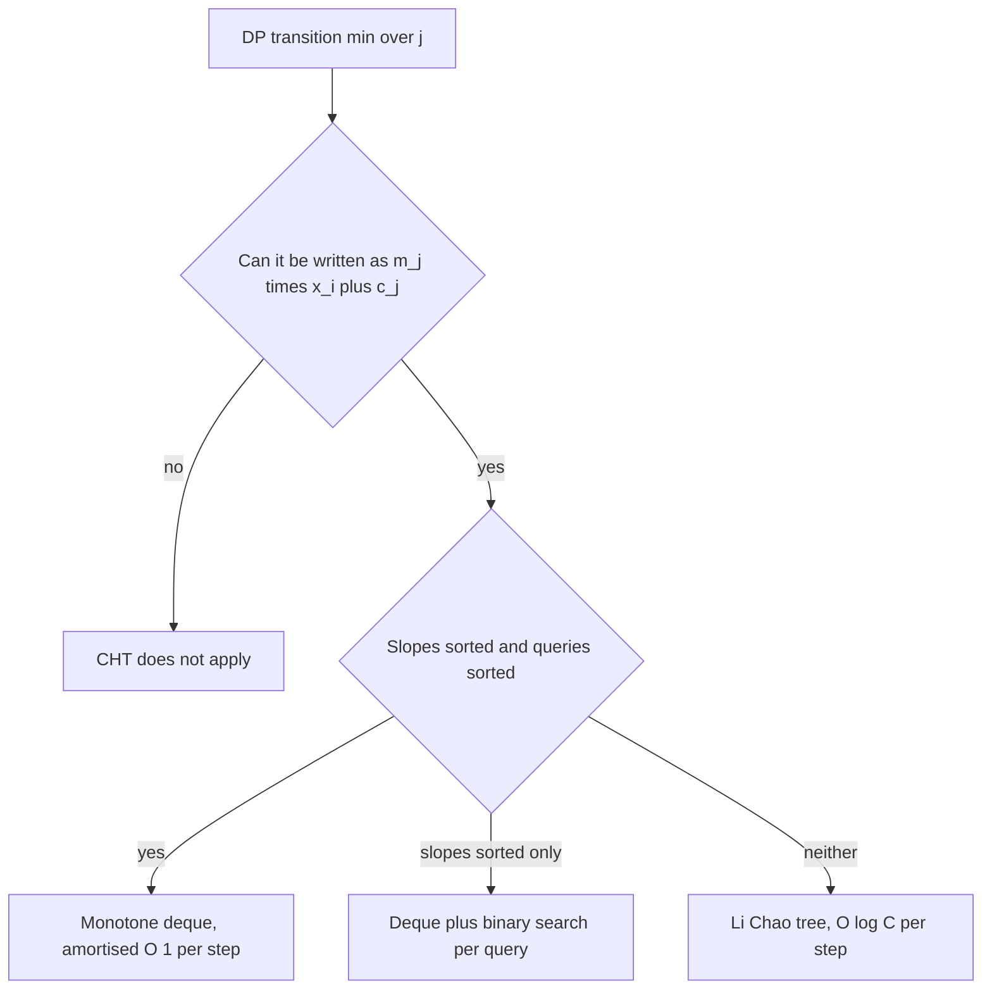

## The hook

A frog hops along stones of increasing height. Jumping from stone j to stone i costs (hᵢ − hⱼ)² plus a fixed fee C, and the frog wants the cheapest way to the last stone. The DP is obvious: dp[i] = min over j < i of dp[j] + (hᵢ − hⱼ)² + C. With 2 × 10⁵ stones that is 2 × 10¹⁰ transitions, far too slow.

The trick is to look at the transition from the right angle. Expand the square, and each earlier stone j turns into a straight line; computing dp[i] becomes "which line is lowest at x = hᵢ?". Keep only the lines that can ever be lowest, and each DP step costs O(1) amortised.

## The intuition

:::analogy
Picture many straight roads crossing a valley, each at a different angle. You are walking along the valley floor from west to east, and at every point you want to stand on the lowest road above you. Some roads are never the lowest anywhere; you can tear them down. The lowest roads form a bent chain: one road is lowest for a stretch, then a steeper one takes over, then another. As you walk east, you only ever move forward along that chain, never back.
:::

The roads are lines, the chain is the [[lower envelope]], and walking east is answering queries with increasing x. The [[convex hull trick (CHT)]] maintains that chain as lines are added and queried.

## How it works

### Step 1: spot the line shape

Look for a transition of the form

$$dp[i] = \min_{j < i} \big( m_j \cdot x_i + c_j \big) + (\text{terms depending only on } i)$$

where mⱼ and cⱼ depend only on j and xᵢ only on i. For the frog:

$$dp[j] + (h_i - h_j)^2 + C = \underbrace{(-2h_j)}_{m_j} \cdot h_i + \underbrace{(dp[j] + h_j^2)}_{c_j} + h_i^2 + C$$

Each j contributes a line with [[slope and intercept]] (−2hⱼ, dp[j] + hⱼ²), and we query it at x = hᵢ.

### Step 2: keep the lower envelope

Among all lines, only those touching the lower envelope matter. If slopes arrive sorted (here decreasing, because heights increase) and queries arrive sorted (increasing x), a [[monotone deque]] does everything in amortised O(1):

- **Add a line** at the back. Before pushing, pop the back line while it is useless: line l₂ between l₁ and the new l₃ is useless if l₃ overtakes l₁ no later than l₂ does. With integer arithmetic, compare intersection points by cross-multiplying: (c₃ − c₁)(m₁ − m₂) ≤ (c₂ − c₁)(m₁ − m₃).
- **Query x**: while the second line in the deque gives a value at most the first line's value at x, pop the front. The front line is then the minimum at x. Because later queries have larger x, a popped line will never be needed again.

### Step 3: Li Chao tree for arbitrary order

If slopes or queries are not sorted, use a [[Li Chao tree]]: a segment tree over the range of x values where each node keeps the line that is best at its midpoint. Inserting a line walks one root-to-leaf path, swapping lines so the better one stays, and a query takes the minimum over the path to its x. Both cost O(log C), where C is the size of the x range. It is often easier to code correctly than the deque.



:::insight
The DP was never really about pairs (i, j). Each j is one line, each i is one point, and the minimum over j is the lower envelope evaluated at that point. A line that is never on the envelope can never be the best predecessor, so throwing it away loses nothing.
:::

## Walk through an example

Frog with heights h = [1, 3, 4, 7, 8] and fee C = 5. Line for stone j: m = −2hⱼ, c = dp[j] + hⱼ². Then dp[i] = (min line value at hᵢ) + hᵢ² + 5.

| i | x = hᵢ | Deque before query (m, c) | Front after pops | Min value | dp[i] | Line added |
|---|---|---|---|---|---|---|
| 0 | 1 | | | | 0 | (−2, 1) |
| 1 | 3 | (−2, 1) | (−2, 1) | −5 | −5 + 9 + 5 = **9** | (−6, 18) |
| 2 | 4 | (−2, 1), (−6, 18) | (−2, 1) | −7 | −7 + 16 + 5 = **14** | (−8, 30) |
| 3 | 7 | (−2, 1), (−6, 18), (−8, 30) | (−8, 30) after popping two | −26 | −26 + 49 + 5 = **28** | (−14, 77) |
| 4 | 8 | (−8, 30), (−14, 77) | (−14, 77) after popping one | −35 | −35 + 64 + 5 = **34** | |

At i = 2, x = 4: line (−2, 1) gives −7 and line (−6, 18) gives −6, so the front stays. At i = 3, x = 7: (−2, 1) gives −13, worse than (−6, 18) at −24, which is worse than (−8, 30) at −26, so two lines are popped. The answer is **34**: from height 1 jump to 4, then 7, then 8, costing 14 + 14 + 6. The front line at each query tells you the best predecessor: stone 0 for i = 1 and i = 2, then the previous stone. The O(n²) DP gives the same table, [0, 9, 14, 28, 34].

:::try-this
At i = 4 (x = 8), check by hand that the front line (−8, 30) is worse than (−14, 77). (−8·8 + 30 = −34, and −14·8 + 77 = −35. The second is smaller, so the first is popped.)
:::

## The code

```pseudo
// lines added with decreasing slope, queries with increasing x, minimum
bad(l1, l2, l3):                       // is l2 useless?
    return (l3.c - l1.c) * (l1.m - l2.m) <= (l2.c - l1.c) * (l1.m - l3.m)

add(line):
    while size >= 2 and bad(dq[-2], dq[-1], line): dq.pop_back()
    dq.push_back(line)

query(x):
    while size >= 2 and value(dq[1], x) <= value(dq[0], x): dq.pop_front()
    return value(dq[0], x)

frog:
    dp[0] = 0; add(line(-2*h[0], h[0]^2))
    for i in 1 .. n-1:
        dp[i] = query(h[i]) + h[i]^2 + C
        add(line(-2*h[i], dp[i] + h[i]^2))
```

```cpp
#include <bits/stdc++.h>
using namespace std;
using ll = long long;

struct Line { ll m, c; ll at(ll x) const { return m * x + c; } };

bool bad(const Line& a, const Line& b, const Line& d) {
    return (__int128)(d.c - a.c) * (a.m - b.m) <= (__int128)(b.c - a.c) * (a.m - d.m);
}

int main() {
    vector<ll> h = {1, 3, 4, 7, 8};
    ll C = 5; int n = h.size();
    vector<ll> dp(n, 0);
    deque<Line> dq;
    auto add = [&](Line l) {
        while (dq.size() >= 2 && bad(dq[dq.size() - 2], dq.back(), l)) dq.pop_back();
        dq.push_back(l);
    };
    add({-2 * h[0], h[0] * h[0]});
    for (int i = 1; i < n; i++) {
        while (dq.size() >= 2 && dq[1].at(h[i]) <= dq[0].at(h[i])) dq.pop_front();
        dp[i] = dq[0].at(h[i]) + h[i] * h[i] + C;
        add({-2 * h[i], dp[i] + h[i] * h[i]});
    }
    for (ll v : dp) cout << v << ' ';                       // 0 9 14 28 34
    cout << '\n';

    vector<ll> slow(n, 0);                                  // O(n^2) check
    for (int i = 1; i < n; i++) {
        slow[i] = LLONG_MAX;
        for (int j = 0; j < i; j++)
            slow[i] = min(slow[i], slow[j] + (h[i] - h[j]) * (h[i] - h[j]) + C);
    }
    cout << (slow == dp ? "match" : "mismatch") << '\n';   // match
}
```

## Complexity

- **Monotone deque:** each line is pushed and popped at most once, so O(n) for n DP steps.
- **Sorted slopes, unsorted queries:** keep the deque, but binary search the envelope for each query: O(n log n).
- **Li Chao tree:** O(n log C) for n inserts and queries over an x range of size C.
- **Memory:** O(n) for lines.

## Common mistakes

:::warning
Common misconception: "the deque works whatever order the lines come in." The pop rules assume slopes arrive sorted in the right direction for the minimum or maximum you want, and the front-popping assumes queries move in one direction. If slopes increase when your code expects them to decrease, or queries jump back and forth, the deque silently returns wrong answers. Check both orders, or use a Li Chao tree.
:::

- **Overflow in the intersection test**: products of slopes and intercepts can exceed 64 bits; use `__int128` or long double.
- **Minimum versus maximum**: for a maximum, either negate everything or flip the comparisons consistently.
- **Equal slopes**: with equal slopes keep only the line with the better intercept, or the intersection test divides by zero in spirit.
- **Forgetting the i-only terms** (here hᵢ² + C) when turning the envelope value back into dp[i].
- **Applying CHT when the cost is not separable** into a product of a j-term and an i-term: then the transition is not a line.

## Practice problems

*Frog 3* (AtCoder Educational DP Contest) is the walkthrough above with up to 2 × 10⁵ stones. *Monster Game I* (CSES) has a transition that is a product of a value from the earlier level and one from the current level, with both orders sorted: the monotone deque. *Monster Game II* drops the sorted-order guarantees, which is where a Li Chao tree is needed. *Kalila and Dimna in the Logging Industry* (Codeforces) is a classic CHT problem whose sorted inputs make the deque work. The DP formulation side is covered in [Stairs, Robbers and Secret Codes](article:dsa-dp-1d).

## Key takeaways

- The convex hull trick applies when dp[i] is a minimum or maximum over j of a line in some x that depends only on i.
- Each earlier state j becomes a line, and only lines on the lower envelope can ever be the best predecessor.
- With sorted slopes and sorted queries, a deque keeps the envelope, giving amortised O(1) per DP step.
- A Li Chao tree handles lines and queries in any order at O(log C) each and is often simpler to get right.
- Use 128-bit or careful arithmetic in the intersection test, and double-check the slope and query order assumptions.
