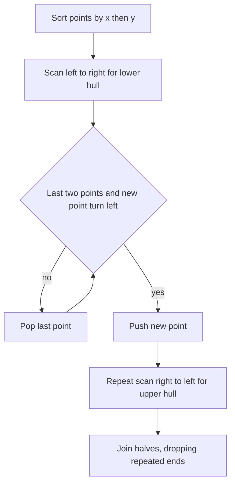

## The hook

A farmer has hammered fence posts all over a field and wants the shortest fence that encloses every post. Some posts will sit on the fence; most will end up inside. Which ones are on the fence, and in what order?

With ten posts you could eyeball it. With 200,000 posts, given only as coordinates, you need an algorithm. The classic contest answer sorts the points once, walks through them twice, and uses nothing but the left-or-right test you already know.

## The intuition

:::analogy
Hammer nails into a board at every point. Stretch a rubber band wide around all of them and let it go. It snaps inward until it rests on the outermost nails, with straight segments between them. Nails inside never touch the band. Nails that sit exactly on a straight stretch of band touch it without bending it. The shape the band makes is the convex hull.
:::

The [[convex hull]] is the smallest [[convex polygon]] containing all the points. The rubber band also tells you the rule for an algorithm: walking around the band counter-clockwise, it only ever bends **left**. A right turn would mean the band is pushed inward by a nail, which a tight band never is.

So the algorithm needs exactly one question at each step: "do these three points turn left?" That is the cross product from [Left Turn or Right Turn at the Junction](article:cp-geometry-basics):

$$\text{cross}(O, A, B) = (A_x - O_x)(B_y - O_y) - (A_y - O_y)(B_x - O_x)$$

Here O, A and B are three points in order. A positive value means O → A → B turns left, a negative value means it turns right, and zero means the three points are on one line.

## How it works

:::history
Ronald Graham published a hull algorithm in 1972 that sorts points by angle around a pivot. In 1979 A. M. Andrew published a variant that sorts by x-coordinate instead, which avoids angles completely. That variant, the monotone chain, is the one most contestants write.
:::

The [[monotone chain]] builds the band in two halves.

1. **Sort** the points by x, breaking ties by y. Remove duplicates.
2. **[[Lower hull]]:** go through the points left to right. Before pushing a point, look at the last two points on the stack. While they and the new point do **not** make a left turn, pop the last point. Then push the new one.
3. **[[Upper hull]]:** do the same, going right to left.
4. **Join** them. Each half ends where the other begins, so drop the last point of each half before concatenating.

The result lists the hull's corners counter-clockwise, starting from the leftmost-lowest point.



Why does popping work? In the lower scan, if A → B → C turns right, then B lies above the straight segment from A to C. A band running along the bottom goes straight from A to C underneath B, so B can never be a lower-hull corner. And once B is gone it never returns, because every later point is even further right.

:::insight
Sorting turns a 2D problem into a 1D sweep. After sorting, the lower hull is just a stack of points where every consecutive triple turns left, and each point is pushed once and popped at most once.
:::

### Collinear points: decide on purpose

A [[collinear point]] sits exactly on a straight stretch of band, so its cross product is zero. The pop condition decides its fate:

| Pop while | Points in the middle of an edge | Use when |
|---|---|---|
| cross ≤ 0 | removed | the problem wants only true corners, or you need area, perimeter, or a strictly convex polygon |
| cross < 0 | kept | the problem wants every point that touches the band |

The second version has one trap. When **all** points are on one line, the lower and upper scans each keep every point, and the joined list contains the middle points twice. Handle that case separately: if every cross product with the first and last sorted points is zero, the answer is just the sorted list.

### Not the convex hull trick

[The Lowest Road at Every Point](article:cp-convex-hull-trick) shares a name and a pop-from-the-back rule, but it solves a different problem. The convex hull trick keeps the lower envelope of **lines** so a DP can ask "which line is lowest at this x?". This article wraps a set of **points**. The names are linked by duality, since the lines on an envelope correspond to points on a hull, but in a contest you write different code for each.

## Walk through an example

Eight nails: (0, 0), (2, 0), (4, 0), (1, 2), (3, 1), (5, 3), (2, 5), (0, 3). Sorted by x then y:

(0, 0), (0, 3), (1, 2), (2, 0), (2, 5), (3, 1), (4, 0), (5, 3)

**Lower hull**, popping on cross ≤ 0:

| New point | Checks | Stack after |
|---|---|---|
| (0, 0) | none | (0,0) |
| (0, 3) | fewer than two points | (0,0) (0,3) |
| (1, 2) | cross((0,0), (0,3), (1,2)) = −3: pop (0,3) | (0,0) (1,2) |
| (2, 0) | cross((0,0), (1,2), (2,0)) = −4: pop (1,2) | (0,0) (2,0) |
| (2, 5) | cross((0,0), (2,0), (2,5)) = 10: left, keep | (0,0) (2,0) (2,5) |
| (3, 1) | cross((2,0), (2,5), (3,1)) = −5: pop (2,5); then cross((0,0), (2,0), (3,1)) = 2: keep | (0,0) (2,0) (3,1) |
| (4, 0) | cross((2,0), (3,1), (4,0)) = −2: pop (3,1); then cross((0,0), (2,0), (4,0)) = 0: collinear, pop (2,0) | (0,0) (4,0) |
| (5, 3) | cross((0,0), (4,0), (5,3)) = 12: keep | (0,0) (4,0) (5,3) |

**Upper hull**, scanning right to left, ends as (5, 3), (2, 5), (0, 3), (0, 0). Joining and dropping the repeated ends gives:

**(0, 0), (4, 0), (5, 3), (2, 5), (0, 3)**, counter-clockwise.

Look at the row for (4, 0). Point (2, 0) sits on the bottom edge between (0, 0) and (4, 0), so the cross product is exactly 0 and the ≤ 0 rule drops it. With the < 0 rule, (2, 0) stays and the hull has six points: (0, 0), (2, 0), (4, 0), (5, 3), (2, 5), (0, 3). Points (1, 2) and (3, 1) are strictly inside and vanish either way.

The shoelace formula on the five corners gives twice the area as 37, so the fenced area is 18.5.

:::try-this
Add the point (6, 1) to the eight nails. Which current corner disappears? (The lower hull now runs (0,0), (4,0), (6,1), and (5,3) is popped from the lower scan because cross((4,0), (5,3), (6,1)) = −5. In the upper scan, (6, 1) comes first and (5, 3) is kept, since cross((6,1), (5,3), (2,5)) = 4 is a left turn. So no corner disappears: the hull becomes (0,0), (4,0), (6,1), (5,3), (2,5), (0,3).)
:::

## The code

```pseudo
hull(points, keep_collinear):
    sort points by (x, y) and remove duplicates
    if fewer than 3 points or all points are collinear: return points
    lower = []
    for p in points:
        while size(lower) >= 2 and turn(lower[-2], lower[-1], p) is not left: pop lower
        push p onto lower
    upper = same loop over points in reverse order
    return lower without its last point + upper without its last point

turn is "not left" when cross <= 0  (drop edge points)
                   or cross < 0     (keep edge points)
```

```cpp
#include <bits/stdc++.h>
using namespace std;
using ll = long long;
using P = pair<ll, ll>;

ll cross(P o, P a, P b) {
    return (a.first - o.first) * (b.second - o.second) - (a.second - o.second) * (b.first - o.first);
}

vector<P> hull(vector<P> pts, bool keepCollinear) {
    sort(pts.begin(), pts.end());
    pts.erase(unique(pts.begin(), pts.end()), pts.end());
    int n = pts.size();
    bool allLine = true;
    for (auto& p : pts) if (cross(pts[0], pts[n - 1], p) != 0) allLine = false;
    if (n < 3 || allLine) return (keepCollinear || n == 1) ? pts : vector<P>{pts[0], pts[n - 1]};
    auto bad = [&](ll c) { return keepCollinear ? c < 0 : c <= 0; };
    vector<P> h;
    for (int pass = 0; pass < 2; pass++) {
        size_t base = h.size();
        for (auto& p : pts) {
            while (h.size() >= base + 2 && bad(cross(h[h.size() - 2], h.back(), p))) h.pop_back();
            h.push_back(p);
        }
        h.pop_back();                       // this end starts the other half
        reverse(pts.begin(), pts.end());
    }
    return h;
}

int main() {
    vector<P> nails = {{0, 0}, {2, 0}, {4, 0}, {1, 2}, {3, 1}, {5, 3}, {2, 5}, {0, 3}};
    for (auto [x, y] : hull(nails, false)) cout << '(' << x << ',' << y << ") ";
    cout << '\n';                           // (0,0) (4,0) (5,3) (2,5) (0,3)
    cout << hull(nails, true).size() << '\n';                    // 6
    cout << hull({{0, 0}, {1, 1}, {2, 2}, {3, 3}}, true).size() << '\n';  // 4
}
```

The `h.size() >= base + 2` check makes the upper pass start fresh on top of the lower hull without popping into it.

## Complexity

- **Time:** O(n log n) for sorting, plus O(n) for the two scans, since each point is pushed and popped at most once per scan. In general you cannot beat O(n log n), because a hull algorithm can be used to sort numbers.
- **Space:** O(n) for the sorted points and the stack.
- **Values:** coordinates up to 10⁹ make cross products up to about 4 × 10¹⁸, which fits in `long long` but not in `int`.

## Common mistakes

:::warning
Common misconception: "points on an edge do not matter." They decide your answer whenever the output is a list or a count of hull points. Read whether the problem wants corners only or every boundary point, then choose ≤ 0 or < 0 on purpose. Test with a square that has a point in the middle of each side.
:::

- **Duplicate points.** Two copies of one point give a zero cross product and can confuse both versions. Remove duplicates after sorting.
- **The all-collinear input** with the keep-collinear rule, which repeats the middle points. Check it separately, along with inputs of one or two points.
- **Forgetting to drop the repeated ends** when joining the halves, which lists the leftmost and rightmost points twice.
- **Sorting by x only.** Ties in x must be broken by y, or vertical edges are scanned in the wrong order.
- **Using doubles** for integer input. Exact `long long` cross products make "is it exactly zero?" reliable.

## Practice problems

*Convex Hull* (CSES) is the algorithm itself: read the output section carefully to see whether points on hull edges must be listed. *Erect the Fence* asks for every tree on the fence, so it needs the keep-collinear version and the all-collinear case. *Largest Triangle Area* is small enough for brute force, but the best triangle always uses hull corners, which is a good observation to practise. *U2* is a lovely disguise: subtracting x² from every y turns parabolas into straight lines, and the answer becomes a count of upper hull edges where collinear points must not add extra edges.

Hull problems tend to appear on Codeforces from roughly the 2000 rating range, often as one step inside a harder idea.

## Key takeaways

- The convex hull is the shape a rubber band takes around all the points, and walking it counter-clockwise turns left at every corner.
- Andrew's monotone chain sorts points by x then y, builds the lower and upper hulls with a stack, and pops any point that does not make a left turn.
- Popping on cross ≤ 0 keeps only true corners, while popping on cross < 0 also keeps points lying on edges.
- The keep-collinear version must handle the case where every point is on one line, or it lists middle points twice.
- Sorting dominates the cost, so the whole algorithm runs in O(n log n) time with exact integer arithmetic.
