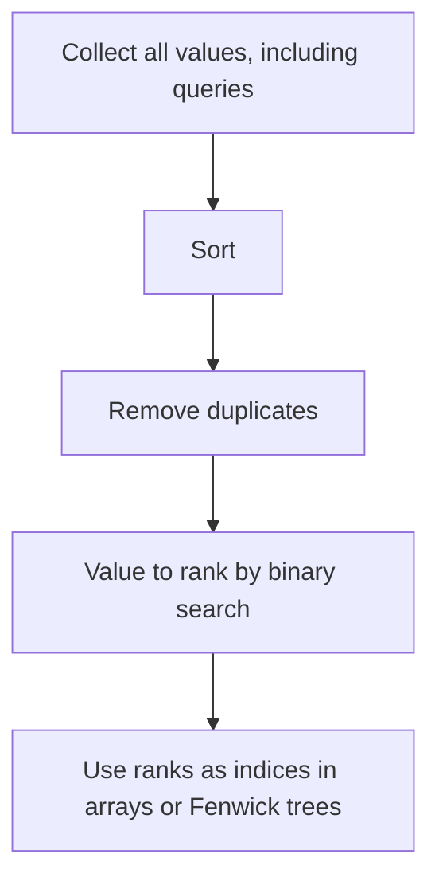

## The hook

You want to count, for each number in an array, how many smaller numbers appear after it. A Fenwick tree over values would do it in O(n log n): walk from the right, query "how many values below x have I seen?", then add x. There is one problem. Values go up to 10⁹, and an array of a billion counters does not fit in memory.

But you only have 10⁵ numbers. At most 10⁵ distinct values ever matter. Rename them 0, 1, 2, ... in sorted order, and the billion-sized array shrinks to 10⁵. That renaming is coordinate compression, one of the most common preprocessing steps in competitive programming.

## The intuition

:::analogy
Imagine a street where houses are numbered 4, 1,800, 52,000 and 9,999,999. A postman delivering in order does not care about the gaps; he only needs to know which house comes first, second, third and fourth. So he writes a little index card: house 4 is stop 1, house 1,800 is stop 2, and so on. His route sheet now has four short lines instead of ten million.
:::

[[Coordinate compression]] replaces each value with its [[rank]] among all distinct values. It is [[order-preserving]]: if a < b, then rank(a) < rank(b), and equal values share a rank. Anything that depends only on order and equality, such as "how many are smaller", "is it inside this range", "which is the maximum", gives the same answer on the ranks.

## How it works

1. Collect every value that will ever be used as an index: array elements, and in [[offline processing]], update values and query bounds too.
2. Sort them and remove duplicates.
3. Map each original value to its position in that sorted list, using binary search (`lower_bound`) or a hash map built once.



### Where it unlocks other techniques

- **[[Fenwick tree]]s and segment trees over values**: counting inversions, "how many smaller after self", salary range queries.
- **Sweep lines** with huge coordinates: compress the event times into indices for a difference array.
- **Grids with huge coordinates**: compress x and y separately to build a small grid of only the interesting rows and columns.
- **DP over values**: longest increasing subsequence variants that index a structure by value.

:::insight
Most range structures need array indices, but most problems give you arbitrary values. Coordinate compression is the adapter: it keeps everything about order and equality and throws away only the sizes of the gaps, which order-based problems never needed.
:::

### What compression loses

Differences between values are gone. If a problem asks about "values within distance 5 of x", ranks cannot answer it directly. You can still compress, but you must convert the bounds x − 5 and x + 5 into rank ranges with `lower_bound` and `upper_bound`, which is exactly why query bounds must be included or searched carefully.

## Walk through an example

**Count smaller numbers after self** for `[50, 1000000000, 7, 50, 3]`.

**Compress:** distinct sorted values are 3, 7, 50, 1000000000, with ranks 0, 1, 2, 3. The array becomes `[2, 3, 1, 2, 0]`.

**Sweep from the right** with a Fenwick tree of counts over ranks 0 to 3:

| Position | Value (rank) | Query: how many seen with rank < r | Answer | Add rank |
|---|---|---|---|---|
| 4 | 3 (0) | 0 | 0 | counts: r0 = 1 |
| 3 | 50 (2) | ranks 0..1 → 1 | 1 | r2 = 1 |
| 2 | 7 (1) | rank 0 → 1 | 1 | r1 = 1 |
| 1 | 10⁹ (3) | ranks 0..2 → 3 | 3 | r3 = 1 |
| 0 | 50 (2) | ranks 0..1 → 2 | 2 | r2 = 2 |

Answer: `[2, 3, 1, 1, 0]`. The Fenwick tree had 4 slots instead of a billion.

:::try-this
Compress `[40, -5, 40, 1000, 7]` into ranks starting at 0. Then compute how many elements are strictly smaller than 40 using only the ranks. (Distinct sorted: −5, 7, 40, 1000, so ranks are [2, 0, 2, 3, 1]. Elements with rank below 2 are −5 and 7: 2 of them, the same answer as with the original values.)
:::

## The code

```pseudo
compress(values):
    vals = sorted unique copy of values
    rank(x) = lower_bound(vals, x)         // index of x in vals
    return [rank(x) for x in values], vals

count_smaller_after(a):
    r, vals = compress(a)
    fenwick = counts of size len(vals)
    for i from n-1 down to 0:
        ans[i] = fenwick.prefix_sum(r[i] - 1)
        fenwick.add(r[i], 1)
```

```cpp
#include <bits/stdc++.h>
using namespace std;

struct Fenwick {
    vector<int> t;
    Fenwick(int n) : t(n + 1, 0) {}
    void add(int i, int v) { for (i++; i < (int)t.size(); i += i & -i) t[i] += v; }
    int sum(int i) const { int s = 0; for (i++; i > 0; i -= i & -i) s += t[i]; return s; }  // ranks 0..i
};

vector<int> countSmallerAfter(const vector<long long>& a) {
    vector<long long> vals(a);
    sort(vals.begin(), vals.end());
    vals.erase(unique(vals.begin(), vals.end()), vals.end());
    int n = a.size();
    vector<int> ans(n);
    Fenwick fw(vals.size());
    for (int i = n - 1; i >= 0; i--) {
        int r = lower_bound(vals.begin(), vals.end(), a[i]) - vals.begin();
        ans[i] = r > 0 ? fw.sum(r - 1) : 0;
        fw.add(r, 1);
    }
    return ans;
}

int main() {
    for (int x : countSmallerAfter({50, 1000000000, 7, 50, 3})) cout << x << ' ';  // 2 3 1 1 0
    cout << '\n';
}
```

## Complexity

- **Build:** O(n log n) to sort and deduplicate.
- **Each lookup:** O(log n) with `lower_bound`, or O(1) average with a hash map built from the sorted list.
- **Space:** O(n) for the sorted distinct values.
- **With a Fenwick tree on top:** O(n log n) overall for problems like counting smaller elements after each position.

## Common mistakes

:::warning
Common misconception: "compress the array once at the start and you are done." In problems with updates or queries, values that appear only later, such as a new salary or a query bound, have no rank. Read all input first and compress every value you will ever need, or map query bounds with lower_bound and upper_bound.
:::

- **Forgetting to deduplicate**, so equal values get different ranks and equality breaks.
- **Off-by-one between 0-based ranks and 1-based Fenwick trees.** Pick one convention and shift once, as in the code above.
- **Using compression when distances matter**, such as "sum of values in a range", where you must keep the original values alongside the ranks.
- **Recomputing `lower_bound` inside heavy loops** when a precomputed rank array would do.

## Practice problems

*Rank Transform of an Array* is compression with 1-based ranks. *Count of Smaller Numbers After Self* is the walkthrough above. *Salary Queries* (CSES) needs offline compression of all salaries, including updates and query bounds, with a Fenwick tree over ranks. *Distinct Values Queries* compresses values so a "last seen position" array fits. Expect compression from about 1500 rating whenever values reach 10⁹ but n is around 10⁵.

## Key takeaways

- Coordinate compression replaces each value with its rank among the distinct values, turning huge values into small array indices.
- It preserves order and equality, so any question that depends only on comparisons has the same answer after compression.
- Build it by collecting values, sorting, removing duplicates, and looking up ranks with binary search.
- In problems with updates or queries, compress every value that will ever be needed, which usually means reading everything first.
- Compression enables Fenwick trees, segment trees, sweeps and small grids over values that would otherwise be far too large.
