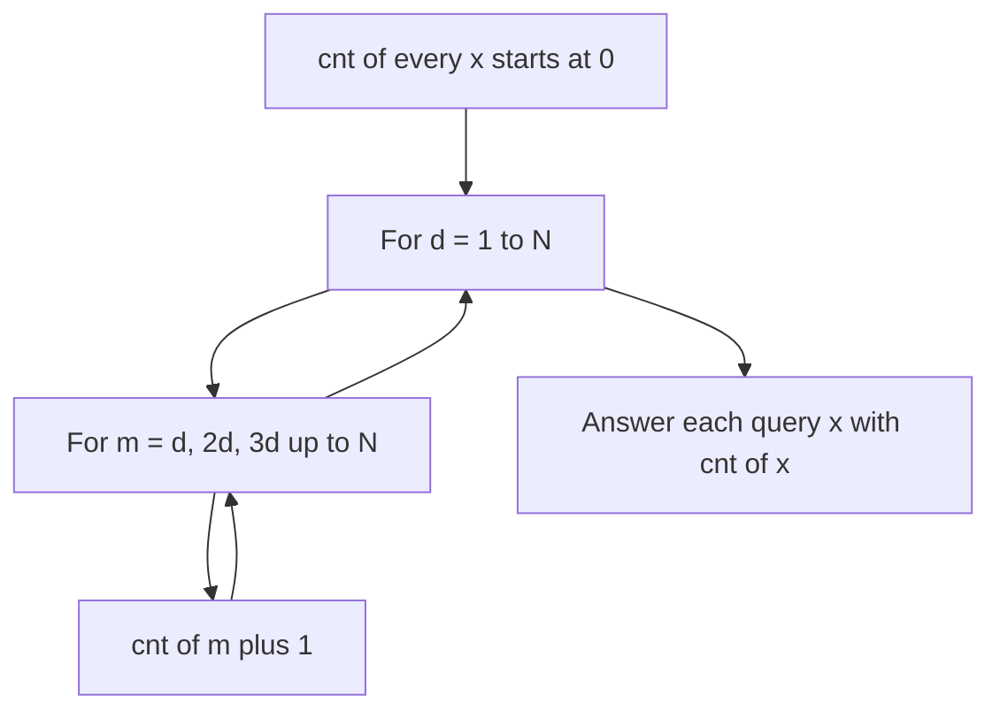

## The hook

Counting the divisors of one number is a beginner exercise: try every candidate up to its square root. Now do it for 100,000 numbers, each up to a million, inside a one-second limit. Suddenly the beginner method is borderline, and the problem is really asking whether you know a different way to organise the work.

This problem, CSES *Counting Divisors*, teaches a pattern that appears all over number theory problems: instead of asking each number "who divides you?", let each potential divisor walk over its multiples and announce itself. The cost of that walk is a harmonic series, and recognising that cost is a skill in its own right.

## The problem

You receive many queries; each gives a positive integer x up to 10⁶, and you must report how many positive [[divisor]]s it has. The number of queries is up to about 10⁵, so the answers should come from a precomputed table, not fresh work per query.

## The obvious approach

For each query, loop i from 1 to √x; whenever i divides x, count both i and x / i (once if they are equal). That is up to 1,000 steps per query and about 10⁸ steps in total, each involving a division. It may squeeze through with a fast language and a generous limit, but it is fragile, and the same idea fails completely in the many variations with larger inputs or more queries.

## The key insight

:::analogy
Imagine a row of a million boxes, numbered 1 to 1,000,000. Every number d walks down the row and drops one token into each box that is a multiple of d: number 1 drops a token in every box, number 2 in every second box, number 3 in every third box, and so on. When everyone has finished, box x contains exactly one token from each of its divisors. Counting divisors becomes counting tokens.
:::

Turn the question around. Instead of each x searching for its divisors, each d visits its multiples. This is the same shape as the sieve in [Washing Away Every Multiple](article:cp-sieve), but every number does the walk, not just primes, and it adds a token instead of crossing out.

**Why it is fast.** Number d drops N/d tokens. The total is

$$\frac{N}{1} + \frac{N}{2} + \dots + \frac{N}{N} = N \left(1 + \frac{1}{2} + \dots + \frac{1}{N}\right) \approx N \ln N$$

The bracket is the [[harmonic series]], which grows like ln N. For N = 10⁶ the total is about 1.4 × 10⁷ token drops, cheap additions with no division, done once. After this [[offline precomputation]], every query is a single table lookup.



:::insight
"For each number, find its divisors" costs a square root per number. "For each divisor, visit its multiples" costs N/d per divisor, which sums to N log N. Flipping the direction of a loop is often the whole solution in number theory problems.
:::

### The formula view

Factorise x = p₁^e₁ × p₂^e₂ × ... A divisor picks each prime's exponent independently from 0 to eᵢ, so by the product rule the [[divisor-count function]] is

$$d(x) = (e_1 + 1)(e_2 + 1)\cdots$$

With a [[smallest prime factor (SPF) sieve]], factorising any x ≤ N takes O(log x) steps, which is the better tool when queries ask for more than the count, such as the sum or product of divisors (*Divisor Analysis*).

## Walk through an example

Token drops for N = 12:

| d | boxes receiving a token |
|---|---|
| 1 | 1, 2, 3, ..., 12 |
| 2 | 2, 4, 6, 8, 10, 12 |
| 3 | 3, 6, 9, 12 |
| 4 | 4, 8, 12 |
| 5 | 5, 10 |
| 6 | 6, 12 |
| 7 to 12 | only themselves |

Final counts:

| x | 1 | 2 | 3 | 4 | 5 | 6 | 7 | 8 | 9 | 10 | 11 | 12 |
|---|---|---|---|---|---|---|---|---|---|---|---|---|
| d(x) | 1 | 2 | 2 | 3 | 2 | 4 | 2 | 4 | 3 | 4 | 2 | 6 |

Check with the formula: 12 = 2² × 3, so d(12) = 3 × 2 = 6. ✓ Primes have exactly 2, and perfect squares (1, 4, 9) have an odd count, because their square root pairs with itself.

**The same flip for Common Divisors.** To find the largest gcd of any two numbers in [3, 14, 15, 7, 9], count how many array elements are multiples of each d, scanning d downwards. For d = 15 and d = 14 only one multiple is present; d = 9, 8 have one or none; at d = 7 both 7 and 14 are present, so the answer is **7**. Counting multiples for all d is again a harmonic-series loop.

:::try-this
Using the formula, find d(360). (360 = 2³ × 3² × 5, so d = 4 × 3 × 2 = 24.)
:::

## The code

```pseudo
N = 1_000_000
cnt = [0] * (N + 1)
for d in 1 .. N:
    for m = d; m <= N; m += d:
        cnt[m] += 1
for each query x: print cnt[x]

max_pair_gcd(a):
    present[v] = how many times v appears in a
    for d = N down to 1:
        multiples = sum of present[m] for m = d, 2d, ...
        if multiples >= 2: return d
```

```cpp
#include <bits/stdc++.h>
using namespace std;

int main() {
    const int N = 1'000'000;
    vector<int> cnt(N + 1, 0);
    for (int d = 1; d <= N; d++)
        for (int m = d; m <= N; m += d) cnt[m]++;

    for (int x : {1, 12, 72, 360, 997}) cout << cnt[x] << ' ';   // 1 6 12 24 2
    cout << '\n';

    vector<int> a = {3, 14, 15, 7, 9}, present(N + 1, 0);
    for (int v : a) present[v]++;
    for (int d = N; d >= 1; d--) {
        int multiples = 0;
        for (int m = d; m <= N && multiples < 2; m += d) multiples += present[m];
        if (multiples >= 2) { cout << d << '\n'; break; }          // 7
    }
}
```

## Complexity

- **Precomputation:** O(N log N), about 1.4 × 10⁷ increments for N = 10⁶.
- **Each query:** O(1).
- **Space:** O(N) integers, about 4 MB for N = 10⁶.
- **Common Divisors:** also O(N log N) in the worst case.

## Common mistakes

:::warning
Common misconception: "a nested loop over d and its multiples must be O(N²)." The inner loop runs N/d times, not N times, and those counts add up to N ln N. Learn to recognise this harmonic pattern: it appears whenever an outer loop index sets the step size of the inner loop.
:::

- **Counting √x twice** in the per-query method when x is a perfect square.
- **Recomputing per query** instead of precomputing once.
- **Using `long long` arrays unnecessarily**: divisor counts up to 10⁶ are at most 240, so `int` is plenty and halves the memory.
- **Fast input**: with 10⁵ queries, use the fast I/O setup from [The Thirty Lines You Paste Before Every Contest](article:cp-fast-io-template).

## Practice problems

*Counting Divisors* is the walkthrough. *Common Divisors* applies the same multiples loop to find the largest pairwise gcd. *Sum of Divisors* asks for the total of all divisors of every number from 1 to n with n up to 10¹²: flip the view the same way, so each d contributes d × ⌊n / d⌋, then group the d values that share the same ⌊n / d⌋. *Divisor Analysis* gives a factorisation and asks for the count, sum and product of divisors modulo a prime, which uses the formula view.

## Key takeaways

- To count divisors for many numbers, let every d add one to each of its multiples instead of factorising each number separately.
- That double loop costs N times the harmonic series, about N ln N, so a million numbers need roughly 14 million cheap steps.
- After precomputation every query is a table lookup.
- The divisor count of p1^e1 × p2^e2 × ... is the product of (ei + 1), which a smallest-prime-factor sieve makes fast to compute.
- Flipping "find my divisors" into "visit my multiples" solves related problems such as the largest pairwise gcd.
