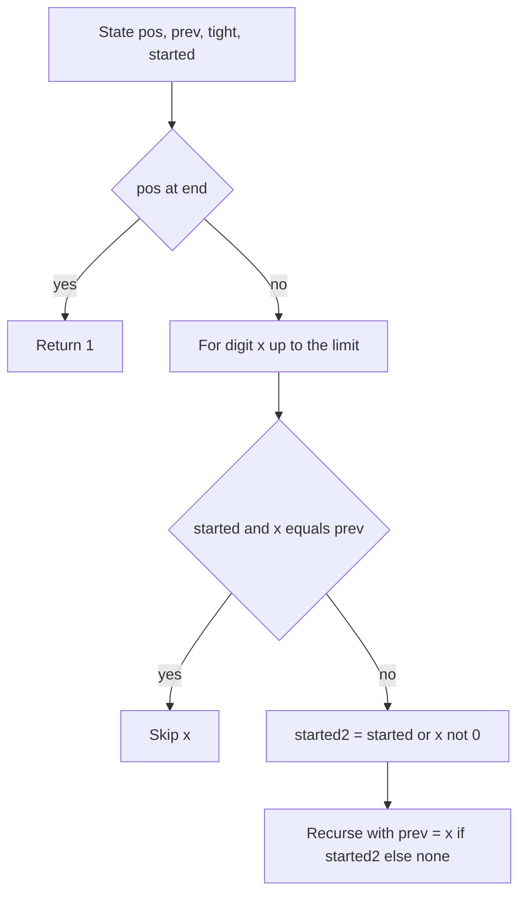

## The hook

How many numbers between a and b, where b can be as large as 10¹⁸, have no two equal digits next to each other? 1213 is fine, 1223 is not. A loop over the range is hopeless, and there is no neat closed formula once the bounds are arbitrary.

This CSES problem is the cleanest possible exercise in digit DP, and its one subtle point, leading zeros, is exactly where most first attempts go wrong. Solve it carefully once and you have a template for a whole family of "count numbers with a digit rule" problems.

## The problem

Given two integers a and b with 0 ≤ a ≤ b ≤ 10¹⁸, count the integers x with a ≤ x ≤ b such that no two [[adjacent digits]] of x (in normal decimal notation, without leading zeros) are equal. Print the count.

## The obvious approach

Loop from a to b, convert each number to a string, and check neighbouring characters. That is O((b − a) × 19), which is fine up to about 10⁷ numbers and useless at 10¹⁸. Keep it anyway: it is the brute force you will stress-test against, as in [Let a Robot Find Your Wrong Answer](article:cp-stress-testing).

## The key insight

:::analogy
Think of writing numbers digit by digit on a form with a rule: no digit may repeat the one just before it. You fill the boxes left to right. To decide what may go in the next box, you only need to know two things: the digit in the previous box, and whether you are still copying the upper limit exactly. Everything earlier on the form is irrelevant to the rule.
:::

So this is [Rolling the Odometer Without Passing the Limit](article:cp-digit-dp) with a small state:

- **pos**: which digit we are filling, out of the bound's length.
- **prev**: the [[previous digit state]], 0 to 9, or "none" before the number starts.
- **tight**: the [[tight flag]], whether we are still equal to the bound's prefix.
- **started**: the [[started flag]], whether a non-zero digit has been placed.

Transition at each position, for digit x from 0 to (bound digit if tight, else 9):

- If started and x == prev, skip: the rule is broken.
- The new started is started OR (x ≠ 0).
- The new prev is x if the new started is true, otherwise still "none", because padding zeros are not real digits.
- The new tight is tight AND x equals the bound digit.

At the end of the digits, return 1: every path that survived is a valid number (an all-zero path is the number 0, which is valid).

The answer is the [[prefix count]] f(b) − f(a − 1), with f(−1) = 0.

:::insight
The started flag is what separates "the number 7 written as 007" from "a number containing 00". Before the first non-zero digit, zeros are invisible: they set no previous digit and break no rule. After it, every zero is a real digit and must differ from its neighbour.
:::



## Walk through an example

Count numbers in [100, 120]: f(120) − f(99).

**f(99)**: the single-digit numbers 0 to 9 (10 of them) plus two-digit numbers with different digits, 9 choices for the first and 9 for the second (anything except the first): 81. Total **91**.

**f(120)**, branching on the first of three digit positions (bound 1 2 0):

| First digit | Meaning | Count |
|---|---|---|
| 0 | not started: these are the numbers 0 to 99 | 91 |
| 1 | tight, started, prev = 1 | 10 |

Inside the "1" branch, the second digit can be 0, 1 or 2:

| Second digit | Tight after? | Third digit options | Count |
|---|---|---|---|
| 0 | no | 1 to 9 (not 0) | 9 (101 to 109) |
| 1 | — | equals prev, skipped | 0 |
| 2 | yes | only 0 allowed by the bound, and 0 ≠ 2 | 1 (120) |

So f(120) = 91 + 10 = **101**, and the answer is 101 − 91 = **10**. A brute-force loop gives 10 as well, and agrees with the DP for every bound tested, including 1,000 (820 valid numbers) and 54,321 (36,804 valid numbers).

**The leading-zero bug.** If you drop the started flag and compare padding zeros like real digits, f(120) comes out as 91 instead of 101: numbers like 5, written 005, are rejected because of the two padding zeros.

:::try-this
What is f(10), and which numbers from 0 to 10 are valid? (All of 0 to 9 have one digit, so they are valid, and 10 has digits 1 and 0, which differ. f(10) = 11.)
:::

## The code

```pseudo
f(R):
    if R < 0: return 0
    d = digits of R
    go(pos, prev, tight, started):        // memoise on all four
        if pos == len(d): return 1
        lim = d[pos] if tight else 9
        total = 0
        for x in 0 .. lim:
            if started and x == prev: continue
            ns = started or x != 0
            total += go(pos + 1, x if ns else NONE, tight and x == lim, ns)
        return total
    return go(0, NONE, true, false)

answer = f(b) - f(a - 1)
```

```cpp
#include <bits/stdc++.h>
using namespace std;
using ll = long long;

string D;
ll memo[20][11][2][2];
bool seen[20][11][2][2];

ll go(int pos, int prev, bool tight, bool started) {
    if (pos == (int)D.size()) return 1;
    if (seen[pos][prev][tight][started]) return memo[pos][prev][tight][started];
    int lim = tight ? D[pos] - '0' : 9;
    ll total = 0;
    for (int x = 0; x <= lim; x++) {
        if (started && x == prev) continue;
        bool ns = started || x != 0;
        total += go(pos + 1, ns ? x : 10, tight && x == lim, ns);   // 10 means "none"
    }
    seen[pos][prev][tight][started] = true;
    return memo[pos][prev][tight][started] = total;
}

ll f(ll R) {
    if (R < 0) return 0;
    D = to_string(R);
    memset(seen, 0, sizeof seen);
    return go(0, 10, true, false);
}

int main() {
    cout << f(120) << ' ' << f(99) << '\n';                  // 101 91
    cout << f(120) - f(100 - 1) << '\n';                     // 10
    cout << f(0) - f(-1) << '\n';                            // 1
    cout << f(1000000000000000000LL) << '\n';                // 168856464709124011
}
```

The answer for the full range [0, 10¹⁸] is about 1.7 × 10¹⁷, which fits comfortably in a 64-bit integer.

## Complexity

- **Time:** at most 19 positions × 11 previous values × 2 × 2 flags = 836 states, each trying up to 10 digits: under 10,000 steps per call to f.
- **Space:** the same 836 memo cells.

## Common mistakes

:::warning
Common misconception: "leading zeros cannot matter because they do not change the number's value." They do not change the value, but they do change the digit string the DP is looking at. Without a started flag, the DP compares padding zeros with each other and rejects valid short numbers like 7 (written 007).
:::

- **a = 0**: computing f(a − 1) must handle −1, which should return 0, not crash on `to_string(-1)`.
- **Memo reused across bounds**: the memo depends on the bound's digits through the tight flag; reset it for each call (or memoise only non-tight states, which do not depend on the bound's digits, when the length is fixed).
- **Forgetting that 0 is valid**: the all-zero path must count as one number.
- **32-bit counters**: the count for the full range is about 1.7 × 10¹⁷, so every count and memo cell must be a 64-bit integer.
- **Using 0 as the "no previous digit" marker** in variants that check prev without a started flag: a real first digit of 0 never occurs, but other rules (such as "digits must increase") would then compare against a fake 0. A separate "none" value (10 here) keeps the state honest.

## Practice problems

*Counting Numbers* (CSES) is this walkthrough. *Digit Sum* (AtCoder) uses a remainder state instead of the previous digit. *Count Special Integers* (LeetCode) asks for numbers with all distinct digits, so the state becomes a 10-bit mask of used digits, with the same started-flag care. *Classy Numbers* (Codeforces) counts numbers with at most three non-zero digits, a count state where leading zeros happen to be harmless.

## Key takeaways

- Counting numbers with no equal adjacent digits in [a, b] is f(b) − f(a − 1), where f counts valid numbers in [0, x].
- The digit DP state needs only the position, the previous real digit, the tight flag and a started flag.
- Before the first non-zero digit, zeros are padding: they set no previous digit and are never compared.
- Without the started flag, valid short numbers are rejected, which is the most common bug in this problem.
- The whole state space has under a thousand states, so each call to f runs in microseconds even for 10^18.
