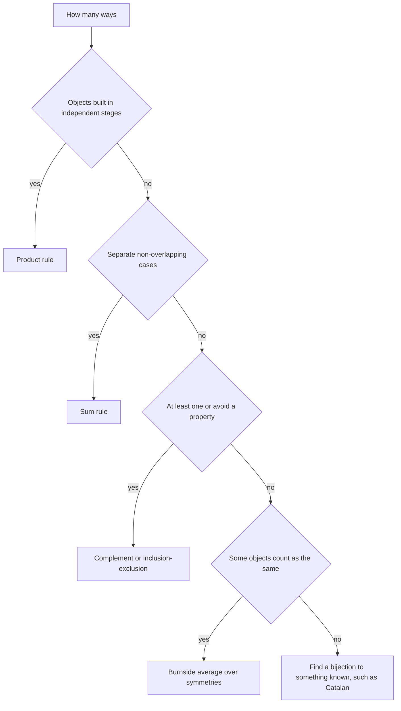

## The hook

A contest problem asks: how many valid bracket sequences of length 10⁶ are there, modulo 10⁹ + 7? Another asks for the number of distinct necklaces of 10⁶ beads in 10⁹ colours, where rotating a necklace does not make it different. Listing the objects is out of the question; even for length 40 there are billions.

Counting problems reward a small toolkit applied with care. With four ideas, the product and sum rules, complement counting, Catalan numbers and Burnside's lemma, plus the binomial coefficients from [How Many Ways to Pick the Team?](article:cp-binomial-coefficients), you can turn most "how many ways" problems into a formula and a few precomputed factorials.

## The intuition

:::analogy
Imagine choosing an outfit from 3 shirts, 4 trousers and 2 pairs of shoes. You could try on every combination in front of a mirror, or you could notice that each shirt pairs with each pair of trousers, and each of those with each pair of shoes: 3 × 4 × 2 = 24 outfits, counted without trying a single one on. Every technique in this article is a way of counting the outfits without trying them on: break the choice into stages, split it into cases, count what you do not want, or notice that two outfits are really the same one seen from a different angle.
:::

The skill is turning "list everything" into "describe how each object is built", then counting the descriptions.

## How it works

### Product and sum rules

- **[[Product rule]]**: if an object is built in stages and each stage's number of options does not depend on earlier choices, multiply. Passwords of length 6 from 36 symbols: 36⁶.
- **[[Sum rule]]**: if objects fall into non-overlapping cases, add the counts. Passwords of length 6 *or* 7: 36⁶ + 36⁷.

The catch is the word "non-overlapping". If cases overlap, adding them double counts, and you need [Counting Without Double Counting](article:cp-inclusion-exclusion).

### Complement counting

[[Complement counting]] counts the outfits you do not want. "At least one" conditions are the classic signal: the strings of length 4 over 26 letters with **at least one** 'a' are all strings minus those with **no** 'a': 26⁴ − 25⁴ = 66,351. Counting "at least one" directly would need awkward case splitting.

### Catalan numbers and bijections

A [[bijection]] is a perfect pairing between two families of objects; if you can build one, the families have the same size, and you can count the easier one. The [[Catalan numbers]] are the most famous example:

$$C_n = \frac{1}{n+1}\binom{2n}{n}$$

C₀ to C₆ are 1, 1, 2, 5, 14, 42, 132. Cₙ counts all of these, each in bijection with the others:

- balanced bracket sequences with n pairs,
- paths on a grid from (0, 0) to (n, n) with right and up steps that never go above the diagonal,
- full binary trees with n + 1 leaves,
- ways to triangulate a polygon with n + 2 sides.

Why the formula? Count all sequences of n '(' and n ')' : C(2n, n). Subtract the bad ones, those where the running balance dips below zero. The **reflection trick** flips every bracket after the first point where the balance hits −1, turning each bad sequence into one with n + 1 ')' and n − 1 '(' . This is a bijection, so there are exactly C(2n, n + 1) bad sequences, and

$$C_n = \binom{2n}{n} - \binom{2n}{n+1}$$

which simplifies to the formula above.

### Burnside's lemma for symmetry

When objects that look the same under some symmetry, such as rotation, count only once, counting gets subtle: some colourings have many rotated copies and some have few. [[Burnside's lemma]] fixes this by averaging:

$$\text{distinct objects} = \frac{1}{|G|} \sum_{g \in G} \text{fix}(g)$$

where G is the set of symmetries and fix(g) is the number of objects unchanged by symmetry g. For necklaces of n beads in m colours under rotation, rotating by i positions splits the beads into gcd(i, n) cycles, and a colouring is unchanged only if each cycle is one colour, so fix = m^gcd(i, n):

$$\text{necklaces} = \frac{1}{n} \sum_{i=0}^{n-1} m^{\gcd(i, n)}$$



:::insight
Every counting technique replaces listing with structure. Stages multiply, cases add, unwanted objects subtract, and symmetric duplicates are handled by averaging what each symmetry leaves fixed. Most contest counting problems are one or two of these steps plus factorials modulo a prime.
:::

## Walk through an example

**Bracket sequences with n = 3.** All arrangements of three '(' and three ')': C(6, 3) = 20. Bad ones: C(6, 4) = 15. Valid: 20 − 15 = **5**, matching C₃ = 5. They are:

| # | Sequence |
|---|---|
| 1 | ((())) |
| 2 | (()()) |
| 3 | (())() |
| 4 | ()(()) |
| 5 | ()()() |

**Necklaces with n = 4 beads, m = 2 colours:**

| Rotation i | gcd(i, 4) | Fixed colourings 2^gcd |
|---|---|---|
| 0 | 4 | 16 |
| 1 | 1 | 2 |
| 2 | 2 | 4 |
| 3 | 1 | 2 |

Sum 24, divided by 4 rotations: **6** distinct necklaces. A brute-force check that lists all 16 colourings and merges rotations also finds 6. With 6 beads the formula gives 14.

:::try-this
How many distinct necklaces of 3 beads in 3 colours are there under rotation? (Rotations 0, 1, 2 have gcd 3, 1, 1, fixing 27, 3, 3 colourings. (27 + 3 + 3) / 3 = 11.)
:::

## The code

```pseudo
precompute fact[0..2n], inv_fact[0..2n] modulo P
C(a, b) = fact[a] * inv_fact[b] * inv_fact[a-b] mod P

catalan(n): return C(2n, n) * inverse(n + 1) mod P

necklaces(n, m):
    total = 0
    for i in 0 .. n-1: total += m ^ gcd(i, n) mod P
    return total * inverse(n) mod P
```

```cpp
#include <bits/stdc++.h>
using namespace std;
const long long MOD = 1'000'000'007;

long long power(long long b, long long e) {
    long long r = 1; b %= MOD;
    for (; e > 0; e >>= 1, b = b * b % MOD) if (e & 1) r = r * b % MOD;
    return r;
}

int main() {
    const int N = 2'000'000;
    vector<long long> f(N + 1), inv(N + 1);
    f[0] = 1;
    for (int i = 1; i <= N; i++) f[i] = f[i - 1] * i % MOD;
    inv[N] = power(f[N], MOD - 2);
    for (int i = N; i > 0; i--) inv[i - 1] = inv[i] * i % MOD;
    auto C = [&](int a, int b) { return f[a] * inv[b] % MOD * inv[a - b] % MOD; };

    auto catalan = [&](int n) { return C(2 * n, n) * power(n + 1, MOD - 2) % MOD; };
    auto necklaces = [&](long long n, long long m) {
        long long total = 0;
        for (long long i = 0; i < n; i++) total = (total + power(m, __gcd(i, n))) % MOD;
        return total * power(n, MOD - 2) % MOD;
    };

    cout << catalan(3) << ' ' << catalan(4) << '\n';             // 5 14
    cout << necklaces(4, 2) << ' ' << necklaces(6, 2) << ' ' << necklaces(3, 3) << '\n';  // 6 14 11
}
```

Note that `__gcd(0, n)` is n, which correctly makes rotation by 0 fix all mⁿ colourings.

## Complexity

- **Factorials:** O(N) precomputation, then O(1) per binomial coefficient.
- **Catalan number:** O(log P) for the inverse after precomputation.
- **Necklaces:** O(n log P), one fast power per rotation.

## Common mistakes

:::warning
Common misconception: "to count symmetric objects, count everything and divide by the number of symmetries." That only works when every object has the same number of distinct rotated copies. A necklace of all one colour has just one copy, not n, so plain division undercounts it. Burnside's average of fixed points handles these special objects exactly.
:::

- **Adding overlapping cases**: the sum rule requires disjoint cases; otherwise use inclusion-exclusion.
- **Multiplying dependent stages**: if a stage's number of options depends on earlier choices, the plain product rule does not apply.
- **Dividing modulo a prime without an inverse**: always multiply by a modular inverse, as in [Finding the Undo Button on a Clock](article:cp-modular-inverse).
- **Factorial tables too short**: Catalan numbers need factorials up to 2n.

## Practice problems

*Bracket Sequences I* (CSES) is the Catalan formula for a given length. *Bracket Sequences II* fixes a prefix and asks for completions, which is the same reflection argument with a shifted start. *Counting Necklaces* is Burnside with rotation exactly as above. *Distributing Apples* is a stars-and-bars count, another classic bijection: arranging apples and dividers in a row.

## Key takeaways

- Multiply the options of independent stages, and add the counts of separate non-overlapping cases.
- For "at least one" conditions, count the complement and subtract it from the total.
- Catalan numbers C(2n, n) / (n + 1) count balanced bracket sequences and every structure in bijection with them.
- The reflection trick shows that exactly C(2n, n + 1) bracket sequences are invalid.
- Burnside's lemma counts objects up to symmetry by averaging, over all symmetries, how many objects each one leaves unchanged.
