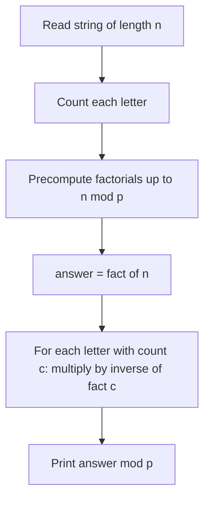

## The hook

How many different strings can you make by rearranging the letters of "mississippi"? If all 11 letters were different, the answer would be 11! = 39,916,800. But swapping two of the s's produces the same string, so most of those orderings are repeats. The real answer is much smaller, and finding it needs one formula.

CSES *Creating Strings II* asks exactly this for a string of up to a million letters, with the answer modulo 10⁹ + 7. Listing arrangements is impossible; even the smaller *Creating Strings* (which prints them all for length up to 8) is about generation, not counting. This walkthrough is about counting fast, and it exercises three contest essentials together: the multinomial coefficient, factorial tables modulo a prime, and modular inverses.

## The problem

You are given a string of lowercase letters, up to 10⁶ characters long. Count how many distinct strings can be formed by rearranging all of its characters, and print the count modulo 10⁹ + 7.

## The obvious approach

Generate every [[permutation]] with `next_permutation`, which skips duplicates automatically when started from the sorted string, and count them. That is correct and works for length 8, but the count itself can be astronomically large: for 20 distinct letters it is 20! ≈ 2.4 × 10¹⁸. We need to count without generating.

## The key insight

:::analogy
Imagine letter tiles on a table. If every tile were a different colour, you could line them up in n! orders. Now suppose the three 'a' tiles are identical twins, indistinguishable from each other. Every arrangement of the full row appears 3! = 6 times in that n! count, once for each way of shuffling the three 'a' tiles among their own positions, and all six look exactly the same. So divide by 3!. Do the same for every letter that repeats.
:::

This gives the [[multinomial coefficient]]. If the string has length n and letter i appears cᵢ times:

$$\text{answer} = \frac{n!}{c_a!\, c_b! \cdots c_z!}$$

Each distinct string corresponds to exactly c_a! · c_b! · ... labelled arrangements of the twin tiles, so dividing the labelled count by that number counts each distinct string once.

### Computing it modulo a prime

1. Precompute a [[factorial table]] fact[i] = i! mod p for i up to n.
2. Division modulo a prime is multiplication by the [[modular inverse]], which by Fermat's little theorem is x^(p−2) mod p, as in [Finding the Undo Button on a Clock](article:cp-modular-inverse).
3. answer = fact[n] × inv(fact[c_a]) × inv(fact[c_b]) × ... mod p.

At most 26 letters appear, so there are at most 26 inverses, each O(log p). Alternatively precompute inverse factorials for all i, which is useful when many such queries arrive.



:::insight
When identical objects make many arrangements look the same, count as if everything were distinct, then divide by the number of ways to shuffle each group of identical objects among themselves. In modular arithmetic that division becomes multiplication by inverse factorials.
:::

### The sibling problem: distributing identical items

*Distributing Apples* flips the roles: m identical apples go to n children, and a child may get none. Lay the apples in a row and insert n − 1 identical dividers between children. Every distribution is one arrangement of m stars and n − 1 bars, which by the same twin-tile logic is (m + n − 1)! / (m! (n − 1)!), that is

$$\binom{m + n - 1}{n - 1}$$

This is [[stars and bars]], the same multinomial thinking with only two kinds of tile.

## Walk through an example

**"aab":** 3! / (2! · 1!) = 6 / 2 = **3**. Listing confirms it: aab, aba, baa. The six labelled arrangements a₁a₂b, a₂a₁b, a₁ba₂, a₂ba₁, ba₁a₂, ba₂a₁ collapse in pairs.

**More words:**

| Word | n | Letter counts | n! | Divisor | Answer |
|---|---|---|---|---|---|
| aab | 3 | a2 b1 | 6 | 2 | 3 |
| aabbc | 5 | a2 b2 c1 | 120 | 4 | 30 |
| aabac | 5 | a3 b1 c1 | 120 | 6 | 20 |
| banana | 6 | a3 n2 b1 | 720 | 12 | 60 |

**Apples:** 2 apples to 3 children: C(2 + 3 − 1, 3 − 1) = C(4, 2) = **6**, namely (2,0,0), (0,2,0), (0,0,2), (1,1,0), (1,0,1), (0,1,1).

:::try-this
How many distinct strings come from "mississippi"? (n = 11 with m × 1, i × 4, s × 4, p × 2: 11! / (1! · 4! · 4! · 2!) = 39,916,800 / 1,152 = 34,650.)
:::

## The code

```pseudo
count_arrangements(s):
    n = len(s); P = 1_000_000_007
    fact[0] = 1; for i in 1..n: fact[i] = fact[i-1] * i mod P
    cnt = letter counts of s
    ans = fact[n]
    for c in cnt: ans = ans * power(fact[c], P - 2) mod P
    return ans
```

```cpp
#include <bits/stdc++.h>
using namespace std;
const long long MOD = 1'000'000'007;

long long power(long long b, long long e) {
    long long r = 1; b %= MOD;
    for (; e > 0; e >>= 1, b = b * b % MOD) if (e & 1) r = r * b % MOD;
    return r;
}

long long arrangements(const string& s) {
    int n = s.size();
    vector<long long> fact(n + 1, 1);
    for (int i = 1; i <= n; i++) fact[i] = fact[i - 1] * i % MOD;
    array<int, 26> cnt{};
    for (char c : s) cnt[c - 'a']++;
    long long ans = fact[n];
    for (int c : cnt) ans = ans * power(fact[c], MOD - 2) % MOD;
    return ans;
}

int main() {
    for (string w : {"aab", "aabbc", "banana", "mississippi"}) cout << arrangements(w) << ' ';
    cout << '\n';                                           // 3 30 60 34650
}
```

Letters that do not appear have count 0, and 0! = 1, so multiplying by its inverse changes nothing.

## Complexity

- **Time:** O(n) to count letters and build factorials, plus 26 inverses at O(log p) each.
- **Space:** O(n) for the factorial table.

## Common mistakes

:::warning
Common misconception: "compute n! mod p, then divide by each c! with normal division." Once a number is reduced modulo p, the exact quotient is gone, and integer division gives garbage. Modular division is multiplication by the modular inverse, which exists because 10⁹ + 7 is prime and larger than n, so no factorial up to n! is divisible by it.
:::

- **Overflow** when multiplying two values below p: use 64-bit integers and reduce after every product.
- **Factorial table too small**: it must go up to n, the full string length.
- **Forgetting repeated letters entirely**, which prints n! and overcounts.
- **Stars and bars off-by-one**: with n children there are n − 1 dividers, not n.

## Practice problems

*Creating Strings II* is the walkthrough. *Distributing Apples* is stars and bars, the same counting with two tile types. *Binomial Coefficients* drills fast C(a, b) mod p for many queries with precomputed factorials and inverse factorials, covered in [How Many Ways to Pick the Team?](article:cp-binomial-coefficients). *Creating Strings* is the small version where you list the arrangements, a good way to verify the formula by brute force.

## Key takeaways

- The number of distinct arrangements of n items with repeated groups is n! divided by the factorial of each group's size.
- Each distinct string appears once for every way to shuffle identical letters among themselves, which is why those factorials divide out.
- Modulo a prime, compute factorials in a table and multiply by modular inverses instead of dividing.
- Distributing identical items into distinct groups is stars and bars: C(m + n − 1, n − 1) for m items and n groups.
- Verify a counting formula on tiny cases by listing arrangements before trusting it at scale.
