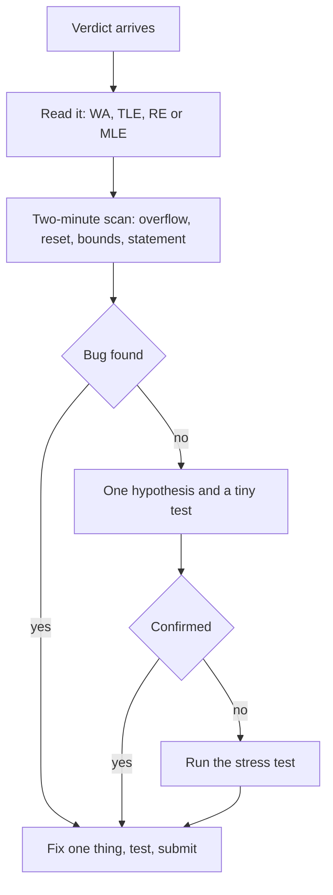

## The hook

The red text appears: Wrong Answer on test 4. Your heart rate jumps. You start changing things: `<` to `<=`, `int` to `long long`, a `+1` here, a `-1` there, resubmitting each time. Each attempt costs penalty, and none of them is aimed at anything.

Debugging under pressure feels like panic, but it can be a procedure. A short, ordered checklist finds most contest bugs faster than staring, and it keeps your penalty low.

## The intuition

:::analogy
When an aircraft warning light flashes, pilots do not start flipping switches at random. They open the checklist for that warning and work through it in order, calmly, because the checklist was written on a quiet day by people who were not panicking. Your debugging checklist is written now, on a quiet day, so that in the contest you only have to follow it.
:::

Each [[verdict]] points to a different part of the checklist. Wrong Answer, Time Limit Exceeded and Runtime Error have different usual suspects.

## Let's build it up

### Step 0: read the verdict properly

| Verdict | Usual suspects |
|---|---|
| Wrong Answer on test 1 | output format, misread statement, debug prints left in |
| Wrong Answer later | edge cases, overflow, a wrong idea, state not reset between tests |
| Time Limit Exceeded | complexity too high, `endl` in loops, no fast I/O, clearing big arrays every test |
| Runtime Error | out-of-bounds index, division by zero, stack overflow from deep recursion |
| Memory Limit Exceeded | arrays too large, recursion depth, storing all test cases |

### Step 1: the two-minute scan

Before forming any theory, check the things that break most often:

- **Overflow**: any sum, product or difference of values near 10⁹ in an `int`?
- **Reset**: in multi-test input, is every array, counter and container cleared for each case?
- **Bounds**: loops from `0` to `n` vs `n - 1`; arrays sized for the maximum n, not the sample's n.
- **Statement words**: "distinct", "at most", "modulo", "print any", "-1 if impossible".

### Step 2: form one hypothesis, test it

Write down a specific [[hypothesis]]: "it fails when n = 1", "it overflows when all values are large". Construct a tiny input that would expose it, run it, and compare with what you compute by hand. Change one thing, only if the test confirms it.

### Step 3: let the machine search

If nothing obvious turns up within a few minutes, run your stress test from [Let a Robot Find Your Wrong Answer](article:cp-stress-testing). A brute force and a generator find the failing input while you think.



:::insight
Most contest bugs are boring: overflow, missing resets, off-by-one bounds and misread words. Checking the boring list first, in the same order every time, beats any clever theory about what might be wrong.
:::

### Runtime errors and undefined behaviour

C++ has [[undefined behaviour]]: reading `a[n]` on an array of size n may print garbage locally and crash on the judge, or the other way round. Compile locally with a [[sanitizer]]:

```cpp partial
// g++ -std=c++17 -O1 -g -fsanitize=address,undefined sol.cpp
```

The program then stops at the exact line of an out-of-bounds read or a signed overflow, with a clear message. Deep recursion on trees or graphs with n near 10⁵ to 10⁶ can overflow the stack; an iterative version or an explicit stack fixes it.

### Time Limit Exceeded is a different hunt

For TLE, first recompute your complexity with the maximum n from the constraints, not the sample's n. Then look for hidden costs: a `map` where an array would do, strings copied into functions by value, `endl` inside loops, or clearing a large global array in every one of thousands of test cases. Generate one maximum-size input locally and time it. If the algorithm itself is too slow, no micro-optimisation will save it, and it is time to look for a better idea or move on.

### When nothing works: explain it

[[Rubber duck debugging]] sounds silly and works. Explain each line, in writing or out loud, to an imaginary listener. Bugs often surface the moment you say "and here we always..." and realise you do not always.

:::warning
Common misconception: "if the samples pass, the bug must be in the judge." The samples are tiny and chosen to explain the format. Hidden tests contain the edge cases and maximum sizes. In practice, the bug is almost always in your code or your reading of the statement.
:::

## A tiny example

Problem: for each test, print the maximum of `a[i] * a[j]` over pairs. You sort and print the product of the two largest. Wrong Answer on test 3.

1. **Scan:** values up to 10⁹, product up to 10¹⁸: is the product computed in `int`? It was `a[n-1] * a[n-2]` with `vector<int>`. Overflow, but fixing it still gives WA.
2. **Hypothesis:** "negatives break it." Tiny test: `[-10, -9, 1, 2]`. Expected 90; your code prints 2.
3. **Fix:** compare the product of the two largest with the product of the two smallest. Resubmit: Accepted.

Two bugs, found in order, each confirmed by a test before changing anything.

:::try-this
Write your personal checklist on a card: five lines for the two-minute scan, one line on how to compile with sanitizers, and the command to run your stress test. Keep it next to you in the next contest. (After a few contests, add the bugs from your mistakes log that keep coming back.)
:::

## Where you'll see this again

Every pattern article in this subject ends with a "Common mistakes" section, which is really a topic-specific version of this checklist. The [contest template](article:cp-fast-io-template) prevents several of these bugs before they happen, and [contest strategy](article:cp-contest-strategy) covers when to stop debugging and move on.

## Key takeaways

- Read the verdict first, because Wrong Answer, Time Limit Exceeded and Runtime Error point to different usual suspects.
- Start every debugging session with the same quick scan: overflow, resets between tests, loop bounds and statement keywords.
- Form one specific hypothesis, test it on a tiny input, and change only one thing at a time.
- If the bug stays hidden, let a stress test search for it while you think.
- Compile locally with sanitizers to catch undefined behaviour that may hide on your machine and crash on the judge.
