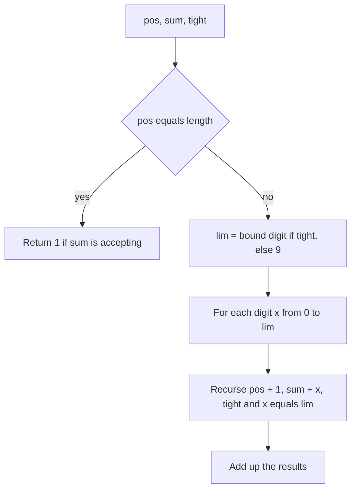

## The hook

How many numbers between 1 and 10¹⁸ have a digit sum divisible by 7? How many have no two equal adjacent digits? How many contain at most three non-zero digits? Looping over 10¹⁸ numbers is impossible, and the property depends on the digits, which plain maths does not handle well.

Problems of this shape come up in rated contests regularly, and they all fall to one technique: build the number digit by digit from the left, remember only what the property needs, and never let the number exceed the bound. With about 19 digits and a small state, the whole count takes microseconds.

## The intuition

:::analogy
Picture a car odometer that must never show more than a fixed limit, say 245. You set its wheels one at a time, from the leftmost. If you set the first wheel to 1, which is less than the limit's 2, the remaining wheels can spin freely through 0 to 9: nothing you choose can push the reading past 245. But if you set the first wheel to exactly 2, you are still pressed against the limit, and the next wheel may only go up to 4. You stay pressed against the limit only as long as you copy the limit's digits exactly.
:::

That "pressed against the limit" state is the [[tight flag]]. [[Digit DP]] counts every reading the odometer can show by filling wheels left to right, branching over each wheel's allowed digits, and remembering only what the property needs, such as the digit sum so far.

## How it works

### Step 1: reduce a range to prefixes

Define f(x) as the number of valid numbers in [0, x]. Then the count in [L, R] is f(R) − f(L − 1), the [[prefix-count trick]]. Careful when L = 0: f(−1) = 0.

### Step 2: the state

Write R as a digit string d₀d₁…d_{n−1}. A state is:

- **pos**: which digit we are choosing next.
- **tight**: are all digits so far equal to R's digits?
- **property state**: whatever the condition needs, such as the digit sum so far, the remainder of the digit sum modulo m, the previous digit, or how many non-zero digits have been used.
- sometimes **started**: has a non-zero digit been placed yet? This matters when [[leading zeros]] would break the property.

### Step 3: the transition

At position pos, the largest allowed digit is lim = d[pos] if tight, otherwise 9. For each digit x from 0 to lim:

- the new tight flag is tight AND (x == lim),
- update the property state with x,
- recurse to pos + 1.

At pos = n, return 1 if the property state is accepting (for example, the digit sum equals S), otherwise 0.

### Step 4: memoise

The number of states is small: for "digit sum equals S" it is about 19 positions × 172 possible sums (0 to 171) × 2 tight values. With [[memoisation]], each state is solved once, and each solve loops over at most 10 digits.



:::insight
Only one path through the digits is tight: the bound's own digits. The moment you choose a smaller digit, the rest of the number is free, and free suffixes with the same property state all have the same count. Memoising those free states is what collapses 10¹⁸ numbers into a few thousand subproblems.
:::

### Leading zeros and the started flag

Padding every number to the bound's length writes 7 as 007. For digit sums this is harmless, because zeros add nothing. For properties like "no two adjacent digits equal" or "the first digit is odd", the padding zeros would be wrongly treated as real digits. Add a [[started flag]] that stays false while only zeros have been placed, and ignore the property until it turns true. [Counting Numbers](article:cp-counting-numbers) walks through exactly this case.

## Walk through an example

Count numbers in [0, 245] whose digit sum is exactly 10.

Branch on the first digit, using R = 2 4 5:

| First digit | Tight after? | Remaining need | Count |
|---|---|---|---|
| 0 | no | two free digits summing to 10 | 9 |
| 1 | no | two free digits summing to 9 | 10 |
| 2 | yes | two digits summing to 8, second at most 4 | 5 |

The free rows are the memoised workhorses: two free digits sum to t in t + 1 ways for t ≤ 9, and in 19 − t ways for t from 10 to 18, so sum 10 gives 9 and sum 9 gives 10.

The tight row branches again. The second digit can be 0 to 4:

- second digit 0, 1, 2 or 3: no longer tight, and the third digit must be 8, 7, 6 or 5. One way each, 4 in total.
- second digit 4: still tight, the third digit must be 4, which is allowed because 4 ≤ 5. One way.

So 5 ways start with 2, and the total is 9 + 10 + 5 = **24**. A brute-force loop over 0 to 245 gives 24 as well.

For the range [100, 1000], the prefix trick gives f(1000) − f(99) = 63 − 9 = 54 numbers with digit sum 10.

:::try-this
Using the table method, how many numbers in [0, 99] have digit sum exactly 10? (Two free digits summing to 10: (1,9), (2,8), …, (9,1), giving 9. This matches the "first digit 0" row above, which is exactly the numbers below 100.)
:::

## The code

```pseudo
count_upto(R, S):                         // numbers in [0, R] with digit sum S
    if R < 0: return 0
    d = digits of R; n = len(d)
    memo = {}
    go(pos, sum, tight):
        if sum > S: return 0
        if pos == n: return 1 if sum == S else 0
        if not tight and (pos, sum) in memo: return memo[(pos, sum)]
        lim = d[pos] if tight else 9
        total = 0
        for x in 0 .. lim:
            total += go(pos + 1, sum + x, tight and x == lim)
        if not tight: memo[(pos, sum)] = total
        return total
    return go(0, 0, true)

answer(L, R) = count_upto(R, S) - count_upto(L - 1, S)
```

```cpp
#include <bits/stdc++.h>
using namespace std;

string D; int S;
long long memo[20][200];
bool seen[20][200];

long long go(int pos, int sum, bool tight) {
    if (sum > S) return 0;
    if (pos == (int)D.size()) return sum == S;
    if (!tight && seen[pos][sum]) return memo[pos][sum];
    int lim = tight ? D[pos] - '0' : 9;
    long long total = 0;
    for (int x = 0; x <= lim; x++) total += go(pos + 1, sum + x, tight && x == lim);
    if (!tight) { seen[pos][sum] = true; memo[pos][sum] = total; }
    return total;
}

long long countUpto(long long R, int s) {
    if (R < 0) return 0;
    D = to_string(R); S = s;
    memset(seen, 0, sizeof seen);
    return go(0, 0, true);
}

int main() {
    cout << countUpto(245, 10) << '\n';                         // 24
    cout << countUpto(1000, 10) - countUpto(99, 10) << '\n';    // 54
}
```

The memo is reset per call because it is indexed by position from the left, which depends on the bound's length.

## Complexity

- **Time:** O(n × K × 10), where n is the number of digits (at most 19 for 10¹⁸) and K the number of property states. For digit sums that is about 19 × 172 × 10 ≈ 33,000 steps.
- **Space:** O(n × K) for the memo.

Common property states: digit sum (up to 9n), a remainder modulo m (m states), the previous digit (10 states plus "none"), a count of something (up to n), or a bitmask of digits seen (2¹⁰).

## Common mistakes

:::warning
Common misconception: "padding with leading zeros never matters." It is harmless for sums and remainders, but it breaks any property that looks at the first digit, adjacent digits or the length of the number. If 007 must be treated as 7, track a started flag.
:::

- **Memoising tight states together with free ones**: a tight state's answer depends on the bound's remaining digits, so either skip memoising it or include tight in the memo key.
- **Forgetting that 0 is counted**: f(x) counts [0, x]. If the problem's range starts at 1, decide whether 0 satisfies the property and subtract it if needed.
- **f(L) instead of f(L − 1)**, which drops L itself from the answer.
- **Reusing the memo across different bounds** when the state depends on the bound's length, or when the property's target changes.
- **State too large**: if your state includes the whole number so far, it is not digit DP any more. Keep only what the property needs.

## Practice problems

*Digit Sum* (AtCoder Educational DP Contest) counts numbers up to a bound with up to 10,000 digits whose digit sum is divisible by D: the state is the remainder. *Counting Numbers* (CSES) needs the previous digit and the started flag. *Classy Numbers* tracks how many non-zero digits have been used. *Numbers At Most N Given Digit Set* restricts which digits can be used, and *Number of Digit One* sums a quantity over all numbers instead of counting them. If recursion with memoisation still feels shaky, revisit [Dynamic Programming Is Just Careful Recursion](article:dsa-dp-intro).

## Key takeaways

- Digit DP counts numbers up to a bound by choosing digits from the left, tracking a tight flag and a small property state.
- While tight, the next digit is limited by the bound's digit; once a smaller digit is chosen, all later digits are free.
- Free states with the same position and property state have the same count, so memoising them turns huge ranges into a few thousand subproblems.
- Answer ranges with f(R) − f(L − 1), and handle L = 0 and whether 0 itself counts.
- Add a started flag whenever leading zeros would change the property, such as rules about adjacent or first digits.
