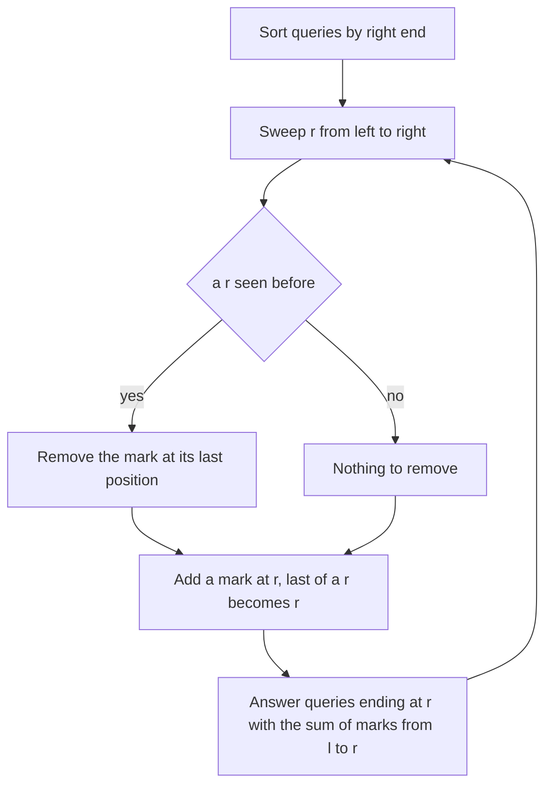

## The hook

A hotel keeps a log of guests checking in, one per night, and the manager asks: between night 40 and night 90, how many different guests stayed? A guest who came five times must count once. Answering by collecting names in a set for every question costs the length of the range each time, and with 2 × 10⁵ questions that is too slow.

The fix is a clever bookkeeping rule: count each guest only at their latest visit. If the questions are answered in the right order, that rule turns "how many distinct" into a plain range sum.

## The problem

CSES *Distinct Values Queries*: an array of n integers and q queries [a, b], each asking how many distinct values a[a..b] contains. n and q go up to 2 × 10⁵, values up to 10⁹.

For a = [3, 1, 3, 2, 1, 3, 4, 2] (0-based) and queries [1, 4], [0, 7], [2, 5], [5, 7], [3, 3], the answers are 3, 4, 3, 3, 1.

## The obvious approach

Put each range into a set: O(n) per query, 4 × 10¹⁰ in the worst case. Mo's algorithm, from [A Tour Guide Who Orders the Stops](article:cp-mos-algorithm), solves it in O((n + q)√n), which passes, and a merge sort tree over next occurrences, from [A Sorted Card Box on Every Shelf](article:cp-merge-sort-tree), answers online in O(log² n). The offline sweep below is simpler and faster than both.

## The key insight

:::analogy
The manager keeps a single board with one pin per night. When a guest checks in, the manager moves that guest's pin to tonight, taking it out of the night of their previous visit. So each guest has exactly one pin, at their latest visit so far. When the manager reaches night 90 and is asked about nights 40 to 90, every guest who stayed at least once in that window has their latest visit in the window too, so their pin is there; guests whose latest visit was before night 40 did not stay. Counting pins between 40 and 90 is the answer.
:::

The pins are [[last-occurrence mark]]s, kept in a Fenwick tree so a range of pins can be counted in O(log n). The order matters, so this is a [[right-end sweep]] with [[offline answering]]:

- compress values and remember last[v], the latest position of value v so far, initially none;
- sort the queries by right end;
- sweep r from 0 to n - 1: if last[a[r]] exists, add -1 there; add +1 at r; set last[a[r]] = r;
- after processing position r, answer every query with that right end: distinct = sum(l..r) of marks.

The correctness argument is the [[representative occurrence]] idea: each value present in [l, r] is represented exactly once, by its latest occurrence up to r, which must lie in [l, r].

| Method | Time | Online? |
|---|---|---|
| Set per query | O(n × q) | yes |
| Mo's algorithm | O((n + q)√n) | no |
| Merge sort tree on next occurrences | O((n + q) log² n) | yes |
| Right-end sweep with a Fenwick tree | O((n + q) log n) | no |

### The same trick elsewhere

Codeforces *Mishka and Interesting sum* asks for the XOR of values that appear an even number of times in a range. The XOR of the whole range cancels pairs and gives the XOR of values appearing an odd number of times; the XOR of distinct values comes from this exact sweep, with a Fenwick tree of XOR instead of sums. XOR-ing the two gives the answer.



:::insight
Counting distinct values is hard because duplicates must be ignored. Keeping a mark only at each value's latest occurrence, and answering queries when the sweep reaches their right end, makes every present value counted exactly once, so a range sum gives the answer.
:::

## Walk through an example

a = [3, 1, 3, 2, 1, 3, 4, 2]; queries sorted by right end: [3, 3], [1, 4], [2, 5], [0, 7], [5, 7].

| Sweep reaches r | Marks (positions 0 to 7) | Query answered | Sum of marks in [l, r] |
|---|---|---|---|
| 3 | 0 1 1 1 0 0 0 0 | [3, 3] | 1 |
| 4 | 0 0 1 1 1 0 0 0 | [1, 4] | 3 |
| 5 | 0 0 0 1 1 1 0 0 | [2, 5] | 3 |
| 7 | 0 0 0 0 1 1 1 1 | [0, 7] | 4 |
| 7 | same | [5, 7] | 3 |

Look at r = 4: the 1 at position 4 moved its mark from position 1, so for [1, 4] value 1 is counted once, at position 4. At r = 5, the 3 at position 5 moved value 3's mark from position 2 to 5; for [2, 5], value 3 is still counted, now at 5.

Answers in the original order [1, 4], [0, 7], [2, 5], [5, 7], [3, 3]: 3, 4, 3, 3, 1.

:::try-this
Answer [3, 6], and show what goes wrong if you read it from the marks at r = 7 instead. (At r = 6 the marks are 0 0 0 1 1 1 1 0, so [3, 6] sums to 4: the values 2, 1, 3 and 4. At r = 7 the mark for value 2 has moved from position 3 to position 7, outside the range, and the same sum gives 3. Each query must be answered exactly when the sweep reaches its own right end.)
:::

:::warning
Common misconception: "Mark the first occurrence of each value instead; it is the same thing." First-occurrence marks depend on the left end, not the right: a value whose first occurrence is before l but which reappears inside [l, r] would be missed. With a left-to-right sweep, the latest occurrence is the one that works; if you prefer first occurrences, sweep from right to left and sort queries by left end instead.
:::

## The code

```pseudo
sort queries by r
last = empty map; bit = zeros; ptr = 0
for r in 0 .. n-1:
    if a[r] in last: bit.add(last[a[r]], -1)
    bit.add(r, +1); last[a[r]] = r
    while ptr < q and queries[ptr].r == r:
        answer[queries[ptr].idx] = bit.sum(l .. r); ptr += 1
```

```cpp
#include <bits/stdc++.h>
using namespace std;

struct BIT {
    int n;
    vector<int> t;
    explicit BIT(int n) : n(n), t(n + 1, 0) {}
    void add(int i, int d) { for (++i; i <= n; i += i & -i) t[i] += d; }          // 0-based input
    int sum(int i) const { int s = 0; for (++i; i > 0; i -= i & -i) s += t[i]; return s; }
    int range(int l, int r) const { return sum(r) - (l ? sum(l - 1) : 0); }
};

vector<int> distinctQueries(const vector<int>& a, const vector<array<int, 2>>& qs) {
    int n = a.size();
    vector<int> order(qs.size()), ans(qs.size());
    iota(order.begin(), order.end(), 0);
    sort(order.begin(), order.end(), [&](int x, int y) { return qs[x][1] < qs[y][1]; });
    unordered_map<int, int> last;
    BIT bit(n);
    size_t p = 0;
    for (int r = 0; r < n; r++) {
        auto it = last.find(a[r]);
        if (it != last.end()) bit.add(it->second, -1);   // move the value's mark to r
        bit.add(r, 1);
        last[a[r]] = r;
        while (p < order.size() && qs[order[p]][1] == r) {
            ans[order[p]] = bit.range(qs[order[p]][0], r);
            p++;
        }
    }
    return ans;
}

int main() {
    vector<int> a = {3, 1, 3, 2, 1, 3, 4, 2};
    for (int x : distinctQueries(a, {{1, 4}, {0, 7}, {2, 5}, {5, 7}, {3, 3}, {2, 7}, {3, 6}})) cout << x << ' ';
    cout << '\n';                                       // 3 4 3 3 1 4 4
}
```

For CSES, compress the values or keep the hash map as shown; with adversarial inputs a sorted-vector compression is the safer choice.

## Complexity

- **Sorting queries: O(q log q).**
- **Sweep: O(n log n),** with at most two Fenwick updates per position.
- **Queries: O(q log n),** one range sum each.
- **Space: O(n + q).**

## Common mistakes

- **Answering a query after the sweep has passed its right end,** when some marks have moved beyond it.
- **Forgetting to remove the previous mark** of a value, which counts duplicates.
- **Losing the original order** of queries when printing answers.
- **Marking first occurrences** with a left-to-right sweep.
- **Using a hash map on Codeforces with adversarial tests;** compress values with sorting instead.

## Practice problems

CSES *Distinct Values Queries* and SPOJ *D-query* are this sweep. Codeforces *Mishka and Interesting sum* uses the same sweep with XOR to recover the XOR of distinct values in a range. For other offline orderings, the general technique has its own article in this track.

## Key takeaways

- Distinct values in a range can be counted by marking only each value's latest occurrence seen so far.
- Sorting queries by right end and answering each when the sweep reaches it keeps those marks correct for the query.
- Each value present in [l, r] has its latest occurrence up to r inside [l, r], so the sum of marks there is the number of distinct values.
- A Fenwick tree makes each mark move and each range count O(log n), for O((n + q) log n) overall.
- The same latest-occurrence sweep works for other "count each value once" questions, such as the XOR of distinct values.
