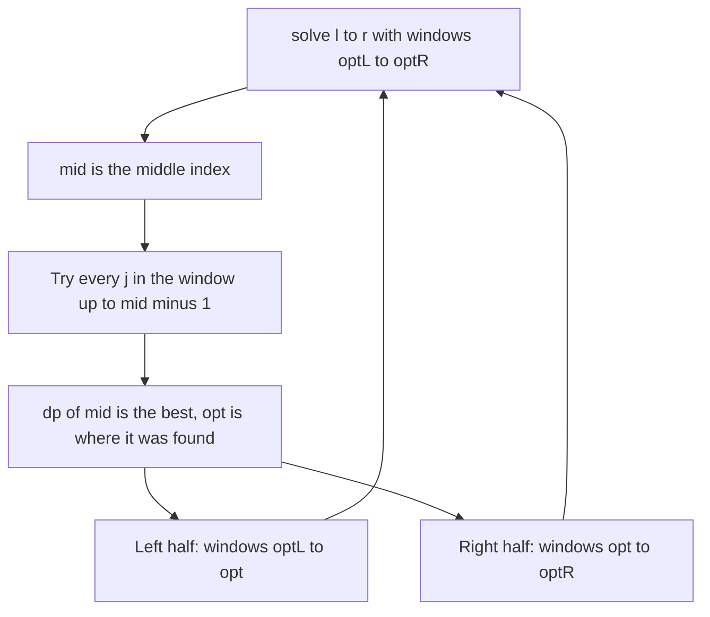

## The hook

A city council splits a long street of shops into k districts, each a run of consecutive shops, and wants to minimise a total cost that grows with each district's size. The textbook DP tries every place for the last district line for every prefix of the street: O(n²) per district count, too slow for n = 4,000 shops and k = 800 districts.

But look at where the best last line falls as the street gets longer. It never jumps backwards: adding shops at the end can only push the best boundary further along. That single observation lets each layer of the DP be computed in O(n log n), by divide and conquer.

## The intuition

:::analogy
The council computes the best last district line for the middle of the street first, by trying every candidate. Now for any shorter street, the best last line cannot be to the right of that answer, and for any longer street it cannot be to the left. So the planners split the remaining work into two halves, each with a smaller strip of candidate lines to try, and repeat. Like a ruler halving a distance again and again, each level of this process checks about as many candidates as there are shops, and there are only log n levels.
:::

The DP is a [[layered partition DP]]: dp[k][i] is the best cost of splitting the first i items into k groups. The [[optimal split point]] opt[k][i] is where the last group starts. When opt is [[monotone opt]], non-decreasing in i, each layer can be computed from the previous one by divide and conquer over i, passing down a shrinking [[search window]] of candidate split points.

## How it works

### The recursion

To fill layer k for indices in [l, r] knowing that their split points lie in [optL, optR]:

```
solve(l, r, optL, optR):
    if l > r: return
    mid = (l + r) / 2
    scan j from optL to min(mid - 1, optR): best = argmin of dp[k-1][j] + cost(j, mid)
    dp[k][mid] = that minimum; opt = best
    solve(l, mid - 1, optL, opt)
    solve(mid + 1, r, opt, optR)
```

Call solve(1, n, 0, n - 1) for each layer k. At each recursion depth, the windows of the calls overlap only at their endpoints, so the total scanning per depth is O(n), and the depth is O(log n): O(n log n) per layer, O(k × n log n) overall.

### When is opt monotone?

A sufficient condition is the [[quadrangle inequality]] on the cost: for a ≤ b ≤ c ≤ d,

cost(a, c) + cost(b, d) ≤ cost(a, d) + cost(b, c).

Informally, two overlapping ranges are never worse than one big range plus one small one inside it. Common costs that satisfy it:

| Cost of a group | Satisfies the inequality? |
|---|---|
| (sum of the group)² with non-negative values | yes |
| sum over pairs in the group of a non-negative matrix entry, as in Ciel and Gondolas | yes |
| sum of distances to the group's median, as in Allocate Mailboxes | yes |
| an arbitrary table of costs | not in general; check or test |

In a contest, if the proof is not obvious, compare against the plain O(n²) DP on random small inputs before trusting the optimisation, the stress-testing habit from [Let a Robot Find Your Wrong Answer](article:cp-stress-testing).

### Costs that are hard to compute

The scan needs cost(j, mid) quickly. Prefix sums give O(1) for sums and squares of sums. For costs like "number of equal pairs in the group", as in *Yet Another Minimization Problem*, the trick is that consecutive cost queries in the recursion move their endpoints only a little, so a Mo-style window with add and remove keeps the total movement at O(n log n) per layer.



:::insight
If the best split point never moves left as the prefix grows, then computing it for the middle index tells you which side every other index's split point lies on. Halving the indices and the candidate ranges together gives O(n log n) per layer instead of O(n²).
:::

## Walk through an example

Split a = [1, 3, 2, 4, 1, 5] into k = 3 groups of consecutive elements, minimising the sum of (group sum)².

### Layer k = 2: optimal split points

| Prefix length i | 1 | 2 | 3 | 4 | 5 | 6 |
|---|---|---|---|---|---|---|
| opt[2][i] | 0 | 1 | 2 | 2 | 3 | 3 |

They never decrease, as the quadrangle inequality promises. Divide and conquer computes i = 3 first (the middle of 1..6), scanning j = 0, 1, 2 and finding opt 2. Then the left half, i = 1 and 2, only scans j from 0 to 2, and the right half, i = 4 to 6, only scans j from 2 upward.

### The answer

dp[3][6] = 86, with groups [1, 3, 2], [4, 1], [5]: 6² + 5² + 5² = 36 + 25 + 25. The plain O(k × n²) DP gives the same value, which the program below checks on random inputs as well.

:::try-this
For a = [1, 3, 2, 4, 1, 5] and k = 2, what is the best split, and is it consistent with opt[2][6] = 3? (opt[2][6] = 3 means the last group is a[3..5] = [4, 1, 5], sum 10, and the first is [1, 3, 2], sum 6. The cost is 36 + 100 = 136. Splitting after 4 instead, [1, 3, 2, 4] and [1, 5], costs 100 + 36 = 136 too; ties are allowed, and taking the smallest j keeps opt monotone.)
:::

:::warning
Common misconception: "Divide and conquer optimisation works for any partition DP." It relies entirely on monotone split points. With a cost that breaks the quadrangle inequality, the narrowed windows exclude the true optimum and the answer is silently too large. Prove the inequality, or at least stress-test against the O(n²) DP, before submitting.
:::

## The code

```pseudo
for k in 1..K:
    solve(l = 1, r = n, optL = 0, optR = n - 1)   # fills cur[] from prev[]
    prev = cur
answer = prev[n]
```

```cpp
#include <bits/stdc++.h>
using namespace std;
using ll = long long;
const ll INF = LLONG_MAX / 4;

struct DCDP {
    vector<ll> P, prv, cur;
    ll cost(int j, int i) const { ll s = P[i] - P[j]; return s * s; }    // group a[j..i-1]
    void solve(int l, int r, int optL, int optR) {
        if (l > r) return;
        int mid = (l + r) / 2, best = optL;
        cur[mid] = INF;
        for (int j = optL; j <= min(mid - 1, optR); j++) {
            if (prv[j] >= INF) continue;
            ll v = prv[j] + cost(j, mid);
            if (v < cur[mid]) cur[mid] = v, best = j;
        }
        solve(l, mid - 1, optL, best);                                    // split points no further right
        solve(mid + 1, r, best, optR);                                    // split points no further left
    }
    ll run(const vector<ll>& a, int K) {
        int n = a.size();
        P.assign(n + 1, 0);
        for (int i = 0; i < n; i++) P[i + 1] = P[i] + a[i];
        prv.assign(n + 1, INF), prv[0] = 0;
        for (int k = 1; k <= K; k++) {
            cur.assign(n + 1, INF);
            solve(1, n, 0, n - 1);
            prv = cur;
            prv[0] = INF;                                                 // k >= 1 groups cannot cover 0 items
        }
        return prv[n];
    }
};

ll slowDP(const vector<ll>& a, int K) {
    int n = a.size();
    vector<ll> P(n + 1, 0);
    for (int i = 0; i < n; i++) P[i + 1] = P[i] + a[i];
    vector<vector<ll>> dp(K + 1, vector<ll>(n + 1, INF));
    dp[0][0] = 0;
    for (int k = 1; k <= K; k++)
        for (int i = 1; i <= n; i++)
            for (int j = 0; j < i; j++)
                if (dp[k - 1][j] < INF) dp[k][i] = min(dp[k][i], dp[k - 1][j] + (P[i] - P[j]) * (P[i] - P[j]));
    return dp[K][n];
}

int main() {
    DCDP d;
    cout << d.run({1, 3, 2, 4, 1, 5}, 3) << ' ' << slowDP({1, 3, 2, 4, 1, 5}, 3) << '\n';   // 86 86
    mt19937 rng(23);
    int bad = 0;
    for (int t = 0; t < 300; t++) {                                       // stress test
        int n = rng() % 12 + 1, K = rng() % n + 1;
        vector<ll> a(n);
        for (ll& x : a) x = rng() % 20;
        bad += d.run(a, K) != slowDP(a, K);
    }
    cout << bad << '\n';                                                  // 0
}
```

The stress test compares the optimised DP with the plain one on 300 random cases; for a cost that satisfies the quadrangle inequality, there should be no mismatches.

## Complexity

- **Per layer: O(n log n)** cost evaluations.
- **Total: O(K × n log n),** compared with O(K × n²) for the plain DP.
- **Space: O(n)** for two layers and the prefix sums.
- **With Mo-style costs,** each layer adds O(n log n) window moves.

## Common mistakes

- **Applying it without monotone split points,** which gives wrong answers without any error.
- **Letting the window exceed mid - 1,** which allows an empty last group.
- **Passing the windows the wrong way:** the left half gets [optL, best] and the right half [best, optR], both including best.
- **Breaking ties inconsistently;** take the smallest best j, or consistently the largest, so monotonicity is preserved.
- **Recomputing costs from scratch** in O(n) each, which loses the speed-up.

## Practice problems

*Ciel and Gondolas* is the classic: split people into k gondolas minimising unfamiliarity, a pair-sum cost with prefix sums over a matrix. *Yet Another Minimization Problem* needs a Mo-style window for its cost. *Allocate Mailboxes* is small enough for the plain DP but is a good place to try the optimisation with a median-distance cost. A related speed-up for interval DPs is Knuth's optimisation, next in this track.

## Key takeaways

- Layered partition DPs of the form dp[k][i] = min over j of dp[k - 1][j] + cost(j, i) are O(n²) per layer when done directly.
- If optimal split points never decrease as i grows, computing dp for the middle index bounds the split points of both halves.
- Recursing with shrinking windows makes each layer O(n log n), because the windows at each recursion depth together span about n candidates.
- The quadrangle inequality on the cost function guarantees monotone split points.
- When a proof is not obvious, a stress test against the plain DP is the practical check before trusting the optimisation.
