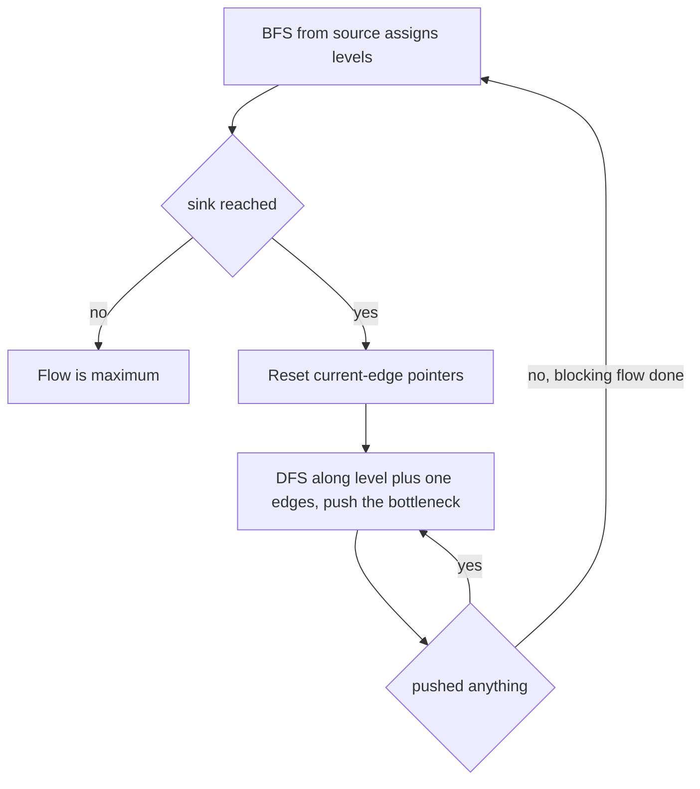
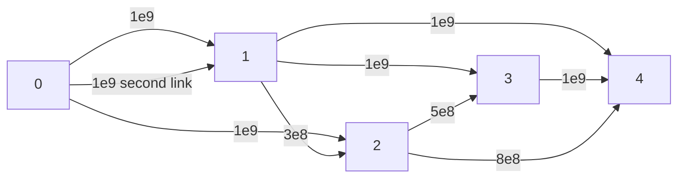

## The hook

You are downloading a file from a server through a mesh of routers. Each link between two routers has a bandwidth limit, data may split and merge freely, and you want the largest total speed. That is a maximum flow, exactly the model of [Water Pipes From a Reservoir to a City](article:cp-max-flow).

The walkthrough here adds two things contest practice needs: a faster algorithm, Dinic's, that is the usual default for flow problems, and the care that a total of several billion bytes per second needs in C++.

## The problem

CSES *Download Speed*: there are n computers, from 1 to n, and m directed connections, each from a to b with speed c. Computer 1 is the server and computer n is yours. Print the maximum download speed. The limits are n ≤ 500, m ≤ 1000 and c ≤ 10⁹; several connections may join the same pair of computers.

For five routers 0 to 4, server 0, user 4, and links 0 → 1 (10⁹, twice), 0 → 2 (10⁹), 1 → 3 (10⁹), 1 → 4 (10⁹), 3 → 4 (10⁹), 2 → 4 (8·10⁸), 1 → 2 (3·10⁸), 2 → 3 (5·10⁸), the answer is 2,800,000,000.

## The obvious approach

Edmonds–Karp from the max-flow article is correct and O(V·E²); at these limits that bound is about 500 · 10⁶ = 5·10⁸, uncomfortably large, although it usually runs well below its bound. Plain DFS augmenting paths are worse: their cost depends on the flow value, which can be billions.

Two simpler slips are also common. Merging parallel links into one edge is fine, provided capacities are added; keeping only one of them loses bandwidth. And storing the total in an int overflows: 2.8·10⁹ is above 2³¹ − 1 = 2,147,483,647.

## The key insight

:::analogy
A network engineer measures every router's hop distance from the server. In one round, data is only allowed to move one hop farther from the server along every link it uses: no sideways links, no links back towards the server. Under that rule, the engineer fills paths until every forward route to the user is clogged. Then they remeasure. Because every shortest route got clogged, the user is now strictly farther away in hops, so there can be at most as many rounds as there are routers.
:::

The hop distances define the [[level graph]], filling until clogged is a [[blocking flow]], and one measure-and-fill round is a [[phase]].

### Dinic's algorithm

```
while BFS from s reaches t:                  # levels = distances in the residual graph
    ptr[v] = 0 for all v
    while (f = dfs(s, t, infinity)) > 0:     # blocking flow
        flow += f

dfs(u, t, pushed):
    if u == t: return pushed
    for each edge index i from ptr[u] onwards:      # i is a reference to ptr[u]
        edge u -> v with cap > 0 and level[v] == level[u] + 1:
            got = dfs(v, t, min(pushed, cap))
            if got > 0: cap -= got; twin cap += got; return got
    return 0
```

- **Why the levels help:** every DFS path is a shortest augmenting path. After a blocking flow, no shortest path has room, so the next BFS puts t farther away; distances are at most V − 1, so there are at most V phases.
- **Why the [[current-edge pointer]] matters:** when an edge is saturated or leads nowhere, it cannot become useful again in this phase, because only edges going one level deeper are used, and pushing flow never adds new edges of that kind. Advancing ptr[u] past it means each edge is abandoned at most once per phase.

With both, a phase costs O(V·E), and the total is O(V²·E). On unit-capacity networks, such as bipartite matching, Dinic is even faster, which is why it is the common default.

### Modelling Download Speed

- One vertex per computer; the server is the source, your computer the sink.
- One directed edge per connection, with its capacity. [[Parallel links]] stay as separate edges, which is correct automatically.
- Capacities and flow in long long.

### Police Chase from the same code

CSES *Police Chase* asks for the fewest streets to close so that no route joins crossing 1 and crossing n. Streets are two-way, so each becomes one edge with capacity 1 whose twin also starts at 1. After the max flow, search from the source along edges with spare capacity; the streets with one end reached and the other not are a minimum cut.



:::insight
Edmonds–Karp finds one shortest augmenting path per BFS. Dinic reuses a single BFS for all shortest augmenting paths of the same length at once, and the current-edge pointer stops the DFS from paying twice for any dead end.
:::

## Walk through an example

The five-router network:



**Phase 1.** BFS levels: router 0 at 0; routers 1 and 2 at 1; routers 3 and 4 at 2. The level graph keeps only edges that go one level deeper, so 1 → 2 (same level) and 3 → 4 (same level) are excluded.

| Step | Path tried | Pushed | What the pointers learn |
|---|---|---|---|
| 1 | 0 → 1 → 4 | 10⁹ | from 1, edge 1 → 3 is skipped first: 3 is a dead end this phase |
| 2 | 0 → second link → 1 | 0 | 1 → 4 is now full and 1 → 2 is not deeper: router 1 is exhausted, so the same DFS call moves on |
| 3 | 0 → 2 → 4 | 8·10⁸ | |
| 4 | none left | 0 | phase ends with 1.8·10⁹ |

**Phase 2.** The residual BFS now finds the sink at level 3: 0 → 1 through the unused second link, 1 → 3, 3 → 4. One push of 10⁹ along 0 → 1 → 3 → 4 saturates 3 → 4. Total 2.8·10⁹.

**Phase 3.** BFS from 0 reaches 2, through the leftover 2·10⁸ on 0 → 2, then 3 through 2 → 3, but 3 → 4, 2 → 4 and 1 → 4 are all full. The sink is unreachable: done after two phases.

The minimum cut is the three links into router 4: 10⁹ + 10⁹ + 8·10⁸ = 2.8·10⁹, matching the flow.

**Police Chase.** Six crossings, streets 0–1, 0–2, 1–2, 1–3, 2–4, 3–5, 4–5, 3–4, from 0 to 5. The max flow is 2, and the residual search from 0 reaches only 0 itself, so the streets to close are 0–1 and 0–2. Other minimum cuts exist, such as 3–5 and 4–5; any one is accepted.

:::try-this
Double the link 3 → 4 to 2·10⁹. What is the new speed, and which cut proves it? (The links into router 4 now total 3.8·10⁹, so that cut no longer binds. The source's own links total 3·10⁹, and a flow of that size exists: 2·10⁹ over both 0 → 1 links, split as 10⁹ to router 3 and 10⁹ to router 4, and 10⁹ over 0 → 2, split as 8·10⁸ to router 4 and 2·10⁸ to router 3. Router 3 forwards its 1.2·10⁹ over the doubled link. The answer is 3,000,000,000, proved by the cut around the source.)
:::

:::warning
Common misconception: "Dinic's DFS can restart each search from the first edge of every vertex." It still gives the right answer, but each phase can then re-walk the same dead ends again and again, and the O(V²·E) bound is lost. The pointer must be a reference, `for (int& i = ptr[u]; ...)`, so the progress survives between DFS calls within a phase and is reset only when a new phase begins.
:::

## The code

```pseudo
addEdge(a, b, c, back = 0): forward edge with cap c, twin with cap back
maxflow: while BFS sets levels and reaches t:
             ptr = 0 everywhere
             while f = dfs(s, t, infinity) > 0: flow += f
dfs(u): if u == t: return pushed
        for i = ptr[u] onwards (by reference): edge to v with cap > 0 and level[v] = level[u] + 1:
            got = dfs(v, min(pushed, cap)); if got: update caps; return got
        return 0
police chase: undirected streets as (c, c); after flow, cut = streets crossing the reachable set
```

```cpp
#include <bits/stdc++.h>
using namespace std;
using ll = long long;

struct Dinic {
    struct Edge { int to; ll cap; };
    vector<Edge> e;                                              // edges 2i and 2i+1 are twins
    vector<vector<int>> g;
    vector<int> level, ptr;
    int phases = 0;
    Dinic(int n) : g(n), level(n), ptr(n) {}
    void addEdge(int a, int b, ll c, ll back = 0) {              // back = c for an undirected street
        g[a].push_back(e.size()), e.push_back({b, c});
        g[b].push_back(e.size()), e.push_back({a, back});
    }
    bool bfs(int s, int t) {                                     // level = distance from s in the residual graph
        fill(level.begin(), level.end(), -1);
        vector<int> q = {s};
        level[s] = 0;
        for (int i = 0; i < (int)q.size(); i++)
            for (int id : g[q[i]])
                if (e[id].cap > 0 && level[e[id].to] < 0) level[e[id].to] = level[q[i]] + 1, q.push_back(e[id].to);
        return level[t] >= 0;
    }
    ll dfs(int u, int t, ll pushed) {                            // follow only edges that go one level deeper
        if (u == t) return pushed;
        for (int& i = ptr[u]; i < (int)g[u].size(); i++) {       // current-edge pointer: dead edges are skipped for good
            int id = g[u][i], v = e[id].to;
            if (e[id].cap == 0 || level[v] != level[u] + 1) continue;
            ll got = dfs(v, t, min(pushed, e[id].cap));
            if (got) { e[id].cap -= got, e[id ^ 1].cap += got; return got; }
        }
        return 0;
    }
    ll maxflow(int s, int t) {
        ll flow = 0;
        while (bfs(s, t)) {                                      // one phase per shortest-path length
            phases++;
            fill(ptr.begin(), ptr.end(), 0);
            while (ll f = dfs(s, t, LLONG_MAX)) flow += f;       // blocking flow in this level graph
        }
        return flow;
    }
    vector<char> sourceSide(int s) const {                       // reachable from s in the final residual graph
        vector<char> seen(g.size(), 0);
        vector<int> st = {s};
        seen[s] = 1;
        while (!st.empty()) {
            int u = st.back(); st.pop_back();
            for (int id : g[u]) if (e[id].cap > 0 && !seen[e[id].to]) seen[e[id].to] = 1, st.push_back(e[id].to);
        }
        return seen;
    }
};

int main() {
    const ll G = 1'000'000'000;                                  // links of up to a billion bytes per second
    vector<array<ll, 3>> links = {{0, 1, G}, {0, 1, G}, {0, 2, G}, {1, 3, G}, {1, 4, G}, {3, 4, G},
                                  {2, 4, 800'000'000}, {1, 2, 300'000'000}, {2, 3, 500'000'000}};
    Dinic d(5);
    for (auto [a, b, c] : links) d.addEdge(a, b, c);
    cout << d.maxflow(0, 4) << ' ' << d.phases << '\n';          // 2800000000 2

    links[5][2] = 2 * G;                                         // the try-this: double the link 3 -> 4
    Dinic d2(5);
    for (auto [a, b, c] : links) d2.addEdge(a, b, c);
    cout << d2.maxflow(0, 4) << '\n';                            // 3000000000

    vector<array<int, 2>> streets = {{0, 1}, {0, 2}, {1, 2}, {1, 3}, {2, 4}, {3, 5}, {4, 5}, {3, 4}};
    Dinic p(6);                                                  // Police Chase: undirected, capacity 1
    for (auto [a, b] : streets) p.addEdge(a, b, 1, 1);
    cout << p.maxflow(0, 5) << ':';
    auto side = p.sourceSide(0);
    for (auto [a, b] : streets) if (side[a] != side[b]) cout << ' ' << a << '-' << b;
    cout << '\n';                                                // 2: 0-1 0-2

    mt19937 rng(16);                                             // flow equals the cheapest cut, directed and undirected
    bool ok = true;
    for (int it = 0; it < 400; it++) {
        int n = 2 + rng() % 6, m = rng() % 12;
        bool undirected = rng() % 2;
        vector<array<ll, 3>> r;
        Dinic h(n);
        for (int i = 0; i < m; i++) {
            int a = rng() % n, b = rng() % n;
            ll c = rng() % 7;
            if (a == b) continue;
            r.push_back({a, b, c}), h.addEdge(a, b, c, undirected ? c : 0);
        }
        ll flow = h.maxflow(0, n - 1), best = LLONG_MAX;
        for (int mask = 0; mask < (1 << n); mask++) {
            if (!(mask & 1) || (mask >> (n - 1) & 1)) continue;   // source inside, sink outside
            ll cut = 0;
            for (auto [a, b, c] : r) {
                bool A = mask >> a & 1, B = mask >> b & 1;
                if (A && !B) cut += c;
                if (undirected && B && !A) cut += c;             // a two-way street crosses either way
            }
            best = min(best, cut);
        }
        ok = ok && flow == best;
    }
    cout << (ok ? "stress ok" : "stress FAILED") << '\n';        // stress ok
}
```

For CSES input, read the connections 1-indexed, call `addEdge(a − 1, b − 1, c)` and print `maxflow(0, n − 1)`. For *Police Chase*, print the flow and then each street that crosses the reachable set, 1-indexed.

## Complexity

- **Dinic: O(V²·E)** in general, at most V phases of O(V·E) each; in practice much faster, and O(E·√V) on unit-capacity bipartite networks.
- **Minimum cut:** one extra O(V + E) search.
- **Space: O(V + E)** with two entries per link.

## Common mistakes

- **int for capacities or totals,** which overflows past 2,147,483,647.
- **Dropping parallel links** instead of keeping each as an edge.
- **A pointer that is not a reference,** which loses the current-edge progress.
- **Forgetting to reset ptr** at the start of each phase.
- **Allowing same-level or backward edges** in the DFS, which breaks the phase bound.
- **For Police Chase, adding two independent directed edges per street with zero-capacity twins:** it works for the flow value, but the cut must then be read carefully; one edge with both capacities set to 1 is simpler.

## Practice problems

*Download Speed* is this walkthrough. *Police Chase* is the minimum cut of an undirected graph. *School Dance* is bipartite matching as unit-capacity flow, where Dinic is fast; the dedicated method is in [Pairing Dancers Who Agreed to Dance Together](article:cp-bipartite-matching). The theory behind every step, from residual graphs to the max-flow min-cut theorem, is in [Water Pipes From a Reservoir to a City](article:cp-max-flow).

## Key takeaways

- Download Speed is maximum flow with one edge per connection, parallel links kept separate, and 64-bit capacities and totals.
- Dinic's algorithm builds a level graph with BFS and pushes a blocking flow along edges that go exactly one level deeper.
- After each blocking flow the sink's distance strictly increases, so there are at most V phases and O(V²·E) work in total.
- The current-edge pointer, kept by reference and reset each phase, ensures every dead end is paid for only once per phase.
- The same code answers minimum cut questions such as Police Chase by searching the final residual graph from the source.
