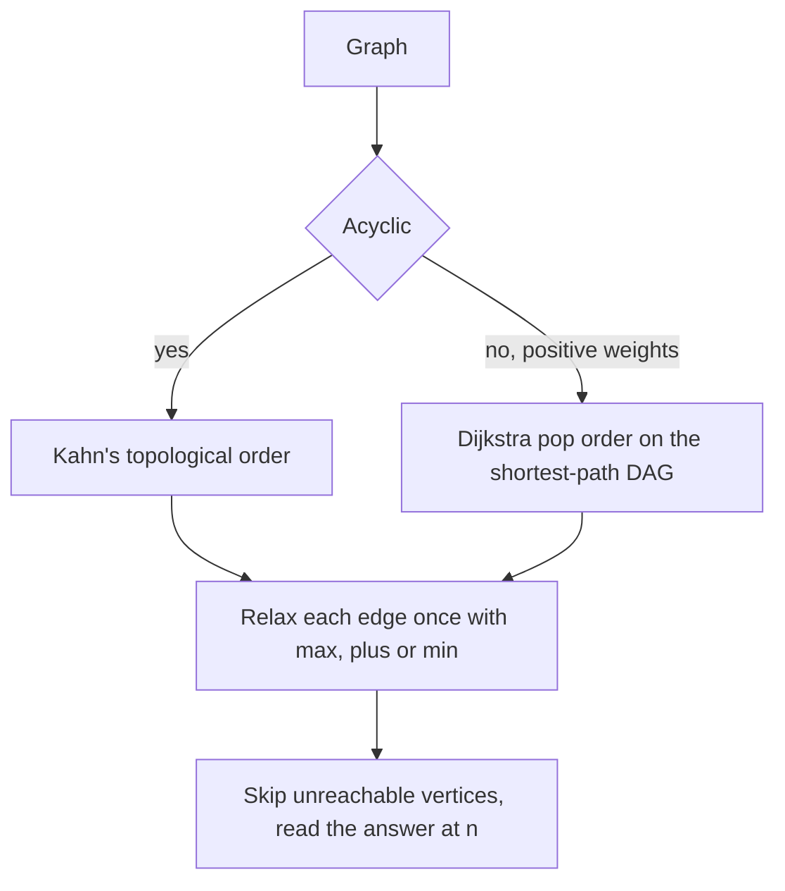

## The hook

Rainwater on a hillside only runs downhill, so it never comes back to a spot it has left. To find the longest stream from the summit to the sea, or to count all the different streams, you can work from high ground to low ground, and each spot needs only the spots above it.

The theory, relaxing edges in topological order, is in [Water Running Downhill](article:dsa-shortest-path-dag). Contest problems add three practical demands: print the route, not just its length; count routes modulo a prime; and treat weighted graphs with cycles by first carving out the DAG that every shortest path uses.

## The intuition

:::analogy
On the hillside, each spot keeps a small card: the longest stream that reaches it, how many streams reach it, and which spot uphill the best stream came from. Spots are visited from the summit down, so by the time water reaches a spot, every spot above it has finished its card. Spots the summit's water can never reach keep blank cards and pass nothing on. For a hillside with lakes and loops, first keep only the channels along which water arrives as early as possible; those channels never loop, and the same cards work on them.
:::

That is [[DAG DP]] with a [[reachability guard]]. For weighted graphs with cycles, the "earliest-arrival channels" are the [[shortest-path DAG]], and Dijkstra visits them in [[settled order]].

## How it works

### Longest Flight Route

Cities 1 to n, one-way flights with no cycles. Find a route from 1 to n visiting as many cities as possible, and print it, or IMPOSSIBLE.

- compute a topological order with Kahn's algorithm, from [Socks Before Shoes](article:dsa-topological-sort);
- best[1] = 1, best[others] = -1 for unreachable;
- for u in order, skip u if best[u] = -1; else for each u → v, if best[u] + 1 > best[v], set best[v] and parent[v] = u;
- if best[n] = -1, print IMPOSSIBLE; else follow parent from n back to 1 and reverse.

Kahn's algorithm must start from every vertex of indegree zero, not just city 1, or vertices behind unreachable parts never enter the order.

### Game Routes

Count the routes from 1 to n modulo 10⁹ + 7: ways[1] = 1, and in topological order ways[v] += ways[u] for every edge. Unreachable vertices have 0 ways and contribute nothing, so here the guard is automatic.

### Investigation: DP on the shortest-path DAG

CSES *Investigation* has a weighted directed graph that may contain cycles, and asks for: the cheapest price from 1 to n, the number of cheapest routes modulo 10⁹ + 7, and the fewest and the most flights on a cheapest route.

With positive weights, every edge on a cheapest route satisfies dist[u] + w = dist[v], so dist[u] < dist[v]: those edges form a DAG. Dijkstra pops vertices in increasing distance, which is a topological order of it. So run the DP inside Dijkstra:

- on a strict improvement dist[u] + w < dist[v]: reset cnt[v] = cnt[u], minF[v] = minF[u] + 1, maxF[v] = maxF[u] + 1;
- on a tie dist[u] + w = dist[v]: cnt[v] += cnt[u], minF[v] = min(minF[v], minF[u] + 1), maxF[v] = max(maxF[v], maxF[u] + 1).

Because u is popped with its final values before it relaxes anything, every tie is seen with complete information.

| Problem | Graph | DP order | Per-vertex state |
|---|---|---|---|
| Longest Flight Route | DAG | Kahn's order | best length, parent |
| Game Routes | DAG | Kahn's order | number of routes mod p |
| Investigation | any, positive weights | Dijkstra's pop order | distance, count, fewest and most flights |
| Course length with durations | DAG | Kahn's order | earliest finish (critical path) |



:::insight
Any graph whose useful edges never loop can be solved by visiting vertices so that predecessors come first. A DAG gives that order directly, and for cheapest routes in any graph with positive weights, Dijkstra's pop order gives it on the edges that shortest paths actually use.
:::

## Walk through an example

### Longest Flight Route and Game Routes

Flights: 1 → 2, 1 → 3, 2 → 4, 3 → 4, 4 → 6, 2 → 5, 5 → 6, 3 → 6.

| City (topological order) | Best length | Parent | Routes from 1 |
|---|---|---|---|
| 1 | 1 | | 1 |
| 2 | 2 | 1 | 1 |
| 3 | 2 | 1 | 1 |
| 4 | 3 | 2 | 2 |
| 5 | 3 | 2 | 1 |
| 6 | 4 | 4 | 4 |

Several routes visit 4 cities; following parents gives one, for example 1 → 2 → 5 → 6 or 1 → 2 → 4 → 6 depending on the order edges are processed. There are 4 routes in total: 1-2-4-6, 1-3-4-6, 1-2-5-6 and 1-3-6.

### Investigation

Flights with prices: 1 → 2 (3), 1 → 3 (2), 2 → 4 (2), 3 → 4 (3), 2 → 5 (3), 4 → 5 (1), 3 → 5 (6).

| City (pop order) | Cheapest price | Cheapest routes | Fewest flights | Most flights |
|---|---|---|---|---|
| 1 | 0 | 1 | 0 | 0 |
| 3 | 2 | 1 | 1 | 1 |
| 2 | 3 | 1 | 1 | 1 |
| 4 | 5 | 2 (via 2 and via 3) | 2 | 2 |
| 5 | 6 | 3 | 2 | 3 |

City 5 is reached at price 6 three ways: 1-2-5 (two flights), 1-2-4-5 and 1-3-4-5 (three flights each). So the answer is 6, 3, 2 and 3.

:::try-this
In the Investigation example, raise the price of 2 → 5 from 3 to 4. What are the four answers now? (1-2-5 costs 7 and is no longer cheapest. The cheapest price stays 6, reached by 1-2-4-5 and 1-3-4-5, so 2 routes, with 3 flights each: answers 6, 2, 3, 3.)
:::

:::warning
Common misconception: "Counting cheapest routes needs a second pass after Dijkstra." Doing it inside Dijkstra is correct, provided counts are updated only from popped vertices and stale heap entries are skipped. The danger is the opposite: processing a stale entry, or relaxing from a vertex before its distance is final, double-adds counts. The standard stale-entry check prevents both.
:::

## The code

```pseudo
longest_route(n, edges):
    order = kahn(n, edges); best = [-1]*n; best[1] = 1
    for u in order:
        if best[u] < 0: continue
        for v in out[u]: if best[u] + 1 > best[v]: best[v] = best[u] + 1; parent[v] = u
    return best[n] < 0 ? IMPOSSIBLE : path by parents

investigation(n, edges):                      # inside Dijkstra
    on strict improvement: reset cnt, minF, maxF from u
    on tie: cnt += cnt[u]; minF = min(minF, minF[u] + 1); maxF = max(maxF, maxF[u] + 1)
```

```cpp
#include <bits/stdc++.h>
using namespace std;
using ll = long long;
const ll MOD = 1000000007;

vector<int> topoOrder(int n, const vector<vector<int>>& out) {
    vector<int> indeg(n + 1, 0), order;
    for (int u = 1; u <= n; u++) for (int v : out[u]) indeg[v]++;
    queue<int> q;
    for (int u = 1; u <= n; u++) if (!indeg[u]) q.push(u);      // every source, not just city 1
    while (!q.empty()) {
        int u = q.front(); q.pop();
        order.push_back(u);
        for (int v : out[u]) if (--indeg[v] == 0) q.push(v);
    }
    return order;
}

int main() {
    int n = 6;
    vector<vector<int>> out(n + 1);
    for (auto [a, b] : vector<pair<int, int>>{{1, 2}, {1, 3}, {2, 4}, {3, 4}, {4, 6}, {2, 5}, {5, 6}, {3, 6}}) out[a].push_back(b);
    vector<int> best(n + 1, -1), parent(n + 1, 0);
    vector<ll> ways(n + 1, 0);
    best[1] = 1, ways[1] = 1;
    for (int u : topoOrder(n, out)) {
        for (int v : out[u]) ways[v] = (ways[v] + ways[u]) % MOD;
        if (best[u] < 0) continue;                               // unreachable from city 1
        for (int v : out[u]) if (best[u] + 1 > best[v]) best[v] = best[u] + 1, parent[v] = u;
    }
    vector<int> route;
    for (int v = n; v != 1; v = parent[v]) route.push_back(v);
    route.push_back(1);
    reverse(route.begin(), route.end());
    cout << best[n] << ':';
    for (int v : route) cout << ' ' << v;
    cout << " | " << ways[n] << '\n';                            // 4: 1 2 5 6 | 4

    int m = 5;                                                   // Investigation
    vector<vector<pair<int, ll>>> g(m + 1);
    for (auto [a, b, w] : vector<array<ll, 3>>{{1, 2, 3}, {1, 3, 2}, {2, 4, 2}, {3, 4, 3}, {2, 5, 3}, {4, 5, 1}, {3, 5, 6}})
        g[a].push_back({(int)b, w});
    vector<ll> dist(m + 1, LLONG_MAX), cnt(m + 1, 0);
    vector<int> mn(m + 1, 0), mx(m + 1, 0);
    priority_queue<pair<ll, int>, vector<pair<ll, int>>, greater<>> pq;
    dist[1] = 0, cnt[1] = 1, pq.push({0, 1});
    while (!pq.empty()) {
        auto [d, u] = pq.top(); pq.pop();
        if (d > dist[u]) continue;                               // stale: never relax from it
        for (auto [v, w] : g[u]) {
            if (d + w < dist[v]) {
                dist[v] = d + w, cnt[v] = cnt[u], mn[v] = mn[u] + 1, mx[v] = mx[u] + 1;
                pq.push({dist[v], v});
            } else if (d + w == dist[v]) {
                cnt[v] = (cnt[v] + cnt[u]) % MOD, mn[v] = min(mn[v], mn[u] + 1), mx[v] = max(mx[v], mx[u] + 1);
            }
        }
    }
    cout << dist[m] << ' ' << cnt[m] << ' ' << mn[m] << ' ' << mx[m] << '\n';   // 6 3 2 3
}
```

The route printed for Longest Flight Route depends on the order edges are stored; any route of maximum length is accepted.

## Complexity

- **DAG DP: O(n + m)** for Kahn's order and one pass over the edges.
- **Investigation: O((n + m) log n)** for Dijkstra, with O(1) extra work per relaxation.
- **Space: O(n + m).**

## Common mistakes

- **Starting Kahn's queue with only city 1,** which leaves vertices with other sources out of the order.
- **Extending from unreachable vertices** in longest-route problems.
- **Forgetting the modulus** when counting routes, which overflow quickly.
- **Updating counts from stale heap entries** in Investigation.
- **Resetting counts on a tie** instead of adding, or adding on a strict improvement instead of resetting.
- **Using this method with zero-weight cycles,** where the shortest-path "DAG" can contain cycles.

## Practice problems

*Longest Flight Route* is longest path with reconstruction and an IMPOSSIBLE case. *Game Routes* counts routes modulo a prime. *Investigation* is DP over the shortest-path DAG inside Dijkstra. Dijkstra itself is in [Water Racing Through a Network of Pipes](article:dsa-dijkstra).

## Key takeaways

- DP on a DAG processes vertices in topological order, so every predecessor's value is final before it is used.
- Longest routes need a reachability guard and parent pointers to print the route.
- Counting routes adds predecessors' counts in topological order, modulo the required prime.
- With positive weights, edges used by shortest paths form a DAG, and Dijkstra's pop order is a topological order of it.
- Counts, fewest flights and most flights among cheapest routes are updated during Dijkstra: reset on strict improvement, combine on ties.
