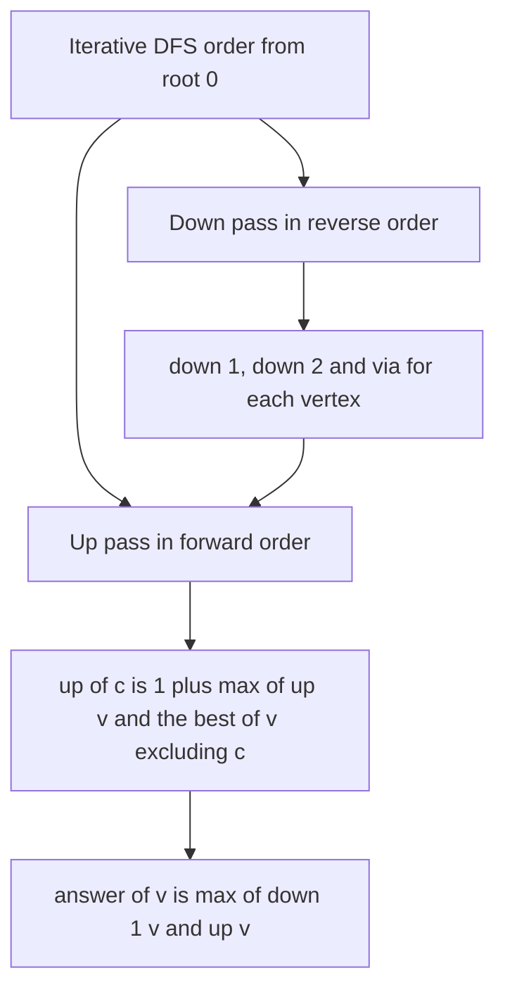

## The hook

A country of towns connected by roads, with no cycles, wants to choose a capital. For each town, the planners ask: if this town were the capital, how far would the most distant town be? Running a search from every town is O(n²), hopeless for 2 × 10⁵ towns. Yet every town's answer comes out of two passes over the tree.

That is rerooting, introduced through the sum of distances in [A Party Where Nobody Comes With Their Boss](article:dsa-dp-on-trees). Contest problems push it further: answers built with maximums, which cannot be subtracted, and trees deep enough to overflow a recursive DFS.

## The intuition

:::analogy
Every town asks its neighbours one question: "what does the country look like beyond you, away from me?" Towns deeper in the country answer first, by summarising their own regions, and those summaries flow towards the old capital. Then the old capital answers its neighbours about everything else, each neighbour passes that on, adding what it knows about its other branches, and so on down. In the end every town has heard about every direction, and each can imagine itself as the capital.
:::

The first sweep computes [[down value]]s; the second computes [[up value]]s; together they give [[rerooting]]. The subtle step is the [[exclusive combine]]: when v tells child c about "everything except your subtree", v must combine its up value with all of its other children, but not c.

## How it works

### The two passes

- **Down pass (post-order):** down[v] = combine of contributions from v's children.
- **Up pass (pre-order):** for each child c of v, up[c] = contribution of "v without c", built from up[v] and every child of v except c.
- **Answer:** ans[v] = combine(down[v], up[v]).

### Invertible combine: sum of distances

For Tree Distances II, the up step is a formula: ans[c] = ans[v] - size[c] + (n - size[c]). The c-side gets one step closer and the rest one step farther. Subtraction does the exclusive combine.

### Non-invertible combine: farthest distance

CSES *Tree Distances I* asks, for each vertex, the distance to the farthest vertex. Max cannot be undone, so use the [[top-two trick]]:

- down1[v], down2[v]: the largest and second-largest values of 1 + down1[child] over v's children, and via[v], the child giving down1[v];
- up[c] = 1 + max(up[v], via[v] == c ? down2[v] : down1[v]);
- ans[v] = max(down1[v], up[v]).

For combines that are neither invertible nor easily "top-two", such as products modulo a composite or general monoids, compute prefix and suffix combinations of v's children's contributions; "all except c" is then prefix before c combined with suffix after c.

### Weighted versions

Codeforces *Tree with Maximum Cost* weights each vertex: the cost of a root is Σ distance × weight. It is Tree Distances II with sizes replaced by subtree weight sums: moving the root from v to c changes the cost by W - 2 × subtreeWeight[c], where W is the total weight.

### Deep trees

A path of 2 × 10⁵ vertices makes recursion that deep, which can overflow the default stack. Compute a parent array and a DFS order with an explicit stack, then run the down pass over the order reversed and the up pass over the order forwards. No recursion at all.

| Answer for each root | Combine | Exclusive combine |
|---|---|---|
| Sum of distances | + | subtract the child's part |
| Weighted sum of distances | + with weights | subtract the child's weight part |
| Farthest distance | max | top-two values |
| General monoid | any associative op | prefix and suffix over children |



:::insight
Rerooting gives every vertex the answer it would have as the root by combining what lies below it with what lies above it. The only delicate step is removing a child's own branch from its parent's information, by subtraction when the combine is invertible, and by top-two values or prefix and suffix combinations when it is not.
:::

## Walk through an example

Tree with edges 0–1, 0–2, 1–3, 1–4, 4–5, 2–6, rooted at 0.

### Down pass

| Vertex | Children | down1 (via) | down2 |
|---|---|---|---|
| 3, 5, 6 | none | 0 | 0 |
| 4 | 5 | 1 (via 5) | 0 |
| 2 | 6 | 1 (via 6) | 0 |
| 1 | 3, 4 | 2 (via 4) | 1 |
| 0 | 1, 2 | 3 (via 1) | 2 |

### Up pass and answers

| Vertex | up value | How | Farthest distance = max(down1, up) |
|---|---|---|---|
| 0 | 0 | root | 3 |
| 1 | 3 | 1 + max(up[0] = 0, down2[0] = 2) because 1 is via[0] | 3 |
| 2 | 4 | 1 + max(0, down1[0] = 3) | 4 |
| 3 | 4 | 1 + max(up[1] = 3, down1[1] = 2) | 4 |
| 4 | 4 | 1 + max(3, down2[1] = 1) because 4 is via[1] | 4 |
| 5 | 5 | 1 + max(up[4] = 4, 0) | 5 |
| 6 | 5 | 1 + max(up[2] = 4, 0) | 5 |

A BFS from every vertex gives the same farthest distances: 3, 3, 4, 4, 4, 5, 5. The sums of distances, from the other rerooting formula, are 11, 10, 14, 15, 13, 18, 19.

:::try-this
Which vertices are centres of this tree, the ones minimising the farthest distance, and why does that match Minimum Height Trees? (Vertices 0 and 1 both have farthest distance 3, the smallest value. Minimum Height Trees asks exactly for the roots giving the smallest height, so the answer is [0, 1]; rerooting finds it without peeling leaves.)
:::

:::warning
Common misconception: "up[c] = 1 + max(up[v], down1[v])." When c is the child that produced down1[v], that formula lets c see its own subtree through its parent, and the answer comes out too large. In the example, it would give vertex 1 the value 1 + 3 = 4 instead of 3. The branch through c must be excluded, which is what down2 and via are for.
:::

## The code

```pseudo
order = DFS order from root with parent links (iterative)
for v in reverse(order):            # down pass
    for child c: d = down1[c] + 1; update (down1, via, down2) of v with d
for v in order:                     # up pass
    for child c:
        best_other = down2[v] if via[v] == c else down1[v]
        up[c] = 1 + max(up[v], best_other)
answer[v] = max(down1[v], up[v])
```

```cpp
#include <bits/stdc++.h>
using namespace std;
using ll = long long;

struct Reroot {
    int n;
    vector<vector<int>> adj;
    vector<int> par, order, down1, down2, via, up, sz;
    vector<ll> sumDown, sumAll;
    Reroot(int n, const vector<array<int, 2>>& edges)
        : n(n), adj(n), par(n, -1), down1(n, 0), down2(n, 0), via(n, -1), up(n, 0), sz(n, 1), sumDown(n, 0), sumAll(n, 0) {
        for (auto [a, b] : edges) adj[a].push_back(b), adj[b].push_back(a);
        vector<int> st = {0};                                   // iterative DFS, no recursion
        vector<bool> seen(n, false);
        seen[0] = true;
        while (!st.empty()) {
            int u = st.back(); st.pop_back();
            order.push_back(u);
            for (int v : adj[u]) if (!seen[v]) seen[v] = true, par[v] = u, st.push_back(v);
        }
        for (int i = n - 1; i >= 0; i--) {                       // down pass
            int u = order[i];
            for (int c : adj[u]) {
                if (c == par[u]) continue;
                int d = down1[c] + 1;
                if (d > down1[u]) down2[u] = down1[u], down1[u] = d, via[u] = c;
                else if (d > down2[u]) down2[u] = d;
                sz[u] += sz[c], sumDown[u] += sumDown[c] + sz[c];
            }
        }
        sumAll[0] = sumDown[0];
        for (int u : order)                                      // up pass
            for (int c : adj[u]) {
                if (c == par[u]) continue;
                int other = (via[u] == c) ? down2[u] : down1[u]; // best of u excluding c's branch
                up[c] = 1 + max(up[u], other);
                sumAll[c] = sumAll[u] - sz[c] + (n - sz[c]);
            }
    }
    int farthest(int v) const { return max(down1[v], up[v]); }
};

int main() {
    Reroot r(7, {{0, 1}, {0, 2}, {1, 3}, {1, 4}, {4, 5}, {2, 6}});
    for (int v = 0; v < 7; v++) cout << r.farthest(v) << ' ';
    cout << '\n';                                               // 3 3 4 4 4 5 5
    for (int v = 0; v < 7; v++) cout << r.sumAll[v] << ' ';
    cout << '\n';                                               // 11 10 14 15 13 18 19

    int n = 200000;                                             // a path: deep enough to break recursion
    vector<array<int, 2>> path;
    for (int i = 0; i + 1 < n; i++) path.push_back({i, i + 1});
    Reroot deep(n, path);
    cout << deep.farthest(0) << ' ' << deep.farthest(n / 2) << '\n';   // 199999 100000
}
```

The last test builds a path of 200,000 vertices, exactly the shape that overflows a recursive DFS; the iterative order handles it without trouble.

## Complexity

- **Both passes: O(n) time,** each edge processed a constant number of times.
- **Space: O(n)** for adjacency lists, the order and the per-vertex values.
- **Prefix and suffix variant:** O(n) as well, with O(deg) extra work per vertex.

## Common mistakes

- **Not excluding the child's own branch** when building its up value.
- **Recursing on deep trees** and overflowing the stack; use an explicit stack.
- **Forgetting the parent check** when iterating neighbours in an unrooted tree.
- **Using a subtraction-based up step for max,** which has no inverse.
- **Mixing 0-based and 1-based vertices** between input and arrays.

## Practice problems

*Tree Distances I* is the top-two rerooting. *Tree Distances II* is the subtraction-based rerooting. *Tree with Maximum Cost* weights the distances by vertex values. *Minimum Height Trees* asks for the roots with the smallest farthest distance, which rerooting answers directly.

## Key takeaways

- Rerooting computes every vertex's answer as root with a down pass for subtrees and an up pass for everything outside them.
- Each child's up value must exclude its own branch, which is where double counting usually happens.
- Invertible combines such as sums exclude a child by subtraction, giving formulas like ans[c] = ans[v] - size[c] + (n - size[c]).
- Maximums need the top-two child values, or prefix and suffix combinations, to find the best excluding one child.
- An iterative DFS order replaces recursion so that path-shaped trees of 2 × 10⁵ vertices do not overflow the stack.
