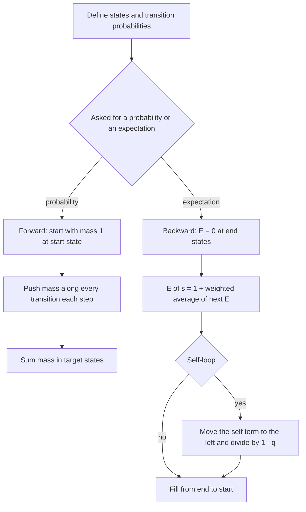

## The hook

You roll a die 100 times. What is the probability that the total lands between 300 and 400? You could simulate a million games and estimate it, but the judge wants six correct decimal places, and simulation will not deliver that. Listing all 6¹⁰⁰ outcomes is out of the question.

Yet the answer comes from a table with about 100 × 600 cells. The idea is to stop following individual games and instead track how much probability sits in each state after each step. A similar table, filled backwards, answers "how many moves does this take on average?". These two DPs cover most probability and expectation problems in contests.

## The intuition

:::analogy
Imagine playing a board game with every possible roll at once. Instead of one token, you pour a jug of water onto the start square. On each turn, the water on every square splits equally into six streams that flow to the squares one to six steps ahead. After 100 turns, the amount of water on each square is exactly the probability of the token ending there. You never follow a single game; you follow where the water goes.
:::

That is [[probability DP]]: the "water" is probability mass, and each step pushes it along the transitions. For averages, you run the same board in reverse: the expected number of turns left from a square is one turn plus the average of the expected turns left from the squares the token could land on. That is [[expectation DP]].

## How it works

### Forward: probability of reaching each state

1. dp[0][start] = 1.
2. For each step t and state s with dp[t][s] > 0, for every outcome with probability p leading to state s': add dp[t][s] × p to dp[t + 1][s'].
3. Answer from the final row: sum the states you care about.

Every step conserves the total probability, which stays 1. That makes a good sanity check.

### Backward: expected steps to finish

Let E[s] be the expected number of further steps from state s until the game ends.

- For an [[absorbing state]] (the game is over), E[s] = 0.
- Otherwise, E[s] = 1 + Σ p(s → s') × E[s'].

If every move goes to a state that is "later" (further along the board, fewer items left), fill E from the end towards the start, and E[start] is the answer. This uses the reasoning from [Averaging Over a Thousand Parallel Universes](article:cp-probability-expectation): expectation is a weighted average over what happens next.

### Self-loops

Sometimes a move leaves the state unchanged: a roll that is wasted, a pick of an empty plate. Then E[s] appears on both sides:

$$E[s] = 1 + q \cdot E[s] + \sum_{s' \ne s} p(s \to s') \, E[s']$$

where q is the [[self-loop]] probability. Solve for it:

$$E[s] = \frac{1 + \sum_{s' \ne s} p(s \to s')\, E[s']}{1 - q}$$

This is how *Sushi* (AtCoder) works. When states form longer cycles, you need a system of linear equations or a clever choice of state that removes the cycle.



:::insight
Probability flows forward from a known start; expectation flows backward from known ends. Pick the direction in which the boundary values are known, and the DP fills itself.
:::

### Expectation without a DP

[[Linearity of expectation]] often avoids a DP entirely. In *Candy Lottery*, n children each get a uniformly random number of candies from 1 to k, and you want the expected maximum. P(max ≤ m) = (m/k)ⁿ because each child independently must get at most m. So P(max = m) = (m/k)ⁿ − ((m − 1)/k)ⁿ, and the expectation is the sum over m of m × P(max = m). Splitting a hard expectation into simple probabilities like this is a skill worth practising alongside the DP.

## Walk through an example

**Forward: sum of two dice at least 9.** Rolling one die puts 1/6 on each sum 1 to 6. Pushing again:

| Sum | 2 | 3 | 4 | 5 | 6 | 7 | 8 | 9 | 10 | 11 | 12 |
|---|---|---|---|---|---|---|---|---|---|---|---|
| Probability | 1/36 | 2/36 | 3/36 | 4/36 | 5/36 | 6/36 | 5/36 | 4/36 | 3/36 | 2/36 | 1/36 |

P(sum in [9, 12]) = (4 + 3 + 2 + 1)/36 = 10/36 = **5/18 ≈ 0.277778**.

**Backward: a coin-flip board.** A token starts on square 0. Each turn, flip a fair coin: heads moves 2 squares, tails 1. The game ends on reaching square 4 or beyond. Expected turns?

| Square | Equation | E |
|---|---|---|
| 4, 5 | game over | 0 |
| 3 | 1 + ½·E[4] + ½·E[5] | 1 |
| 2 | 1 + ½·E[3] + ½·E[4] | 1.5 |
| 1 | 1 + ½·E[2] + ½·E[3] | 2.25 |
| 0 | 1 + ½·E[1] + ½·E[2] | **2.875** |

**Self-loop: two heads in a row.** States: 0 heads in a row, 1 head in a row, done. From state 1, tails sends you back to state 0, a cycle. Write E₁ = 1 + ½·0 + ½·E₀ and E₀ = 1 + ½·E₁ + ½·E₀. Substituting, E₀ = 2 + E₁ = 2 + 1 + E₀/2, so **E₀ = 6** flips. A 200,000-run simulation averages about 6.01.

**Candy Lottery with n = 2 children and k = 3:** P(max = 1) = 1/9, P(max = 2) = 4/9 − 1/9 = 3/9, P(max = 3) = 1 − 4/9 = 5/9. Expected max = 1·1/9 + 2·3/9 + 3·5/9 = 22/9 ≈ **2.444444**.

:::try-this
On the coin-flip board, change the end to square 3 or beyond. What is the expected number of turns from square 0? (E[2] = 1, E[1] = 1 + ½·1 + ½·0 = 1.5, E[0] = 1 + ½·1.5 + ½·1 = 2.25.)
:::

## The code

```pseudo
dice_probability(n, a, b):              // n throws, P(a <= sum <= b)
    dp = [1] + [0] * (6n)
    repeat n times:
        nd = zeros
        for s with dp[s] > 0:
            for d in 1..6: nd[s + d] += dp[s] / 6
        dp = nd
    return sum(dp[a..b])

expected_turns(N):                      // board: heads +2, tails +1, end at >= N
    E[N] = E[N + 1] = 0
    for i = N - 1 down to 0:
        E[i] = 1 + 0.5 * E[i + 1] + 0.5 * E[i + 2]
    return E[0]
```

```cpp
#include <bits/stdc++.h>
using namespace std;

int main() {
    int n = 2, a = 9, b = 12;
    vector<double> dp(6 * n + 1, 0.0);
    dp[0] = 1.0;
    for (int t = 0; t < n; t++) {
        vector<double> nd(6 * n + 1, 0.0);
        for (int s = 0; s <= 6 * n; s++)
            if (dp[s] > 0)
                for (int d = 1; d <= 6 && s + d <= 6 * n; d++) nd[s + d] += dp[s] / 6;
        dp = nd;
    }
    double p = 0;
    for (int s = a; s <= b; s++) p += dp[s];
    printf("%.6f\n", p);                                     // 0.277778

    int N = 4;
    vector<double> E(N + 2, 0.0);
    for (int i = N - 1; i >= 0; i--) E[i] = 1 + 0.5 * E[i + 1] + 0.5 * E[i + 2];
    printf("%.3f\n", E[0]);                                  // 2.875

    int kids = 2, k = 3;
    double ex = 0;
    for (int m = 1; m <= k; m++)
        ex += m * (pow((double)m / k, kids) - pow((double)(m - 1) / k, kids));
    printf("%.6f\n", ex);                                    // 2.444444
}
```

## Complexity

- **Forward probability DP:** O(T × S × O) for T steps, S states and O outcomes per step; *Dice Probability* is 100 × 600 × 6 ≈ 360,000 operations.
- **Backward expectation DP:** O(S × O) when the states are acyclic.
- **Memory:** O(S) by keeping only two rows for the forward DP.

## Common mistakes

:::warning
Common misconception: "probabilities and expectations need exact fractions, so floating point is wrong." Contest problems that print decimals expect double or long double, and they set tolerances or decimal places accordingly. The real dangers are subtracting two nearly equal numbers, values underflowing to 0 after many multiplications, and printing too few digits. Problems that want an exact answer ask for it modulo a prime instead, using modular inverses for the divisions.
:::

- **Wrong direction**: pushing expectations forward from the start. Expected values are anchored at the end states.
- **Forgetting the "+1"** for the step being taken in the expectation equation.
- **Ignoring self-loops**: a state that can stay put makes E depend on itself; solve the equation instead of reading an unfilled cell.
- **Probability leaks**: transitions that go past the array bound silently drop mass. Check that each row still sums to 1.
- **Output format**: print with the number of decimals the problem specifies, using fixed notation.

## Practice problems

*Dice Probability* (CSES) is the forward DP above with up to 100 throws. *Candy Lottery* is the linearity trick with powers. *Moving Robots* combines a probability DP per robot with linearity of expectation over the board's squares. *Coins* (AtCoder) is a forward DP over "coins tossed, heads so far" with different probabilities per coin. *Sushi* is the classic self-loop expectation: the state is how many plates have 1, 2 and 3 pieces left.

## Key takeaways

- Probability DP pushes probability mass forward from the start state along every transition, and the mass in a state is its probability.
- Expectation DP sets end states to 0 and fills backwards with E = 1 + the probability-weighted average of the next states' E.
- A self-loop makes a state's equation refer to itself; move that term to the left and divide by 1 minus the loop probability.
- Linearity of expectation and P(max ≤ m) style counting often replace a DP with a short formula.
- Use double or long double with fixed-precision output, and check that probabilities in each step still sum to 1.
