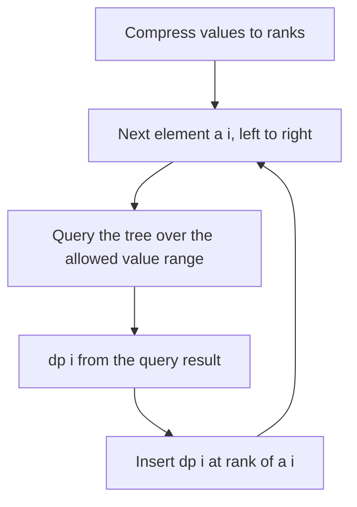

## The hook

At a sports day, each new runner wants to know the best time among all earlier runners who were younger. Asking every earlier runner is slow when there are 200,000 of them. A scoreboard organised by age answers instantly: look up the best entry in the "younger than me" section.

Many DPs have that shape: dp[i] combines dp[j] over earlier j whose value is smaller, or within some range. Written directly, that is O(n²). Store the DP values in a Fenwick or segment tree indexed by value, and every transition becomes one O(log n) query.

## The intuition

:::analogy
The scoreboard has one slot per possible age, sorted from youngest to oldest. Each runner, after finishing, writes their result into their age's slot. The next runner reads the best result in all slots below their own age, a single range lookup, adds their own contribution, and writes into their slot. Nobody ever walks along the line of earlier runners.
:::

That is a [[value-indexed DP store]]. Process elements left to right; the store holds exactly the earlier elements. A [[prefix transition]] reads a prefix of values; a [[window transition over values]] reads a range. Values must be compressed to ranks first, as in [Renaming Huge Numbers as 1, 2, 3](article:cp-coordinate-compression).

## How it works

### Counting increasing subsequences

CSES *Increasing Subsequence II*: count the strictly increasing subsequences, modulo 10⁹ + 7.

- dp[i] = 1 + Σ dp[j] over j < i with a[j] < a[i]: the subsequence of a[i] alone, plus every earlier increasing subsequence ending in a smaller value, extended by a[i].
- Store dp values in a Fenwick tree by rank; dp[i] = 1 + prefix(rank(a[i]) - 1); then add dp[i] at rank(a[i]).
- The answer is Σ dp[i].

O(n log n). The sum Fenwick tree is from [A Pyramid of Savings Jars](article:dsa-fenwick-tree).

### LIS with a gap limit

*Longest Increasing Subsequence II*: the longest strictly increasing subsequence where consecutive elements differ by at most k. dp[i] = 1 + max dp[j] over earlier j with a[i] - k ≤ a[j] < a[i]. That is a range maximum over values, so use a segment tree of maxima indexed by value (values are small enough here to index directly). The classic O(n log n) LIS, from [Dealing Cards Into Piles](article:dsa-lis), cannot handle the gap limit; the tree can.

### Counting longest increasing subsequences

*Number of Longest Increasing Subsequence*: for each element, keep (length, count) of the longest increasing subsequences ending there. Store pairs in a tree by value with the [[pair merge]]: larger length wins, and on equal lengths counts add. Query the prefix below a[i], then dp[i] = (best length + 1, its count), or (1, 1) if empty.

| Transition | Store | Query |
|---|---|---|
| sum of dp over smaller values | Fenwick tree of sums | prefix sum up to rank - 1 |
| max of dp over smaller values (plain LIS) | Fenwick tree of maxima | prefix max |
| max over values in [a - k, a - 1] | segment tree of maxima | range max |
| (length, count) over smaller values | tree of pairs with pair merge | prefix merge |



:::insight
If a DP looks back over earlier elements filtered by value, process elements in order and keep their DP values in a tree indexed by value. The filter becomes a prefix or range query, so each transition costs O(log n) instead of O(n).
:::

## Walk through an example

a = [3, 1, 4, 1, 5, 2, 6]. Ranks: 1 → 1, 2 → 2, 3 → 3, 4 → 4, 5 → 5, 6 → 6.

### Counting increasing subsequences

| i | a[i] | Sum of dp over smaller values | dp[i] |
|---|---|---|---|
| 0 | 3 | 0 | 1 |
| 1 | 1 | 0 | 1 |
| 2 | 4 | dp of 3 and 1: 2 | 3 |
| 3 | 1 | nothing smaller than 1 | 1 |
| 4 | 5 | 3, 1, 4, 1: 1 + 1 + 3 + 1 = 6 | 7 |
| 5 | 2 | the two 1s: 2 | 3 |
| 6 | 6 | everything earlier: 1 + 1 + 3 + 1 + 7 + 3 = 16 | 17 |

Total: 1 + 1 + 3 + 1 + 7 + 3 + 17 = 33 increasing subsequences. Each row is one runner reading the scoreboard: the slots for smaller values hold the results of earlier runners, and one lookup replaces a walk along the line. At i = 3, the second 1 finds no smaller value; the earlier 1 is equal, and the strict query up to rank - 1 excludes it.

### Counting the longest ones

| i | a[i] | (length, count) |
|---|---|---|
| 0 | 3 | (1, 1) |
| 1 | 1 | (1, 1) |
| 2 | 4 | (2, 2), from 3 or from 1 |
| 3 | 1 | (1, 1) |
| 4 | 5 | (3, 2), from the length-2 state at 4 |
| 5 | 2 | (2, 2), from either 1 |
| 6 | 6 | (4, 2) |

The longest length is 4, achieved by 2 subsequences: 3, 4, 5, 6 and 1, 4, 5, 6.

### Gap limit k = 2

For [5, 1, 6, 2, 7, 3, 9, 4, 6], the longest increasing subsequence with consecutive differences at most 2 has length 5, for example 1, 2, 3, 4, 6. A brute force over all subsequences agrees.

:::try-this
In the counting table, what would go wrong at i = 3 if the query went up to rank(a[i]) instead of rank(a[i]) - 1? (The query would include the earlier 1, giving dp[3] = 1 + 1 = 2. That counts "1, 1" as increasing, which it is not strictly, and every later total would be too large: the answer would no longer be 33.)
:::

:::warning
Common misconception: "Compress only the values seen so far, as you go." Compression must use every value in the array before any query, or ranks shift as new values appear and earlier tree positions become wrong. Compress once at the start, then run the DP.
:::

## The code

```pseudo
ranks = compress(a)
for i in 0..n-1:
    s = bit.prefix(rank[i] - 1)              # strictly smaller values
    dp[i] = 1 + s
    bit.add(rank[i], dp[i])
answer = sum of dp
```

```cpp
#include <bits/stdc++.h>
using namespace std;
using ll = long long;
const ll MOD = 1000000007;

vector<int> compress(const vector<int>& a) {
    vector<int> v(a);
    sort(v.begin(), v.end());
    v.erase(unique(v.begin(), v.end()), v.end());
    vector<int> r(a.size());
    for (size_t i = 0; i < a.size(); i++) r[i] = lower_bound(v.begin(), v.end(), a[i]) - v.begin() + 1;
    return r;
}

ll countIncreasing(const vector<int>& a) {
    auto rk = compress(a);
    int k = *max_element(rk.begin(), rk.end());
    vector<ll> t(k + 1, 0);
    auto add = [&](int i, ll d) { for (; i <= k; i += i & -i) t[i] = (t[i] + d) % MOD; };
    auto pre = [&](int i) { ll s = 0; for (; i > 0; i -= i & -i) s = (s + t[i]) % MOD; return s; };
    ll total = 0;
    for (int r : rk) {
        ll dp = (1 + pre(r - 1)) % MOD;                  // strictly smaller values only
        add(r, dp);
        total = (total + dp) % MOD;
    }
    return total;
}

int lisWithGap(const vector<int>& a, int k) {             // values up to about 10^5
    int M = *max_element(a.begin(), a.end()) + 1, size = 1;
    while (size < M + 1) size <<= 1;
    vector<int> mx(2 * size, 0);
    auto update = [&](int p, int v) { for (p += size, mx[p] = max(mx[p], v); p >>= 1;) mx[p] = max(mx[2 * p], mx[2 * p + 1]); };
    auto query = [&](int l, int r) {                      // max over values [l, r]
        int res = 0;
        for (l += size, r += size + 1; l < r; l >>= 1, r >>= 1) {
            if (l & 1) res = max(res, mx[l++]);
            if (r & 1) res = max(res, mx[--r]);
        }
        return res;
    };
    int best = 0;
    for (int x : a) {
        int v = 1 + query(max(0, x - k), x - 1);
        update(x, v);
        best = max(best, v);
    }
    return best;
}

pair<int, ll> countLongest(const vector<int>& a) {
    auto rk = compress(a);
    int k = *max_element(rk.begin(), rk.end());
    vector<pair<int, ll>> t(k + 1, {0, 0});
    auto merge = [](pair<int, ll> x, pair<int, ll> y) {
        if (x.first != y.first) return max(x, y);
        return make_pair(x.first, x.second + y.second);
    };
    auto add = [&](int i, pair<int, ll> v) { for (; i <= k; i += i & -i) t[i] = merge(t[i], v); };
    auto pre = [&](int i) { pair<int, ll> s = {0, 0}; for (; i > 0; i -= i & -i) s = merge(s, t[i]); return s; };
    pair<int, ll> best = {0, 0};
    for (int r : rk) {
        auto [len, cnt] = pre(r - 1);
        pair<int, ll> cur = len ? make_pair(len + 1, cnt) : make_pair(1, 1LL);
        add(r, cur);
        best = merge(best, cur);
    }
    return best;
}

int main() {
    vector<int> a = {3, 1, 4, 1, 5, 2, 6};
    auto [len, cnt] = countLongest(a);
    cout << countIncreasing(a) << ' ' << len << ' ' << cnt << '\n';          // 33 4 2
    cout << lisWithGap({5, 1, 6, 2, 7, 3, 9, 4, 6}, 2) << '\n';             // 5
}
```

## Complexity

- **Time: O(n log n)** for compression plus one query and one update per element.
- **Space: O(n)** for ranks and the tree.
- **Compared with the direct DP:** O(n²), 4 × 10¹⁰ steps for n = 2 × 10⁵.

## Common mistakes

- **Querying up to rank instead of rank - 1** for strictly increasing conditions.
- **Compressing incrementally,** so ranks change after values are inserted.
- **Using a Fenwick tree for range maxima over [a - k, a - 1];** Fenwick handles prefix maxima, but arbitrary ranges need a segment tree.
- **Forgetting the modulus** when counting, as counts grow exponentially.
- **Merging (length, count) pairs by adding counts when lengths differ;** only equal lengths combine.

## Practice problems

CSES *Increasing Subsequence II* is the counting Fenwick DP. *Longest Increasing Subsequence II* is the gap-limited LIS with a segment tree of maxima. *Number of Longest Increasing Subsequence* uses (length, count) pairs; its limits allow O(n²), but the tree version is the one that scales.

## Key takeaways

- DP transitions that combine earlier states filtered by value become range queries once the states are stored in a tree indexed by value.
- Processing elements left to right keeps exactly the earlier elements in the tree.
- Strictly increasing conditions query up to rank - 1, so equal values are excluded.
- Values are compressed to ranks once, before the DP, so the tree has at most n positions.
- Sums, maxima and (length, count) pairs all fit the same pattern with the right combine function.
