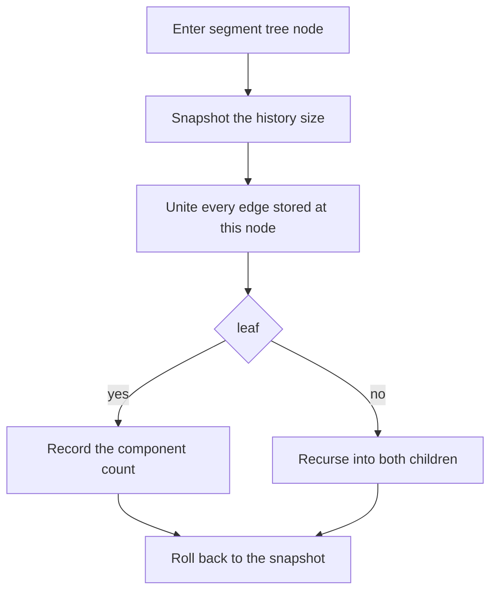

## The hook

Plain union-find answers one question: are these two in the same group? [Friend Groups That Merge at a Party](article:dsa-union-find) built it with path compression and union by size, and CSES *Road Construction* is that structure printing the number of groups and the largest group after every new road.

Contest problems push further. "Ali and Bea must be on opposite teams; Bea and Chen on opposite teams; can Ali and Chen be on opposite teams too?" needs a group to remember more than membership. "Roads are built and also destroyed; how many groups are there after each event?" needs merges to be undone. Both are small changes to the same structure, and both appear regularly in contests.

## The intuition

:::analogy
Picture each friend group at a party as a chain of introductions leading to one host. Now every guest also wears a badge saying "same team as the person who introduced me" or "opposite team". To learn whether two guests are teammates, each follows their introductions up to the host, counting the "opposite" badges along the way; if both counts have the same evenness, they are on the same team. And if the party organiser wants to rewind the evening, they keep a notebook of every introduction made, in order, and tear out the last few pages.
:::

The badges are the [[relative parity]] that makes a [[parity DSU]]. The notebook of introductions is the history stack of a [[rollback DSU]].

## How it works

### Parity DSU: same team or opposite

Each vertex v stores par[v] = colour[v] xor colour[p[v]]. Then:

- **find(v)** returns the root and the xor of par along the path, which is colour[v] xor colour[root]. With path compression, when v is re-pointed straight at the root, par[v] becomes that accumulated xor, so the meaning is preserved.
- **relate(a, b, d)** demands colour[a] xor colour[b] = d, where d = 0 means "same team" and d = 1 "opposite". Find both: roots ra, rb and parities pa, pb.
  - Same root: the relation is already decided; it is consistent exactly when pa xor pb = d.
  - Different roots: attach rb under ra and set par[rb] = pa xor pb xor d.

Why that last formula: we need colour[a] xor colour[b] = d. Going from a to b through the roots, the xor is pa, then par[rb], then pb. Setting par[rb] = pa xor pb xor d makes the total pa xor (pa xor pb xor d) xor pb = d.

This decides bipartiteness incrementally: an edge u–v is relate(u, v, 1), and the first contradiction is the first edge that creates an odd cycle. Codeforces *Split Into Two Sets* reduces to exactly that check. Replacing xor by addition gives a **weighted DSU** that maintains differences, such as "value[a] − value[b] = w", with the same structure.

### Rollback DSU: undoing merges

Undo is easy if each merge changes very little. With [[union by size]] and no path compression:

- a merge sets one parent pointer p[b] = a and adds one size, so record (b, a) on a stack;
- a merge of two vertices already together changes nothing, but still pushes a marker so every operation can be undone one for one;
- rollback pops entries and restores p[b] = b and sz[a] −= sz[b];
- find walks up without compressing; union by size keeps every tree at most log₂ n high, so find is O(log n).

Path compression is the trap. It rewrites parent pointers during ordinary finds, long after the merge that caused them, so undoing a merge would leave compressed pointers that skip over a link that no longer exists. Logging every compression would fix correctness, but the amortised O(α(n)) bound relies on never undoing work, so it no longer applies. Union by size alone is the standard choice.

### Offline dynamic connectivity

CSES *Dynamic Connectivity* adds and removes edges and asks for the number of components after each event. If all events are known in advance, every edge has a lifetime: an interval [l, r) of query times during which it exists.

- **Build** a [[segment tree over time]] on query times 0 to q − 1.
- **Store** each edge at the O(log q) nodes whose ranges exactly cover its lifetime, just like a range update.
- **DFS** the segment tree. On entering a node, unite its edges; at a leaf t, the DSU contains exactly the edges alive at time t, so record the component count; on leaving, roll back to the snapshot taken on entry.

Each edge is united O(log q) times, each union costs O(log n), so the total is O(q log q log n). This is [[offline dynamic connectivity]], and *Bipartite Checking* is the same scheme with a parity DSU that supports rollback.

| Need | Structure | Find cost |
|---|---|---|
| connectivity, merges only | path compression and union by size | O(α(n)) amortised |
| same or opposite team, or differences | parity or weighted DSU | O(α(n)) amortised |
| undo the latest merges | rollback DSU, union by size only | O(log n) |
| edges added and removed, known in advance | segment tree over time plus rollback DSU | O(log q · log n) per edge |



:::insight
Both extensions keep the union-find shape and change what a merge records. Parity adds one bit per link, carried along every path. Rollback removes path compression so that a merge touches only two values, which makes it cheap to log and exact to undo.
:::

## Walk through an example

### Parity

Five players, 0 to 4. Rules arrive in order; d = 1 means opposite teams.

| Rule | Finds | Action | par after |
|---|---|---|---|
| relate(0, 1, 1) | roots 0 and 1 | attach 1 under 0, par[1] = 0 ⊕ 0 ⊕ 1 = 1 | 1 opposite 0 |
| relate(1, 2, 1) | 1 → root 0 with parity 1; 2 is a root | attach 2 under 0, par[2] = 1 ⊕ 0 ⊕ 1 = 0 | 2 same as 0 |
| relate(3, 4, 1) | roots 3 and 4 | attach 4 under 3, par[4] = 1 | 4 opposite 3 |
| relate(2, 3, 1) | 2 → 0 parity 0; 3 is a root | attach 3 under 0, par[3] = 0 ⊕ 0 ⊕ 1 = 1 | 3 opposite 0 |
| relate(0, 4, 0) | 4 → 3 → 0, parity 1 ⊕ 1 = 0 | same root, 0 ⊕ 0 = 0 = d | consistent |
| relate(0, 2, 1) | both root 0, parities 0 and 0 | 0 ⊕ 0 = 0 ≠ 1 | **contradiction** |

The teams so far are {0, 2, 4} and {1, 3}. The last rule asks 0 and 2 to be on opposite teams, but the chain 0 ≠ 1 ≠ 2 already forces them together. During the fifth rule, path compression re-pointed 4 directly at 0 with par[4] = 0, and the meaning "4 is on 0's team" was kept.

### Rollback over time

Four vertices and six events; the component count is recorded after each.

| Time | Event | Alive edges | Components |
|---|---|---|---|
| 0 | add 0–1 | 0–1 | 3 |
| 1 | add 1–2 | 0–1, 1–2 | 2 |
| 2 | add 2–3 | 0–1, 1–2, 2–3 | 1 |
| 3 | remove 1–2 | 0–1, 2–3 | 2 |
| 4 | add 0–3 | 0–1, 2–3, 0–3 | 1 |
| 5 | remove 0–1 | 2–3, 0–3 | 2 |

Lifetimes: 0–1 lives over times [0, 5), 1–2 over [1, 3), 2–3 over [2, 6) and 0–3 over [4, 6). The segment tree on times 0 to 5 stores 1–2 at the nodes covering [1, 2) and [2, 3), for example. When the DFS reaches leaf 3, the edges united along the root-to-leaf path are exactly 0–1 and 2–3, giving 2 components; when it moves on, those unions are rolled back node by node.

:::try-this
At time 5 the edge 0–1 has just been removed. Which nodes contribute edges on the path to leaf 5, and what is the count? (Only 2–3 and 0–3 cover time 5, since 0–1's lifetime [0, 5) ends just before it. Uniting them joins 0, 2 and 3, leaving 1 alone: 2 components.)
:::

:::warning
Common misconception: "Rollback DSU can keep path compression if you just undo the merges." A compressed pointer may jump over the very link being undone. After undoing, that vertex would still point at the old root, a group it no longer belongs to. Either log every pointer change or, as everyone does, drop compression and rely on union by size.
:::

## The code

```pseudo
parity find(v): if v is root: return (v, 0)
                (r, x) = find(p[v]); par[v] ^= x; p[v] = r; return (r, par[v])
relate(a, b, d): (ra, pa) = find(a); (rb, pb) = find(b)
                 if ra == rb: return (pa xor pb) == d
                 attach smaller root rb under ra; par[rb] = pa xor pb xor d
rollback DSU: unite pushes (b, a) or a marker; rollback(t) pops until the stack has t entries
offline: place each edge on the nodes covering its lifetime
         go(node): snap; unite node's edges; leaf -> record; else recurse; rollback(snap)
```

```cpp
#include <bits/stdc++.h>
using namespace std;

struct ParityDSU {                                               // par[v] = colour[v] xor colour[p[v]]
    vector<int> p, par, sz;
    ParityDSU(int n) : p(n), par(n, 0), sz(n, 1) { iota(p.begin(), p.end(), 0); }
    pair<int, int> find(int v) {                                 // (root, colour of v xor colour of root)
        if (p[v] == v) return {v, 0};
        auto [r, x] = find(p[v]);                                // depth is O(log n) thanks to union by size
        par[v] ^= x, p[v] = r;                                   // compress, keeping the meaning of par
        return {r, par[v]};
    }
    bool relate(int a, int b, int d) {                           // demand colour[a] xor colour[b] = d
        auto [ra, pa] = find(a);
        auto [rb, pb] = find(b);
        if (ra == rb) return (pa ^ pb) == d;
        if (sz[ra] < sz[rb]) swap(ra, rb), swap(pa, pb);
        p[rb] = ra, par[rb] = pa ^ pb ^ d, sz[ra] += sz[rb];
        return true;
    }
};

struct RollbackDSU {                                             // union by size, no path compression
    vector<int> p, sz;
    vector<pair<int, int>> history;                              // (attached root, new parent) or (-1, -1)
    int comps;
    RollbackDSU(int n) : p(n), sz(n, 1), comps(n) { iota(p.begin(), p.end(), 0); }
    int find(int v) const { while (p[v] != v) v = p[v]; return v; }
    void unite(int a, int b) {
        a = find(a), b = find(b);
        if (a == b) { history.push_back({-1, -1}); return; }    // a no-op still gets an entry
        if (sz[a] < sz[b]) swap(a, b);
        p[b] = a, sz[a] += sz[b], comps--;
        history.push_back({b, a});
    }
    int snapshot() const { return history.size(); }
    void rollback(int t) {
        while ((int)history.size() > t) {
            auto [b, a] = history.back(); history.pop_back();
            if (b != -1) p[b] = b, sz[a] -= sz[b], comps++;
        }
    }
};

vector<int> dynamicConnectivity(int n, const vector<array<int, 3>>& events) {   // {1 add or 2 remove, a, b}
    int q = events.size();
    map<pair<int, int>, int> openedAt;
    vector<vector<array<int, 2>>> seg(4 * q);
    function<void(int, int, int, int, int, array<int, 2>)> place = [&](int node, int l, int r, int ql, int qr, array<int, 2> e) {
        if (qr <= l || r <= ql) return;
        if (ql <= l && r <= qr) { seg[node].push_back(e); return; }
        int m = (l + r) / 2;
        place(2 * node, l, m, ql, qr, e), place(2 * node + 1, m, r, ql, qr, e);
    };
    for (int t = 0; t < q; t++) {                                // answer t is taken after event t
        auto [type, a, b] = events[t];
        if (a > b) swap(a, b);
        if (type == 1) openedAt[{a, b}] = t;
        else place(1, 0, q, openedAt[{a, b}], t, {a, b}), openedAt.erase({a, b});
    }
    for (auto [e, t] : openedAt) place(1, 0, q, t, q, {e.first, e.second});   // alive until the end
    RollbackDSU d(n);
    vector<int> ans(q);
    function<void(int, int, int)> go = [&](int node, int l, int r) {
        int snap = d.snapshot();
        for (auto [a, b] : seg[node]) d.unite(a, b);
        if (r - l == 1) ans[l] = d.comps;
        else { int m = (l + r) / 2; go(2 * node, l, m), go(2 * node + 1, m, r); }
        d.rollback(snap);                                        // undo exactly what this node added
    };
    go(1, 0, q);
    return ans;
}

int main() {
    ParityDSU P(5);
    cout << P.relate(0, 1, 1) << P.relate(1, 2, 1) << P.relate(3, 4, 1) << P.relate(2, 3, 1)
         << P.relate(0, 4, 0) << P.relate(0, 2, 1) << '\n';     // 111110
    vector<array<int, 3>> ev = {{1, 0, 1}, {1, 1, 2}, {1, 2, 3}, {2, 1, 2}, {1, 0, 3}, {2, 0, 1}};
    for (int c : dynamicConnectivity(4, ev)) cout << c << ' ';
    cout << '\n';                                                // 3 2 1 2 1 2

    mt19937 rng(4);                                              // both structures against brute force
    bool ok = true;
    for (int t = 0; t < 300; t++) {
        int n = 2 + rng() % 5, q = 1 + rng() % 15;
        set<pair<int, int>> alive;
        vector<array<int, 3>> e;
        vector<int> expect;
        for (int i = 0; i < q; i++) {
            int a = rng() % n, b = (a + 1 + rng() % (n - 1)) % n;
            pair<int, int> key = {min(a, b), max(a, b)};
            if (alive.count(key)) alive.erase(key), e.push_back({2, a, b});
            else alive.insert(key), e.push_back({1, a, b});
            RollbackDSU fresh(n);
            for (auto [x, y] : alive) fresh.unite(x, y);
            expect.push_back(fresh.comps);
        }
        ok = ok && dynamicConnectivity(n, e) == expect;
        ParityDSU Q(n);
        vector<array<int, 3>> rules;
        for (int i = 0; i < 8; i++) {
            int a = rng() % n, b = rng() % n, d = rng() % 2;
            rules.push_back({a, b, d});
            bool exists = false;                                 // does some 2-colouring satisfy every rule so far?
            for (int mask = 0; mask < (1 << n) && !exists; mask++) {
                bool all = true;
                for (auto [x, y, z] : rules) all = all && ((((mask >> x) ^ (mask >> y)) & 1) == z);
                exists = all;
            }
            bool got = Q.relate(a, b, d);
            ok = ok && got == exists;
            if (!got) break;
        }
    }
    cout << (ok ? "stress ok" : "stress FAILED") << '\n';        // stress ok
}
```

The stress test checks the offline answers against rebuilding a fresh DSU after every event, and checks every parity verdict against trying all 2ⁿ colourings. For *Road Construction*, the plain DSU from the DSA article is enough: print the component count and the largest size after each union.

## Complexity

- **Parity DSU:** O(α(n)) amortised per operation with compression and union by size.
- **Rollback DSU:** O(log n) per find and union, O(1) per undone entry.
- **Offline dynamic connectivity:** each edge sits on O(log q) nodes and each union costs O(log n): O(q log q log n) time, O(q log q) memory for the stored edges.

## Common mistakes

- **Forgetting to update par during path compression,** which corrupts every later parity.
- **Using pa xor pb as the new par[rb]** without the d term, or attaching ra under rb without swapping pa and pb.
- **Keeping path compression in a rollback DSU.**
- **Not pushing a marker for a no-op union,** so rollback undoes the wrong merge.
- **Getting lifetimes off by one:** an edge removed at event t is gone from answer t onwards, so its lifetime is [added, t).
- **Forgetting edges that are never removed;** they live until the last query.
- **Normalising edge endpoints inconsistently,** so a removal of 2–1 does not find the addition of 1–2.

## Practice problems

*Road Construction* is plain union-find with sizes. *Split Into Two Sets* turns each domino into a constraint between its two numbers and checks for an odd cycle, which a parity DSU detects. *Dynamic Connectivity* is the offline segment tree over time exactly as above. *Bipartite Checking* asks, after each edge toggle, whether the graph is bipartite: offline over time with a parity DSU without compression, so it can roll back. The incremental bipartite idea is also a stepping stone to [Seating Rules Turned Into One-Way Arrows](article:cp-two-sat), where constraints between two choices become a graph.

## Key takeaways

- A parity DSU stores, for each link, whether a vertex is on the same team as its parent, and xoring along the path to the root tells any two connected vertices' relation.
- Merging two groups under a relation d sets the new link's parity to pa xor pb xor d, and a rule inside one group is a contradiction exactly when pa xor pb differs from d.
- A rollback DSU drops path compression and keeps union by size, so each merge changes two values that a stack can restore exactly.
- Offline dynamic connectivity stores each edge on the segment tree nodes that cover its lifetime and replays the tree with unions on entry and rollbacks on exit.
- Path compression and undo do not mix, because compressed pointers can skip over the very links being undone.
