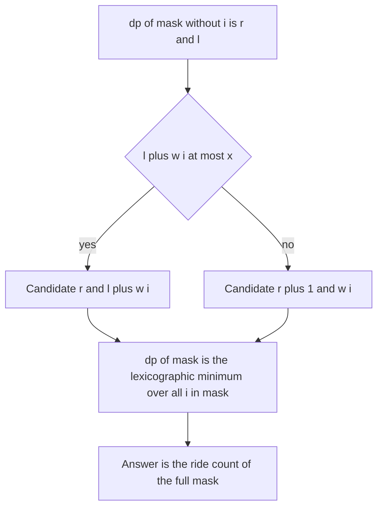

## The hook

Twenty friends with luggage want to go up a tower in a lift that carries at most 10 units of weight per trip. What is the fewest number of trips? Sorting by weight and packing greedily is wrong in general; this is bin packing, a famously hard problem. But with only 20 people, a bitmask over "who has already gone up" makes it exact and fast.

The interesting part is the state. Remembering the full contents of every trip is hopeless. Remembering just two numbers, how many trips so far and how full the current one is, turns out to be enough.

## The problem

CSES *Elevator Rides*: n people with weights, and a lift with maximum total weight x per ride. Find the minimum number of rides that takes everyone up. n ≤ 20, weights and x up to 10⁹.

Example: weights 4, 8, 6, 1, 5, 7, 2 with x = 10 need 4 rides; weights 2, 3, 3, 5, 6 with x = 10 need 2 rides, {2, 3, 5} and {3, 6}.

## The obvious approach

Greedy first-fit after sorting is a heuristic, not an exact method: bin packing has no known greedy that is always optimal. Trying every way to split people into rides is too many. The set partition DP with submasks, from [Visited Cities as a Row of Switches](article:cp-bitmask-dp), is exact:

dp[mask] = min over valid rides s ⊆ mask, containing mask's lowest person, of dp[mask ^ s] + 1.

But it costs O(3ⁿ), about 3.5 × 10⁹ for n = 20, which is too slow.

## The key insight

:::analogy
Picture the friends boarding one at a time from a queue. The attendant only ever looks at the lift that is currently loading: if the next friend fits, they get in; if not, the lift goes up and a new one starts with that friend. Earlier lifts are already at the top and nothing about them matters any more. So the whole situation at any moment is: which friends have boarded, how many lifts have gone or are loading, and how much weight is in the loading one.
:::

That is [[order-based packing]], and every valid plan can be produced by some boarding order: list the people ride by ride. So dp[mask] = the best [[ride state]] (rides, last) for sending exactly the people in mask, where rides counts the current open ride too, and last is its weight.

Adding person i to a state (r, l) gives:

- (r, l + w[i]) if l + w[i] ≤ x, joining the open ride;
- (r + 1, w[i]) otherwise, starting a new ride.

Take the [[lexicographic minimum]] over all choices of the last person i in mask. That is safe by [[dominance]]: fewer rides is never worse, since an extra ride can always be started, and with the same number of rides, a lighter open ride leaves more room.

Start with dp[0] = (1, 0), one empty open ride, and read dp[full].first. Each of 2ⁿ masks tries n last persons: O(2ⁿ × n), about 2 × 10⁷ for n = 20.

| Method | State | Time for n = 20 |
|---|---|---|
| Greedy first-fit | none | fast, but not always optimal |
| Submask partition DP | dp[mask] = rides | about 3.5 × 10⁹, too slow |
| Ride-state DP | dp[mask] = (rides, last weight) | about 2 × 10⁷ |



:::insight
When items are added one at a time, only the open bin can still change, so the state is just the number of bins and the open bin's load. Comparing those pairs with fewer bins first keeps the one state that dominates all others for each set of items.
:::

## Walk through an example

Weights 2, 3, 3, 5, 6 (people 0 to 4), x = 10. Masks are written with person 4 on the left.

| Mask | People | Best state (rides, last) | Why |
|---|---|---|---|
| 00001 | {0} | (1, 2) | person 0 in the first ride |
| 00011 | {0, 1} | (1, 5) | 2 + 3 fits |
| 00111 | {0, 1, 2} | (1, 8) | 2 + 3 + 3 fits |
| 01111 | {0, 1, 2, 3} | (2, 3) | best is to end a ride and leave a light open one |
| 11111 | everyone | (2, 9) | 2 rides; the open ride holds 9 |

At 01111, adding person 3 (weight 5) last to (1, 8) would need a new ride, (2, 5). But adding person 2 (weight 3) last to the best state of {0, 1, 3}, which is (1, 10) after 2 + 3 + 5, gives (2, 3): same rides, lighter open ride. Lexicographic minimum picks (2, 3), and then person 4 (weight 6) fits: (2, 9).

For weights 4, 8, 6, 1, 5, 7, 2 with x = 10, the DP gives 4 rides, and a brute force over all boarding orders agrees. Since the total weight is 33, at least 4 rides are needed, so 4 is optimal.

:::try-this
Can the people {0, 1, 2, 3} ever be sent in a single ride, and who should board last to reach the state (2, 3)? (No: they weigh 2 + 3 + 3 + 5 = 13, more than 10, so at least two rides are needed. The best open-ride weight is 3: send {0, 1, 3} first, filling a ride exactly with 2 + 3 + 5 = 10, then person 2, with weight 3, starts the second ride.)
:::

:::warning
Common misconception: "Compare states by the open ride's weight first, to keep as much room as possible." That can prefer (3, 1) over (2, 9), throwing away a whole saved ride for a little room. A saved ride is worth more than any amount of room, because you can always start a new ride later. Rides first, weight second.
:::

## The code

```pseudo
best[0] = (1, 0)
for mask in 1 .. 2^n - 1:
    best[mask] = (inf, inf)
    for each i in mask:
        (r, l) = best[mask without i]
        cand = (r, l + w[i]) if l + w[i] <= x else (r + 1, w[i])
        best[mask] = min(best[mask], cand)        # lexicographic
return best[full].rides
```

```cpp
#include <bits/stdc++.h>
using namespace std;
using ll = long long;

int elevatorRides(const vector<ll>& w, ll x) {
    int n = w.size(), full = (1 << n) - 1;
    vector<pair<int, ll>> best(1 << n, {INT_MAX, LLONG_MAX});
    best[0] = {1, 0};                                     // one open, empty ride
    for (int mask = 1; mask <= full; mask++)
        for (int i = 0; i < n; i++) {
            if (!(mask >> i & 1)) continue;
            auto [r, l] = best[mask ^ (1 << i)];
            pair<int, ll> cand = (l + w[i] <= x) ? make_pair(r, l + w[i]) : make_pair(r + 1, w[i]);
            best[mask] = min(best[mask], cand);           // fewer rides first, then lighter
        }
    return best[full].first;
}

int bruteForce(vector<ll> w, ll x) {                      // try every boarding order
    sort(w.begin(), w.end());
    int ans = INT_MAX;
    do {
        int r = 1;
        ll l = 0;
        for (ll v : w) {
            if (l + v <= x) l += v;
            else r++, l = v;
        }
        ans = min(ans, r);
    } while (next_permutation(w.begin(), w.end()));
    return ans;
}

int main() {
    cout << elevatorRides({4, 8, 6, 1, 5, 7, 2}, 10) << ' ' << elevatorRides({2, 3, 3, 5, 6}, 10) << '\n';   // 4 2
    mt19937 rng(37);
    int bad = 0;
    for (int t = 0; t < 200; t++) {
        vector<ll> w(rng() % 7 + 1);
        for (ll& v : w) v = rng() % 10 + 1;
        bad += elevatorRides(w, 10) != bruteForce(w, 10);
    }
    cout << bad << '\n';                                  // 0
    vector<ll> twenty(20);
    for (ll& v : twenty) v = rng() % 1000000000 + 1;
    cout << elevatorRides(twenty, 1000000000) << '\n';    // 10, computed in well under a second
}
```

The brute force tries every boarding order, which is exactly the set of plans the DP covers; agreeing on 200 random cases is strong evidence that the state and the comparison are right.

## Complexity

- **Time: O(2ⁿ × n),** about 2 × 10⁷ for n = 20.
- **Space: O(2ⁿ)** pairs, about 16 MB with an int and a 64-bit weight.
- **Versus submask DP:** O(3ⁿ), about 3.5 × 10⁹ for n = 20.

## Common mistakes

- **Comparing by weight first,** which can throw away a saved ride.
- **Starting with best[0] = (0, 0)** and then forgetting to open the first ride; with (1, 0), the open ride is counted from the start.
- **Using int for weights,** since sums of two weights can exceed 2³¹ when weights reach 10⁹.
- **Using greedy first-fit,** which is not always optimal for bin packing.
- **Reaching for 3ⁿ submask DP** at n = 20.

## Practice problems

CSES *Elevator Rides* is this walkthrough. *Minimum Number of Work Sessions to Finish the Tasks* is the same bin-packing DP with smaller limits, solvable either way. *Matchsticks to Square* packs sticks into four sides of equal length, where the same (sides completed, current side length) state works.

## Key takeaways

- Elevator Rides is bin packing with up to 20 items, solved exactly by DP over the set of people already sent.
- The state for a set is the pair (rides used, weight in the open ride), because closed rides never matter again.
- Adding one person either joins the open ride or starts a new one, and the best state is the lexicographic minimum.
- Fewer rides dominate more rides, and with equal rides a lighter open ride dominates a heavier one.
- The DP runs in O(2ⁿ × n), exponentially faster than the O(3ⁿ) submask partition.
