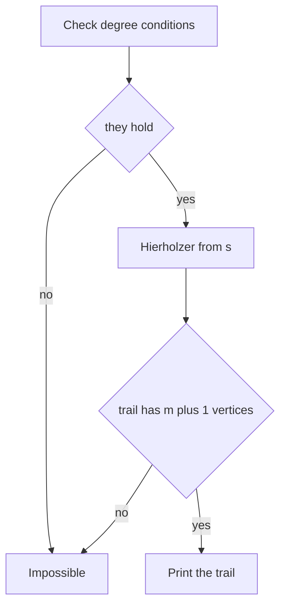
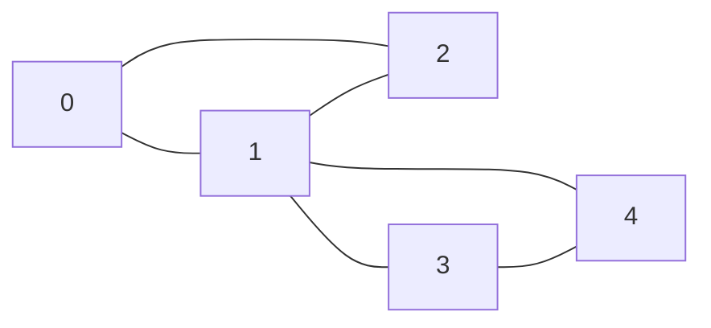

## The hook

Can you draw an envelope without lifting the pen and without tracing any line twice? Children try for minutes. A graph theorist checks how many corners have an odd number of lines and answers in seconds.

The question is old. In 1736 Euler proved that nobody could walk through Königsberg crossing each of its seven bridges exactly once, and the argument he used is exactly the degree condition below. Contest problems ask the same thing about postal routes, teleporters and strings: use every edge once, and print the route.

## The intuition

:::analogy
Drawing without lifting the pen means that every time the pen arrives at a corner, it must also leave along a different line, except at the very start and the very end. So the lines at each corner pair up as "in, out", and a corner with an odd number of lines must be where the drawing starts or ends. If the pen gets stuck early, nothing is lost: go back to the last corner that still has undrawn lines, draw that loop, and slip it into the drawing at that point.
:::

A drawing that uses every line once is an [[Euler trail]]; one that ends where it began is an [[Euler circuit]]. "Corners pair up their lines" is the [[degree condition]], and "slip the loop in" is the heart of [[Hierholzer's algorithm]].

## How it works

### When does a trail exist?

Ignore isolated vertices, and require every edge to lie in one connected piece. Then:

| Graph | Euler circuit exists when | Euler trail from s to t, s ≠ t, exists when |
|---|---|---|
| undirected | every vertex has even degree | s and t are the only odd-degree vertices |
| directed | out-degree = in-degree everywhere | out − in is +1 at s, −1 at t, 0 elsewhere |

The undirected and directed conditions look alike but are not interchangeable. In a directed graph, a vertex with in-degree 3 and out-degree 1 has even total degree 4 but cannot be passed through cleanly. CSES *Teleporters Path* needs the directed version, from city 1 to city n.

### Königsberg

Model each land mass as a vertex and each bridge as an edge. The island had five bridges and the other three land masses three each. Four vertices of odd degree: no circuit, and not even a trail, which allows at most two.

### Hierholzer's algorithm

```
stack = [s]
while stack not empty:
    u = top of stack
    if u has an unused edge (u, v): mark it used; push v
    else: pop u; append u to trail
reverse trail
```

The walk goes forward along unused edges until it reaches a vertex with nothing left, which in a valid graph can only be the end of the current route. That vertex is written down and popped. Backing up, the first vertex that still has unused edges starts a detour; the detour, too, must return to that vertex, and because written vertices come out in reverse order, the detour lands exactly where it belongs.

Two details keep it linear:

- an [[edge pointer]] it[u] per vertex skips past used edges permanently, so each adjacency entry is looked at O(1) times;
- for undirected graphs, mark the edge used by its id, since it appears in both endpoints' lists.

### The connectivity check

Degrees can be perfect while the edges sit in two separate pieces, such as two disjoint triangles. Instead of a separate search, check the output: a trail through all m edges has exactly m + 1 vertices. If Hierholzer returns fewer, some edges were unreachable, and the answer is "impossible".

### De Bruijn sequences

CSES *De Bruijn Sequence* asks for a shortest bit string containing every length-k string. Make each (k − 1)-bit string a vertex; from vertex x, the edge labelled b goes to the last k − 1 bits of x followed by b. Each of the 2^k edges is one length-k string. Every vertex has in-degree 2 and out-degree 2, so an Euler circuit exists; reading the start vertex, then one new bit per edge, gives a [[De Bruijn sequence]] of length 2^k + k − 1.



:::insight
The degree condition says when a route can exist, and Hierholzer's algorithm shows how to build one: get stuck, record, back up, detour. Writing vertices down only when they are stuck is what fits every detour into the right place without any explicit splicing.
:::

## Walk through an example

Five post offices, six roads: 0–1, 1–2, 2–0, 1–3, 3–4, 4–1. The postman starts and ends at 0. Degrees: vertex 1 has 4, the rest 2. All even, so a circuit should exist.



Adjacency lists in input order: vertex 1 lists 0, 2, 3, 4. Hierholzer from 0:

| Step | Action | Stack | Trail written so far |
|---|---|---|---|
| 1 | walk 0–1, 1–2, 2–0 | 0 1 2 0 | |
| 2 | 0 has no unused road: write 0 | 0 1 2 | 0 |
| 3 | 2 has none: write 2 | 0 1 | 0 2 |
| 4 | 1 still has roads: walk 1–3, 3–4, 4–1 | 0 1 3 4 1 | 0 2 |
| 5 | 1 is stuck: write 1 | 0 1 3 4 | 0 2 1 |
| 6 | 4, 3, 1, 0 are all stuck in turn | empty | 0 2 1 4 3 1 0 |

Reversed: 0, 1, 3, 4, 1, 2, 0. The first walk 0 → 1 → 2 → 0 came home too early, leaving the loop 1 → 3 → 4 → 1 undrawn; backing up to 1 found it, and the reversal put it right after the first visit to 1.

**Teleporters, directed.** Teleporters 0 → 1, 1 → 2, 2 → 0, 0 → 3, 3 → 1, 1 → 4, from 0 to 4. Out minus in: vertex 0 has 2 − 1 = +1, vertex 4 has 0 − 1 = −1, and vertices 1, 2, 3 are balanced. Hierholzer gives 0, 1, 2, 0, 3, 1, 4.

**De Bruijn, k = 3.** Vertices 00, 01, 10, 11; the circuit from 00 gives the string 0001011100, which contains 000, 001, 010, 101, 011, 111, 110 and 100, each once, in 2³ + 2 = 10 characters.

:::try-this
Add the road 0–3 to the post office graph. Is there still a circuit from 0, and if not, what does exist? (Vertices 0 and 3 now have degree 3, so no circuit exists. Exactly two vertices are odd, so an Euler trail exists from 0 to 3, or from 3 to 0, covering all seven roads.)
:::

:::warning
Common misconception: "Run a DFS and print vertices in the order they are first visited." A DFS visits vertices, not edges, and a preorder list can jump between vertices that are not adjacent. Euler trails need the opposite rule: write a vertex when it is stuck, and reverse at the end. Printing in the forward order of the walk also fails, because the first walk can return home before using every edge.
:::

## The code

```pseudo
eulerTrail(s, t):
    check degree conditions for s and t (undirected parity or directed balance)
    stack = [s]; it[v] = 0 for all v
    while stack: u = top
        advance it[u] past used edges
        if none left: append u to trail; pop
        else: take edge (u, v, id); used[id] = true; push v
    if trail has m + 1 vertices: return reversed trail, else impossible
```

```cpp
#include <bits/stdc++.h>
using namespace std;

// Hierholzer: vertex sequence of a trail from s to t using every edge exactly once, or {} if none exists
vector<int> eulerTrail(int n, const vector<array<int, 2>>& edges, bool directed, int s, int t) {
    int m = edges.size();
    vector<vector<pair<int, int>>> adj(n);                       // (neighbour, edge id)
    vector<int> out(n, 0), in(n, 0);
    for (int i = 0; i < m; i++) {
        auto [a, b] = edges[i];
        adj[a].push_back({b, i}), out[a]++, in[b]++;
        if (!directed) adj[b].push_back({a, i});
    }
    for (int v = 0; v < n; v++) {                                // degree conditions
        if (directed) {
            if (out[v] - in[v] != (v == s) - (v == t)) return {}; // +1 at s, -1 at t, 0 elsewhere
        } else {
            bool shouldBeOdd = s != t && (v == s || v == t);
            if ((adj[v].size() % 2 == 1) != shouldBeOdd) return {};
        }
    }
    vector<int> it(n, 0), st = {s}, trail;
    vector<char> used(m, 0);
    while (!st.empty()) {
        int u = st.back();
        while (it[u] < (int)adj[u].size() && used[adj[u][it[u]].second]) it[u]++;   // skip walked edges
        if (it[u] == (int)adj[u].size()) trail.push_back(u), st.pop_back();       // stuck: u's place is fixed
        else { auto [v, id] = adj[u][it[u]]; used[id] = 1; st.push_back(v); }    // walk a fresh edge
    }
    if ((int)trail.size() != m + 1) return {};                   // edges in another component
    reverse(trail.begin(), trail.end());
    return trail;
}

bool valid(const vector<int>& tr, const vector<array<int, 2>>& edges, bool directed, int s, int t) {
    if (tr.empty() || tr.front() != s || tr.back() != t || tr.size() != edges.size() + 1) return false;
    multiset<pair<int, int>> left;
    for (auto [a, b] : edges) left.insert(directed ? make_pair(a, b) : make_pair(min(a, b), max(a, b)));
    for (size_t i = 0; i + 1 < tr.size(); i++) {
        int a = tr[i], b = tr[i + 1];
        auto f = left.find(directed ? make_pair(a, b) : make_pair(min(a, b), max(a, b)));
        if (f == left.end()) return false;                       // consecutive vertices must be an unused edge
        left.erase(f);
    }
    return true;
}

int main() {
    vector<array<int, 2>> mail = {{0, 1}, {1, 2}, {2, 0}, {1, 3}, {3, 4}, {4, 1}};
    for (int v : eulerTrail(5, mail, false, 0, 0)) cout << v << ' ';
    cout << '\n';                                                // 0 1 3 4 1 2 0

    vector<array<int, 2>> konigsberg = {{0, 1}, {0, 1}, {0, 2}, {0, 2}, {0, 3}, {1, 3}, {2, 3}};
    cout << eulerTrail(4, konigsberg, false, 0, 0).size() << '\n';   // 0

    vector<array<int, 2>> tele = {{0, 1}, {1, 2}, {2, 0}, {0, 3}, {3, 1}, {1, 4}};
    for (int v : eulerTrail(5, tele, true, 0, 4)) cout << v << ' ';
    cout << '\n';                                                // 0 1 2 0 3 1 4

    int k = 3, V = 1 << (k - 1);                                 // De Bruijn: vertices are the last k-1 bits
    vector<array<int, 2>> db;
    for (int v = 0; v < V; v++) for (int b = 0; b < 2; b++) db.push_back({v, ((v << 1) | b) & (V - 1)});
    auto c = eulerTrail(V, db, true, 0, 0);
    string seq(k - 1, '0');
    for (size_t i = 1; i < c.size(); i++) seq += char('0' + (c[i] & 1));
    cout << seq << '\n';                                         // 0001011100

    mt19937 rng(12);                                             // compare with backtracking on tiny graphs
    bool ok = true;
    for (int rep = 0; rep < 2000; rep++) {
        int n = 1 + rng() % 4, m = rng() % 7;
        bool directed = rng() % 2;
        vector<array<int, 2>> e;
        for (int i = 0; i < m; i++) e.push_back({(int)(rng() % n), (int)(rng() % n)});   // loops and repeats allowed
        int s = rng() % n, t = rng() % n;
        vector<char> usedE(m, 0);
        function<bool(int, int)> search = [&](int u, int done) {
            if (done == m) return u == t;
            for (int i = 0; i < m; i++) {
                if (usedE[i]) continue;
                auto [a, b] = e[i];
                int v = a == u ? b : (!directed && b == u ? a : -1);
                if (v < 0) continue;
                usedE[i] = 1;
                bool found = search(v, done + 1);
                usedE[i] = 0;
                if (found) return true;
            }
            return false;
        };
        bool exists = search(s, 0);
        auto tr = eulerTrail(n, e, directed, s, t);
        ok = ok && (exists ? valid(tr, e, directed, s, t) : tr.empty());
    }
    cout << (ok ? "stress ok" : "stress FAILED") << '\n';        // stress ok
}
```

The random test includes self-loops and parallel edges, directed and undirected graphs, and start and end vertices chosen at random; every answer is checked against backtracking over all edge orders. For *Mail Delivery*, call it with s = t = 0 on the undirected graph and print `IMPOSSIBLE` for an empty result.

## Complexity

- **Time: O(n + m).** Each edge is walked once, and each adjacency entry is skipped at most once thanks to the edge pointers.
- **Space: O(n + m)** for the adjacency lists, the used flags, the stack and the trail; the explicit stack avoids recursion depth problems on long trails.

## Common mistakes

- **Using the undirected parity test on a directed graph,** or the reverse.
- **Skipping the connectivity check,** which accepts two separate cycles as one route.
- **Writing vertices when first visited** instead of when stuck.
- **Forgetting to reverse** the trail, which matters for directed graphs.
- **Marking undirected edges by direction** instead of by id, so each road can be walked twice.
- **No edge pointer:** rescanning adjacency lists from the start makes dense graphs quadratic.
- **Recursion** on 2·10⁵ edges where an explicit stack is safer.

## Practice problems

*Mail Delivery* is the undirected circuit from vertex 1. *Teleporters Path* is the directed trail from 1 to n, with the balance conditions. *De Bruijn Sequence* is the directed circuit on (k − 1)-bit strings. *Reconstruct Itinerary* needs the lexicographically smallest directed trail: sort each adjacency list and run Hierholzer as above. Cycle reasoning in directed and undirected graphs is in [When the Rumour Comes Back to You](article:dsa-cycle-detection).

## Key takeaways

- An undirected graph whose edges are connected has an Euler circuit when every degree is even, and an Euler trail when exactly two vertices have odd degree.
- In a directed graph, every vertex must be balanced for a circuit, while a trail needs one extra outgoing edge at the start and one extra incoming edge at the end.
- Hierholzer's algorithm walks unused edges until stuck, writes down stuck vertices, and the reversed list is the trail with every detour already in place.
- A trail through all m edges has m + 1 vertices, which doubles as the connectivity check.
- A De Bruijn sequence is an Euler circuit on the graph of (k − 1)-bit strings, so it is built by the same algorithm.
