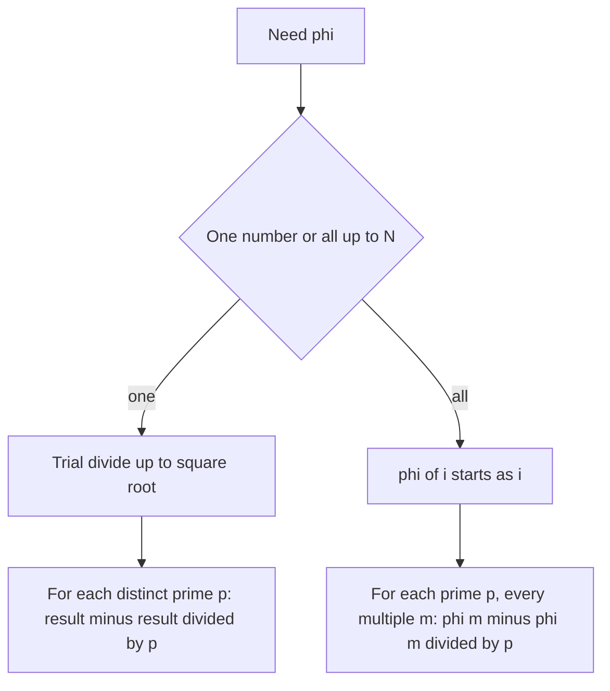

## The hook

A clock has 12 positions. You start at 0 and jump forward by the same step each time. With a step of 5 you visit every position before returning to 0; with a step of 4 you only ever visit 0, 4 and 8. The steps that visit every position are exactly those that share no factor with 12: 1, 5, 7 and 11.

Counting those steps is Euler's totient function, φ(n). It looks like a curiosity, but it is the key to reducing huge exponents modulo n, to RSA, and to a whole family of "count the coprime pairs" contest problems.

## The intuition

:::analogy
Think of gears. A small gear with k teeth turning against a big gear with n teeth will touch every tooth on the big gear only if k and n share no common factor. If they share a factor, the small gear keeps landing on the same few teeth. Counting the small-gear sizes that reach every tooth is counting the numbers coprime to n.
:::

[[Euler's totient function]] φ(n) counts the integers from 1 to n that are [[coprime]] to n, the gear sizes that reach every tooth.

## How it works

### The product formula

Remove the numbers sharing each prime factor of n. A fraction 1/p of all numbers are multiples of p, so a fraction (1 − 1/p) survive. Because different primes act independently, the fractions multiply:

$$\varphi(n) = n \prod_{p \mid n} \left(1 - \frac{1}{p}\right)$$

- The product runs over the **distinct** primes p dividing n.
- Repeated factors do not matter: φ(8) and φ(2) use the same factor (1 − 1/2).

Useful special cases: φ(p) = p − 1 for a prime p, and φ(pᵏ) = pᵏ − pᵏ⁻¹ for a [[prime power]]. φ is a [[multiplicative function]]: φ(a·b) = φ(a)·φ(b) when a and b are coprime.

### Computing it

- **One value:** factorise n by trial division up to √n, applying `result -= result / p` for each distinct prime p found. O(√n).
- **All values up to N:** a sieve. Start with phi[i] = i; for each prime p, for every multiple m of p, do `phi[m] -= phi[m] / p`. O(N log log N).



### Euler's theorem

For a and n coprime:

$$a^{\varphi(n)} \equiv 1 \pmod n$$

[[Euler's theorem]] generalises Fermat's little theorem, which is the case n prime, where φ(n) = n − 1. It lets you reduce huge exponents: $a^b \equiv a^{b \bmod \varphi(n)} \pmod n$ when gcd(a, n) = 1. It is also the mathematical heart of RSA.

:::insight
φ(n) depends only on n's distinct prime factors: start with n and, for each prime, keep the fraction (1 − 1/p) of numbers that avoid it. Once you see that, both the single-value formula and the all-values sieve are the same idea.
:::

### Where it hides in contests

- **Counting coprime pairs**: the number of pairs (a, b) with 1 ≤ a ≤ b ≤ n and gcd(a, b) = 1 is φ(1) + φ(2) + ... + φ(n).
- **Sums of gcds**: Σ gcd(i, n) over i = 1..n equals Σ d · φ(n/d) over divisors d of n, because exactly φ(n/d) values of i have gcd exactly d.
- **Reduced fractions**: the number of fractions a/n in lowest terms with 1 ≤ a ≤ n is φ(n).

## Walk through an example

**φ(36):** 36 = 2² × 3². φ(36) = 36 × (1 − 1/2) × (1 − 1/3) = 36 × 1/2 × 2/3 = **12**.

Check by listing numbers from 1 to 36 with no factor 2 or 3: 1, 5, 7, 11, 13, 17, 19, 23, 25, 29, 31, 35. Twelve. ✓

**Sieve for φ up to 10:**

| i | 1 | 2 | 3 | 4 | 5 | 6 | 7 | 8 | 9 | 10 |
|---|---|---|---|---|---|---|---|---|---|---|
| start | 1 | 2 | 3 | 4 | 5 | 6 | 7 | 8 | 9 | 10 |
| after p = 2 | 1 | 1 | 3 | 2 | 5 | 3 | 7 | 4 | 9 | 5 |
| after p = 3 | 1 | 1 | 2 | 2 | 5 | 2 | 7 | 4 | 6 | 5 |
| after p = 5, 7 | 1 | 1 | 2 | 2 | 4 | 2 | 6 | 4 | 6 | 4 |

**Euler's theorem:** 7^222 mod 10. gcd(7, 10) = 1 and φ(10) = 4, so 222 mod 4 = 2 and 7^222 ≡ 7² = 49 ≡ **9** (mod 10).

:::try-this
Compute φ(100) and use it to find 3^1001 mod 100. (100 = 2² × 5², φ(100) = 100 × 1/2 × 4/5 = 40. 1001 mod 40 = 1, so 3^1001 ≡ 3 (mod 100).)
:::

## The code

```pseudo
phi(n):
    result = n
    for p = 2; p * p <= n; p++:
        if n mod p == 0:
            while n mod p == 0: n = n / p
            result -= result / p
    if n > 1: result -= result / n        // a prime factor above sqrt
    return result
```

```cpp
#include <bits/stdc++.h>
using namespace std;

long long phi(long long n) {
    long long result = n;
    for (long long p = 2; p * p <= n; p++) {
        if (n % p == 0) {
            while (n % p == 0) n /= p;
            result -= result / p;
        }
    }
    if (n > 1) result -= result / n;
    return result;
}

int main() {
    cout << phi(12) << ' ' << phi(36) << ' ' << phi(100) << '\n';  // 4 12 40

    const int N = 10;
    vector<int> ph(N + 1);
    iota(ph.begin(), ph.end(), 0);
    for (int p = 2; p <= N; p++)
        if (ph[p] == p)                                   // p is still untouched, so prime
            for (int m = p; m <= N; m += p) ph[m] -= ph[m] / p;
    for (int i = 1; i <= N; i++) cout << ph[i] << ' ';     // 1 1 2 2 4 2 6 4 6 4
    cout << '\n';
}
```

## Complexity

- **One value:** O(√n) trial division.
- **All values up to N:** O(N log log N) with the sieve, O(N) memory.
- **With a precomputed smallest-prime-factor table**, single values up to N cost O(log n).

## Common mistakes

:::warning
Common misconception: "Euler's theorem lets me reduce any exponent modulo φ(n)." It requires gcd(a, n) = 1. When a and n share a factor, the plain reduction can give wrong answers; there are generalised versions for large exponents, but they need care.
:::

- **Forgetting the last prime factor** above √n, the `if (n > 1)` line.
- **Using repeated primes** in the product: each distinct prime appears once.
- **Order of operations**: `result -= result / p` keeps everything an integer; `result * (1 − 1/p)` with integer division gives 0.
- **Confusing φ with the number of divisors**, which uses exponents instead.

## Practice problems

*Exponentiation II* is the prime case of Euler's theorem. *Counting Coprime Pairs* (CSES) leans on totients or Möbius-style counting over divisors. *Sum of Divisors* practises the related "group by divisor" trick. *Same GCDs* (Codeforces) reduces to counting numbers coprime to m / gcd(a, m) in a range, which is exactly a totient.

## Key takeaways

- φ(n) counts the integers from 1 to n that are coprime to n.
- It equals n times (1 − 1/p) over the distinct primes p dividing n, so φ(p) = p − 1 for a prime.
- Compute one value by trial division in O(sqrt n), or all values up to N with a sieve in O(N log log N).
- Euler's theorem, a^φ(n) ≡ 1 mod n for coprime a and n, lets you reduce huge exponents and underlies RSA.
- Sums of totients count coprime pairs, and grouping by gcd turns many gcd sums into totient sums.
