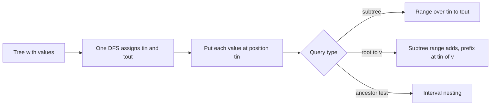
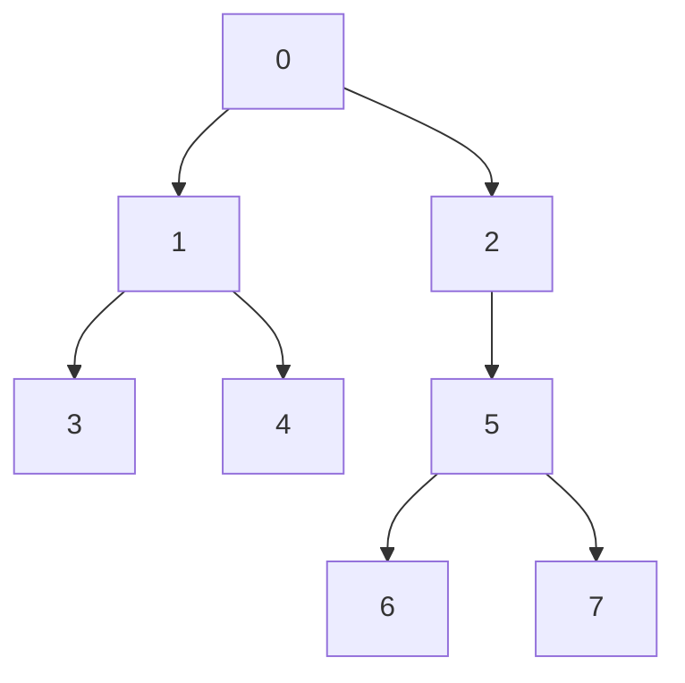

## The hook

A tree of 2·10⁵ vertices, each with a value, and 2·10⁵ operations mixed together: change one vertex's value, or ask for the total over some vertex's entire subtree. Walking the subtree costs up to n per question. A segment tree would answer range sums in O(log n), but a subtree is not a range... unless you number the vertices cleverly.

That numbering is the Euler tour. After one DFS, every subtree is a contiguous block of positions, so every tool from [A Tournament Bracket for Your Array](article:cp-segment-tree) and [A Pyramid of Savings Jars](article:dsa-fenwick-tree) applies to trees without change.

## The intuition

:::analogy
An archivist files a family's records in one long cabinet. Starting from the eldest ancestor, they file a person's folder, then file all of that person's first child's branch before touching the second child, and so on. Because each branch is filed completely before the next one starts, every person's descendants end up in one unbroken block of drawers, starting at that person's own folder. Asking "everything about this branch" means pulling out one block of drawers.
:::

The drawer number of a person is their [[entry time]], tin[v]. The last drawer of their block is their [[exit time]], tout[v]. Putting each value in drawer tin[v] is [[flattening]], and the block [tin[v], tout[v]] is the [[subtree range]].

## How it works

### Computing tin and tout

```
dfs(u):
    tin[u] = timer++
    for each child c of u: dfs(c)
    tout[u] = timer - 1          # the last entry time handed out inside u's subtree
```

The subtree of u has tout[u] − tin[u] + 1 vertices. Leaves have tin = tout.

This convention, where tout is the last entry time inside the subtree, gives closed ranges that plug straight into a Fenwick tree. Another common convention increments the timer on exit as well, giving 2n distinct times; it also works, but mixing the two in one solution is a classic source of off-by-one errors.

### Subtree queries

Store val[v] at position tin[v] in a Fenwick tree.

- **Set val[v] = x:** add x − val[v] at position tin[v].
- **Subtree sum of v:** range sum over [tin[v], tout[v]].

That is all of CSES *Subtree Queries*.

### The ancestor test

u is an ancestor of v, or v itself, exactly when v's block nests inside u's block: tin[u] ≤ tin[v] and tout[v] ≤ tout[u]. This [[ancestor test]] is O(1) and is used inside many LCA and path algorithms.

### Root-to-vertex path sums

CSES *Path Queries* asks for the sum on the path from the root to v, with value changes. Turn it around: a vertex u contributes to the path sum of v exactly when v is in u's subtree. So:

- each vertex u adds val[u] to every position in [tin[u], tout[u]], using the [[difference trick]]: +val[u] at tin[u] and −val[u] at tout[u] + 1;
- the root-to-v sum is the prefix sum up to tin[v].

A value change is two Fenwick updates; a query is one prefix sum. This is the range-update, point-query arrangement from [Two Piggy Banks That Track One Total](article:cp-fenwick-advanced).

For a path between any two vertices a and b, with L = lca(a, b):

- sum(a, b) = rootSum(a) + rootSum(b) − 2·rootSum(L) + val[L].

The LCA comes from [Express Elevators That Skip 1, 2, 4 and 8 Floors](article:cp-binary-lifting).

### Which tree questions flatten

| Question | Array view | Structure |
|---|---|---|
| sum, min or max over a subtree | range over [tin, tout] | Fenwick or segment tree |
| add to a whole subtree | range update over [tin, tout] | lazy segment tree or Fenwick difference |
| sum from root to v | prefix at tin[v] after subtree range adds | Fenwick |
| distinct colours in each subtree | offline distinct-values queries on ranges | Fenwick, as in distinct values queries |
| is u an ancestor of v | interval nesting | none needed |
| path between two arbitrary vertices | not one range | combine with LCA, or use heavy-light decomposition |

### The 2n − 1 tour and LCA

A second kind of Euler tour writes a vertex down every time the DFS is at it: on entry, and again after returning from each child. That sequence has 2n − 1 entries. Between the first appearances of a and b, the shallowest vertex is lca(a, b), so LCA becomes a range minimum over depths, answered in O(1) by the sparse table from [Lookout Towers Built for Contest Speed](article:cp-sparse-table). It is the same idea as flattening, applied to a different question.



:::insight
A DFS spends one unbroken stretch of time inside each subtree. Recording when that stretch starts and ends turns "the subtree of v" into "positions tin[v] to tout[v]", and every array data structure becomes a tree data structure.
:::

## Walk through an example

Eight vertices, root 0, children listed in the order DFS visits them: 0 has children 1 and 2; 1 has children 3 and 4; 2 has child 5; 5 has children 6 and 7. Values: 4, 2, 5, 2, 1, 3, 1, 6 for vertices 0 to 7.



The DFS visits 0, 1, 3, 4, 2, 5, 6, 7 in that order:

| Vertex | 0 | 1 | 2 | 3 | 4 | 5 | 6 | 7 |
|---|---|---|---|---|---|---|---|---|
| tin | 0 | 1 | 4 | 2 | 3 | 5 | 6 | 7 |
| tout | 7 | 3 | 7 | 2 | 3 | 7 | 6 | 7 |
| subtree range | [0, 7] | [1, 3] | [4, 7] | [2, 2] | [3, 3] | [5, 7] | [6, 6] | [7, 7] |

The flattened array, position by position:

| Position | 0 | 1 | 2 | 3 | 4 | 5 | 6 | 7 |
|---|---|---|---|---|---|---|---|---|
| Vertex | 0 | 1 | 3 | 4 | 2 | 5 | 6 | 7 |
| Value | 4 | 2 | 2 | 1 | 5 | 3 | 1 | 6 |

**Subtree sums.** Subtree of 1 is positions [1, 3]: 2 + 2 + 1 = 5. Subtree of 5 is [5, 7]: 3 + 1 + 6 = 10. The whole tree is [0, 7]: 24. After setting vertex 6 to 10, which adds 9 at position 6, subtree 5 becomes 19 and subtree 2, positions [4, 7], becomes 5 + 3 + 10 + 6 = 24.

**Root-to-vertex sums.** Each vertex adds its value over its own block:

| Vertex | Adds | Over positions |
|---|---|---|
| 0 | +4 | [0, 7] |
| 1 | +2 | [1, 3] |
| 2 | +5 | [4, 7] |
| 5 | +3 | [5, 7] |
| 6 | +1 | [6, 6] |

Position tin[6] = 6 lies inside the blocks of 0, 2, 5 and 6, so the prefix sum there is 4 + 5 + 3 + 1 = 13, exactly the path 0 → 2 → 5 → 6. Position tin[4] = 3 lies inside the blocks of 0, 1 and 4: 4 + 2 + 1 = 7. Setting vertex 5 to 10 adds 7 over [5, 7], so the root sums of 6 and 7 become 20 and 25, and vertex 4's stays 7.

**Ancestor test.** Is 2 an ancestor of 7? [7, 7] sits inside [4, 7]: yes. Is 1 an ancestor of 7? [7, 7] is not inside [1, 3]: no.

:::try-this
Using the table, compute the sum on the path from 4 to 6 with the original values. (The LCA is 0. rootSum(4) = 7, rootSum(6) = 13, rootSum(0) = 4, so the sum is 7 + 13 − 2·4 + 4 = 16. Directly: 1 + 2 + 4 + 5 + 3 + 1 = 16, along 4, 1, 0, 2, 5, 6.)
:::

:::warning
Common misconception: "If tin[u] < tin[v], then u is an ancestor of v." Vertex 1 has tin 1 and vertex 7 has tin 7, yet 1 is not an ancestor of 7: 1's branch was simply filed earlier. The block must contain v's position, which also needs tout[u] ≥ tin[v].
:::

## The code

```pseudo
flatten (iterative DFS from the root):
    on entering u: tin[u] = timer++
    on leaving u:  tout[u] = timer - 1
subtree queries: fenwick.add(tin[v], val[v]); query = fenwick.range(tin[v], tout[v])
path queries:    addSubtree(v, d) = fenwick.add(tin[v], d), fenwick.add(tout[v] + 1, -d)
                 rootSum(v) = fenwick.prefix(tin[v])
```

```cpp
#include <bits/stdc++.h>
using namespace std;

struct Fenwick {
    int n; vector<long long> t;
    Fenwick(int n) : n(n), t(n + 1, 0) {}
    void add(int i, long long d) { for (i++; i <= n; i += i & -i) t[i] += d; }          // position i, 0-indexed
    long long prefix(int i) const { long long s = 0; for (i++; i > 0; i -= i & -i) s += t[i]; return s; }
    long long range(int l, int r) const { return prefix(r) - (l ? prefix(l - 1) : 0); }
};

struct EulerTour {                                               // vertices 0..n-1, rooted at 0
    int n;
    vector<int> tin, tout, parent, order;                        // order[t] = vertex whose tin is t
    EulerTour(const vector<vector<int>>& adj) : n(adj.size()), tin(n), tout(n), parent(n, -1) {
        vector<int> it(n, 0), st = {0};                          // iterative DFS: safe for deep trees
        int timer = 0;
        tin[0] = timer++, order.push_back(0);
        while (!st.empty()) {
            int u = st.back();
            if (it[u] < (int)adj[u].size()) {
                int v = adj[u][it[u]++];
                if (v == parent[u]) continue;
                parent[v] = u, tin[v] = timer++, order.push_back(v);
                st.push_back(v);
            } else {
                tout[u] = timer - 1;                             // last entry time inside u's subtree
                st.pop_back();
            }
        }
    }
    bool isAncestor(int u, int v) const { return tin[u] <= tin[v] && tout[v] <= tout[u]; }
};

int main() {
    int n = 8;
    vector<array<int, 2>> edges = {{0, 1}, {0, 2}, {1, 3}, {1, 4}, {2, 5}, {5, 6}, {5, 7}};
    vector<vector<int>> adj(n);
    for (auto [a, b] : edges) adj[a].push_back(b), adj[b].push_back(a);
    vector<long long> val = {4, 2, 5, 2, 1, 3, 1, 6};
    EulerTour E(adj);
    for (int x : E.order) cout << x << ' ';
    cout << '\n';                                                // 0 1 3 4 2 5 6 7

    Fenwick sub(n);                                              // Subtree Queries
    for (int v = 0; v < n; v++) sub.add(E.tin[v], val[v]);
    auto subtree = [&](int v) { return sub.range(E.tin[v], E.tout[v]); };
    cout << subtree(0) << ' ' << subtree(1) << ' ' << subtree(5) << '\n';         // 24 5 10
    sub.add(E.tin[6], 10 - val[6]);                              // set vertex 6 to 10
    cout << subtree(5) << ' ' << subtree(2) << '\n';                              // 19 24

    Fenwick path(n + 1);                                         // Path Queries: range add, point query
    auto addSubtree = [&](int v, long long d) { path.add(E.tin[v], d), path.add(E.tout[v] + 1, -d); };
    for (int v = 0; v < n; v++) addSubtree(v, val[v]);
    auto rootSum = [&](int v) { return path.prefix(E.tin[v]); };
    cout << rootSum(6) << ' ' << rootSum(4) << '\n';                              // 13 7
    cout << rootSum(4) + rootSum(6) - 2 * rootSum(0) + val[0] << '\n';            // 16
    addSubtree(5, 10 - val[5]);                                  // set vertex 5 to 10
    cout << rootSum(6) << ' ' << rootSum(7) << ' ' << rootSum(4) << '\n';         // 20 25 7
    cout << E.isAncestor(2, 7) << E.isAncestor(1, 7) << E.isAncestor(0, 4) << '\n';   // 101
}
```

The Fenwick for path queries has n + 1 slots because the difference trick writes to tout[v] + 1, which is n for any vertex whose block ends at the last position.

## Complexity

- **Flattening: O(n)** time, one DFS, and O(n) memory for tin, tout and the order.
- **Point update and subtree query: O(log n)** each with a Fenwick tree.
- **Root path sum: O(log n)** per update and query; arbitrary paths add one LCA query.
- **2n − 1 tour plus sparse table:** O(n log n) build, O(1) per LCA.

## Common mistakes

- **Mixing conventions:** tout as "last entry time inside the subtree" gives closed ranges [tin, tout]; tout as "time of leaving" with a shared timer gives half-open ranges over 2n positions. Pick one.
- **Indexing the Fenwick by vertex** instead of by tin[v].
- **Updating with the new value** instead of the difference between new and old.
- **Treating tin[u] < tin[v] as ancestry** without checking tout.
- **A difference array one slot too short** for the −d at tout[v] + 1.
- **Recursive DFS on a path of 2·10⁵ vertices** where the judge's stack is small.

## Practice problems

*Subtree Queries* is point update plus subtree sum. *Path Queries* is subtree range add plus prefix sum at tin[v]. *Distinct Colors* flattens the tree and then asks how many distinct values sit in each block, which is the offline technique from [Counting a Guest Only at Their Latest Visit](article:cp-distinct-values-queries). *New Year Tree* combines flattening with a lazy segment tree that stores the set of colours as a bitmask.

## Key takeaways

- One DFS that records entry and exit times turns every subtree into the contiguous range of positions from tin[v] to tout[v].
- Storing each value at tin[v] lets a Fenwick or segment tree answer subtree sums, minima and range updates in O(log n).
- Root-to-vertex sums come from adding each value over its own subtree range and reading one prefix sum at tin[v].
- The ancestor test is interval nesting, tin[u] ≤ tin[v] and tout[v] ≤ tout[u], and an earlier entry time alone does not imply ancestry.
- Paths between two arbitrary vertices are not single ranges, so they need an LCA combination or heavy-light decomposition.
