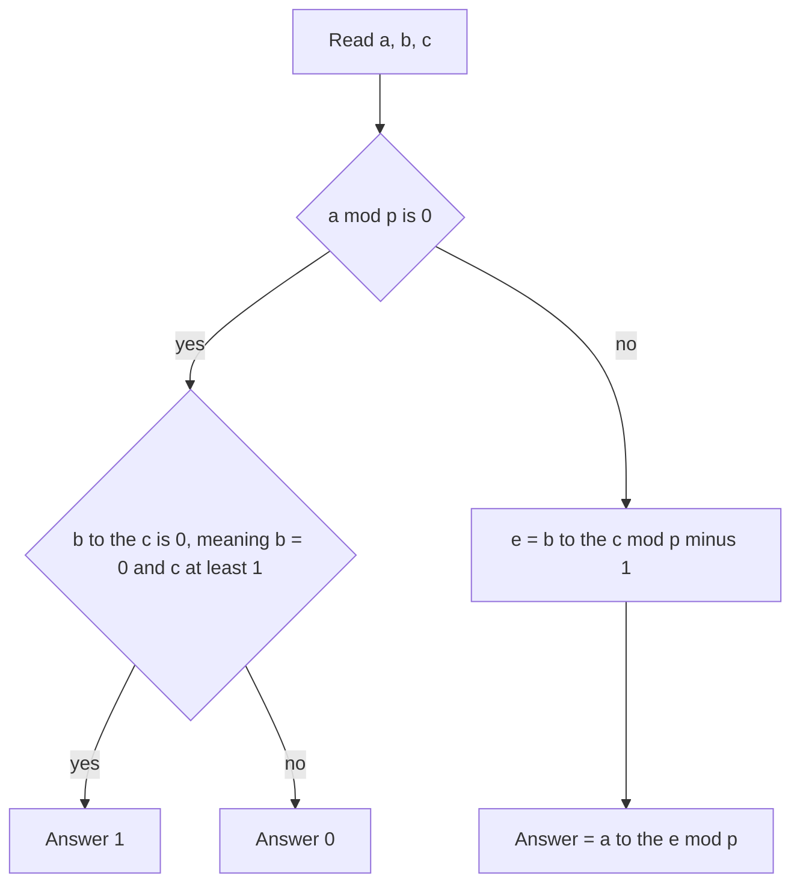

## The hook

Computing aᵇ mod p for b up to 10⁹ is the classic fast exponentiation exercise from [Raising to the Power of a Billion in Thirty Steps](article:cp-binary-exponentiation). Now raise the stakes: compute a^(b^c) mod p, where b and c are each up to 10⁹. The exponent b^c can have billions of digits. You cannot even write it down, let alone loop over its bits.

CSES *Exponentiation II* asks exactly this with p = 10⁹ + 7. It looks like a trick question, but it has a clean answer from one theorem, and it contains the single most common modular-arithmetic bug: reducing the exponent by the wrong modulus.

## The problem

Each test gives three non-negative integers a, b and c, each up to 10⁹. Print a^(b^c) modulo 10⁹ + 7, which is prime. The [[exponent tower]] is read from the top: first b^c, then a to that power. There can be many tests, so each must be fast.

## The obvious approach

Compute e = b^c exactly and then aᵉ mod p with [[binary exponentiation]]. But e has up to about c × log₁₀ b ≈ 9 × 10⁹ digits, so this is impossible. The tempting fix is "reduce e modulo p, like everything else", computing b^c mod p and then a to that. That runs fast and gives wrong answers.

## The key insight

:::analogy
Picture a clock whose hand jumps every time you multiply by a. Modulo a prime p, after p − 1 jumps the hand is guaranteed to be back exactly where it started (as long as a is not a multiple of p). It might come home sooner, but never later than p − 1 jumps. So jumping e times lands in the same place as jumping e mod (p − 1) times. To know where the hand ends, you only need the exponent modulo the clock's cycle, and the cycle length is p − 1, not p.
:::

The guarantee is [[Fermat's little theorem]]: for prime p and a not divisible by p,

$$a^{p-1} \equiv 1 \pmod p$$

So exponents can be reduced modulo p − 1:

$$a^{e} \equiv a^{\,e \bmod (p-1)} \pmod p$$

The actual cycle length, the [[order of an element]], may be smaller, but it always divides p − 1, so reducing modulo p − 1 is always safe.

The algorithm:

1. e = b^c mod (p − 1), using binary exponentiation with modulus p − 1.
2. answer = aᵉ mod p, using binary exponentiation with modulus p.

Both steps take about 30 squarings each.

### The zero cases

Fermat needs a not divisible by p. In this problem a ≤ 10⁹ < p, so that only happens when a = 0.

- If a = 0 and the true exponent b^c is positive, the answer is 0.
- If the true exponent is 0 (b = 0 and c ≥ 1), the answer is a⁰ = 1, with the usual convention 0⁰ = 1.

The danger: e = b^c mod (p − 1) can be 0 even when b^c is positive, and then the formula returns 1 for a = 0 instead of 0. With this problem's limits that cannot happen, because p − 1 = 2 × 500,000,003 and no b ≤ 10⁹ is a multiple of both factors, but in variations with other moduli it can. The robust code handles a mod p = 0 explicitly instead of relying on that.



:::insight
An exponent counts how many times you go round a cycle, so it lives modulo the cycle length, not modulo the base's modulus. For a prime p the cycle length divides p − 1. For a composite modulus n, the same idea uses φ(n) from [[Euler's theorem]], with extra care when gcd(a, n) ≠ 1.
:::

## Walk through an example

Use a tiny prime so every step is visible: p = 7, and compute 3^(2^3) mod 7.

Powers of 3 modulo 7:

| k | 1 | 2 | 3 | 4 | 5 | 6 | 7 | 8 |
|---|---|---|---|---|---|---|---|---|
| 3ᵏ mod 7 | 3 | 2 | 6 | 4 | 5 | 1 | 3 | 2 |

The hand returns to 1 after 6 = p − 1 jumps, then repeats.

- True exponent: 2³ = 8, so the answer is 3⁸ mod 7 = 6,561 mod 7 = **2** (the table's k = 8 column).
- Correct reduction: 8 mod 6 = 2, and 3² mod 7 = **2**. ✓
- Wrong reduction: 8 mod 7 = 1, and 3¹ mod 7 = 3. ✗

The order can be smaller than p − 1: powers of 2 modulo 7 go 2, 4, 1, a cycle of length 3, which divides 6, so reducing modulo 6 is still correct.

With the real modulus p = 10⁹ + 7: a = 3, b = 7, c = 1 gives 3⁷ = **2187**; a = 2, b = 3, c = 2 gives 2⁹ = **512**. Both exponents are small, so the reduction changes nothing, a useful sanity check.

:::try-this
Compute 2^(3^4) mod 5 by hand. (p − 1 = 4. 3⁴ = 81, and 81 mod 4 = 1, so the answer is 2¹ = 2. Check: powers of 2 mod 5 cycle 2, 4, 3, 1, and 81 = 20 × 4 + 1 lands on the first entry, 2.)
:::

## The code

```pseudo
power(base, exp, mod):
    result = 1 mod mod; base = base mod mod
    while exp > 0:
        if exp odd: result = result * base mod mod
        base = base * base mod mod; exp = exp / 2
    return result

solve(a, b, c):
    P = 1_000_000_007
    if a mod P == 0:
        return 1 if (b == 0 and c >= 1) else 0
    e = power(b, c, P - 1)
    return power(a, e, P)
```

```cpp
#include <bits/stdc++.h>
using namespace std;
const long long P = 1'000'000'007;

long long power(long long b, long long e, long long m) {
    long long r = 1 % m; b %= m;
    for (; e > 0; e >>= 1, b = b * b % m) if (e & 1) r = r * b % m;
    return r;
}

long long solve(long long a, long long b, long long c) {
    if (a % P == 0) return (b == 0 && c >= 1) ? 1 : 0;   // exponent 0 gives 1, otherwise 0
    long long e = power(b, c, P - 1);
    return power(a, e, P);
}

int main() {
    cout << solve(3, 7, 1) << ' ' << solve(2, 3, 2) << ' ' << solve(0, 5, 3) << ' ' << solve(5, 0, 3) << '\n';
    // 2187 512 0 1
    cout << power(3, power(2, 3, 6), 7) << ' ' << power(3, power(2, 3, 7), 7) << '\n';
    // 2 (correct, reduced mod 6)   3 (wrong, reduced mod 7)
}
```

Note that `power(b, 0, m)` returns 1, so when c = 0 the tower is a¹ = a, as expected (b⁰ = 1 even for b = 0 under the 0⁰ = 1 convention).

## Complexity

- **Time:** O(log c) for the inner power and O(log p) for the outer one, about 60 multiplications per test.
- **Space:** O(1).

## Common mistakes

:::warning
Common misconception: "in modular problems, reduce every number modulo p." Bases and results live modulo p, but exponents live modulo the cycle length, which is p − 1 for a prime modulus. Reducing b^c modulo p is the classic wrong answer on this problem, and it passes small tests where the exponent never wraps.
:::

- **Forgetting the a ≡ 0 case**, where Fermat does not apply.
- **Using `int`** for intermediate products: values up to p² need 64 bits.
- **Composite moduli**: reduce modulo φ(n) only when gcd(a, n) = 1, as discussed in [Counting the Numbers That Share Nothing With n](article:cp-euler-totient).
- **Reading the tower bottom-up**: a^(b^c) is not (a^b)^c, which would be a^(b·c).

## Practice problems

*Exponentiation* is the warm-up: aᵇ mod p for many queries. *Exponentiation II* is the walkthrough. *Pow(x, n)* on LeetCode practises binary exponentiation with negative exponents and doubles. *Super Pow* computes aᵇ mod 1337 where b is given as a huge digit array; 1337 is composite, so it is best solved by processing b digit by digit, a good contrast with the Fermat shortcut.

## Key takeaways

- For a prime p and a not divisible by p, Fermat's little theorem gives a^(p−1) ≡ 1, so powers of a repeat with a cycle dividing p − 1.
- Therefore a huge exponent can be reduced modulo p − 1, never modulo p.
- Compute a^(b^c) mod p as a to the power (b^c mod (p − 1)), using fast exponentiation twice.
- When a is a multiple of p, Fermat does not apply: the answer is 0 for a positive exponent and 1 for a zero exponent.
- Bases live modulo p, exponents live modulo the cycle length; mixing them up is the classic bug.
