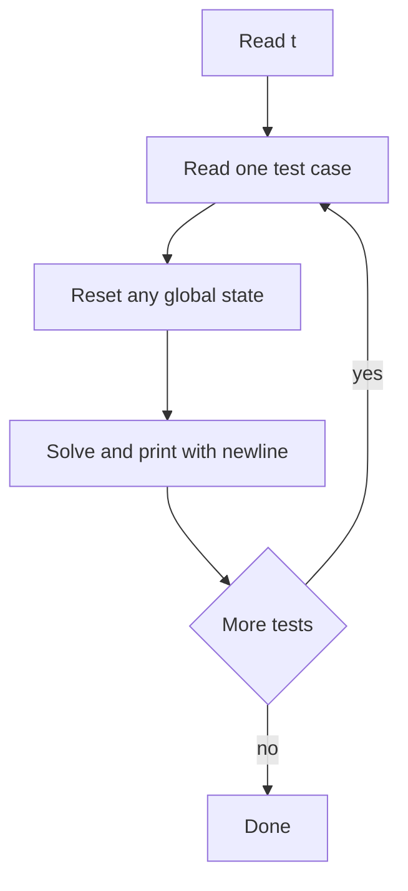

## The hook

You found the right idea in five minutes. The algorithm is O(n log n). You submit, and the judge says Time Limit Exceeded. You change nothing in the algorithm, swap `endl` for `'\n'`, and resubmit. Accepted.

Some verdicts have nothing to do with how smart your idea is. A good contest template removes these silly failures before they happen, so every minute goes into the actual problem.

## The intuition

:::analogy
A chef starts service with mise en place: knives sharpened, onions chopped, sauces ready. When orders arrive, they cook instead of hunting for a pan. Your [[template]] is your mise en place: includes, fast input, safe types and the multi-test loop are already in place when the clock starts.
:::

The template should be short. Long templates full of macros make code hard to read and hard to debug under pressure. Aim for something you understand line by line.

## Let's build it up

### The template

```cpp
#include <bits/stdc++.h>
using namespace std;

using ll = long long;

void solve() {
    int n;
    cin >> n;
    vector<ll> a(n);
    for (auto& x : a) cin >> x;
    ll sum = 0;
    for (ll x : a) sum += x;
    cout << sum << '\n';
}

int main() {
    ios::sync_with_stdio(false);
    cin.tie(nullptr);
    int t = 1;
    cin >> t;  // remove this line if the problem has a single test
    while (t--) solve();
}
```

Each line earns its place:

- `#include <bits/stdc++.h>` pulls in the whole standard library. It is a GCC convenience, fine on judges, not something for production code.
- `using ll = long long;` because [[overflow]] is the most common silent bug. A 32-bit `int` tops out around 2.1 × 10⁹; a `long long` reaches about 9.2 × 10¹⁸.
- `solve()` handles one test case. Many problems use [[multi-test input]]: the first line is t, then t independent cases.
- The two lines at the start of `main` give you [[fast I/O]].

### Why those two magic lines matter

By default, C++ streams stay synchronised with C's `printf` and `scanf`, and `cin` flushes `cout` before every read. Both are safe and slow. `ios::sync_with_stdio(false)` drops the synchronisation, and `cin.tie(nullptr)` stops the automatic [[flush]]. With 10⁶ numbers to read, this is the difference between comfortably fast and too slow.

After those lines, do not mix `cin` with `scanf` or `cout` with `printf` in the same program.

:::insight
Most "my O(n log n) solution got TLE" stories in beginner contests are I/O, not algorithms: missing fast I/O, or `endl` in a loop. Fix the template once and the problem disappears for good.
:::

### Output: '\n', not endl

`endl` writes a newline **and** flushes. Printing 200,000 lines with `endl` means 200,000 flushes. Use `'\n'` and let the buffer flush in large chunks. The only time you want explicit flushing is in interactive problems, where the judge waits for your output before replying.



### The reset trap

:::warning
Common misconception: "global arrays are zeroed, so I do not need to clear them." They are zeroed once, when the program starts. With t test cases, the second case sees whatever the first one left behind. Either declare containers inside `solve()`, or clear exactly the part you used.
:::

There is a second trap: clearing a huge global array of size 10⁶ in every one of 10⁴ test cases costs 10¹⁰ operations. Problems usually guarantee that the **sum** of n over all tests is at most some bound, like 2 × 10⁵. Clear only the first n entries, and your total work stays within that sum.

### Debug without breaking your output

When a solution misbehaves, you want to print intermediate values. Print them to `cerr`, not `cout`. Judges only read standard output, so debug lines on standard error never cause a Wrong Answer. Many contestants wrap this in a tiny helper that disappears when a `LOCAL` flag is not defined, so they never forget to delete it before submitting:

```cpp partial
#ifdef LOCAL
#define dbg(x) cerr << #x << " = " << (x) << '\n'
#else
#define dbg(x)
#endif
```

Compile locally with `-DLOCAL` and the helper prints; on the judge it vanishes.

### Reading the awkward inputs

Most input is whitespace-separated numbers, which `cin >>` handles. Two cases need care:

- **Whole lines with spaces:** use `getline(cin, s)`. If you read a number with `cin >>` just before, the newline after it is still waiting, so call `cin.ignore()` first or `getline` will return an empty line.
- **Grids of characters:** read each row as a `string`, so `grid[i][j]` gives the cell directly.

Compile with warnings on, such as `g++ -std=c++17 -O2 -Wall`. The compiler flags many bugs, like an `int` compared with `size()` or a variable used before it is set, before the judge ever sees them.

## A tiny example

Problem: t test cases; each has n numbers up to 10⁹. Print the sum of each case.

Suppose t = 2, with cases `[1000000000, 1000000000, 1000000000]` and `[5]`.

| Case | Values | Sum | Fits in int? |
|---|---|---|---|
| 1 | three values of 10⁹ | 3,000,000,000 | **no**, int maxes out near 2.1 × 10⁹ |
| 2 | 5 | 5 | yes |

With `int sum`, case 1 overflows and prints a negative number. The template's `ll` prevents it, and since `a` and `sum` live inside `solve()`, case 2 starts fresh.

:::try-this
In the template above, imagine moving `vector<ll> a` outside `solve()` and calling `a.push_back(x)` instead of indexing. What goes wrong on the second test case? (The vector still holds the first case's numbers, so the second sum includes them.)
:::

## Where you'll see this again

Every C++ block in the CP subject assumes this template. The next article teaches you to read a problem in two minutes, and the stress-testing article shows how to catch wrong answers yourself with a brute force and a random generator. The containers used inside `solve()` all come from [the STL toolkit](article:dsa-cpp-stl-toolkit).

## Key takeaways

- A short template you fully understand removes I/O and overflow failures before the contest starts.
- `ios::sync_with_stdio(false)` and `cin.tie(nullptr)` make reading large inputs much faster; do not mix C and C++ I/O afterwards.
- Print `'\n'` instead of `endl`, because `endl` flushes on every line.
- Use `long long` for sums and products by default, since values near 10⁹ overflow a 32-bit int quickly.
- In multi-test problems, reset state for every case, and clear only what you used so the total work respects the sum-of-n guarantee.
