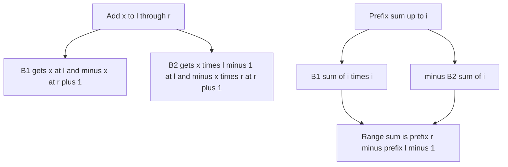

## The hook

A plain Fenwick tree, from [A Pyramid of Savings Jars](article:dsa-fenwick-tree), handles "change one element" and "sum a prefix". Contest problems quickly ask for more: add 7 to every element from position 1,000 to 50,000, then ask for a range sum; or toggle trees on a 1,000 by 1,000 forest map and count trees in rectangles.

A lazy segment tree does all of this, but it is long and easy to get wrong. Three small Fenwick tricks cover the same ground in a dozen lines each.

## The intuition

:::analogy
Picture two piggy banks that together keep track of a running total. The first bank receives a coin of value x whenever a range update starts, and pays it back where the range ends; multiplied by how far along you are, it slightly overestimates the total. The second bank quietly records exactly how much that overestimate is for each update. Subtract the second bank's balance from the first bank's scaled balance, and the true running total appears, without ever touching every element in the range.
:::

The tools are:

- a [[difference array]] stored in a Fenwick tree, for range update and point query;
- the [[two-tree trick]], with a second, [[correction tree]], for range update and range sum;
- a [[2D Fenwick tree]] for point update and rectangle sum.

## How it works

### Range update, point query

Store the difference array d in a Fenwick tree. Adding x to a[l..r] is add(l, x) and add(r + 1, -x). The value a[i] is sum(i), the prefix sum of differences. Both are O(log n). CSES *Range Update Queries* is exactly this.

### Range update, range sum with two trees

The prefix sum of a is Σ over j ≤ i of a[j] = Σ over j ≤ i of (i - j + 1) × d[j] = (i + 1) × Σ d[j] - Σ j × d[j]. With 1-based indices, a common equivalent form uses B1 and B2:

- update(l, r, x): B1.add(l, x), B1.add(r + 1, -x), B2.add(l, x × (l - 1)), B2.add(r + 1, -x × r);
- prefix(i) = B1.sum(i) × i - B2.sum(i);
- rangeSum(l, r) = prefix(r) - prefix(l - 1).

Why it works for one update of x on [l, r]:

| Position i | B1.sum(i) × i | B2.sum(i) | Difference, the true prefix |
|---|---|---|---|
| i < l | 0 | 0 | 0 |
| l ≤ i ≤ r | x × i | x × (l - 1) | x × (i - l + 1) |
| i > r | 0 | x × (l - 1) - x × r | x × (r - l + 1) |

The middle row is x times the number of covered positions up to i; the last row is the full range. Updates add linearly, so the identity holds for any number of them.

### 2D Fenwick tree

For a grid with point updates and rectangle sums, nest the loops:

```
add(r, c, d):  for i = r; i <= n; i += i & -i:  for j = c; j <= m; j += j & -j:  t[i][j] += d
sum(r, c):     for i = r; i > 0;  i -= i & -i:  for j = c; j > 0;  j -= j & -j:  s += t[i][j]
```

sum(r, c) is the rectangle from (1, 1) to (r, c), and any rectangle follows by inclusion-exclusion with four calls. CSES *Forest Queries II* toggles cells between tree and empty, which is add(r, c, ±1).

| Need | Structure | Update | Query |
|---|---|---|---|
| Point update, range sum | one tree of values | O(log n) | O(log n) |
| Range update, point value | one tree of differences | O(log n), two adds | O(log n) |
| Range update, range sum | two trees | O(log n), four adds | O(log n), four sums |
| Point update, rectangle sum | 2D tree | O(log n log m) | O(log n log m), four sums |



:::insight
A range update is two changes to a difference array, and the prefix sum of the array is a linear expression in prefix sums of that difference array. Splitting the expression across two Fenwick trees keeps every operation at O(log n), with no lazy tags at all.
:::

## Walk through an example

Array a = [5, 1, 4, 2, 3], positions 1 to 5. Updates: add 2 to [2, 4], then add -1 to [1, 3].

| After | Array |
|---|---|
| start | 5, 1, 4, 2, 3 |
| add 2 to [2, 4] | 5, 3, 6, 4, 3 |
| add -1 to [1, 3] | 4, 2, 5, 4, 3 |

Queries: sum [1, 5] = 18, sum [3, 4] = 9, value at 2 = 2.

With the two-tree trick, the initial values can be loaded as range updates of length one, add(i, i, a[i]), and every later update is four Fenwick adds. For example, after both updates, prefix(4) = B1.sum(4) × 4 - B2.sum(4) gives 4 + 2 + 5 + 4 = 15, and prefix(2) = 6, so sum [3, 4] = 15 - 6 = 9.

### A 2D forest

```
* . . *
. * * .
. . * .
* . . .
```

| Query (rows and columns 1-based) | Rectangle | Trees |
|---|---|---|
| whole map | (1, 1) to (4, 4) | 6 |
| centre | (2, 2) to (3, 3) | 3 |
| top right | (1, 2) to (2, 4) | 3 |

Toggle (3, 2) to a tree and (2, 2) to empty. The centre now holds 3 trees and the whole map still 6: one tree appeared and one disappeared, two add(r, c, ±1) calls.

:::try-this
Using only the difference-array tree, add 5 to [2, 3] on an all-zero array of length 4, then read positions 1 to 4. Which tree entries changed? (Only add(2, 5) and add(4, -5). The values read are sum(1) = 0, sum(2) = 5, sum(3) = 5, sum(4) = 0. The Fenwick positions touched are 2 and 4 for the first add, and 4 for the second, since 2 → 4 and 4 → 8 is past the end.)
:::

:::warning
Common misconception: "For range update and range sum, a Fenwick tree of differences is enough." One tree gives single values, so a range sum would need r - l + 1 point reads, O(n log n) in the worst case. The second tree is what makes the prefix sum, and so the range sum, a constant number of Fenwick queries.
:::

## The code

```pseudo
range_add(l, r, x):                           # two-tree trick, 1-based
    B1.add(l, x);  B1.add(r + 1, -x)
    B2.add(l, x * (l - 1));  B2.add(r + 1, -x * r)
prefix(i): return B1.sum(i) * i - B2.sum(i)
range_sum(l, r): return prefix(r) - prefix(l - 1)
```

```cpp
#include <bits/stdc++.h>
using namespace std;
using ll = long long;

struct BIT {
    int n;
    vector<ll> t;
    explicit BIT(int n) : n(n), t(n + 2, 0) {}
    void add(int i, ll d) { for (; i <= n + 1; i += i & -i) t[i] += d; }
    ll sum(int i) const { ll s = 0; for (; i > 0; i -= i & -i) s += t[i]; return s; }
};

struct RangeBIT {                                         // range add, range sum
    int n;
    BIT b1, b2;
    explicit RangeBIT(int n) : n(n), b1(n), b2(n) {}
    void add(int l, int r, ll x) {
        b1.add(l, x), b1.add(r + 1, -x);
        b2.add(l, x * (l - 1)), b2.add(r + 1, -x * r);    // corrections
    }
    ll prefix(int i) const { return b1.sum(i) * i - b2.sum(i); }
    ll sum(int l, int r) const { return prefix(r) - prefix(l - 1); }
};

struct BIT2D {                                            // point add, rectangle sum
    int n, m;
    vector<vector<int>> t;
    BIT2D(int n, int m) : n(n), m(m), t(n + 1, vector<int>(m + 1, 0)) {}
    void add(int r, int c, int d) {
        for (int i = r; i <= n; i += i & -i)
            for (int j = c; j <= m; j += j & -j) t[i][j] += d;
    }
    int sum(int r, int c) const {
        int s = 0;
        for (int i = r; i > 0; i -= i & -i)
            for (int j = c; j > 0; j -= j & -j) s += t[i][j];
        return s;
    }
    int rect(int r1, int c1, int r2, int c2) const {
        return sum(r2, c2) - sum(r1 - 1, c2) - sum(r2, c1 - 1) + sum(r1 - 1, c1 - 1);
    }
};

int main() {
    vector<ll> a = {5, 1, 4, 2, 3};
    RangeBIT rb(5);
    for (int i = 1; i <= 5; i++) rb.add(i, i, a[i - 1]);
    rb.add(2, 4, 2), rb.add(1, 3, -1);
    cout << rb.sum(1, 5) << ' ' << rb.sum(3, 4) << ' ' << rb.sum(2, 2) << '\n';   // 18 9 2

    BIT diff(4);                                          // range add, point read
    diff.add(2, 5), diff.add(4, -5);
    for (int i = 1; i <= 4; i++) cout << diff.sum(i) << ' ';
    cout << '\n';                                         // 0 5 5 0

    vector<string> g = {"*..*", ".**.", "..*.", "*..."};
    BIT2D f(4, 4);
    for (int r = 0; r < 4; r++)
        for (int c = 0; c < 4; c++) if (g[r][c] == '*') f.add(r + 1, c + 1, 1);
    cout << f.rect(1, 1, 4, 4) << ' ' << f.rect(2, 2, 3, 3) << ' ' << f.rect(1, 2, 2, 4) << ' ';
    f.add(3, 2, 1), f.add(2, 2, -1);                      // toggle two cells
    cout << f.rect(2, 2, 3, 3) << ' ' << f.rect(1, 1, 4, 4) << '\n';             // 6 3 3 3 6
}
```

## Complexity

- **Difference tree: O(log n)** per range update and per point read.
- **Two-tree trick: O(log n)** per range update (four adds) and per range sum (four prefix sums).
- **2D tree: O(log n × log m)** per update and per rectangle query, O(n × m) memory.
- **Compared with a lazy segment tree:** the same asymptotic costs with far less code, but only for sums.

## Common mistakes

- **Mixing 0-based and 1-based indices,** especially at r + 1, which can be n + 1; size the tree one larger.
- **Writing the corrections with the wrong factors:** l - 1 at l and r at r + 1, for 1-based indices.
- **Overflow in x × r** for large values and indices; use 64-bit.
- **Toggling in 2D by setting instead of adding:** to flip a cell, add +1 or -1 depending on its current state, and keep the grid to know which.
- **Using the two-tree trick for min or max,** which are not linear and need a segment tree.

## Practice problems

*Range Update Queries* is the difference tree. *Forest Queries II* is the 2D tree with toggles. *Forest Queries*, the version without updates, is solved by plain 2D prefix sums, a useful contrast for when the Fenwick tree is not needed. When updates are assignments or the query is a minimum, use the lazy segment tree in [A Manager Who Promises Raises to the Whole Team](article:cp-lazy-propagation).

## Key takeaways

- Adding x to a range is two point updates on a difference array, and a single value is a prefix sum of that array.
- Range update with range sum uses two Fenwick trees, with prefix(i) = B1.sum(i) × i - B2.sum(i).
- The second tree stores the correction x × (l - 1) at l and -x × r at r + 1 for each update.
- A 2D Fenwick tree nests the index loops, giving rectangle sums in O(log n × log m) by inclusion-exclusion over four prefix queries.
- These tricks work because sums are linear; operations such as minimum need a segment tree.
