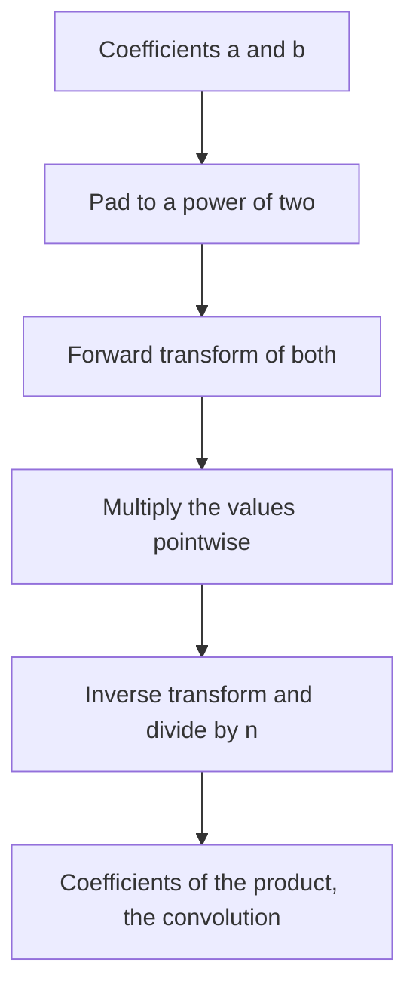

## The hook

A café combines one of its cakes with one of its drinks into a set menu, and the price of a set is the cake's price plus the drink's. With 200,000 cakes and 200,000 drinks, how many set menus are there at every possible total price? Pairing everything is 4 × 10¹⁰ combinations, far too many.

This counting question is a convolution, the same operation as multiplying two polynomials. Done term by term it is quadratic. The fast Fourier transform does it in O(n log n), and in contests it usually appears in its exact modular form, the number theoretic transform. It is advanced, but the core idea fits on one page.

## The intuition

:::analogy
Mixing two recipes by hand means trying every pair of ingredients: slow. A clever chef instead samples both recipes at a set of special tasting points, multiplies the two tastes at each point, and then reconstructs the combined recipe from the tasting results. The special points are chosen so cleverly that sampling and reconstructing both take only about n log n steps, instead of trying all n² pairs. The cleverness is that the points come in matched pairs, so half the work at each stage is shared.
:::

Concretely:

- the [[convolution]] c[k] = Σ a[i] × b[k - i] is the coefficient list of A(x) × B(x);
- a polynomial is also described by its values at enough points, its [[point-value form]], and in that form multiplication is pointwise: (A × B)(x) = A(x) × B(x);
- choosing the points as the powers of a [[root of unity]] makes both evaluation and interpolation recursive, splitting into even and odd coefficients, for O(n log n) each.

So: transform a and b, multiply pointwise, transform back.

## How it works

### Why roots of unity make it fast

Split A(x) into even and odd coefficients: A(x) = E(x²) + x × O(x²). With n points w⁰, w¹, ..., w^(n-1) where w is a primitive n-th root of unity, the squares (w^j)² take only n / 2 distinct values, and w^(j + n/2) = -w^j. So

A(w^j) = E(w^(2j)) + w^j × O(w^(2j)), and A(w^(j + n/2)) = E(w^(2j)) - w^j × O(w^(2j)).

Two half-size problems give both halves of the answer. That combine step is the [[butterfly]]: from u = E(...) and v = O(...), produce u + w^j v and u - w^j v. Recursing gives O(n log n). The inverse transform is the same algorithm with w replaced by w⁻¹ and a final division by n.

### FFT with doubles versus NTT

| | Complex FFT | NTT modulo 998244353 |
|---|---|---|
| Roots of unity | e^(2πi / n) | powers of 3, the primitive root, raised to (p - 1) / n |
| Arithmetic | doubles | integers modulo p |
| Exact? | no, rounding error grows with values and length | yes |
| Length limit | memory and precision | n must divide p - 1, so up to 2²³ |
| Results | must be rounded, and must stay below about 10¹⁵ | results are modulo p |

998244353 = 119 × 2²³ + 1, so p - 1 has the factor 2²³, and transform lengths that are powers of two up to 2²³ have exact roots of unity. That is why it is the standard modulus for convolution problems. The [[number theoretic transform]] is the same butterfly with modular multiplication, built on the fast exponentiation from [Raising to the Power of a Billion in Thirty Steps](article:cp-binary-exponentiation).

If true counts can exceed p, use FFT with care, NTT with several primes plus the Chinese remainder theorem, or split values into halves.

### Counting sums with frequency arrays

CSES *Apples and Bananas*: given weights of apples and bananas, count, for every total w, the pairs (apple, banana) with that total weight. Build frequency arrays A[x] and B[y]; the answer for total w is Σ A[x] × B[w - x], their convolution.

### Correlation: Signal Processing

CSES *Signal Processing* slides a mask over a signal and asks for the sum of products at every offset. That is a correlation, Σ s[i + k] × m[i], which becomes a convolution after reversing the mask: conv(s, reverse(m)).

### Practical recipe

- Pad both arrays to a power of two n ≥ len(a) + len(b) - 1.
- Transform both, multiply pointwise, inverse transform.
- Trim to len(a) + len(b) - 1 entries.



:::insight
Multiplying polynomials is slow on coefficients but trivial on values. Evaluating at roots of unity lets each half of the work reuse the other, so moving between coefficients and values costs O(n log n), and the whole convolution follows.
:::

## Walk through an example

### A small product

(1 + 2x + 3x²) × (4 + 5x):

| Power of x | Products that land there | Coefficient |
|---|---|---|
| 0 | 1 × 4 | 4 |
| 1 | 1 × 5 + 2 × 4 | 13 |
| 2 | 2 × 5 + 3 × 4 | 22 |
| 3 | 3 × 5 | 15 |

The convolution of [1, 2, 3] and [4, 5] is [4, 13, 22, 15]; the NTT below computes the same with length 4 transforms.

### Apples and bananas

Apples weigh 1, 2 and 2; bananas weigh 1 and 3. Frequency arrays by weight 0 to 3: A = [0, 1, 2, 0], B = [0, 1, 0, 1].

| Total weight | Pairs | Count |
|---|---|---|
| 2 | (1, 1) | 1 |
| 3 | (2, 1) twice | 2 |
| 4 | (1, 3) | 1 |
| 5 | (2, 3) twice | 2 |

The convolution of A and B is [0, 0, 1, 2, 1, 2, 0], matching the table.

### Signal processing

Signal [1, 3, 2, 1], mask [2, 1]. Reversed mask [1, 2]; the convolution is [1, 5, 8, 5, 2]. For example, the middle entry 8 is 3 × 2 + 2 × 1, the mask laid over the signal's second and third values.

:::try-this
Using convolution, how many ways can two dice, one with faces 1 to 3 and one with faces 1 to 2, show each total? (Frequency arrays by face: [0, 1, 1, 1] and [0, 1, 1]. The convolution is [0, 0, 1, 2, 2, 1]: totals 2, 3, 4 and 5 occur 1, 2, 2 and 1 ways, six outcomes in all.)
:::

:::warning
Common misconception: "FFT with doubles is always accurate enough." Rounding error grows with the size of the values and the length. Convolving arrays of 10⁶ entries with values near 10⁶ produces results around 10¹⁸, beyond what a double can represent exactly, and the rounded answers come out wrong. Use NTT when answers are wanted modulo a suitable prime, and be explicit about the magnitude otherwise.
:::

## The code

```pseudo
ntt(a, invert):                               # n is a power of two, mod 998244353, root 3
    bit-reversal permutation of a
    for len = 2, 4, ..., n:
        w_len = 3^((p - 1) / len), or its inverse if invert
        for each block of size len:
            w = 1
            for j in 0 .. len/2 - 1:
                u = a[i + j]; v = a[i + j + len/2] * w
                a[i + j] = u + v; a[i + j + len/2] = u - v; w *= w_len
    if invert: multiply every entry by n^-1

convolve(a, b): pad, ntt both, multiply pointwise, inverse ntt, trim
```

```cpp
#include <bits/stdc++.h>
using namespace std;
using ll = long long;
const ll MOD = 998244353, G = 3;                               // 998244353 = 119 * 2^23 + 1

ll power(ll b, ll e) {
    ll r = 1;
    for (b %= MOD; e; e >>= 1, b = b * b % MOD) if (e & 1) r = r * b % MOD;
    return r;
}

void ntt(vector<ll>& a, bool invert) {
    int n = a.size();
    for (int i = 1, j = 0; i < n; i++) {                       // bit-reversal permutation
        int bit = n >> 1;
        for (; j & bit; bit >>= 1) j ^= bit;
        j ^= bit;
        if (i < j) swap(a[i], a[j]);
    }
    for (int len = 2; len <= n; len <<= 1) {
        ll wl = power(G, (MOD - 1) / len);
        if (invert) wl = power(wl, MOD - 2);
        for (int i = 0; i < n; i += len) {
            ll w = 1;
            for (int j = 0; j < len / 2; j++) {
                ll u = a[i + j], v = a[i + j + len / 2] * w % MOD;   // butterfly
                a[i + j] = (u + v) % MOD;
                a[i + j + len / 2] = (u - v + MOD) % MOD;
                w = w * wl % MOD;
            }
        }
    }
    if (invert) {
        ll inv = power(n, MOD - 2);
        for (ll& x : a) x = x * inv % MOD;
    }
}

vector<ll> convolve(vector<ll> a, vector<ll> b) {
    int need = a.size() + b.size() - 1, n = 1;
    while (n < need) n <<= 1;
    a.resize(n), b.resize(n);
    ntt(a, false), ntt(b, false);
    for (int i = 0; i < n; i++) a[i] = a[i] * b[i] % MOD;      // pointwise product
    ntt(a, true);
    a.resize(need);
    return a;
}

int main() {
    auto print = [](const vector<ll>& v) { for (ll x : v) cout << x << ' '; cout << '\n'; };
    print(convolve({1, 2, 3}, {4, 5}));                         // 4 13 22 15
    print(convolve({0, 1, 2, 0}, {0, 1, 0, 1}));                // 0 0 1 2 1 2 0
    print(convolve({1, 3, 2, 1}, {1, 2}));                      // 1 5 8 5 2

    mt19937 rng(5);                                             // check against the naive product
    vector<ll> x(300), y(200);
    for (ll& v : x) v = rng() % 1000;
    for (ll& v : y) v = rng() % 1000;
    auto fast = convolve(x, y);
    int bad = 0;
    for (size_t k = 0; k < fast.size(); k++) {
        ll s = 0;
        for (size_t i = 0; i < x.size(); i++) if (k >= i && k - i < y.size()) s = (s + x[i] * y[k - i]) % MOD;
        bad += s != fast[k];
    }
    cout << bad << '\n';                                        // 0
}
```

## Complexity

- **Transform: O(n log n)** for n a power of two at least len(a) + len(b) - 1.
- **Convolution: three transforms plus O(n) pointwise work,** so O(n log n), against O(len(a) × len(b)) naively.
- **Space: O(n)** for the padded arrays.
- **In practice:** convolving two arrays of 2 × 10⁵ entries takes well under a second.

## Common mistakes

- **Padding too little:** the length must be at least len(a) + len(b) - 1, rounded up to a power of two.
- **Forgetting the division by n** in the inverse transform.
- **Using a modulus without the right roots of unity;** 998244353 works for lengths up to 2²³ with primitive root 3, but 10⁹ + 7 does not support NTT directly.
- **Trusting double-precision FFT** with results near or above about 10¹⁵.
- **Using convolution when true counts exceed the modulus** and exact values are needed; use several primes and CRT.
- **Forgetting to reverse the mask** in correlation problems.

## Practice problems

*Apples and Bananas* is the counting-sums convolution of two frequency arrays. *Signal Processing* is correlation through a reversed mask. *Multiply Strings* is the same convolution on decimal digits; for its sizes the quadratic method is expected, but it shows why large-number multiplication uses FFT. Fast exponentiation, which NTT relies on for its roots, is in [Raising to the Power of a Billion in Thirty Steps](article:cp-binary-exponentiation).

## Key takeaways

- The convolution c[k] = Σ a[i] × b[k - i] is the coefficient list of the product of two polynomials.
- In point-value form, polynomials multiply pointwise, and roots of unity make converting to and from that form O(n log n).
- The butterfly combines two half-size results into u + w × v and u - w × v, which is what makes the transform recursive.
- The number theoretic transform does the same in modular arithmetic, exactly, and 998244353 = 119 × 2²³ + 1 supports lengths up to 2²³.
- Counting pairs by total, and sliding a mask over a signal, both become a single convolution of frequency or reversed arrays.
