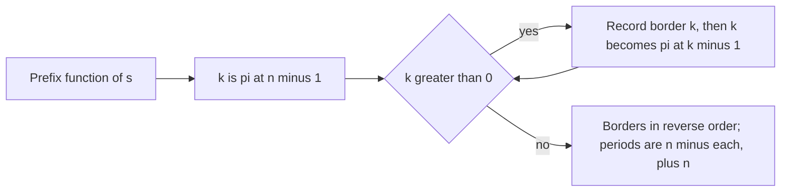

## The hook

Put a book between two bookends and the left one mirrors the right one. A word has bookends too: "abcababcab" starts with "ab" and ends with "ab", and also starts and ends with "abcab". Those matching beginnings and endings are borders, and they reveal how the word repeats itself.

CSES *Finding Borders* asks for all of them in a string of up to a million letters, and *Finding Periods* asks for every period, which turns out to be the same list read the other way round. The prefix function from [A Reader Who Never Rereads the Page](article:cp-prefix-function) answers both in one pass.

## The problem

Given a string s of length n, up to 10⁶ lowercase letters, print the lengths of all its borders in increasing order. A border is a [[proper prefix]] that is also a suffix.

*Finding Periods* asks for all periods p in increasing order, where p is a period when s is a prefix of its first p letters repeated, the last copy possibly cut short.

For s = "abcababcab", the borders are 2 and 5, and the periods are 5, 8 and 10.

## The obvious approach

For every k from 1 to n − 1, compare the first k letters with the last k. On a string of distinct letters each comparison fails at once, but on "aaaa...a" every comparison succeeds and runs its full length: 1 + 2 + ... + (n − 1), about 5·10¹¹ letter checks for n = 10⁶. Far too slow.

Hashing each prefix and suffix makes every comparison O(1), which is fast enough, but it relies on hash collisions not occurring. An exact linear method is better.

## The key insight

:::analogy
Think of the longest pair of bookends first: the longest beginning of the word that is also its ending. Any shorter pair of bookends of the word sits inside that pair: it is a beginning and an ending of the long bookend itself. So once you know the longest bookend, the next one is simply the longest bookend of that, and so on, until nothing is left. You never have to look at the rest of the word again.
:::

That is the [[border of a border]] fact, and it turns the search into a walk along the [[border chain]]:

- **Step 1.** Compute the prefix function pi in O(n).
- **Step 2.** Start at k = pi[n − 1], the longest [[border]]. Record k, then move to k = pi[k − 1]. Stop at 0.
- **Step 3.** Print the recorded lengths in increasing order.

**Periods.** If k is a border, then s[i] = s[i + (n − k)] wherever both exist, which is exactly the definition of [[period]] n − k. Conversely, every period p < n comes from the border n − p. So the periods are n minus each border, plus n itself; reversing the chain order gives them increasing.

**Two other exact methods.** With the Z-function from [A Window That Remembers What It Already Checked](article:cp-z-function), the suffix starting at i is a border exactly when i + z[i] = n. With hashing, a border is a length k whose prefix and suffix fingerprints agree; that is easy to write but probabilistic.

| Method | Time | Exact | Notes |
|---|---|---|---|
| direct comparison of every length | O(n²) worst case | yes | too slow on repeated letters |
| hashing every length | O(n) | with high probability | needs a good modulus or random base |
| prefix-function chain | O(n) | yes | lists borders longest first |
| Z-function test | O(n) | yes | lists borders in any order you scan |



:::insight
Borders nest: every shorter border lives inside the longest one. That single observation lets a precomputed prefix function list all borders by jumping, without comparing a single extra letter, and periods are the same jumps measured from the other end.
:::

## Walk through an example

s = "abcababcab", n = 10.

| i | 0 | 1 | 2 | 3 | 4 | 5 | 6 | 7 | 8 | 9 |
|---|---|---|---|---|---|---|---|---|---|---|
| s[i] | a | b | c | a | b | a | b | c | a | b |
| pi[i] | 0 | 0 | 0 | 1 | 2 | 1 | 2 | 3 | 4 | 5 |

The chain:

| Step | k | Border | Next |
|---|---|---|---|
| 1 | pi[9] = 5 | abcab | pi[4] = 2 |
| 2 | 2 | ab | pi[1] = 0 |
| 3 | 0 | stop | |

Borders in increasing order: 2, 5. Periods: 10 − 5 = 5, 10 − 2 = 8, and 10. Check period 5: "abcab" repeated is "abcababcab", exactly s. Check period 8: "abcababc" followed by its first two letters "ab" gives s again.

**The worst case.** For "aaaa" the chain is 3, 2, 1: every length is a border, and the periods are 1, 2, 3 and 4. For a million a's the program prints 999,999 borders, so fast output matters as much as the algorithm.

:::try-this
Find the borders and periods of "abacabadabacaba", length 15. (pi ends with 7, then pi[6] = 3, then pi[2] = 1, then 0, so the borders are 1, 3 and 7: "a", "aba" and "abacaba". The periods are 15 − 7 = 8, 15 − 3 = 12, 15 − 1 = 14 and 15.)
:::

:::warning
Common misconception: "The whole string is its own longest border, so print n too." Borders are proper: the string itself is excluded from *Finding Borders*. It is included in *Finding Periods*, where p = n is always a period. Mixing up the two conventions is the usual wrong answer on these problems.
:::

## The code

```pseudo
pi = prefixFunction(s)
borders = []; k = pi[n-1]
while k > 0: borders.append(k); k = pi[k-1]
print reversed(borders)                       # Finding Borders
print n - b for b in borders, then n          # Finding Periods, increasing
```

```cpp
#include <bits/stdc++.h>
using namespace std;
using ull = unsigned long long;

vector<int> bordersByPrefixFunction(const string& s) {           // shortest first
    int n = s.size();
    vector<int> pi(n, 0), res;
    for (int i = 1; i < n; i++) {
        int k = pi[i - 1];
        while (k > 0 && s[i] != s[k]) k = pi[k - 1];
        pi[i] = k + (s[i] == s[k]);
    }
    for (int k = n ? pi[n - 1] : 0; k > 0; k = pi[k - 1]) res.push_back(k);   // the chain: longest border first
    reverse(res.begin(), res.end());
    return res;
}

vector<int> bordersByZ(const string& s) {                        // a suffix at i is a border iff i + z[i] == n
    int n = s.size();
    vector<int> z(n, 0), res;
    for (int i = 1, l = 0, r = 0; i < n; i++) {
        if (i < r) z[i] = min(r - i, z[i - l]);
        while (i + z[i] < n && s[z[i]] == s[i + z[i]]) z[i]++;
        if (i + z[i] > r) l = i, r = i + z[i];
    }
    for (int i = n - 1; i >= 1; i--) if (i + z[i] == n) res.push_back(n - i);
    return res;
}

vector<int> bordersByHash(const string& s) {                     // compare prefix and suffix fingerprints
    int n = s.size();
    const ull B = 911382323;                                     // arithmetic mod 2^64; fine for non-adversarial tests
    vector<ull> h(n + 1, 0), pw(n + 1, 1);
    for (int i = 0; i < n; i++) h[i + 1] = h[i] * B + s[i], pw[i + 1] = pw[i] * B;
    auto get = [&](int l, int r) { return h[r] - h[l] * pw[r - l]; };
    vector<int> res;
    for (int k = 1; k < n; k++) if (get(0, k) == get(n - k, n)) res.push_back(k);
    return res;
}

int main() {
    string s = "abcababcab";
    for (int k : bordersByPrefixFunction(s)) cout << k << ' ';
    cout << "| periods:";
    auto b = bordersByZ(s);
    for (int i = b.size() - 1; i >= 0; i--) cout << ' ' << (int)s.size() - b[i];   // longest border = shortest period
    cout << ' ' << s.size() << '\n';                             // 2 5 | periods: 5 8 10
    cout << bordersByPrefixFunction("aaaa").size() << ' ' << bordersByPrefixFunction("abc").size() << '\n';   // 3 0

    mt19937 rng(27);                                             // three methods against direct comparison
    bool ok = true;
    for (int t = 0; t < 500; t++) {
        int n = 1 + rng() % 20;
        string x;
        for (int i = 0; i < n; i++) x += char('a' + rng() % 2);
        vector<int> brute;
        for (int k = 1; k < n; k++) if (x.compare(0, k, x, n - k, k) == 0) brute.push_back(k);
        ok = ok && bordersByPrefixFunction(x) == brute && bordersByZ(x) == brute && bordersByHash(x) == brute;
    }
    string big(1000000, 'a');                                    // the worst case for output size
    cout << bordersByPrefixFunction(big).size() << ' ' << (ok ? "stress ok" : "stress FAILED") << '\n';   // 999999 stress ok
}
```

The random test checks all three methods, the chain, the Z-function and hashing, against direct comparison on 500 random binary strings. The final line runs the chain on a million identical letters to show that the worst case for output size is still instant.

## Complexity

- **Time: O(n)** for the prefix function and the chain.
- **Space: O(n)** for pi.
- **Output** can be n − 1 numbers, so build the answer in a string or use fast output.

## Common mistakes

- **Including the whole string** as a border.
- **Excluding n** from the periods.
- **Printing the chain in the order found,** longest first, when increasing order is required.
- **Off-by-one in the chain:** the next border after k is pi[k − 1], not pi[k].
- **Direct comparison of every length,** which is quadratic on repeated letters.
- **Slow output** with endl for hundreds of thousands of numbers.

## Practice problems

*Finding Borders* and *Finding Periods* are this walkthrough. *Repeated Substring Pattern* asks whether a string is a whole number of copies of a shorter block: the smallest period n − pi[n − 1] must divide n and be smaller than n. The general tool is in [A Reader Who Never Rereads the Page](article:cp-prefix-function).

## Key takeaways

- A border is a proper prefix that is also a suffix, and every shorter border of a string is a border of its longest border.
- Following the prefix function from the end, k then pi[k − 1], lists every border from longest to shortest in linear time.
- Every border of length k corresponds to the period n − k, and the full length n is always a period.
- The Z-function gives the same borders through the test i + z[i] = n, and hashing gives them with high probability.
- Direct comparison of every length is quadratic on strings of repeated letters, which is exactly the case these problems test.
