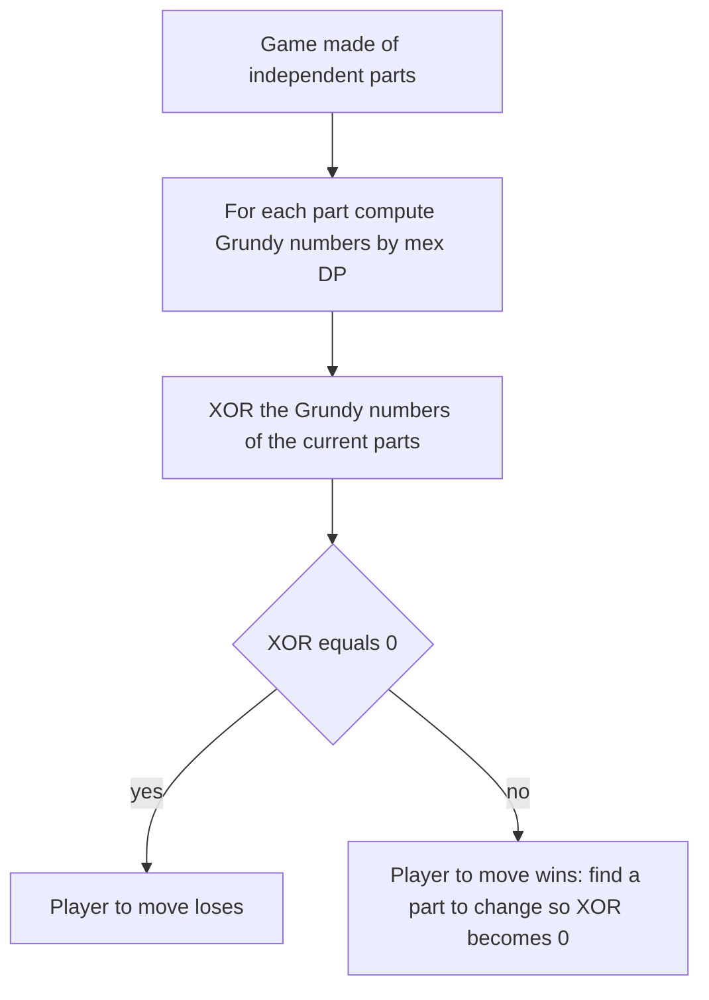

## The hook

"Alice and Bob take turns removing 1, 3 or 4 stones from a pile. Whoever cannot move loses. Who wins with 10,000 stones if both play perfectly?" Statements like this look like they need a clever trick or a lot of game tree search. In fact, a ten-line DP answers every pile size at once, and a single XOR answers the famous game of Nim.

Game problems appear in Codeforces rounds, in ICPC sets and in online assessments, often with "Alice and Bob" in the title. They reward one way of thinking: start from the end of the game, where the answer is obvious, and reason backwards.

## The intuition

:::analogy
Imagine counting backwards from the last move of a game. With no stones left, the player to move is stuck and loses: that position is decided. With one stone, you take it and leave your opponent stuck, so you win. For each larger pile, ask a single question: "Can I move to a position that we already know is a loss for whoever moves there?" If yes, you win by moving there. If every move hands your opponent a winning position, you lose. Working backwards from the end, every position gets labelled one by one.
:::

That labelling is backward induction. In an [[impartial game]] under [[normal play]], every position is either a [[losing position (P-position)]] or a [[winning position (N-position)]], and the rule is simple:

- A position is **losing** if every move leads to a winning position (including when there are no moves at all).
- A position is **winning** if at least one move leads to a losing position.

## How it works

### Win/lose DP

Order positions so that moves always go to "smaller" positions (fewer stones, fewer cells), then fill a table from the smallest:

```pseudo
win[0] = false                                   // no move: lose
for n in 1 .. N:
    win[n] = any(not win[n - m] for m in moves if m <= n)
```

This is exactly a DP from [Dynamic Programming Is Just Careful Recursion](article:dsa-dp-intro): the state is the position, and the transition looks at the positions one move away. Often the table reveals a pattern, such as a period, that gives an O(1) formula for huge inputs, but the DP is what finds and proves it for small sizes.

### Nim and XOR

In Nim there are several heaps, and a move removes any positive number of stones from one heap. The whole game has a startling answer:

**The position is losing exactly when the XOR of all heap sizes is 0.**

Why it works, in two facts:

1. From a position with XOR 0, every move changes one heap, which changes the XOR, so it becomes non-zero. You cannot stay at 0.
2. From a position with XOR x ≠ 0, take the highest set bit of x. Some heap h has that bit set; then h XOR x < h, so you can reduce that heap to h XOR x, making the total XOR 0.

So the player facing XOR 0 is always handed a non-zero XOR back, and the game ends at all heaps empty, which has XOR 0, on their turn.

### Grundy numbers: every game is secretly Nim

Many games are a **sum** of independent smaller games: several piles in the stick game, several tokens on a board, several separate regions. On each turn you move in exactly one component. To combine them, give each position a [[Grundy number]]:

$$g(p) = \operatorname{mex}\{\, g(q) : q \text{ reachable from } p \text{ in one move} \,\}$$

where [[mex]] is the smallest non-negative integer missing from the set. A terminal position has g = 0.

The Sprague-Grundy theorem says:

- A position is losing exactly when its Grundy number is 0.
- A sum of independent games has Grundy number equal to the **XOR** of the components' Grundy numbers.

A Nim heap of size h has Grundy number h, which is why Nim is solved by XOR. Every impartial normal-play game behaves like a Nim heap of size g.



:::insight
Win/lose labels are enough for a single game, but they do not combine: two winning games can add up to a losing one. Grundy numbers carry exactly the extra information needed so that combining games becomes XOR, which turns a huge product of game states into a sum of small independent DPs.
:::

## Walk through an example

**Subtraction game, moves {1, 3, 4}.** Fill positions 0 to 12:

| n | 0 | 1 | 2 | 3 | 4 | 5 | 6 | 7 | 8 | 9 | 10 | 11 | 12 |
|---|---|---|---|---|---|---|---|---|---|---|---|---|---|
| win/lose | L | W | L | W | W | W | W | L | W | L | W | W | W |
| Grundy | 0 | 1 | 0 | 1 | 2 | 3 | 2 | 0 | 1 | 0 | 1 | 2 | 3 |

- n = 2: the only move is to 1, which is W, so 2 is L.
- n = 5: moves reach 4 (W), 2 (L), 1 (W). Reaching L means 5 is W. Grundy: mex{g(4), g(2), g(1)} = mex{2, 0, 1} = 3.
- n = 7: moves reach 6, 4 and 3, all W, so 7 is L.

The losing positions 0, 2, 7, 9 repeat with period 7: n is losing when n mod 7 is 0 or 2. The DP discovered the formula.

**Two piles of this game, sizes 5 and 7.** g(5) XOR g(7) = 3 XOR 0 = 3 ≠ 0: the first player wins. Now take two piles of size 1. Each pile alone is a win for the player to move (g = 1), yet together they give 1 XOR 1 = 0, a loss: whatever you take, your opponent takes the other stone. This is why win/lose labels cannot be combined but Grundy numbers can. A brute-force search over all pairs of pile sizes up to 12 agrees with the XOR rule in every case.

**Nim with heaps 3, 4, 5.** 3 XOR 4 XOR 5 = 011 XOR 100 XOR 101 = 010 = 2. Non-zero, so the first player wins. The highest set bit of 2 is the 2s bit, and only heap 3 (binary 011) has it. Reduce that heap to 3 XOR 2 = 1: now 1 XOR 4 XOR 5 = 0, and the opponent faces a losing position.

:::try-this
In Nim with heaps 3, 4 and 7, who wins? (3 XOR 4 = 7, and 7 XOR 7 = 0. The first player is in a losing position: every move breaks the zero XOR and the opponent restores it.)
:::

## The code

```pseudo
grundy_table(N, moves):
    g = array of size N + 1
    for n in 0 .. N:
        seen = { g[n - m] for m in moves if m <= n }
        g[n] = smallest x >= 0 not in seen
    return g

first_player_wins(piles):
    x = 0
    for p in piles: x ^= g[p]
    return x != 0
```

```cpp
#include <bits/stdc++.h>
using namespace std;

int main() {
    vector<int> moves = {1, 3, 4};
    int N = 12;
    vector<int> g(N + 1, 0);
    for (int n = 1; n <= N; n++) {
        set<int> seen;
        for (int m : moves) if (m <= n) seen.insert(g[n - m]);
        int x = 0;
        while (seen.count(x)) x++;
        g[n] = x;
    }
    for (int n = 0; n <= N; n++) cout << g[n] << ' ';           // 0 1 0 1 2 3 2 0 1 0 1 2 3
    cout << '\n';
    cout << ((g[5] ^ g[7]) ? "First" : "Second") << '\n';        // First
    cout << ((3 ^ 4 ^ 5) ? "First" : "Second") << ' '
         << ((3 ^ 4 ^ 7) ? "First" : "Second") << '\n';          // First Second
}
```

## Complexity

- **Grundy or win/lose DP:** O(P × M) for P positions and M moves per position, with O(P) memory. The mex of at most M values costs O(M).
- **Nim:** O(k) for k heaps.
- **Huge positions** (n up to 10¹⁸) need a pattern: compute the table for small n, look for periodicity, and confirm it on as many values as you can before relying on it.

## Common mistakes

:::warning
Common misconception: "misère Nim is just normal Nim with the answer flipped." It is not. In misère Nim the XOR rule still holds while some heap has at least 2 stones; only when every heap has size 0 or 1 does it flip, so the player to move wins exactly when the number of heaps of size 1 is even. Always check which convention the statement uses: "the player who cannot move loses" is normal play, "the player who takes the last stone loses" is misère.
:::

- **Using win/lose labels to combine games**: two winning games can sum to a losing game. Combine with Grundy XOR instead.
- **Moves that do not shrink the position**, which break the DP order: make sure every move leads to a strictly "smaller" state, or the game may not end.
- **Wrong mex**: it is the smallest missing value starting from 0, not the maximum plus one.
- **Trusting a guessed pattern** without verifying it on enough small cases, ideally against a brute force.
- **Partizan games**, where players have different moves (as in chess), are not covered by Sprague-Grundy at all.

## Practice problems

*Stick Game* (CSES) is the subtraction-game DP above for every n. *Nim Game I* is plain XOR. *Nim Game II* restricts each move to removing 1, 2 or 3 sticks from a heap, so each heap's Grundy number is its size mod 4 and you XOR those. *Stair Game* is staircase Nim: balls move down one stair at a time, and only every second stair matters, the ones an odd number of steps above the bottom stair. *Grundy's Game* splits a heap into two unequal parts and needs Grundy values plus an observation about large sizes. *Stones* (AtCoder Educational DP Contest) is the win/lose DP as a warm-up.

## Key takeaways

- In an impartial game, a position is losing if every move leads to a winning position, and winning if some move leads to a losing one.
- Filling these labels from the end of the game backwards is a plain DP, and its table often reveals a periodic pattern.
- In Nim, the player to move loses exactly when the XOR of the heap sizes is 0.
- The Grundy number of a position is the mex of its options' Grundy numbers, and a sum of independent games has the XOR of the parts' Grundy numbers.
- Check normal versus misère play in the statement, because misère games need separate handling.
