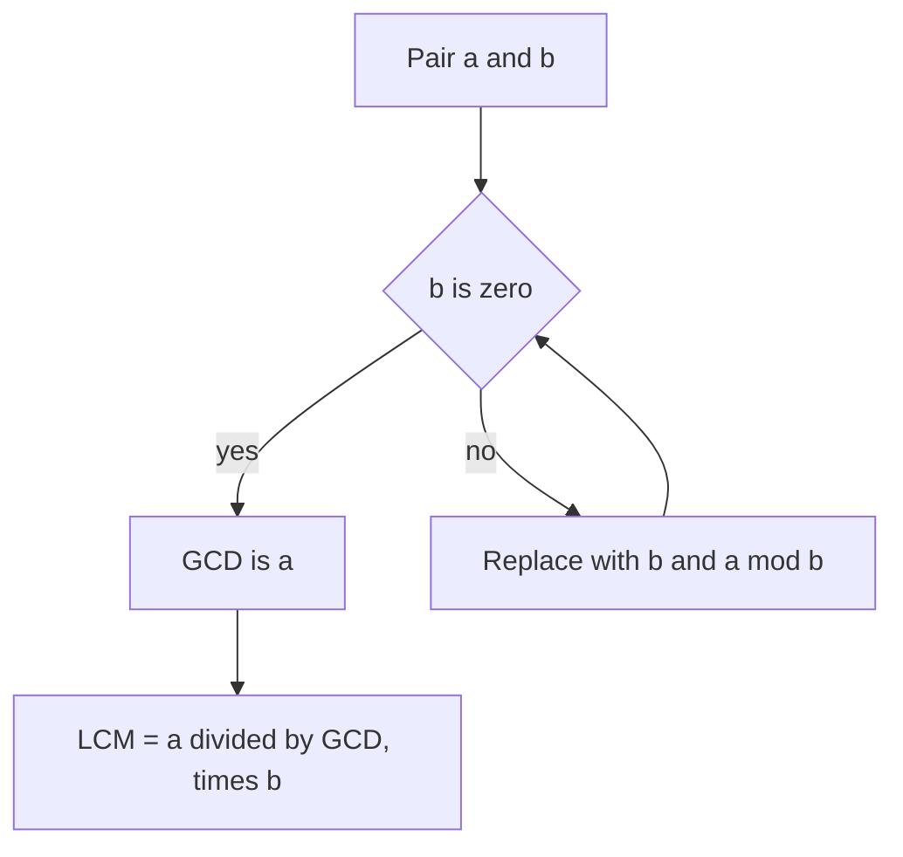

## The hook

A room is 1,071 cm by 462 cm, and you want to tile it with identical square tiles, no cutting. What is the largest tile size that fits exactly? You could try every size from 462 downward. Or you could use an algorithm written down by Euclid more than two thousand years ago, which answers in a handful of steps.

It is one of the oldest algorithms still in daily use, and in contests it is everywhere: simplifying fractions, aligning cycles, counting lattice points, and computing modular inverses.

## The intuition

:::analogy
Imagine tiling that 1,071 by 462 floor. First lay the biggest squares you can, 462 by 462, along the long side: two of them fit, leaving a 147 by 462 strip. Any tile that fits the whole floor must also fit this leftover strip exactly. So tile the strip with 147 by 147 squares: three fit, leaving a 147 by 21 strip. Tile that with 21 by 21 squares: exactly seven fit, nothing left over. The largest tile is 21.
:::

That is the [[Euclidean algorithm]]. Each step replaces the problem with a smaller leftover strip whose answer is the same. The answer is the [[GCD]], the greatest common divisor.

## How it works

### Euclid's algorithm

$$\gcd(a, b) = \gcd(b,\ a \bmod b), \qquad \gcd(a, 0) = a$$

- $a \bmod b$ is the leftover strip after laying as many b-sized squares as possible.
- When the remainder reaches 0, the last non-zero value is the GCD.

Why it is correct: any number dividing both a and b also divides a − k·b for any k, and a mod b is exactly such a number. So (a, b) and (b, a mod b) have the same common divisors, and the same greatest one.

### LCM from GCD

The [[LCM]], least common multiple, is the first time two cycles line up again: two buses arriving every 12 and 18 minutes next meet after lcm(12, 18) = 36 minutes.

$$\text{lcm}(a, b) = \frac{a}{\gcd(a, b)} \times b$$

Divide before multiplying, so the intermediate value stays small.

### Extended Euclid

The extended version also finds integers x and y, the [[Bezout coefficients]], with

$$a x + b y = \gcd(a, b)$$

It tracks how each remainder is built from a and b as the algorithm runs. When a and b are [[coprime]] (GCD 1), this gives $a x \equiv 1 \pmod b$, so x is the modular inverse of a modulo b. That is how inverses are computed when the modulus is not prime.



:::insight
Euclid's trick is that subtracting multiples of b never changes the common divisors. So you can throw away as much of a as possible in one step, a mod b, and the problem shrinks fast: the numbers at least halve every two steps.
:::

## Walk through an example

The floor from the hook, gcd(1071, 462):

| a | b | a mod b |
|---|---|---|
| 1071 | 462 | 147 |
| 462 | 147 | 21 |
| 147 | 21 | 0 |
| 21 | 0 | done: GCD = 21 |

Three division steps. Then lcm(1071, 462) = 1071 / 21 × 462 = 51 × 462 = 23,562.

**Extended version** for gcd(1071, 462) = 21: work backwards. 21 = 462 − 3 × 147, and 147 = 1071 − 2 × 462. Substitute: 21 = 462 − 3 × (1071 − 2 × 462) = 7 × 462 − 3 × 1071. So x = −3 and y = 7.

:::try-this
Compute gcd(48, 180) with the table, then lcm(48, 180). (180 mod 48 = 36; 48 mod 36 = 12; 36 mod 12 = 0. GCD 12. LCM = 48 / 12 × 180 = 720.)
:::

## The code

```pseudo
gcd(a, b):
    while b != 0:
        (a, b) = (b, a mod b)
    return a

ext_gcd(a, b):                  // returns (g, x, y) with a*x + b*y = g
    if b == 0: return (a, 1, 0)
    (g, x1, y1) = ext_gcd(b, a mod b)
    return (g, y1, x1 - (a / b) * y1)
```

```cpp
#include <bits/stdc++.h>
using namespace std;

long long extGcd(long long a, long long b, long long& x, long long& y) {
    if (b == 0) { x = 1; y = 0; return a; }
    long long x1, y1;
    long long g = extGcd(b, a % b, x1, y1);
    x = y1;
    y = x1 - (a / b) * y1;
    return g;
}

int main() {
    cout << gcd(1071LL, 462LL) << ' ' << lcm(1071LL, 462LL) << '\n';  // 21 23562 (C++17 <numeric>)
    long long x, y;
    long long g = extGcd(1071, 462, x, y);
    cout << g << " = 1071*" << x << " + 462*" << y << '\n';            // 21 = 1071*-3 + 462*7
}
```

C++17 provides `std::gcd` and `std::lcm` in `<numeric>`, so you rarely need to write the basic version yourself.

## Complexity

O(log min(a, b)) steps. The worst case is consecutive Fibonacci numbers, where each step reduces the pair as slowly as possible; even then, numbers up to 10¹⁸ finish in under about 90 steps.

## Common mistakes

:::warning
Common misconception: "lcm is just a × b / gcd, so compute a × b first." Mathematically yes, but a × b can overflow a 64-bit integer even when the LCM itself fits. Always divide first: a / gcd(a, b) × b. For LCMs of many numbers, the result can still outgrow 64 bits, so check for overflow or cap it.
:::

- **gcd with zero**: gcd(a, 0) = a, and gcd(0, 0) is usually defined as 0; handle it explicitly if inputs can be zero.
- **Negative numbers**: `%` can return negatives in C++; use absolute values for GCD.
- **Using the inverse when gcd ≠ 1**: a has an inverse modulo m only if they are coprime.
- **Recomputing GCDs of many pairs** when a prefix or running GCD would do: gcd(a1, ..., an) is a running fold.

## Practice problems

*Find Greatest Common Divisor of Array* is a warm-up. *Greatest Common Divisor of Strings* applies the same idea to repeated strings, a favourite interview twist. *Common Divisors* (CSES) asks for the largest GCD of any pair and needs counting over divisors instead of checking all pairs. *Number of Subarrays With LCM Equal to K* uses running LCMs with an early stop when the LCM exceeds k.

## Key takeaways

- The GCD of a and b equals the GCD of b and a mod b, because subtracting multiples of b keeps the common divisors.
- Euclid's algorithm repeats that step until the remainder is zero, in O(log min(a, b)) steps.
- The LCM is a divided by the GCD, times b, dividing first to avoid overflow.
- The extended algorithm finds x and y with ax + by = gcd(a, b), which gives modular inverses when a and b are coprime.
- C++17 offers std::gcd and std::lcm, but you still need the extended version for inverses with non-prime moduli.
