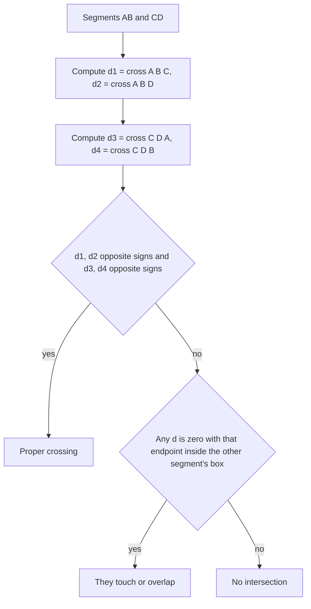

## The hook

Geometry problems scare many contestants: angles, trigonometry, floating-point errors, special cases everywhere. But the vast majority of contest geometry needs exactly one tool, used over and over. It decides whether a point is left or right of a line, whether two segments cross, whether a polygon is convex, and how big its area is, all in exact integer arithmetic.

That tool is the 2D cross product. Learn it, and geometry problems shrink from "pages of special cases" to "a few sign checks".

## The intuition

:::analogy
Imagine driving along a road from junction A to junction B, and then turning towards a landmark C. Either you turn left, you turn right, or C is straight ahead on the same road. A driver does not need the angle in degrees, just the direction of the turn. Almost every geometric question in contests reduces to asking, at the right junctions, "left, right or straight?"
:::

The cross product is the formula that answers "left, right or straight?" for three points, exactly, using only multiplication and subtraction.

## How it works

### Points as vectors

Store each point as a pair of integers. The [[vector]] from A to B is B − A = (B.x − A.x, B.y − A.y). Thinking of differences as vectors lets you add, subtract and scale them like numbers.

### The cross product

For vectors u = (u.x, u.y) and v = (v.x, v.y):

$$u \times v = u_x v_y - u_y v_x$$

For three points, define cross(A, B, C) = (B − A) × (C − A). The [[cross product]] gives the [[orientation]] of the turn A → B → C:

- **positive**: C is to the left of the directed line AB (counter-clockwise turn),
- **negative**: C is to the right (clockwise turn),
- **zero**: A, B and C are [[collinear]].

Its absolute value is twice the area of triangle ABC, which is why the same tool also measures area.

### Segment intersection

Segments AB and CD intersect if either:

1. **They properly cross**: C and D are on strictly opposite sides of line AB, *and* A and B are on strictly opposite sides of line CD. That is, cross(A, B, C) and cross(A, B, D) have opposite signs, and so do cross(C, D, A) and cross(C, D, B).
2. **They touch**: some endpoint is collinear with the other segment (cross product zero) and lies within that segment's bounding box. This covers touching at an endpoint and collinear overlap.



### Polygon area: the shoelace formula

For a polygon with vertices P₀, P₁, ..., Pₙ₋₁ listed in order around the boundary:

$$\text{Area} = \frac{1}{2}\left|\sum_{i=0}^{n-1} P_i \times P_{i+1}\right|$$

with Pₙ = P₀. Each term is the signed area of the triangle formed with the origin; triangles outside the polygon cancel because they are added once with each sign. This is the [[shoelace formula]]. The sum before halving is always an integer for integer coordinates, so many problems ask for twice the area to avoid fractions.

### Point in polygon

Shoot a ray from the point to the right and count how many polygon edges it crosses: odd means inside, even means outside. Before counting, check whether the point lies on any edge (cross product zero and inside the edge's box); boundary points usually need their own answer.

:::insight
One formula, u.x·v.y − u.y·v.x, gives turn direction from its sign and area from its size. Orientation tests, intersection, convexity, area and point-in-polygon are all built from it, and with integer inputs every answer is exact.
:::

## Walk through an example

**Orientation**, with the directed line from A = (1, 1) to B = (5, 3), so B − A = (4, 2):

| C | C − A | cross = 4·(C−A).y − 2·(C−A).x | Verdict |
|---|---|---|---|
| (3, 4) | (2, 3) | 12 − 4 = 8 | left |
| (6, 2) | (5, 1) | 4 − 10 = −6 | right |
| (9, 5) | (8, 4) | 16 − 16 = 0 | on the line |

**Segment intersection.** AB from (0, 0) to (4, 4), CD from (0, 4) to (4, 0): cross(A, B, C) = 16 and cross(A, B, D) = −16, opposite signs; cross(C, D, A) = −16 and cross(C, D, B) = 16, also opposite. They cross (at (2, 2)). Now AB from (0, 0) to (4, 0) and CD from (1, 1) to (3, 2): cross(A, B, C) = 4 and cross(A, B, D) = 8, the same sign, so both of CD's endpoints are on the same side: no intersection. Collinear segments (0, 0)–(2, 2) and (3, 3)–(5, 5) have all cross products zero but do not overlap, so they do not intersect; (0, 0)–(3, 3) and (2, 2)–(5, 5) overlap.

**Shoelace area** for the pentagon (0, 0), (4, 0), (4, 3), (2, 5), (0, 3):

| i | Pᵢ | Pᵢ₊₁ | Pᵢ × Pᵢ₊₁ |
|---|---|---|---|
| 0 | (0, 0) | (4, 0) | 0 |
| 1 | (4, 0) | (4, 3) | 12 |
| 2 | (4, 3) | (2, 5) | 14 |
| 3 | (2, 5) | (0, 3) | 6 |
| 4 | (0, 3) | (0, 0) | 0 |

Sum 32, so twice the area is 32 and the area is **16**: a 4 × 3 rectangle (12) plus a triangle on top with base 4 and height 2 (4). ✓

:::try-this
Is the polygon (0, 0), (4, 0), (4, 3), (2, 5), (0, 3) listed counter-clockwise? (Yes: the signed sum, +32, is positive. A clockwise listing would give −32.)
:::

## The code

```pseudo
cross(o, a, b): return (a.x - o.x) * (b.y - o.y) - (a.y - o.y) * (b.x - o.x)

on_segment(p, q, r):                  // r collinear with pq: is it between them?
    return min(p.x,q.x) <= r.x <= max(p.x,q.x) and min(p.y,q.y) <= r.y <= max(p.y,q.y)

intersect(a, b, c, d):
    d1 = cross(a,b,c); d2 = cross(a,b,d); d3 = cross(c,d,a); d4 = cross(c,d,b)
    if sign(d1) * sign(d2) < 0 and sign(d3) * sign(d4) < 0: return true
    return (d1 == 0 and on_segment(a,b,c)) or (d2 == 0 and on_segment(a,b,d))
        or (d3 == 0 and on_segment(c,d,a)) or (d4 == 0 and on_segment(c,d,b))

twice_area(poly): return |sum over i of cross(origin, poly[i], poly[i+1 mod n])|
```

```cpp
#include <bits/stdc++.h>
using namespace std;
using ll = long long;
struct P { ll x, y; };

ll cross(P o, P a, P b) { return (a.x - o.x) * (b.y - o.y) - (a.y - o.y) * (b.x - o.x); }
int sgn(ll v) { return (v > 0) - (v < 0); }
bool onSeg(P p, P q, P r) {
    return min(p.x, q.x) <= r.x && r.x <= max(p.x, q.x) && min(p.y, q.y) <= r.y && r.y <= max(p.y, q.y);
}
bool intersect(P a, P b, P c, P d) {
    ll d1 = cross(a, b, c), d2 = cross(a, b, d), d3 = cross(c, d, a), d4 = cross(c, d, b);
    if (sgn(d1) * sgn(d2) < 0 && sgn(d3) * sgn(d4) < 0) return true;
    return (d1 == 0 && onSeg(a, b, c)) || (d2 == 0 && onSeg(a, b, d)) ||
           (d3 == 0 && onSeg(c, d, a)) || (d4 == 0 && onSeg(c, d, b));
}
ll twiceArea(const vector<P>& p) {
    ll s = 0; int n = p.size();
    for (int i = 0; i < n; i++) s += p[i].x * p[(i + 1) % n].y - p[(i + 1) % n].x * p[i].y;
    return llabs(s);
}

int main() {
    P a{1, 1}, b{5, 3};
    cout << cross(a, b, {3, 4}) << ' ' << cross(a, b, {6, 2}) << ' ' << cross(a, b, {9, 5}) << '\n';  // 8 -6 0
    cout << intersect({0, 0}, {4, 4}, {0, 4}, {4, 0}) << intersect({0, 0}, {2, 2}, {3, 3}, {5, 5})
         << intersect({0, 0}, {3, 3}, {2, 2}, {5, 5}) << '\n';                                      // 101
    cout << twiceArea({{0, 0}, {4, 0}, {4, 3}, {2, 5}, {0, 3}}) << '\n';                            // 32
}
```

## Complexity

- **Orientation and intersection tests:** O(1), a handful of multiplications.
- **Polygon area and point in polygon:** O(n) for n vertices.
- **Value range:** coordinates up to 10⁹ give cross products up to about 4 × 10¹⁸, which fits in a signed 64-bit integer (limit about 9.2 × 10¹⁸).

## Common mistakes

:::warning
Common misconception: "geometry needs floating point and angles." With integer inputs, cross products answer orientation, intersection and area exactly. Floating point introduces rounding, and a test like "is this point exactly on the line?" can then give the wrong answer. Stay in integers until the very end, and print halves (like area / 2) by checking the parity of the integer result.
:::

- **Overflow with 32-bit integers**: products of coordinates up to 10⁹ need `long long`.
- **Forgetting touching and collinear cases** in segment intersection; test endpoints touching and overlapping collinear segments.
- **Unordered polygon vertices**: the shoelace formula needs vertices in boundary order.
- **Boundary points in point-in-polygon**: check "on an edge" before ray casting.

## Practice problems

*Point Location Test* is the orientation test exactly as in the table. *Line Segment Intersection* needs every touching case. *Polygon Area* is the shoelace formula, printing twice the area. *Point in Polygon* combines the on-edge check with ray casting. These all lead to convex hulls, which build hulls by keeping only left turns.

## Key takeaways

- Treat points as integer vectors, and compute directions as differences between points.
- The cross product's sign tells you whether three points turn left, turn right or lie on one line.
- Two segments intersect if each straddles the other's line, or if an endpoint lies on the other segment.
- The shoelace formula sums cross products of consecutive vertices to get twice a polygon's signed area.
- Use 64-bit integers and avoid floating point so every geometric test is exact.
