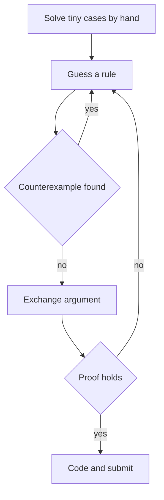

## The hook

Eight minutes into a contest you read problem B. A rule jumps out: sort, then pair the biggest with the smallest. It passes the samples. You submit, and the verdict comes back: wrong answer on test 7.

Greedy ideas are the fastest solutions to write and the easiest to get wrong. Strong contestants are not better at guessing. They are better at the two minutes after the guess: trying to break it, and then explaining to themselves why it cannot break. This article is about those two minutes.

## The intuition

:::analogy
You are walking to college and spot a lane that seems to cut the corner. It might save five minutes, or it might end in a wall. Smart walkers do two things before trusting a shortcut every day: they glance at the map to see where the lane really goes, and they ask whether any turn on it could lead somewhere worse than the main road. Only then does the shortcut become their route.
:::

A [[greedy algorithm]] is a shortcut: at every step it takes the choice that looks best now and never looks back. Some shortcuts are true. "Always take the movie that ends earliest" really maximises how many movies you watch. Others are walls: "always take the largest coin" fails for coins 1, 3 and 4 when paying 6, because it pays 4 + 1 + 1 when 3 + 3 is shorter.

Checking the map has two parts. First you hunt for a [[counterexample]], a small input where the rule loses. If you cannot find one, you prove the rule, usually with an [[exchange argument]].

## How it works

### Step 1: Guess from small cases

Solve three or four tiny inputs by hand, honestly, without a rule in mind. Then look at what your optimal answers have in common. Did you always handle the largest item first? Always pair extremes? Always finish the shortest job first? That pattern is your candidate rule.

### Step 2: Hunt for counterexamples

Attack your own rule before the judge does. Good habits:

- **Try the obvious rivals.** For choosing non-overlapping intervals, test "shortest first", "earliest start" and "earliest end" against each other. Shortest first fails on [1, 5], [4, 7], [6, 10]: it takes [4, 7], which blocks both others, while [1, 5] and [6, 10] fit together. Earliest start fails on [1, 10], [2, 3], [4, 5].
- **Use ties, equal values and extremes.** Many wrong greedies break only when two items look equally good.
- **Let the computer search.** Write a brute force that tries every option on inputs of size 5 or so, and compare it with your greedy on thousands of random cases. A [[stress test]] finds walls in seconds; [Let a Robot Find Your Wrong Answer](article:cp-stress-testing) walks through the setup.

### Step 3: Prove it with an exchange argument

The template is always the same:

1. Take any optimal solution O. Look at the first place it differs from the greedy choice G.
2. Change O at that place so it agrees with G, and show the result is still valid and no worse.
3. Repeat. O turns into G one step at a time without ever losing value, so G is optimal.



:::insight
You never need to know what the optimal solution looks like. You only need to show that any optimal solution can be nudged toward the greedy choice without getting worse. That is what makes exchange arguments short enough to do during a contest.
:::

### Sorting by a custom key, with a proof

Many greedies are "sort by the right key, then sweep". The key is found and proved with an [[adjacent swap]]: compare two neighbours in both orders and see which is better.

Take a chai stall with several group orders. Order i takes t minutes to make and has w people waiting. Every person waits until their group's order is done, and you want to minimise total person-minutes of waiting.

Suppose orders i and j are next to each other, starting at time T. Everyone else waits exactly the same in both orders. If i goes first, the cost of these two is w_i(T + t_i) + w_j(T + t_i + t_j). If j goes first, it is w_j(T + t_j) + w_i(T + t_j + t_i). Cancel the common terms and only w_j · t_i versus w_i · t_j remains.

So i should go first exactly when t_i · w_j < t_j · w_i, that is, when t_i / w_i is smaller. If an optimal order ever has a neighbouring pair the other way round, swapping them does not increase the cost, so repeating swaps reaches the sorted order without loss. That is the whole proof, and it hands you the comparator. Compare with cross-multiplication, not division, to avoid floating-point error.

## Walk through an example

### The custom key on real numbers

Four orders as (t, w): A (2, 6), B (5, 3), C (3, 1), D (1, 4). The ratios t / w are A 0.33, B 1.67, C 3 and D 0.25, so the key sorts them D, A, B, C.

| Order | Takes | Finishes at | People | Person-minutes |
|---|---|---|---|---|
| D | 1 | 1 | 4 | 4 |
| A | 2 | 3 | 6 | 18 |
| B | 5 | 8 | 3 | 24 |
| C | 3 | 11 | 1 | 11 |

Total: **57**. Trying all 24 orders confirms 57 is the minimum. The tempting rivals both lose: shortest first (D, A, C, B) costs 61, and biggest group first (A, D, B, C) costs 59.

### An exchange proof on a pairing greedy

People with weights [7, 2, 3, 9, 5, 4] ride gondolas that carry at most two people and at most 10 units. Minimise the number of gondolas. The rule: sort, then let the heaviest remaining person share with the lightest if they fit, otherwise ride alone.

| Sorted remaining | Heaviest + lightest | Decision | Gondolas |
|---|---|---|---|
| 2 3 4 5 7 9 | 9 + 2 = 11 | 9 rides alone | 1 |
| 2 3 4 5 7 | 7 + 2 = 9 | pair 7 with 2 | 2 |
| 3 4 5 | 5 + 3 = 8 | pair 5 with 3 | 3 |
| 4 | only one left | 4 rides alone | 4 |

The answer is 4, and a brute force over all pairings agrees. Now check the map. If the heaviest person h cannot fit with the lightest l, h fits with nobody and must ride alone. If h does fit with l, take any optimal plan. Suppose h shares with some y and l shares with z. Swap y and l: h + l ≤ h + y ≤ 10, and z + y ≤ h + y ≤ 10 because nobody is heavier than h. If one of them rode alone instead, move l in with h and let the leftover partner ride alone; the count does not grow. Either way an optimal plan exists that pairs h with l, which is exactly what the greedy does.

:::try-this
Two orders: P takes 4 minutes for 2 people, Q takes 1 minute for 1 person. Which goes first, and what is the total? (Compare t_P · w_Q = 4 with t_Q · w_P = 2. Since 2 < 4, Q goes first: Q finishes at 1, costing 1, and P at 5, costing 10, for a total of 11. P first would cost 8 + 5 = 13.)
:::

## The code

```pseudo
gondolas(weights, limit):
    sort weights; i = 0; j = n - 1; used = 0
    while i <= j:
        if i < j and w[i] + w[j] <= limit: i += 1   // lightest joins heaviest
        j -= 1; used += 1                           // heaviest boards now
    return used

order_cost(jobs):
    sort jobs so that a comes before b when a.t * b.w < b.t * a.w
    time = 0; total = 0
    for job in jobs: time += job.t; total += job.w * time
    return total

stress():
    repeat many times: random small jobs; check order_cost == brute force over all orders
```

```cpp
#include <bits/stdc++.h>
using namespace std;

// Ferris-wheel style: each gondola holds at most two people, total weight <= limit.
int gondolas(vector<int> w, int limit) {
    sort(w.begin(), w.end());
    int i = 0, j = (int)w.size() - 1, used = 0;
    while (i <= j) {
        if (i < j && w[i] + w[j] <= limit) i++;  // heaviest shares with lightest
        j--;                                     // heaviest always boards now
        used++;
    }
    return used;
}

struct Job { long long t, w; };

long long cost(const vector<Job>& order) {  // sum of w * finish time
    long long time = 0, total = 0;
    for (auto& j : order) { time += j.t; total += j.w * time; }
    return total;
}

long long greedyCost(vector<Job> jobs) {  // sort by t/w using cross-multiplication
    sort(jobs.begin(), jobs.end(), [](const Job& a, const Job& b) { return a.t * b.w < b.t * a.w; });
    return cost(jobs);
}

long long bruteCost(vector<Job> jobs) {  // try every order
    vector<int> idx(jobs.size());
    iota(idx.begin(), idx.end(), 0);
    long long best = LLONG_MAX;
    do {
        vector<Job> order;
        for (int k : idx) order.push_back(jobs[k]);
        best = min(best, cost(order));
    } while (next_permutation(idx.begin(), idx.end()));
    return best;
}

int main() {
    cout << gondolas({7, 2, 3, 9, 5, 4}, 10) << '\n';                    // 4
    cout << greedyCost({{2, 6}, {5, 3}, {3, 1}, {1, 4}}) << '\n';        // 57
    mt19937 rng(1);
    int agree = 0;
    for (int test = 0; test < 1000; test++) {                           // stress test
        int n = rng() % 6 + 1;
        vector<Job> jobs(n);
        for (auto& j : jobs) j = {(long long)(rng() % 9 + 1), (long long)(rng() % 9 + 1)};
        agree += greedyCost(jobs) == bruteCost(jobs);
    }
    cout << agree << " of 1000 random tests agree\n";                   // 1000 of 1000
}
```

The stress loop is the habit in code form. It took two minutes to write, and if the comparator were wrong it would print fewer than 1000 matches and you would have a failing input to study.

## Complexity

- **Time:** O(n log n) for both greedies, because sorting dominates and the sweep afterwards is O(n).
- **Space:** O(n) for the sorted copy.
- **Brute force for stress testing:** O(n! · n), which is fine because it only ever runs on n ≤ 6.

## Common mistakes

:::warning
Common misconception: "it passed all the samples, so the greedy is right." Samples are chosen to explain the statement, not to break wrong ideas. A greedy that fails only when two items tie, or only with three or more items, sails through the samples and dies on test 7. Hunt for a counterexample or run a stress test before you submit.
:::

- **A comparator that is not a [[strict weak ordering]].** Writing `<=` instead of `<`, or a key that is not transitive, makes `std::sort` misbehave and can even crash it.
- **Comparing ratios with doubles.** Cross-multiply instead, and check that the products fit in `long long`.
- **Proving the wrong statement.** The exchange must keep the solution valid, not only no worse; check capacity and overlap rules after every swap.
- **Greedy on a problem that needs DP.** If every counterexample you find involves a small choice now enabling a big gain later, switch to dynamic programming, as with general coin systems in [Making Change at the Counter](article:dsa-coin-change).

## Practice problems

*Apartments* and *Ferris Wheel* are sort-plus-two-pointers greedies; prove each with the exchange above. *Concert Tickets* gives each customer the most expensive ticket they can afford, which needs a multiset and `upper_bound`. *Stick Lengths* asks for one target length that minimises total change; the median is optimal, and moving the target toward it never hurts. *Movie Festival* is the earliest-end rule. *Tasks and Deadlines* is the chai-stall key with all weights equal, so shortest first wins. Greedy problems appear from 800 rating, and proving them quickly becomes the deciding skill by about 1400. [A Map From Newbie to Expert](article:cp-rating-ladder) shows where they sit in your practice.

## Key takeaways

- A greedy rule is a guess until you have tried to break it on small cases and proved it.
- Counterexample hunting means testing obvious rival rules, ties and extremes, and stress testing against a brute force when hand checks are not enough.
- An exchange argument proves a greedy by turning any optimal solution into the greedy one, step by step, without making it worse.
- For orderings, compare two neighbours in both orders; the leftover inequality is your sorting key, here t_i · w_j < t_j · w_i.
- Write comparators with cross-multiplication and strict less-than, so that std::sort receives a valid strict weak ordering.
