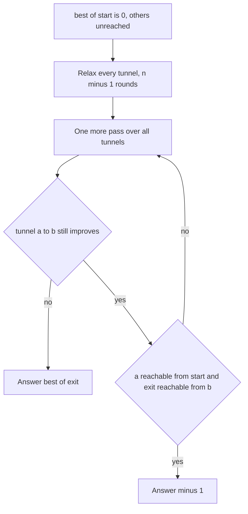

## The hook

A game has rooms joined by one-way tunnels, and walking through a tunnel changes your score by some amount, possibly negative. You start in room 1 and want to finish in room n with the highest possible score. If you can make the score as large as you like, you must say so.

The twist is a loop of tunnels that pays you every time round. Whether such a loop matters depends on where it is, and the classic wrong answer is to panic at any positive loop anywhere in the game.

## The problem

There are n rooms and m tunnels, with n up to 2500 and m up to 5000; tunnel i goes from room a to room b and adds x to the score, where x may be negative. Print the largest score with which you can go from room 1 to room n, or −1 if the score can be arbitrarily large. Room n is reachable from room 1.

For six rooms 0 to 5 and tunnels 0 → 1 (+3), 1 → 2 (+4), 2 → 5 (+2), 0 → 3 (+1), 3 → 4 (+2), 4 → 3 (+1), 1 → 5 (+5), the answer is 9. The loop 3 → 4 → 3 pays +3 per lap, but it never leads to room 5.

## The obvious approach

Longest paths sound like Dijkstra with max instead of min. That fails twice:

- Dijkstra finalises a room when it is first popped, which relies on scores only getting worse as a route grows. Here a later tunnel can add points, so an early "final" value can be beaten.
- Even ignoring correctness, longest simple path in a general graph has no known polynomial algorithm. What saves us is that we are allowed walks with repeated rooms, and the only way repetition helps is through a positive cycle, which we can detect.

Trying every walk is hopeless as soon as there is a cycle.

## The key insight

:::analogy
Picture every room holding a scoreboard. In each round, every tunnel tells the room it leads to: "come through me and you would have this many points". A room keeps the best offer. After n − 1 rounds, every route without repeated rooms has been offered. If any room still gets a better offer in one more round, there is a loop somewhere that pays forever. But a loop in a side wing that never connects to the exit is only a bonus nobody can take home: what matters is whether the improving tunnel sits on a way from the start to the exit.
:::

The offers are [[relaxation]]s. Negating every score turns this into shortest paths with negative weights, exactly what Bellman–Ford handles in [A Rumour Spreading Round by Round](article:dsa-bellman-ford-floyd); here we simply keep the maximisation form.

- **Step 1, n − 1 rounds.** best[0] = 0, every other room "unreached". Relax all tunnels n − 1 times. If no [[positive cycle]] is involved, a best route is a simple path with at most n − 1 tunnels, and it is fully settled.
- **Step 2, the [[extra round test]].** Relax once more. A tunnel a → b that can still improve best[b] proves that some positive cycle feeds into a.
- **Step 3, usefulness.** The answer is −1 only if such a tunnel has a reachable from room 0 and b able to reach room n. The second set is the [[reverse reachability]] from room n. Then the cycle is a [[useful cycle]]: go round it as often as you like, then walk to the exit.

Why one extra round is enough: if a useful positive cycle exists, some tunnel on it can still be improved after any number of rounds, since the cycle's total is positive and the scoreboards around it cannot all be consistent. Every room on that cycle is reachable from the start and can reach the exit, so the test fires on that tunnel.



:::insight
A late improvement says where a positive cycle's influence reaches, not whether it matters. Intersecting with "reachable from the start" and "can reach the exit" is what turns "there is a positive cycle somewhere" into "the answer is unbounded".
:::

## Walk through an example

Tunnels in the order given: 0 → 1 (+3), 1 → 2 (+4), 2 → 5 (+2), 0 → 3 (+1), 3 → 4 (+2), 4 → 3 (+1), 1 → 5 (+5). Relaxing in that order within each round:

| After round | Room 0 | Room 1 | Room 2 | Room 3 | Room 4 | Room 5 |
|---|---|---|---|---|---|---|
| 1 | 0 | 3 | 7 | 4 | 3 | 9 |
| 2 | 0 | 3 | 7 | 7 | 6 | 9 |
| 3 | 0 | 3 | 7 | 10 | 9 | 9 |
| 4 | 0 | 3 | 7 | 13 | 12 | 9 |
| 5 | 0 | 3 | 7 | 16 | 15 | 9 |

In round 1, room 3 first gets 1 from 0 → 3, then room 4 gets 3, then 4 → 3 lifts room 3 to 4 within the same round. Rooms 3 and 4 then climb by 3 every round: that is the loop paying out. Room 5 settles at 9 via 0 → 1 → 2 → 5 and never moves.

**The extra round.** Tunnels 3 → 4 and 4 → 3 can still improve. Room 3 and room 4 are reachable from room 0, but neither can reach room 5: reverse reachability from 5 gives {5, 2, 1, 0}. So neither improving tunnel passes the test, and the answer is 9.

**Now connect the loop to the exit.** Add 4 → 5 with −100. Room 4 can now reach room 5, so the improving tunnel 3 → 4 has a reachable from the start and b able to reach the exit. The answer is −1: go round 3 → 4 → 3 thirty-four times to bank 102 extra points, which more than pays for the −100 tunnel, and every further lap adds more.

:::try-this
Instead of adding 4 → 5, change 4 → 3 from +1 to −5. What is the answer? (The loop 3 → 4 → 3 now sums to 2 − 5 = −3, so it is not positive and no tunnel improves in the extra round. The best route is still 0 → 1 → 2 → 5 with 9.)
:::

:::warning
Common misconception: "If anything improves in round n, print −1." In the example, rooms 3 and 4 improve forever, yet the answer is 9. Positive cycles in parts of the game that cannot lead to the exit are irrelevant, and testing only "can the start reach it" is not enough either: the exit must be reachable from the improving tunnel too.
:::

## The code

```pseudo
fromStart = rooms reachable from 0;  toEnd = rooms that can reach n-1 (search reversed tunnels)
best[0] = 0; best[others] = unreached
repeat n-1 times: for each tunnel (a, b, w): if best[a] reached and best[a] + w > best[b]: best[b] = best[a] + w
for each tunnel (a, b, w):
    if best[a] reached and best[a] + w > best[b] and fromStart[a] and toEnd[b]: return -1
return best[n-1]
```

```cpp
#include <bits/stdc++.h>
using namespace std;
using ll = long long;
const ll NEG = LLONG_MIN / 4;                                    // "not reached yet"

vector<char> reachable(int n, const vector<vector<int>>& g, int s) {
    vector<char> seen(n, 0);
    vector<int> st = {s};
    seen[s] = 1;
    while (!st.empty()) {
        int u = st.back(); st.pop_back();
        for (int v : g[u]) if (!seen[v]) seen[v] = 1, st.push_back(v);
    }
    return seen;
}

// Best score from room 0 to room n-1, or -1 if a positive cycle can be used on the way
ll highScore(int n, const vector<array<ll, 3>>& edges) {
    vector<vector<int>> g(n), rg(n);
    for (auto [a, b, w] : edges) g[a].push_back(b), rg[b].push_back(a);
    auto fromStart = reachable(n, g, 0), toEnd = reachable(n, rg, n - 1);
    vector<ll> best(n, NEG);
    best[0] = 0;
    for (int round = 1; round < n; round++)                      // n - 1 rounds settle every simple path
        for (auto [a, b, w] : edges)
            if (best[a] != NEG && best[a] + w > best[b]) best[b] = best[a] + w;
    for (auto [a, b, w] : edges)                                 // round n: an edge that still improves...
        if (best[a] != NEG && best[a] + w > best[b] && fromStart[a] && toEnd[b])
            return -1;                                           // ...and leads to the exit: unbounded
    return best[n - 1];
}

int main() {
    vector<array<ll, 3>> e = {{0, 1, 3}, {1, 2, 4}, {2, 5, 2}, {0, 3, 1}, {3, 4, 2}, {4, 3, 1}, {1, 5, 5}};
    cout << highScore(6, e) << '\n';                             // 9: the loop 3-4-3 never reaches room 5
    e.push_back({4, 5, -100});
    cout << highScore(6, e) << '\n';                             // -1: now it does

    mt19937 rng(14);                                             // brute force on small graphs
    bool ok = true;
    for (int t = 0; t < 500; t++) {
        int n = 2 + rng() % 5, m = rng() % 9;
        vector<array<ll, 3>> r;
        for (int i = 0; i < m; i++) r.push_back({(ll)(rng() % n), (ll)(rng() % n), (ll)(rng() % 11) - 6});
        vector<vector<int>> g(n), rg(n);
        for (auto [a, b, w] : r) g[a].push_back(b), rg[b].push_back(a);
        auto f = reachable(n, g, 0), to = reachable(n, rg, n - 1);
        if (!f[n - 1]) continue;                                 // the exit is guaranteed reachable
        bool unbounded = false;                                  // positive closed walk of length <= n through a useful room
        for (int v = 0; v < n; v++) {
            if (!f[v] || !to[v]) continue;
            vector<ll> cur(n, NEG);
            cur[v] = 0;
            for (int len = 1; len <= n; len++) {
                vector<ll> nxt(n, NEG);
                for (auto [a, b, w] : r) if (cur[a] != NEG) nxt[b] = max(nxt[b], cur[a] + w);
                cur = nxt;
                if (cur[v] > 0) unbounded = true;
            }
        }
        ll expect = -1;
        if (!unbounded) {                                        // otherwise a best walk is a simple path
            vector<ll> cur(n, NEG);
            cur[0] = 0;
            ll bestEnd = NEG;
            for (int len = 1; len < n; len++) {
                vector<ll> nxt(n, NEG);
                for (auto [a, b, w] : r) if (cur[a] != NEG) nxt[b] = max(nxt[b], cur[a] + w);
                cur = nxt;
                bestEnd = max(bestEnd, cur[n - 1]);
            }
            expect = bestEnd;
        }
        ok = ok && highScore(n, r) == expect;
    }
    cout << (ok ? "stress ok" : "stress FAILED") << '\n';        // stress ok
}
```

The brute force decides "unbounded" independently: it looks for a closed walk of positive score, of at most n tunnels, through some room that is reachable from the start and can reach the exit. A positive closed walk always contains a positive simple cycle, so length n is enough. Otherwise it takes the best walk of at most n − 1 tunnels.

## Complexity

- **Time: O(n·m),** about 2500 · 5000 = 1.25·10⁷ relaxations at the largest sizes, plus two O(n + m) reachability searches.
- **Space: O(n + m).**

## Common mistakes

- **Printing −1 for any improvement in round n,** including cycles that cannot reach the exit.
- **Checking only reachability from the start,** and not reachability to the exit.
- **Relaxing from unreached rooms,** where NEG + w can drift upwards and fake an improvement; skip rooms still at NEG.
- **Using int:** single tunnel scores can already be large, and a route of thousands of tunnels adds them up far beyond 32 bits.
- **Running Dijkstra with max,** which is wrong whenever later tunnels can add points.
- **Stopping Bellman–Ford early by mistake** when a round changes nothing in one region but another region is still settling; stopping early is only safe when no room changed at all in a round.

## Practice problems

*High Score* is this walkthrough. *Score Attack* is the same problem with the answer `inf` for unbounded scores. *Cycle Finding* turns the extra round around: find any negative cycle and print it, by following parent pointers n times from an improving room to land inside the cycle. The underlying round-by-round method is in [A Rumour Spreading Round by Round](article:dsa-bellman-ford-floyd).

## Key takeaways

- The highest score is a longest walk, which becomes a Bellman–Ford problem: relax every tunnel n − 1 times, keeping the larger score.
- Without a useful positive cycle, some best route is a simple path of at most n − 1 tunnels, so n − 1 rounds settle the answer.
- One extra round finds tunnels that can still improve, and each one proves that a positive cycle feeds into it.
- The answer is unbounded only when such a tunnel starts in a room reachable from the start and ends in a room that can still reach the exit.
- Positive cycles elsewhere in the graph grow their own scores forever but never change the answer at the exit.
