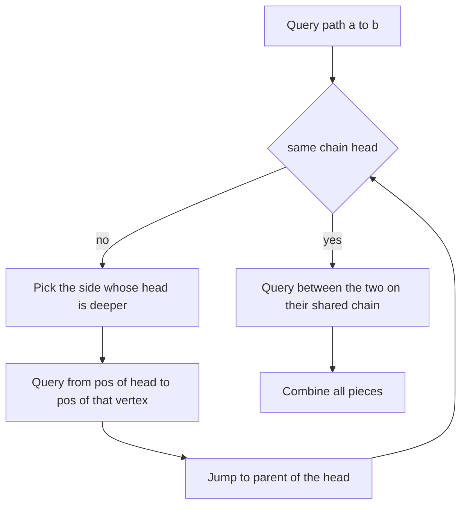
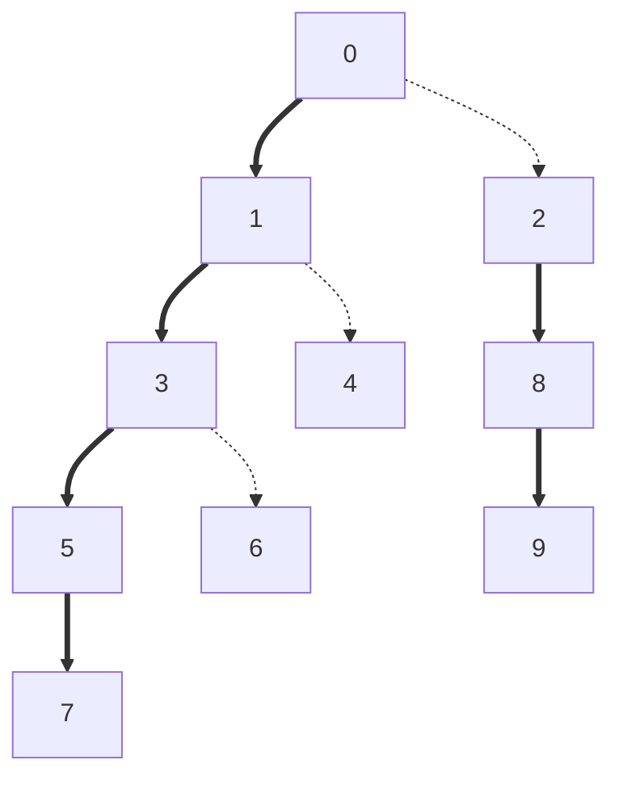

## The hook

Every vertex of a tree has a value. Two kinds of operations arrive, 2·10⁵ of them: change one vertex's value, or report the largest value on the path between two vertices. The Euler tour from [Numbering a Family Tree So Every Branch Is a Block](article:cp-euler-tour) made subtrees into ranges, but a path between two vertices is not one block of that numbering, and a maximum cannot be "subtracted out" the way sums were.

Heavy-light decomposition cuts the tree into a few long vertical strips, numbered so that each strip is one range of an array. Any path then crosses only O(log n) strips, and a segment tree answers each piece.

## The intuition

:::analogy
A city planner wants fast lanes on the roads that carry the most traffic. At every junction, the road leading towards the largest part of the city becomes a highway lane; every other road is a side street. Highway lanes join up into long highways running outwards from the centre. Any trip through the city drives along a highway, turns onto a side street, joins another highway, and so on. The trick is that every side street you take towards the centre leads into a part of the city at least twice as big, so no trip can use more than a handful of side streets.
:::

The road towards the largest part is the [[heavy child]] edge; side streets are [[light edge]]s; each highway is a [[heavy chain]] with a [[chain head]] at its top. Numbering the junctions highway by highway gives the [[chain-contiguous order]].

## How it works

### Step 1: sizes and heavy children

One pass computes sz[v], the subtree size, and for each vertex picks the child with the largest sz as heavy[v]. Leaves have no heavy child.

### Step 2: chains and positions

Walk the tree in preorder, always visiting the heavy child first:

- the heavy child continues its parent's chain: head[heavy[v]] = head[v];
- each light child starts a new chain: head[c] = c;
- pos[v] = the next free array position.

Because the heavy child is visited immediately after its parent, each chain occupies consecutive positions, from its head downwards. Because this is still a DFS preorder, every subtree is still the range [pos[v], pos[v] + sz[v] − 1]. Put val[v] at position pos[v] in one segment tree.

### Why there are few chains on any path

Let c be a light child of v. The heavy child h satisfies sz[h] ≥ sz[c], so sz[v] ≥ 1 + sz[h] + sz[c] > 2·sz[c]. Walking up from any vertex, every light edge crossed at least doubles the subtree size, which starts at 1 and can never exceed n. So a vertex-to-root path crosses at most log₂ n light edges, and therefore touches at most log₂ n + 1 chains. A path between two vertices is two such climbs, so it splits into O(log n) chain pieces.

| Tree shape | Chains on a root path | Why |
|---|---|---|
| a single long path | 1 | every edge is heavy |
| a perfectly balanced binary tree | about log₂ n | each level may switch chains |
| a star | 2 | one heavy edge, the rest light but only one is crossed |
| any tree | at most log₂ n + 1 | the doubling argument |

### Step 3: answering a path query

```
pathMax(a, b):
    res = -infinity
    while head[a] != head[b]:
        if depth[head[a]] < depth[head[b]]: swap(a, b)
        res = max(res, segMax(pos[head[a]], pos[a]))    # the piece of a's chain from its head down to a
        a = parent[head[a]]                             # leave the chain through its head
    if depth[a] > depth[b]: swap(a, b)
    res = max(res, segMax(pos[a], pos[b]))              # same chain: a is the LCA
    return res
```

Moving the side whose chain head is deeper is what keeps the loop correct: that chain piece cannot contain the LCA. If it did, b would sit below the LCA but on a different chain, so b's chain would start strictly below the LCA, making head[b] deeper than head[a], which contradicts the choice. So the whole piece from the head down to a lies on the path. When both are on one chain, the shallower one is the LCA, a free by-product.

Each piece is one segment tree query, O(log n), and there are O(log n) pieces: O(log² n) per path query. A point update is one segment tree update at pos[v].

### Variants that reuse the same skeleton

- **Edge weights** (as in SPOJ *Query on a tree*): store the weight of edge parent[v]–v at pos[v]. The final same-chain query becomes [pos[a] + 1, pos[b]], because the LCA's own slot holds the edge above the LCA, which is not on the path; skip it entirely when a = b.
- **Path updates**, such as "add x on the path": the same loop, calling a lazy range update on each piece.
- **Subtree operations**: still the range [pos[v], pos[v] + sz[v] − 1], so one segment tree serves both kinds. Codeforces *Water Tree* mixes "fill a subtree" with "empty a root path".
- **Sums instead of maxima**: replace max with + and LLONG_MIN with 0; CSES *Path Queries* also falls to this, though the Euler tour solution is simpler there.



:::insight
Heavy-light decomposition is a numbering trick plus a counting argument. The numbering makes every chain an array range; the doubling argument guarantees any path needs only logarithmically many ranges. Everything else is an ordinary segment tree.
:::

## Walk through an example

Ten vertices rooted at 0: 0 has children 1 and 2; 1 has children 3 and 4; 3 has children 5 and 6; 5 has child 7; 2 has child 8; 8 has child 9. Values for vertices 0 to 9: 3, 1, 4, 1, 5, 9, 2, 6, 5, 3.

| Vertex | 0 | 1 | 2 | 3 | 4 | 5 | 6 | 7 | 8 | 9 |
|---|---|---|---|---|---|---|---|---|---|---|
| sz | 10 | 6 | 3 | 4 | 1 | 2 | 1 | 1 | 2 | 1 |
| heavy child | 1 | 3 | 8 | 5 | none | 7 | none | none | 9 | none |
| head | 0 | 0 | 2 | 0 | 4 | 0 | 6 | 0 | 2 | 2 |
| pos | 0 | 1 | 7 | 2 | 6 | 3 | 5 | 4 | 8 | 9 |

At the root, child 1 (size 6) beats child 2 (size 3), so 0–1 is heavy. The chains are 0, 1, 3, 5, 7, then 6 alone, then 4 alone, then 2, 8, 9:



Thick arrows are heavy edges, dotted arrows light ones. The segment tree array, by position:

| pos | 0 | 1 | 2 | 3 | 4 | 5 | 6 | 7 | 8 | 9 |
|---|---|---|---|---|---|---|---|---|---|---|
| vertex | 0 | 1 | 3 | 5 | 7 | 6 | 4 | 2 | 8 | 9 |
| value | 3 | 1 | 1 | 9 | 6 | 2 | 5 | 4 | 5 | 3 |
| chain | A | A | A | A | A | B | C | D | D | D |

**pathMax(7, 9).** head[7] = 0 at depth 0, head[9] = 2 at depth 1, so 9's side moves first: query positions [7, 9], values 4, 5, 3, maximum 5; jump to parent[2] = 0. Now 0 and 7 share chain A: query [0, 4], values 3, 1, 1, 9, 6, maximum 9. Answer 9, in 2 pieces.

**pathMax(6, 4).**

| Round | a | b | Deeper head | Piece | Max of piece | Then |
|---|---|---|---|---|---|---|
| 1 | 6 | 4 | 6, depth 3 | [5, 5] | 2 | a = parent[6] = 3 |
| 2 | 3 | 4 | 4, depth 2 | [6, 6] | 5 | b = parent[4] = 1 |
| 3 | 3 | 1 | same chain | [1, 2] | 1 | LCA is 1 |

Answer max(2, 5, 1) = 5, in 3 pieces; the path is 6, 3, 1, 4 with values 2, 1, 1, 5.

**After setting vertex 5 to 0**, position 3 holds 0, and pathMax(7, 9) becomes max(5, max(3, 1, 1, 0, 6)) = 6.

:::try-this
Compute pathMax(7, 6) by hand, before and after vertex 5 is set to 0. (head[6] = 6 is deeper, so query [5, 5] giving 2 and jump to 3. Now 3 and 7 share chain A: query [2, 4], values 1, 9, 6. The answer is 9 before the update and max(2, 1, 0, 6) = 6 after.)
:::

:::warning
Common misconception: "Move the vertex that is deeper, not the one whose chain head is deeper." Depth of the vertex itself is the wrong test. In pathMax(7, 6), vertex 7 is deeper than 6, but 7 sits on chain A, whose head is the root; consuming 7's piece [0, 4] would add the root and vertex 1, which are not on the path from 7 to 6. Comparing head depths is what guarantees the consumed piece lies on the path.
:::

## The code

```pseudo
build:
    sizes by reverse BFS order; heavy[v] = child with max size
    preorder with heavy child first: pos[v] = timer++; head[heavy] = head[v]; head[light] = light
    segment tree over positions with val[v] at pos[v]
pathMax(a, b):
    while head[a] != head[b]:
        if depth[head[a]] < depth[head[b]]: swap a, b
        res = max(res, seg.max(pos[head[a]], pos[a])); a = parent[head[a]]
    if depth[a] > depth[b]: swap a, b
    return max(res, seg.max(pos[a], pos[b]))
```

```cpp
#include <bits/stdc++.h>
using namespace std;

struct MaxSeg {                                                  // iterative segment tree: point set, range max
    int n; vector<long long> t;
    MaxSeg(int n) : n(n), t(2 * n, LLONG_MIN) {}
    void set(int i, long long v) { for (t[i += n] = v; i > 1; i >>= 1) t[i >> 1] = max(t[i], t[i ^ 1]); }
    long long query(int l, int r) const {                        // max over [l, r]
        long long res = LLONG_MIN;
        for (l += n, r += n + 1; l < r; l >>= 1, r >>= 1) {
            if (l & 1) res = max(res, t[l++]);
            if (r & 1) res = max(res, t[--r]);
        }
        return res;
    }
};

struct HLD {                                                     // vertices 0..n-1, root 0
    int n;
    vector<int> parent, depth, heavy, head, pos, sz;
    MaxSeg seg;
    int pieces = 0;                                              // chain pieces used by the last query
    HLD(const vector<vector<int>>& adj, const vector<long long>& val)
        : n(adj.size()), parent(n, -1), depth(n, 0), heavy(n, -1), head(n), pos(n), sz(n, 1), seg(n) {
        vector<int> order = {0};                                 // BFS order: parents before children
        for (int i = 0; i < (int)order.size(); i++)
            for (int v : adj[order[i]])
                if (v != parent[order[i]]) parent[v] = order[i], depth[v] = depth[order[i]] + 1, order.push_back(v);
        for (int i = n - 1; i > 0; i--) sz[parent[order[i]]] += sz[order[i]];
        for (int v : order)                                      // heavy child = child with the largest subtree
            for (int c : adj[v])
                if (c != parent[v] && (heavy[v] == -1 || sz[c] > sz[heavy[v]])) heavy[v] = c;
        vector<int> st = {0};                                    // iterative preorder, heavy child first
        head[0] = 0;
        int timer = 0;
        while (!st.empty()) {
            int v = st.back(); st.pop_back();
            pos[v] = timer++;
            for (int c : adj[v])
                if (c != parent[v] && c != heavy[v]) head[c] = c, st.push_back(c);   // light child starts a chain
            if (heavy[v] != -1) head[heavy[v]] = head[v], st.push_back(heavy[v]);    // pushed last, popped next
        }
        for (int v = 0; v < n; v++) seg.set(pos[v], val[v]);
    }
    void update(int v, long long x) { seg.set(pos[v], x); }
    long long pathMax(int a, int b) {
        long long res = LLONG_MIN;
        pieces = 0;
        while (head[a] != head[b]) {
            if (depth[head[a]] < depth[head[b]]) swap(a, b);     // consume the chain whose head is deeper
            res = max(res, seg.query(pos[head[a]], pos[a])), pieces++;
            a = parent[head[a]];
        }
        if (depth[a] > depth[b]) swap(a, b);                     // same chain now: a is the LCA
        res = max(res, seg.query(pos[a], pos[b])), pieces++;
        return res;
    }
};

int main() {
    int n = 10;
    vector<array<int, 2>> edges = {{0, 1}, {0, 2}, {1, 3}, {1, 4}, {3, 5}, {3, 6}, {5, 7}, {2, 8}, {8, 9}};
    vector<vector<int>> adj(n);
    for (auto [a, b] : edges) adj[a].push_back(b), adj[b].push_back(a);
    vector<long long> val = {3, 1, 4, 1, 5, 9, 2, 6, 5, 3};
    HLD h(adj, val);
    for (int v = 0; v < n; v++) cout << h.pos[v] << ' ';
    cout << '\n';                                                // 0 1 7 2 6 3 5 4 8 9
    cout << h.pathMax(7, 9) << ' ' << h.pieces << '\n';          // 9 2
    cout << h.pathMax(6, 4) << ' ' << h.pieces << '\n';          // 5 3
    cout << h.pathMax(7, 6) << ' ' << h.pieces << '\n';          // 9 2
    h.update(5, 0);
    cout << h.pathMax(7, 9) << ' ' << h.pathMax(7, 6) << '\n';   // 6 6

    mt19937 rng(3);                                              // random trees and updates against a naive walk
    bool ok = true;
    int most = 0;
    for (int t = 0; t < 300; t++) {
        int m = 1 + rng() % 60;
        vector<vector<int>> g(m);
        vector<int> par(m, -1);
        for (int v = 1; v < m; v++) { int p = rng() % v; par[v] = p; g[p].push_back(v), g[v].push_back(p); }
        vector<long long> w(m);
        for (auto& x : w) x = rng() % 100;
        HLD H(g, w);
        auto naive = [&](int a, int b) {
            vector<int> up;
            for (int x = a; x != -1; x = par[x]) up.push_back(x);
            set<int> onA(up.begin(), up.end());
            long long r = LLONG_MIN;
            int x = b;
            while (!onA.count(x)) r = max(r, w[x]), x = par[x];  // climb from b to the LCA
            for (int y : up) { r = max(r, w[y]); if (y == x) break; }
            return r;
        };
        for (int q = 0; q < 40; q++) {
            if (rng() % 3 == 0) { int v = rng() % m; w[v] = rng() % 100; H.update(v, w[v]); }
            int a = rng() % m, b = rng() % m;
            ok = ok && H.pathMax(a, b) == naive(a, b);
            most = max(most, H.pieces);
        }
    }
    cout << (ok ? "stress ok" : "stress FAILED") << ' ' << most << '\n';   // stress ok 6
}
```

Across 12,000 random queries on trees of up to 60 vertices, no path needed more than 6 chain pieces, in line with the logarithmic bound for two climbs. For CSES *Path Queries II*, read the values and edges, then answer each "2 a b" query with `pathMax(a − 1, b − 1)` and each "1 s x" with `update(s − 1, x)`.

## Complexity

- **Build: O(n)** for sizes, heavy children and positions, plus O(n) to fill the segment tree.
- **Path query: O(log² n):** O(log n) chain pieces, each an O(log n) segment tree query.
- **Point update: O(log n);** subtree query or update: O(log n), using [pos[v], pos[v] + sz[v] − 1].
- **Space: O(n).**

## Common mistakes

- **Moving the deeper vertex** instead of the vertex whose chain head is deeper.
- **Visiting the heavy child last** in the numbering, which breaks chain contiguity.
- **Forgetting head[heavy] = head[v]** or setting a light child's head to its parent's head; this is the chain-head bookkeeping that most bugs come from.
- **Including the LCA's slot for edge-weighted paths;** with weights stored at the child, the final range starts at pos[a] + 1.
- **Indexing the segment tree by vertex** instead of by pos[v].
- **Recursive DFS on a 2·10⁵-vertex path;** the build above is iterative.

## Practice problems

*Path Queries II* is the template: point update and path maximum. *Water Tree* combines subtree updates and root-path updates in one numbering, which is exactly why heavy-light keeps subtrees contiguous. SPOJ *Query on a tree* uses edge weights, so values sit at the child end of each edge. Path ideas without updates, such as LCA and distances, are simpler with [Express Elevators That Skip 1, 2, 4 and 8 Floors](article:cp-binary-lifting), and the segment tree itself is in [A Tournament Bracket for Your Array](article:cp-segment-tree).

## Key takeaways

- Heavy-light decomposition marks the edge to each vertex's largest child as heavy, and the heavy edges join into chains that cover every vertex exactly once.
- Numbering vertices in a preorder that visits the heavy child first makes every chain, and every subtree, a contiguous range of one segment tree.
- Each light edge crossed on the way up more than doubles the subtree size, so any path splits into O(log n) chain pieces.
- A path query repeatedly consumes the chain whose head is deeper and finishes on the shared chain, whose shallower vertex is the LCA.
- With a segment tree on top, path queries cost O(log² n), point and subtree operations cost O(log n), and edge weights work by storing each weight at the child end.
