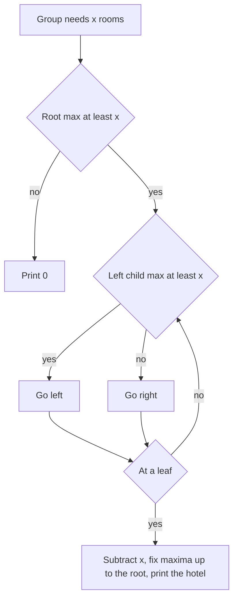

## The hook

A receptionist at a row of small hotels gets a stream of tour groups. Each group must go, whole, to the first hotel in the row that still has enough free rooms. If none does, the group is turned away. Scanning the row for every group works on a quiet day; with 200,000 hotels and 200,000 groups, the receptionist would never finish.

CSES *Hotel Queries* is the cleanest example of why segment trees are more than range-sum machines: the answer is a position, found by walking down the tree, and it takes O(log n) per group.

## The problem

There are n hotels in a row, hotel i having h[i] free rooms. Groups arrive one at a time, group j needing r[j] rooms. Each group is assigned to the leftmost hotel with at least r[j] free rooms, whose free rooms then drop by r[j]; print that hotel's number, or 0 if no hotel fits. Both n and m go up to 2 × 10⁵.

For hotels [4, 1, 6, 2, 5] and groups 5, 1, 4, 3, 2, 6, the answers are 3, 1, 5, 1, 4, 0.

## The obvious approach

Scan from the left for each group: O(n) per group, O(n × m) = 4 × 10¹⁰ in the worst case, for example when every group fits only the last hotel.

A second idea is a sorted multiset of capacities with lower_bound. It finds the hotel whose capacity is the smallest that fits, but the rule asks for the [[leftmost fit]], a different hotel in general. In the example, the first group needs 5 rooms: the tightest fit is hotel 5, with exactly 5, but the rule sends the group to hotel 3, the leftmost with at least 5. A capacity-ordered set cannot see "leftmost" at all.

## The key insight

:::analogy
The receptionist pins a sign at the start of every corridor: "the roomiest hotel down here has this many free rooms". For a group of four, they look at the left corridor's sign. If it says at least four, the answer is somewhere down the left corridor, and they walk in; otherwise it must be down the right corridor. Repeating at each fork leads straight to the leftmost hotel that fits. After the group checks in, the receptionist updates the signs on the way back to the desk.
:::

The signs form a [[maximum tree]]: each node stores the largest free capacity in its segment. A group of size x is assigned by [[descend and fix]]:

- if the root's maximum is below x, print 0;
- otherwise descend: go left when the left child's maximum is at least x, else go right;
- at the leaf, subtract x and recompute maxima on the way back up.

Going left whenever possible guarantees the leftmost fit, because the left half contains only smaller indices. This is the general technique from [A Librarian Walking Down to the Right Shelf](article:cp-segment-tree-descend), in its most common form.

### An iterative version

Many contestants write Hotel Queries with an [[iterative tree]], which avoids recursion and is a few lines shorter. Round n up to a power of two, size; leaves live at size + i; node v's children are 2v and 2v + 1. The descent is a loop from v = 1 while v < size; the fix-up is a loop from the leaf to the root, v /= 2.

| Approach | Per group | Finds the leftmost fit? |
|---|---|---|
| Scan from the left | O(n) | yes, but too slow |
| Sorted set by capacity | O(log n) | no, finds the tightest fit |
| Maximum tree with descent | O(log n) | yes |



:::insight
Storing the maximum free capacity of every segment lets one root-to-leaf walk answer "where is the leftmost hotel that fits?", because a segment can contain a fitting hotel exactly when its maximum is large enough.
:::

## Walk through an example

Hotels [4, 1, 6, 2, 5] (numbered 1 to 5); groups 5, 1, 4, 3, 2, 6.

| Group | Descent | Hotel | Free rooms after |
|---|---|---|---|
| 5 | left half [4, 1, 6] has max 6 ≥ 5; inside it, [4, 1] has max 4 < 5, so go right to hotel 3 | 3 | 4, 1, 1, 2, 5 |
| 1 | left half max 4 ≥ 1; hotel 1 fits first | 1 | 3, 1, 1, 2, 5 |
| 4 | left half max 3 < 4, go right; [2, 5] has 2 < 4 on its left, so hotel 5 | 5 | 3, 1, 1, 2, 1 |
| 3 | left half max 3 ≥ 3; hotel 1 | 1 | 0, 1, 1, 2, 1 |
| 2 | left half max 1 < 2; right half [2, 1], hotel 4 | 4 | 0, 1, 1, 0, 1 |
| 6 | root max 1 < 6 | 0 | unchanged |

Output: 3 1 5 1 4 0. Notice the group of 4: hotel 3 had dropped to 1 room, so the left half's maximum was only 3, and the descent went right at once without checking any left hotel individually.

:::try-this
Continue with one more group of size 1 on the final state 0, 1, 1, 0, 1. Which hotel does it get, and which maxima change? (The descent goes left while the left part still has a free room, and at the pair of hotels 1 and 2 it goes right, because hotel 1 is full. Hotel 2 drops to 0, so that pair's maximum becomes 0. Every larger segment still contains hotel 3 or hotel 5 with one free room, so their maxima stay 1.)
:::

:::warning
Common misconception: "Use lower_bound on a multiset of capacities." That returns the hotel whose capacity is closest above the group size, the best fit, not the leftmost one. The two differ whenever an earlier hotel has more than enough rooms. The problem is about positions, so the structure must be ordered by position.
:::

## The code

```pseudo
build max tree over h
for each group x:
    if max[root] < x: print 0; continue
    v = root
    while v is not a leaf: v = left(v) if max[left(v)] >= x else right(v)
    max[v] -= x; print hotel index of v
    while v != root: v = parent(v); max[v] = max(max[left(v)], max[right(v)])
```

```cpp
#include <bits/stdc++.h>
using namespace std;

struct HotelTree {                                        // iterative maximum tree
    int size;
    vector<int> mx;
    explicit HotelTree(const vector<int>& h) {
        size = 1;
        while (size < (int)h.size()) size <<= 1;
        mx.assign(2 * size, 0);                           // padding leaves hold 0 rooms
        for (size_t i = 0; i < h.size(); i++) mx[size + i] = h[i];
        for (int v = size - 1; v >= 1; v--) mx[v] = max(mx[2 * v], mx[2 * v + 1]);
    }
    int assign(int x) {                                   // returns the 1-based hotel, or 0
        if (mx[1] < x) return 0;
        int v = 1;
        while (v < size) v = (mx[2 * v] >= x) ? 2 * v : 2 * v + 1;   // leftmost fit
        mx[v] -= x;
        int hotel = v - size + 1;
        for (v /= 2; v >= 1; v /= 2) mx[v] = max(mx[2 * v], mx[2 * v + 1]);
        return hotel;
    }
};

int main() {
    HotelTree t({4, 1, 6, 2, 5});
    for (int g : {5, 1, 4, 3, 2, 6, 1}) cout << t.assign(g) << ' ';
    cout << '\n';                                         // 3 1 5 1 4 0 2

    mt19937 rng(17);                                      // random check against scanning
    vector<int> h(100);
    for (int& x : h) x = rng() % 50;
    HotelTree big(h);
    int bad = 0;
    for (int it = 0; it < 2000; it++) {
        int g = rng() % 40 + 1, want = 0;
        for (int i = 0; i < 100; i++) if (h[i] >= g) { want = i + 1, h[i] -= g; break; }
        bad += big.assign(g) != want;
    }
    cout << bad << '\n';                                  // 0
}
```

Padding leaves beyond n hold 0 rooms, so they never fit any group, and the descent never lands on them.

## Complexity

- **Build: O(n).**
- **Each group: O(log n)** for the descent and O(log n) for the fix-up.
- **Total: O(n + m log n),** about 4 × 10⁶ steps for the largest inputs.
- **Space: O(n),** an array of 2 × size integers.

## Common mistakes

- **Scanning for each group,** which is O(n × m).
- **Using a capacity-ordered set,** which finds the tightest fit instead of the leftmost.
- **Checking the right child first,** which finds the rightmost fit.
- **Forgetting the root check,** which sends the descent into a leaf that cannot fit and corrupts the counts.
- **Not recomputing ancestors,** leaving stale maxima that send later groups the wrong way.
- **Padding leaves with a large value** instead of 0 in the iterative tree.

## Practice problems

*Hotel Queries* is this walkthrough. *List Removals* uses the same descent on counts instead of capacities. *Booking Concert Tickets in Groups* combines a maximum descent for "first row with enough seats" with sums for "enough seats in total across rows". The general descent technique is in [A Librarian Walking Down to the Right Shelf](article:cp-segment-tree-descend).

## Key takeaways

- Hotel Queries asks for the leftmost position with enough capacity, which is a question about positions, not capacities.
- A segment tree storing the maximum capacity per segment tells, at every node, whether the left half can fit the group.
- Descending left whenever the left maximum is large enough finds the leftmost fit in O(log n).
- After assigning a group, only the chosen hotel's ancestors need their maxima recomputed.
- An iterative tree with leaves at size + i gives a short, recursion-free implementation of the same idea.
